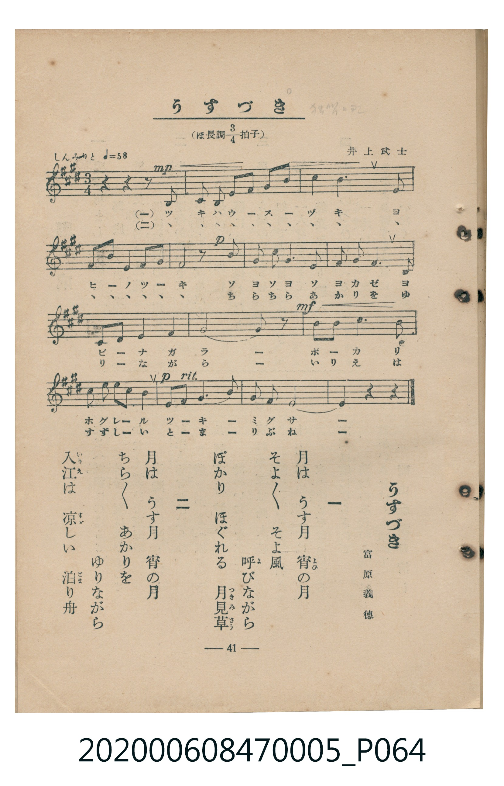

# うすづき

> Re:Shōka 使用 AI 協助辨識與重建樂譜，可能會有錯誤。歡迎回報。

- **鋼琴伴奏版**：<br><audio controls src="usuzuki.mp3"></audio>
- **NEUTRINO 歌聲合成版**：<br><audio controls src="usuzuki_neutrino.mp3"></audio>

- 臺灣教育會公認《新定兒童唱歌》尋常科第五學年用（2020.006.0847.0005）

## 說明

原書資訊與歌詞全文（對應 P064.jpg，書頁 p. 41，參考教材第 7 首）：
調性與拍號：ほ長調四分之三拍子（E 大調 3/4 拍），しんみりと（♩= 58）
作曲與作歌：井上武士、富原義德


## 歌詞

```text
一　月はうす月　宵（よひ）の月
そよ〳〵　そよ風
呼（よ）びながら
ぽかり　ほぐれる　月見草（つきみさう）

二　月はうす月　宵の月
ちら〳〵　あかりを
ゆりながら
入江（いりえ）は　涼（すゞ）しい　泊（とま）り舟（ぶね）
```

## ABC

<div class="abc-score" data-abc-src="usuzuki.abc" aria-label="五線譜載入中"></div>

[下載 ABC 原始檔](usuzuki.abc)

## TMD 檔案連結

- [主旋律 TMD 檔案](usuzuki.tmd) [[在 TMD Studio 編輯](https://tmdlang.github.io/Tmd-TS/#tmd=s7IKdvYPcrWy4qpTUCpJTLdSSM7PyUlNLsnMz7MqzsjMK0nNjM_KTMmPL87Iz05Ugisry88pzU21Si9KTEmNN403MjAyiDcwMIs3sDAxBzIMTBFKi_NLi5JTrYqTM_Lzc-JLUitKkvLzsxHyBUX5Zal5iXlANQVFIBtTwIoQClLLMlNSQdKpKZkl-UWZiTlI7kgtKga7FWxJfElRYl5xclFmAcgDCFUlGalAx5Zk5qbG56fFpyRWoksVpyYW5-cVI4SB1qRn5lmVJGYCPQ7yfHlifG5iZl5OYl4KsqqSjHxgGBRkVFplZBaDHJecmBOfnZiHFFRQpxUkpqdaBRiYmShxaWkpPG5se9w483Hj0seNvQpaWlyKtgqmFlz2tgquXDbG-iZ2IN0v2nc9b1z8bOrMF02bns1pftq65sWq3scNXc-mbXi6btbT1knPVy99OmXjs7U9jxu6n27ofrpjx_PlE5-vWfNk15Sna3c83bnl-ZQV7_d0gCJHDxg5eqDIATIMTN_v6VTi4tLXUrClFuBSUFB42jf_2ewdLza3v1jR9aKjHeiuFyvnPW1d8WxaO9AVTzf0PmvvVACFgF5WQfr7PT1AxS8XNCoU6CmYGAK5T_ubXzQ0A737bO4EoCcUzBVeLpsGdOn7PbNApr9Ytf9Zw3KQud29L2bOB4o-btz9cup2oPjT2bOfdrQ92dn9ZEcnUPbp2glA-1wVni5ZDpRUAAanAlAUbFLP48bpj5smP27c_7ip63EjKHQezVwJCnugNMiWJ3vnPJu9CWgLiLG2B2jLk11Tn-zoerZ22dPFqx83ND5d3wP05_N9K5_u284F1rGj4XFDw7M5HY8b10NiFcRuaHi6bivQ9MdNQPFNQMMfN64DioM0PG6cCxJt2Py4YStQHYT7ctEKcBBO3APRBNax-XHjqseNPY-bwE573Lj3cWM3yN0gTbsfN0543ASU64bY_mJZ94teoA-B1i0BpimQDxunAt0D8hfYmbuAqQS7M5GdthBoGZLTmqA2Nk0CSze1gYMNyVFPW5c-2wiMDKCxLWA5iMvXg-zaBvYLMJU3zQMLTgepAYpv7gKLr3jcuA8k3gRMLBATtj1uXAuNB8pTJBQoaOlzcYUWl1aVZmdaBWQm5uU71BjUVIPsULCx0LIDM7DlBAVQRtrR8GJhj4KGscLTDf3P1zfowJOvJhYNQJughmkANWpagTho4HFzi0INMBzXAln9QHoZkN4DpHeCaaBMcytYGVABTMMKFHN39VDd3BoFAwVdKDaNB3LN4kHIUMFIwVjBFMQHSoGwLogH1uJjWKMQD-RDMKblumCrdaEWg3hrwfpBtkJNMEIxoXEJSC2wKAQmHVDZCFLbOBNiQuNSMK8XYkJTB9AE_JG2qwccaSbkRdrj5kmQwGvug4UsNAzhgQcOyb1g362AcZCYEPHHTauBeA--eCTSqsaFYKFOGAfObAIHTzdQoAuIJ8Gd1oaIWlAMQuIPFJOG4DAERzSQZwpkGQNjWRcoXgONbZCsMVIsg5wIirc-MNkCiRFobIJjDu5fUNxAggHCQg0FzNgHFovgeF0HJpdA4xoSy5A0AfM2SB7iaxAL3dOQVNFGMFXs6KQsVUyGRlUXJIzXQML3cfNKRExBAEgQFu0ognOhmXI1LKKaV2FJEyBvgZQ1roJEcg9UOyTSibGoEZiMQKY0dsAsAmYqeIoAxTMozo3BIQ5LESCInD5APFCawcz3oJAAxWUXONzXQHP5ShRzYCxQ7ob4HKR2NTQVrEJOBUCHgmJ1FZjsgaYvUEzjNA3Je2DzgJ4jEPfA9gFlcT8baOMGIL0GmgbAMQjyGCTDQrMrNDZA4vMhGpq2EogtzOgHlnqPG2cB8XRoMmiBxSowM4EF9qHaBQ6KbUCMVGTgswtUJpiA0wAotiHpwQTIAqUJUAqAiCPSA6xyQE4BiPAAxScoXiGBgSjpISKIYECOS1i5j1wWIHwNilFoOQP0Moi3D2Eikmexm1jLxaVrpwCt7xWATGUuAA)]
- [鋼琴伴奏 TMD 檔案](usuzuki_piano.tmd) [[在 TMD Studio 編輯](https://tmdlang.github.io/Tmd-TS/#tmd=s7IKdvYPcrWy4qpTUCpJTLdSyC8qychPL0osyKi0ysgsLskvykxOzInPTsxLVIIrKs4vLUpOjS9ITE-1CjAwM1Hi0tJSeNzY9rhx5uPGpY8be9_v6XjZvef5hC1P9mx5urT_eWfH-z2dClpaXIq2CqYWXPa2Cq5cNsb6JnYgI1-073reuPjZ1JkvmjY9m9P8tHXNi1W9jxu6nk3b8HTdrKetk56vXvp0ysZna3seN3Q_3dD9dMeO58snPl-z5smuKU_X7ni6c8vzKSuANhoZGBnoGRiY6RlYmJgDGQamQEuVuLhCi0urSrMzrQIyE_PygzwcagxqqrkUgMDGQssOzNDXUrBFBwogC3Y0vFjYo6BhrPB0Q__z9Q06CiDf6mUVpGti0aClDzasRsFAQReKTeOBXLN4EDJUMFIwVjAF8YFSIKwL4oG1-BjWKMQD-RD8uLkFqOpx01ogqx9ILwOKPm7aCSSBos2tYN5asP7HzStgJhihmNC4BKS2sReI14MiBqS2cSbEhMalYF4vxISmDqAJ-ANhVw84EExICwSQXyE-BfnZEGwbOEiAPFMgyxgYHrpA8RpouIBkjZHC43HzJLAP-8BkC8TtUH-D_di0FxweK8C-2IvEgog-bloNxHuwhNPjxk3gEFgHJpdAQwUSHpDQWwi2qxMsvxDOagKr6wbyu4AY5DqQfW0Ew29HJznhBwoVUAgZg90HCz8QRA5NEA8Uwpjp6XHzZLDPu8CuXANNPStRzIGxQKkGJDsXrHY1NMxWIYcZ0M-gMFgFJnugsQEKF5ymNbZAQqqxA2IeMCUSCKmns2eTl9JMwGEFChVIuJkAWaCwA4UURBwRbrDMiRxSs4Eu3QCkQaH0uBnkf5AoKM0hUhxIZD5EXdNWFD_D8h1yCpsJxLOAeDrY59DU2whOoY37ECaCw2cbECNsQTWxFq348kEuvkwQxdfLuXNerJnwbNfqZ_OnPNnZDUxzz7p7n66d8HT7smed3ZBS-P0eYEZe8bx_39Ml_U-XzHm2feGzOR1P9617uWjFi452IPvFsu4XvZ3Pt-1-NmUf0JBnM9cjl2kgCCrM4hWizeJzYxWiDWOBfBMg1wTKgSo1BAoBuRBVcC5IsylIs2k8TK8RkGcEMgkkBNONUAMWhZsG1oFkFmGLUY0Hy8I0gDhg_4ACWNdOARrG0T5ASWSuEZirzAUA)]

## 分析

```text
================================================================================
📊 TMD Song Profile: [ うすづき ]
================================================================================
⏱  Duration:       0:46 (46.6s), 15 measures total
🎼 Key & Tempo:    首調基準 E, != 58.0 BPM, <3/4>
   - 分析範圍：      由實際發聲的音符與和弦推測調性；播放脈絡另行呈現
🎤 人聲音域:    B3 (MIDI 59) – C#5 (MIDI 73) [跨度: 14 個半音 / 1.2 個八度, 難度: moderate]
   - 最低音:  B3 in [Usuzuki #1 @ m.1, 0:02]
   - 最高音: C#5 in [Usuzuki #1 @ m.3, 0:06]
   - 適合: soprano, mezzo-soprano, contralto, tenor, baritone, bass
🏛  結構:      Usuzuki (46.6s)
⚡ 編曲密度:        Peak 1 軌道同時演奏
🗝  調性診斷：       E 大調（純淨自然大調，未偵測到可信轉調）
   - 風格氣質:    純淨自然大調（陽光明朗、易唱易記，無明顯調外色彩）
   - 轉調歷程:    全曲維持單一推測調性（未偵測到可信轉調）
   - 核心骨幹音:  E, C#, B, F#, G#
   - 調性數值:    E 大調 [相關度: 0.90, 穩定度: High, 自然音純度: 100.0%]
   - 候選調性 (K-S): E 大調 (0.90), C# 小調 (0.76), B 大調 (0.59)
   - 五度圈歷程:   +4
   - 各段落調性細節:
     • [Usuzuki #1]: E 大調 (r: 0.90, 自然音純度: 100.0%)

  [ 五度圈游移軌跡 ]
               C  
         F            G  
      Bb               D  
      Eb               A  
         Ab          [E ]*
            Db       B  
               F# 
     (* = active key center)

  [ 十二半音累積音高分佈 ]
     C  :                            0.0%
     C# : █████████████             17.9%
     D  :                            0.0%
     D# :                            0.0%
     E  : ████████████████████████  32.1%
     F  :                            0.0%
     F# : ████████████              15.4%
     G  :                            0.0%
     G# : ███████████               14.1%
     A  : ███                        3.8%
     A# :                            0.0%
     B  : ████████████              16.7%
--------------------------------------------------------------------------------
Assignment 軌道音域：
  - Piano         : B3 – C#5 (14 個半音 / 1.2 個八度, 48 個音符)
================================================================================
```


## 原書掃描頁




