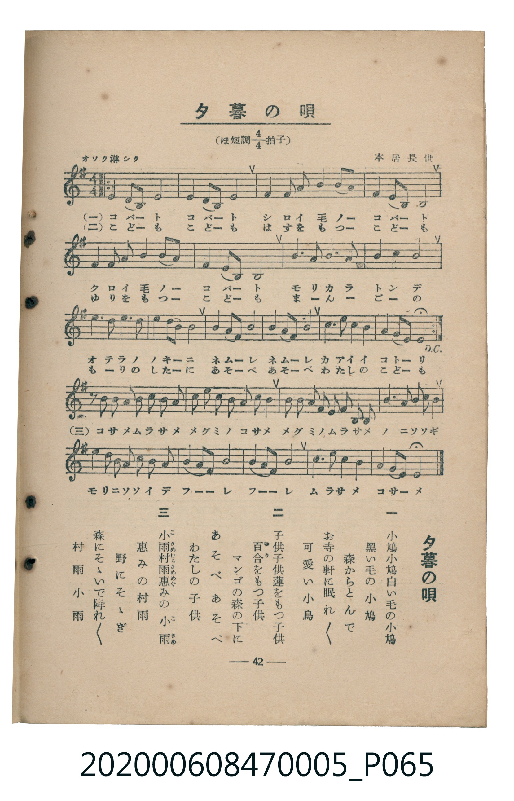

# 夕暮の唄

> Re:Shōka 使用 AI 協助辨識與重建樂譜，可能會有錯誤。歡迎[回報](https://github.com/TMDLang/reshoka/issues)。

- **鋼琴伴奏版**：<br><audio controls src="yugure_no_uta.mp3"></audio>
- **NEUTRINO 歌聲合成版**：<br><audio controls src="yugure_no_uta_neutrino.mp3"></audio>

- 臺灣教育會公認《新定兒童唱歌》尋常科第五學年用（2020.006.0847.0005）

## 說明

原書資訊與歌詞全文（對應 P065.jpg，書頁 p. 42，參考教材第 8 首）：
調性與拍號：ほ短調四分之四拍子（E 小調 4/4 拍），オソク淋シク
作曲與作歌：本居長世


## 歌詞

```text
一　小鳩小鳩白い毛の小鳩
黒い毛の小鳩
森からとんで
お寺の軒に眠れ〳〵
可愛い小鳥

二　子供子供蓮をもつ子供
百合（ゆり）をもつ子供
マンゴの森の下に
あそべあそべ
わたしの子供

三　小雨村雨惠（こさめむらさめめぐ）みの小雨（こさめ）
惠みの村雨
野にそゝぎ
森にそゝいで降れ〳〵
村雨小雨
```

## ABC

<div class="abc-score" data-abc-src="yugure_no_uta.abc" aria-label="五線譜載入中"></div>

[下載 ABC 原始檔](yugure_no_uta.abc)

## TMD 檔案連結

- [主旋律 TMD 檔案](yugure_no_uta.tmd) [[在 TMD Studio 編輯](https://tmdlang.github.io/Tmd-TS/#tmd=s7IKdvYPcrWy4qpTUCpJTLdSSM7PyUlNLsnMz7MqzsjMK0nNjM_KTMmPL87Iz05Ugisry88pzU21Si9KTEmNN403MjAyiDcwMIs3sDAxBzIMTBFKi_NLi5JTrYqTM_Lzc-JLUitKkvLzsxHyBUX5Zal5iXlANQVFIBtTwIoQClLLMlNSQdKpKZkl-UWZiTlI7kgtKga7FWxJfElRYl5xclFmAcgDCFUlGalAx-YllpQWpSJEgUalZ-ZZlSRmAj0H8mB5YnxuYmZeTmJeCrKqkox8oD8LMiqtMjKLQQ5ITsyJz07MQwoOqPUFiempVgEGZkDfa2kpPF0y9dmsdY8b1z2d0qKgpcWlaKtgbsRlb6vgzpWdWmmr4JrLZWOib2IHMuVF-67njYufTZ35omnTsznNT1vXvFjV-7ih69m0DU_XzXraOun56qVPp2x8trbncUP30w3dT3fseL584vM1a57smvJ07Y6nO7c8n7Li_Z4OUEToASNCDxQRQIaB6fs9nUpcXPpaCrbUAlwKCgpP--Y_m73jxeb2Fyu6XnS0A931YuW8p60rnk1rB7ri6YbeZ-2dCqCQ0MsqSH-_pweo-OWCRoUCPQUTIyD3aX_zi4ZmoHefzZ0A9ISChcLLZdOALn2_ZxbI9Ber9j9rWA4yt7v3xcz5QNHHjbufz18LFH86e_bTjrYnO7uBDKDs07UTgPa5Kjzd0A-UVAAGpwJQFGxSz-OmVY-b9j5uWv9se_fjpu1ABsjsJ3vnPJu9CWg2iLG2B2j2szlrnm5sfTl1-5Md07jASnY0PG5oABr5cvNKCPl85t7HjS3P1s8GxSZYBKTu5e5JWESfLQbGOdDCzseNKx43TX7cuBwk-rix6-n6XUCFL0CaVj-fs-BxEzAuNz9u2AoOz_71z1qA5rSAzVkKccYuoIIGoA-f7JsNIV9MXve4adLjpqbHjUsgIiB1z2fuezqhAxgMj5vaHjd1AT2PRdHj5nmPmzc_btoCdALYheue7OgGOgTiNqDauY8bd8IZYNGm_seN8x83Tgf5DmIOJHA6oYEze8WzuRNBZPMCkOWNQK9OfdzU-LipAex5CLvxcSMwhoDc_dBAmg1KpnDFQClwmDUvgKiAmAgO3PY-oPNAzmkCuqgPHrJwoRZgyL6c2YsSjBDtEGtAfMoTOxQoaOlzcUWWpgMLEL_80JJEq4DMxLx8hxqDmmqQPQo2hmZadmAWtpymAMqoOxpeLOxR0DABpdXn6xt04NlDByr9bN1WTSx6gTZDzdUAKtK0AkbMZmB0TgDiPUDcAZKEgxqCstuBomuB9BIFYMIFsvtAEiDFcN1gPhYDkB2yqwfkkMbJQLwSorKpCd0qArLrgXgmUGYSWBaYWFEdAtQN4mMzAOqQGgVjBV0FIyA2jwcSZiACHRKnBiwMJsCqwIQhVBakH6IKZAoIgmTAio3RTasBu8sHEoy64FCESIDCEZvFxKvbDpZdCyKBUQciN4JF-nCYCTENt7k14MyMO7Xu6qFaagVGNJkpDijbvAgiuwpMNa0GcyBpAqoArB5YtkGodoxkgpRem9qAuIusNAeS3YekGliyQzlI2qcgK2hch-EUKqY0RFKGaQebBabgUjUwQUgWAEGMHICUZteDUwoV0xg4-mCyq2AsYCRCRFaiqITpBkUljNWO4VgCZWwn1VItKME9bgYmGKAzQaw-CG4CpmRwpHeDHd0LifEFUME1KAkGKIssBU29TYvAwQvCsNK6A6oGnMjREw1y-gUlSEjS7IImMWD9DMTzIaKNq8HJEJxsgdUkVHAniqOAsshSwFoerBhoAtikdQRKbpSyF5RmIQnLCJwMQWLwFIeWRLGXv9jKZ7SEDObWoJmBvSBHJGVIYoPFH4QNiUFQAgQncWAMIhJfLzzJLYCz1mC4FaIOXQ08QUNjFpZ9EMU7ImnDMgFJibrhRftmSNJ-2t_7YlmbgoahETyFQwpr_Ol6MNeUwLQGDBhgaoMGETC9YbOYeHXgUgzYsgCpmQRXCSrrsZsJNg2PuRCnDvKiuw3s9C4wSRVPg6s7VDFQlYepagq6KmARgs2Zg73EgIUAJBQh_gAViSDWfDAJyeUQX8NVA4tSGGsnhksh6tDVgIpcCA9S6MLCjOhEjr-8AHaM8VeCncRUgp3A-gZcWwHrp6atwJJrIbQuA1YLUD6oPASKNm0A0qAKCFQ7IlRDq0A0BViMgDYHuyHW7YVicOMJXnwZoMQiIpIRLFCCgEQ5arQj8ioij-LKyQhd4EyLK6OiGQ5PQyAOtMQHeg9U2i8Ek6DaAlILIYtDAgcktgEsBk5j0PoJ3QxoasKlHo8NsKYborYDBS-ChOVVgt2BKeA0ZUpxmgK1CEHVIMhBiNgGNocgLXeQm6dCEgSkZY3RpsIvuwDKhiUyMBOWGOGpE6QRLAgHWBroKGkJlLzwFPKw9IHI-iTVAyCIXJAhynwSSzFwcxvSyoDEOGpsg9sm8EY1JDRRjcLe6iFOFaxVBFGBSI0QPlI6RkrfqHKonqrl4tK1U0AadFEAcpW5AA)]
- [鋼琴伴奏 TMD 檔案](yugure_no_uta_piano.tmd) [[在 TMD Studio 編輯](https://tmdlang.github.io/Tmd-TS/#tmd=s7IKdvYPcrWy4qpTUCpJTLdSyC8qychPL0osyKi0ysgsLskvykxOzInPTsxLVIIrKs4vLUpOjS9ITE-1CjAwM1Xi0tJSeLpk6rNZ6x43rns6peX9no6X3XueT9jyZM-Wp0v7n3d2vN_TqaClxaVoq2BuxGVvq-DOlZ1aaavgmstlY6JvYgcy-kX7rueNi59NnfmiadOzOc1PW9e8WNX7uKHr2bQNT9fNeto66fnqpU-nbHy2tudxQ_fTDd1Pd-x4vnzi8zVrnuya8nTtjqc7tzyfsgJos5GBkYGegYGZnoGFiTmQYWAKtFyJiyuyNL20KNUvP7Qk0SogMzEvP8jDocagpppLAQhsDM207MAsfS0FW3SgALJlR8OLhT0KGiYKTzf0P1_foKMA8rpeVkG6DlT62bqtmlj0aumDza1RMFbQVTACYvN4IGEGItAhcWrAwmACrApMGEJlQfohqkCmgCBIBqzYGN20GrC7fGoUHjdtBnIfN0-ASjxu7sBqMfHqtoNl14LIpiVgciNYpA-HmRDTcJtbw4U_bnb1UBg3VAtTRKTBtIPNAlNwqRqYICSyQRAjrpFiZz04TKgYmkCxRXDZVTBW02qoyEoUlTDdj5sRZrdjOJZA3umkQt4BxQQkuIzAgQsSg4cjWsBjzz_Y8hda9IC5NWhmYM-IiAiCBOHj5jZ44IEiBxJBj5vAEdfcjRSkvfCAXABnrcFwK0Qduhp4NDUtgicHEInInogIg0UtSVHV8KJ9MyTCnvb3vljWpqBhaASPN0hmG7olXeNkUMA0wlL446YmrBYTrw6cNxtngtVMgqt83AiKEmxmgk3DYy7EqYO8QGoDO70LTFLF00DZfWhij5tgOpFVTUFX1bgOqzMHe4kBCwFIKEL88bhxOpg1H0xCcjnE13DVjXPhrJ0YLoWoQ1fzuKkfypsPtwEUZkQncvzlxdPZs_EX7Z2ECgsDlDBDBCmCBQp-SACjBjIiZyByBK58g9AFziK4sgWa4fAYA3Gg5WvTVhDZvBBMgspmSJmPLA4qu8HyTRvAYuAYhdYG6GZA4w6Xejw2wKp_RN3yuGkvEgnLGQQbT1PAMWhKdgwiwhwljkDRhqeogoU7IgGTVJqBIHJ2RJRcJOZFcFMIUldCQhI1FME1LLzBA1I_Fc0o7HU3capgdTtEBSKWIXyk9IGUblDlUD1Vi6Wf44PczzFBdHOedU161tz6dN-E59tXPtkJ7FL1v1i1H5ifn3X3Pl074en2Zc86uyEduPd7ep63z3_ZsOBp7_Snc7qB_bwXnZseNzS-AJowb86zedNfdLQDtb-cvQJozsu5c16smfBsw-ync3qR00i8QrRZfG4sEouwqCGQYQgSMgIyjIACxiApY7AyDIPxKUZShiwKU4lkO6z6gKuCG0vIsditA7EMsLh2NBgwVEOtIOxerKJ4jYb5kMjAgcli8wEwi-naKSDlMgUgV5kLAA)]

## 分析

```text
================================================================================
📊 TMD Song Profile: [ 夕暮の唄 ]
================================================================================
⏱  Duration:       1:50 (110.0s), 33 measures total
🎼 Key & Tempo:    首調基準 G, != 72.0 BPM, <4/4>
   - 分析範圍：      由實際發聲的音符與和弦推測調性；播放脈絡另行呈現
🎤 人聲音域:    B3 (MIDI 59) – B4 (MIDI 71) [跨度: 12 個半音 / 1.0 個八度, 難度: easy]
   - 最低音:  B3 in [YugureNoUta #1 @ m.4, 0:11]
   - 最高音: B4 in [YugureNoUta #1 @ m.1, 0:00]
   - 適合: soprano, mezzo-soprano, contralto, tenor, baritone, bass
🏛  結構:      YugureNoUta (110.0s)
⚡ 編曲密度:        Peak 1 軌道同時演奏
🗝  調性診斷：       E 小調（純淨自然小調，未偵測到可信轉調）
   - 風格氣質:    純淨自然小調（陰鬱抒情、旋律集中，無明顯調外色彩）
   - 轉調歷程:    全曲維持單一推測調性（未偵測到可信轉調）
   - 核心骨幹音:  E, F#, B, G, A
   - 調性數值:    E 小調 [相關度: 0.84, 穩定度: Moderate, 自然音純度: 100.0%]
   - 候選調性 (K-S): E 小調 (0.84), E 大調 (0.74), A 大調 (0.48)
   - 五度圈歷程:   +4
   - 各段落調性細節:
     • [YugureNoUta #1]: E 小調 (r: 0.84, 自然音純度: 100.0%)

  [ 五度圈游移軌跡 ]
               C  
         F            G  
      Bb               D  
      Eb               A  
         Ab          [E ]*
            Db       B  
               F# 
     (* = active key center)

  [ 十二半音累積音高分佈 ]
     C  :                            0.0%
     C# :                            0.0%
     D  :                            0.0%
     D# :                            0.0%
     E  : ████████████████████████  38.4%
     F  :                            0.0%
     F# : ████████████              19.4%
     G  : █████████                 13.7%
     G# :                            0.0%
     A  : ███████                   11.4%
     A# :                            0.0%
     B  : ███████████               17.1%
--------------------------------------------------------------------------------
Assignment 軌道音域：
  - Piano         : B3 – B4 (12 個半音 / 1.0 個八度, 169 個音符)
================================================================================
```


## 原書掃描頁




