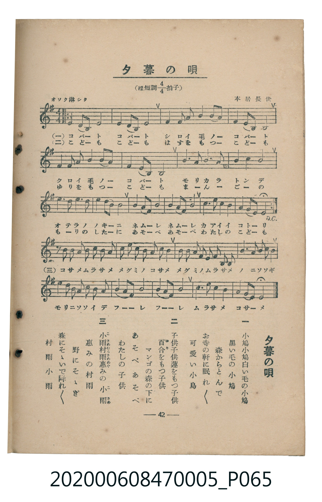

# 夕暮の唄

> Re:Shōka 使用 AI 協助辨識與重建樂譜，可能會有錯誤。歡迎回報。

<audio controls src="yugure_no_uta.mp3"></audio>

- 臺灣教育會公認《新定兒童唱歌》尋常科第五學年用（2020.006.0847.0005）

## 說明

原書資訊與歌詞全文（對應 P065.jpg，書頁 p. 42，參考教材第 8 首）：
調性與拍號：ほ短調四分之四拍子（E 小調 4/4 拍），オソク淋シク
作曲與作歌：本居長世

## 歌詞

```text
一　小鳩小鳩白い毛の小鳩
黒い毛の小鳩
森からとんで
お寺の軒に眠れ〳〵
可愛い小鳥

二　子供子供蓮をもつ子供
百合（ゆり）をもつ子供
マンゴの森の下に
あそべあそべ
わたしの子供

三　小雨村雨惠（こさめむらさめめぐ）みの小雨（こさめ）
惠みの村雨
野にそゝぎ
森にそゝいで降れ〳〵
村雨小雨
```

## ABC

```abc
X:1
T:夕暮の唄
M:4/4
L:1/16
Q:1/4=72
K:Em
V:V1 name="Piano" snm="Pia"
[V:V1]
B2 A2 F2 E10 | B2 A2 F2 E10 | E2 E2 F2 F2 G4 B4 | A4 G2 E2 B,8 |
w: コ バ _ ト | コ バ _ ト | シ ロ イ ケ ノ _ | コ バ _ ト
E2 E2 F2 F2 G4 B4 | A4 G2 E2 B,8 | E4 G4 F3 F E4 | F4 A4 E8 |
w: ク ロ イ ケ ノ _ | コ バ _ ト | モ リ カ ラ _ | ト ン デ
B3 B A3 A G2 B2 F4 | E4 G2 F2 E8 | B2 A2 F2 E2 F3 F E2 F2 | G2 F2 E2 E10 |
w: オ テ ラ ノ ノ キ ニ | ネ ム _ レ | ネ ム _ レ カ ア イ イ | コ ト _ リ
B2 A2 F2 E10 | B2 A2 F2 E10 | E2 E2 F2 F2 G4 B4 | A4 G2 E2 B,8 |
w: こ ど _ も | こ ど _ も | は す を も つ _ | こ ど _ も
E2 E2 F2 F2 G4 B4 | A4 G2 E2 B,8 | E4 G4 F3 F E4 | F4 A4 E8 |
w: ゆ り を も つ _ | こ ど _ も | ま _ ん _ _ | ご _ の
B3 B A3 A G2 B2 F4 | E4 G2 F2 E8 | B2 A2 F2 E2 F3 F E2 F2 | G2 F2 E2 E10 |
w: も _ り の し た に | あ そ _ べ | あ そ _ べ わ た し の | こ ど _ も
z2 E2 E2 E2 F2 E2 F2 A2 | G2 G2 F2 E2 F2 F2 B4 | E2 E2 F2 F2 G2 F2 E2 B,2 | E4 G4 F2 F2 E2 F2 |
w: コ サ メ ム ラ サ メ | メ グ ミ ノ コ サ メ | メ グ ミ ノ ム ラ サ メ | ノ ニ ソ ソ ギ _
E2 E2 G2 G2 F2 A2 B4 | A4 G2 E2 G8 | A4 G2 E2 B,8 | E6 E2 F4 A4 |
w: モ リ ニ ソ ソ イ デ | フ _ _ レ | フ _ _ レ | ム ラ サ メ
G2 F2 E2 E10 |
w: コ サ _ メ
```

## TMD 檔案連結

- [主旋律 TMD 檔案](yugure_no_uta.tmd) [[在 TMD Studio 編輯](https://tmdlang.github.io/Tmd-TS/#tmd=s7IKdvYPcrWy4qpTUCpJTLdSSM7PyUlNLsnMz7MqzsjMK0nNjM_KTMmPL87Iz05Ugisry88pzU21Si9KTEmNN403MjAyiDcwMIs3sDAxBzIMTBFKi_NLi5JTrYqTM_Lzc-JLUitKkvLzsxHyBUX5Zal5iXlANQVFIBtTwIoQClLLMlNSQdKpKZkl-UWZiTlI7kgtKga7FWxJfElRYl5xclFmAcgDCFUlGalAx-YllpQWpSpxaWkpPF0y9dmsdY8b1z2d0qKgpcWlaKtgbsRlb6vgzpWdWmmr4JrLZWOib2IHMuFF-67njYufTZ35omnTsznNT1vXvFjV-7ih69m0DU_XzXraOun56qVPp2x8trbncUP30w3dT3fseL584vM1a57smvJ07Y6nO7c8n7Li_Z4OUBjpAcNIDxRGQIaB6fs9nUpcXPpaCrbUAlwKCgpP--Y_m73jxeb2Fyu6XnS0A931YuW8p60rnk1rB7ri6YbeZ-2dCgEGZqZ6WQXp7_f0ABW_XNCoUKCnYGIE5D7tb37R0Az07rO5E4CeULBQeLlsGtCl7_fMApn-YtX-Zw3LQeZ2976YOR8o-rhx9_P5a4HiT2fPftrR9mRnN5ABlH26dgLQPleFpxv6gZIKwOBUAIqCTep53LTqcdPex03rn23vfty0HcgAmf1k75xnszcBzQYx1vYAzX42Z83Tja0vp25_smMaF1jJjobHDQ1AI19uXgkhn8_c-7ix5dn62aDYBIuA1L3cPQmL6LPFwDgHWtj5uHHF46bJjxuXg0QfN3Y9Xb8LqPAFSNPq53MWPG4CxuXmxw1bweHZv_5ZC9CcFrA5SyHO2AVU0AD04ZN9syHki8nrHjdNetzU9LhxCUQEpO75zH1PJ3QAg-FxU9vjpi6g57Eoetw873Hz5sdNW4BOALtw3ZMd3UCHQNwGVDv3ceNOOAMs2tT_uHH-48bpIN9BzIEETic0cGaveDZ3IohsXgCyvBHo1amPmxofNzWAPQ9hNz5uBMYQkLsfGkizQckUrhgoBQ6z5gUQFRATwYHb3gd0Hsg5TUAX9cFDFi7UAgzZlzN7UYIRoh1iDYhPeWKHAgUtfS6uyNJ0YN72yw8tSbQKyEzMy3eoMaipBtmjYGNopmUHZmHLaQqgjLqj4cXCHgUNE1Bafb6-QQeePXSg0s_WbdXEohdoM9RcDaAiTStgxGwGRucEIN4DxB0gSTioISi7HSi6FkgvUQAmXCC7DyQBUgzXDeZjMQDZIbt6QA5pnAzEKyEqm5rQrSIgux6IZwJlJoFlgYkV1SFA3SA-NgOgDqlRMFbQVTACYvN4IGEGItAhcWrAwmACrApMGEJlQfohqkCmgCBIBqzYGN20GrC7fCDBqAsORYgEKByxWUy8uu1g2bUgEhh1IHIjWKQPh5kQ03CbWwPOzLhT664eqqVWYESTmeKAss2LILKrwFTTajAHkiagCsDqgWUbhGrHSCZI6bWpDYi7yEpzINl9SKqBJTuUg6R9CrKCxnUYTqFiSkMkZZh2sFlgCi5VAxOEZAEQxMgBSGl2PTilUDGNgaMPJrsKxgJGIkRkJYpKmG5QVMJY7RiOJVDGdlIt1YIS3ONmYIIBOhPE6oPgJmBKBkd6N9jRvZAYXwAVXIOSYICyyFLQ1Nu0CBy8IAwrrTugasCJHD3RIKdfUIKEJM0uaBID1s9APB8i2rganAzByRZYTUIFd6I4CiiLLAWs5cGKgSaATVpHoORGKXtBaRaSsIzAyRAkBk9xaEkUe_mLrXxGS8hgbg2aGdgLckRShiQ2WPxB2JAYBCVAcBIHxiAi8fXCk9wCOGsNhlsh6tDVwBM0NGZh2QdRvCOSNiwTkJSoG160b4Yk7af9vS-WtSloGBrBUziksMafrgdzTQlMa8CAAaY2aBAB0xs2i4lXBy7FgC0LkJpJcJWgsh67mWDT8JgLceogL7rbwE7vApNU8TS4ukMVA1V5mKqmoKsCFiHYnDnYSwxYCEBCEeIPUJEIYs0Hk5BcDvE1XDWwKIWxdmK4FKIOXQ2oyIXwIIUuLMyITuT4ywtgxxh_JdhJTCXYCaxvwLUVsH5q2gosuRZC6zJgtQDlg8pDoGjTBiANqoBAtSNCNbQKRFOAxQhoc7AbYt1eKAY3nuDFlwFKLCIiGcECJQhIlKNGOyKvIvIorpyM0AXOtLgyKprh8DQE4kBLfKD3QKX9QjAJqi0gtRCyOCRwQGIbwGLgNAatn9DNgKYmXOrx2ABruiFqO1DwIkhYXiXYHZgCTlOmFKcpUIsQVA2CHISIbWBzCNJyB7l5KiRBQFrWGG0q_LILoGxYIgMzYYkRnjpBGsGCcIClgY6SlkDJC08hD0sfiKxPUj0AgsgFGaLMJ7EUAze3Ia0MSIyjxja4bQJvVENCE9Uo7K0e4lTBWkUQFYjUCOEjpWOk9I0qh-qpWi4uXTsFpEEXBSBXmQsA)]
- [鋼琴伴奏 TMD 檔案](yugure_no_uta_piano.tmd) [[在 TMD Studio 編輯](https://tmdlang.github.io/Tmd-TS/#tmd=s7IKdvYPcrWy4tLSUni6ZOqzWeseN657OqXl_Z6Ol917nk_Y8mTPlqdL-593drzf06mgpcWlaKtgbsRlb6vgzpWdWmmr4JrLZWOib2LHVaeg9KJ91_PGxc-mznzRtOnZnOanrWterOp93ND1bNqGp-tmPW2d9Hz10qdTNj5b2_O4ofvphu6nO3Y8Xz7x-Zo1T3ZNebp2x9OdW55PWQG02cjAyEDPwMBMz8DCxBzIMDAFWq7ExRVZml5alOqXH1qSaBWQmZiXH-ThUGNQU82lAAQ2hmZadmCWvpaCLTpQANmyo-HFwh4FDROFpxv6n69v0FEIMDAz1csqSNeBSj9bt1UTi14tfbC5NQrGCroKRkBsHg8kzEAEOiRODVgYTIBVgQlDqCxIP0QVyBQQBMmAFRujm1YDdpdPjcLjps1A7uPmCVCJx80dWC0mXt12sOxaENm0BExuBIv04TATYhpuc2u48MfNrh4K44ZqYYqINJh2sFlgCi5VAxOERDYIYsQ1UuysB4cJFUMTKLYILrsKxmpaDRVZiaISpvtxM8LsdgzHEsg7nVTIO6CYgASXEThwQWLwcEQLeOz5B1v-QoseMLcGzQzsGRERQZAgfNzcBg88UORAIuhxEzjimruRgrQXHpAL4Kw1GG6FqENXA4-mpkXw5AAiEdkTEWGwqCUpqhpetG-GRNjT_t4Xy9oUNAyN4PEGyWxDt6RrnAwKmEZYCn_c1ITVYuLVgfNm40ywmklwlY8bQVGCzUywaXjMhTh1kBdIbWCnd4FJqngaKLsPTexxE0wnsqop6Koa12F15mAvMWAhAAlFiD8eN04Hs-aDSUguh_garrpxLpy1E8OlEHXoah439UN58-E2gMKM6ESOv7x4Ons2_qK9k1BhYYASZoggRbBAwQ8JYNRARuQMRI7AlW8QusBZBFe2QDMcHmMgDrR8bdoKIpsXgklQ2Qwp85HFQWU3WL5pA1gMHKPQ2gDdDGjc4VKPxwZY9Y-oWx437UUiYTmDYONpCjgGTcmOQUSYo8QRKNrwFFWwcEckYJJKMxBEzo6IkovEvAhuCkHqSkhIooYiuIaFN3hA6qeiGYW97iZOFaxuh6hAxDKEj5Q-kNINqhyqp2qx9HN8kPs5JohuzrOuSc-aW5_um_B8-8onO4Fdqv4Xq_YD8_Oz7t6nayc83b7sWWc3pAP3fk_P8_b5LxsWPO2d_nRON7Cf96Jz0-OGxhdAE-bNeTZv-ouOdqD2l7NXAM15OXfOizUTnm2Y_XROL3IaiVeINovPjUViERY1BDIMQUJGQIYRUMAYJGUMVoZhMD7FSMqQRWEqkWyHVR9wVXBjCTkWu3UglgEW144GA4ZqqBWE3YtVFK_RMB8SGTgwWWw-AGYxXTsFpFymAOQqcwEA)]

## 分析

```text
================================================================================
📊 TMD Song Profile: [ 夕暮の唄 ]
================================================================================
⏱  Duration:       1:50 (110.0s), 33 measures total
🎼 Key & Tempo:    首調基準 G, != 72.0 BPM, <4/4>
   - 分析範圍：      由實際發聲的音符與和弦推測調性；播放脈絡另行呈現
🎤 人聲音域:    B3 (MIDI 59) – B4 (MIDI 71) [跨度: 12 個半音 / 1.0 個八度, 難度: easy]
   - 最低音:  B3 in [YugureNoUta #1 @ m.4, 0:11]
   - 最高音: B4 in [YugureNoUta #1 @ m.1, 0:00]
   - 適合: soprano, mezzo-soprano, contralto, tenor, baritone, bass
🏛  結構:      YugureNoUta (110.0s)
⚡ 編曲密度:        Peak 1 軌道同時演奏
🗝  調性診斷：       E 小調（純淨自然小調，未偵測到可信轉調）
   - 風格氣質:    純淨自然小調（陰鬱抒情、旋律集中，無明顯調外色彩）
   - 轉調歷程:    全曲維持單一推測調性（未偵測到可信轉調）
   - 核心骨幹音:  E, F#, B, G, A
   - 調性數值:    E 小調 [相關度: 0.84, 穩定度: Moderate, 自然音純度: 100.0%]
   - 候選調性 (K-S): E 小調 (0.84), E 大調 (0.74), A 大調 (0.48)
   - 五度圈歷程:   +4
   - 各段落調性細節:
     • [YugureNoUta #1]: E 小調 (r: 0.84, 自然音純度: 100.0%)

  [ 五度圈游移軌跡 ]
               C  
         F            G  
      Bb               D  
      Eb               A  
         Ab          [E ]*
            Db       B  
               F# 
     (* = active key center)

  [ 十二半音累積音高分佈 ]
     C  :                            0.0%
     C# :                            0.0%
     D  :                            0.0%
     D# :                            0.0%
     E  : ████████████████████████  38.4%
     F  :                            0.0%
     F# : ████████████              19.4%
     G  : █████████                 13.7%
     G# :                            0.0%
     A  : ███████                   11.4%
     A# :                            0.0%
     B  : ███████████               17.1%
--------------------------------------------------------------------------------
Assignment 軌道音域：
  - Piano         : B3 – B4 (12 個半音 / 1.0 個八度, 169 個音符)
================================================================================
```


## 原書掃描頁




