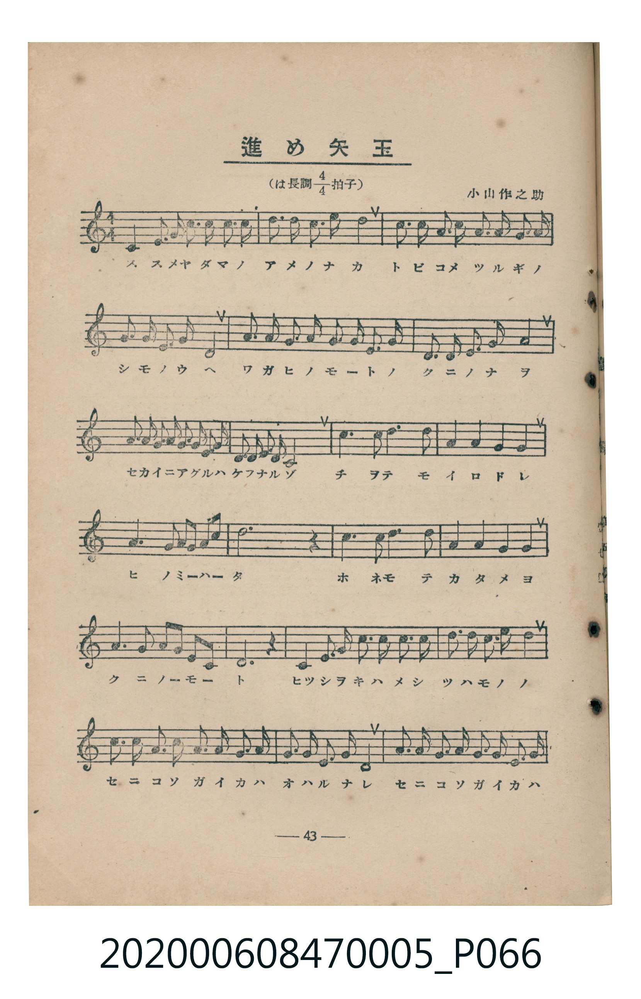
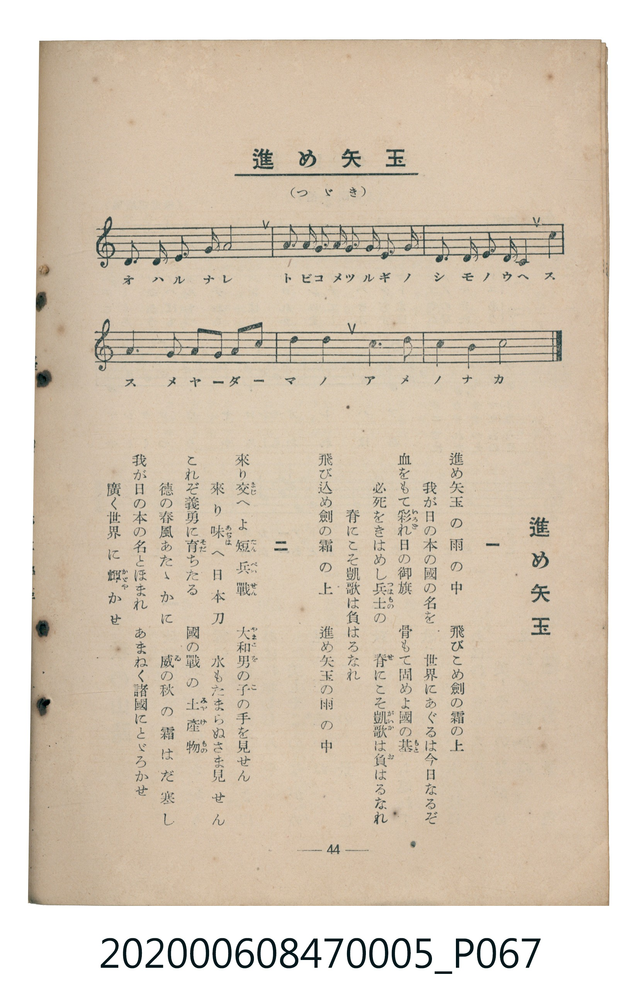

# 進め矢玉

> Re:Shoka 使用 AI 協助辨識與重建樂譜，可能會有錯誤。歡迎回報。

<audio controls src="susume_yadama.mp3"></audio>

- 臺灣教育會公認《新定兒童唱歌》尋常科第五學年用（2020.006.0847.0005）

## 說明

原書資訊與歌詞全文（對應 P066.jpg – P067.jpg，書頁 pp. 43–44，參考教材第 9 首）：
調性與拍號：は長調四分之四拍子（C 大調 4/4 拍）
作曲：小山作之助

## 歌詞

```text
一　進め矢玉の雨の中　飛びこめ劍の霜の上
我が日の本の國の名を　世界にあぐるは今日なるぞ
血をもて彩（いろど）れ日の御旗　骨もて固めよ國の基（もと）
必死をきはめし兵士（つはもの）の　脊（せ）にこそ凱歌（がいか）は負（お）はるなれ
脊にこそ凱歌は負はるなれ　飛び込め劍の霜の上
進め矢玉の雨の中

二　來り交（まじ）へよ短兵戰（たんぺいせん）　大和男の子（やまとをのこ）の手を見せん
來り味（あぢは）へ日本刀　水もたまらぬさま見せん
これぞ義勇に育（そだ）ちたる　國の戰の土産物（みやげもの）
德の春風あたゝかに　威（ゐ）の秋の霜はだ寒し
我が日の本の名とほまれ　あまねく諸國にとゞろかせ
廣く世界に輝（かゞや）かせ
```

## ABC

```abc
X:1
T:進め矢玉
M:4/4
L:1/16
Q:1/4=112
K:C
V:V1 name="Piano" snm="Pia"
[V:V1]
C4 E3 G c2 G2 E2 G2 | c2 G2 E3 G c8 | A2 A2 G3 A G3 E D2 E2 | G2 G2 E3 C D8 |
E3 E G3 G A2 A2 G3 E | C3 C D3 D E4 G4 | A2 A2 G2 A2 c2 A2 G2 E2 | G2 E2 D3 C C8 |
B6 B2 d6 B2 | A4 A4 G4 A4 | G6 E2 G2 E2 A2 c2 | B12 z4 |
B6 B2 d6 B2 | A4 A4 G4 A4 | G6 G2 c2 G2 E2 C2 | D12 z4 |
C4 E3 G c2 c2 B2 A2 | d2 d2 B2 G2 c8 | c2 c2 G3 G A3 A G3 E | G2 G2 E3 C D8 |
G3 G A2 G2 E3 G C3 E | D2 D2 E3 D C8 | A2 A2 G2 A2 G2 E2 D2 E2 | G2 G2 E2 C2 D4 C4 |
G6 G2 c2 G2 A2 c2 | d4 c4 e6 e2 | d4 B4 c8 |
```

## TMD 檔案連結

- [主旋律 TMD 檔案](susume_yadama.tmd) [[在 TMD Studio 編輯](https://tmdlang.github.io/Tmd-TS/#tmd=s7IKdvYPcrWy4qpTUCpJTLdSSM7PyUlNLsnMz7MqzsjMK0nNjM_KTMmPL87Iz05Ugisry88pzU21Si9KTEmNN403MjAyiDcwMIs3sDAxBzIMTBFKi_NLi5JTrYqTM_Lzc-JLUitKkvLzsxHyBUX5Zal5iXlANQVFIBtTwIoQClLLMlNSQdKpKZkl-UWZiTlI7kgtKga7FWxJfElRYl5xclFmAcgDCFUlGalAx-Zm5mSWJBZVKnFpaSm8bNj0uKnx-fxFz_s6FbS0uBRtFQwNjbjsbRWcuWxM9E3sQJpftO963rj42dSZL5o2PZvT_LR1zYtVvY8bup5N2_B03aynrZOer176dMrGZ2t7Hjd0P93Q_XTHjufLJz5fs-bJrilP1-54unPL8ykr3u_pAAWPHjB49EDBA2QYmL7f06nExaWvpWBLLcCloKDwtG_-s9k7Xmxuf7Gi60VHO9BdL1bOe9q64tm0dqArnm7ofdbeqRBgYGaml1WQrvCoYTKIYw7ivN_TA9T5ckGjQkGBnoKJMVDOxAQo-LS_-UVDMzAEns2dAPSXgqXCy2XTgI5_v2cWyMIXq_Y_a1gOsqq798XM-UDRx43rX07dDhR_Onv20462Jzu7gQyg7NO1E4BOcFZ4umQ5UFIBGMIKQFGgSSBjnuyd82z2JqDupxv6n27cCOSC9HWt5AJL7mh43NCAHF-PG9e9nL0CSD7ZsRYktXj248bNjxsnAxU87eoFyc6ZA5btAul_1jHxcWPPs-lLgULP5qwBkk_ndIPICb2PmyYB9T_ZMe351J7HjasfNzY9bpzwuAkou_7J7i6wllVg7jywZxc2gDQ0ARUte7p3JdA7jxtbHjcBLQSyOx83Qe14um_hs-nTQe5atQKqePYuoNMeN3VALZ6_C6QXJAVMHOAAeLq_9dna3SDTG4HGrQepbpz-tHXr08WrwdYsAQsCNawD2dS4Dmj6i5YusNRssAjQ7ZMfN8592g5KjGBxoIdaHjd2g2XXv9i0ACwI1ALigv0E9FkP2FstXWj6IRqQ1cFD-cW-PdhDGVf8QKJwF8iEJ_vaHjd1Pdm1BOyUfY8bZ4BdswMYMM_nrwX69lnHBrDU_MdNQMfsAntgNpANUtbQAEw5Tyf1PJ-yHRSE4NT0uAmoAGgOMJiBAbcO6AVI6Dzr7AaKvFgGdDxIO9gFYLufTtwMtgAYkIuA3oNYD4w1YLJ42gFKZc82bAEH83yQuU1AWWBymQpko5gFTmnAQJr3fN_Kp93twMADFg9gc-c-bgSGM1DbQrAnukGuBkc50GfgdDf_-ZTFzzshSWc_2PmQ9ASKVnA62Afy3bMZS18uAoYf2CFNQEOBRqwGmbWiEexroN9B3ny-HGQ0OBbWAy1-uh4YCNNxpHhgWgcGU-NusL9AkQE2HRh2ax839r9YvQPsTGAiAAblPHCSBvkX7KLdi4Eq4FnkxZ65YMcDAxiorgXsEJhSysswKFDQ0ufiCi4tBtYwkYkpibmJVgGZiXn5DjUGNQrVIJsUbAzNtOzALGxFqAKoBN7R8GJhj4KGsQKwTHm-vkEHXu5pYtEAtBBqmAZQo6aVwuOmnSABCPW4eSEQLwHiBiCeB8R9CjVAuUVQmT6wmi6gyGqQJggAKmjuAOLJQOHNcENawKzVQLF1YI1Qi2sUDBV0wdAYTJoqGMaBKYgAiAYqQRaCq0GGNQpmQBKEQcpALAhtrGAE1VYDzo-4Q21XD2Whth3oK1CwgIOkaRmQNQM1SNaDJdYAWZPAQdEH1bAHHFwQEVDYgtU1dyOHbvMmkCHwEAN5DREahmAvogYGRMYYGgimaIFjDA91mF4jqA6YCsLBtaMTHFwm5AbXbnCaedwESltAv4JSVNMGSAJp7geHw0YgayrY_7CEsw81QBuhbFDwPG5ug_MWgbUvgXDWQqhOCLUGJRyRQwVEg1MVTACcZuAsSDAZwhMrIqjNkXggthFy0gQJQOyBJErUMIbxCYQ1sBlBUViD0xvE_6A0Nx-a5vrBNCio9iPCFRmAwng2XGsvOGRhvDawRnCmh-oH5XIwtQIljGF-heVwWIDCwxs1BJGhAR3DGNhspSw9g3ItxP-QnAsJY0j-hhSIOMN40uPmZlAwbgdrB6blprXQ6AGWm0BRkJoWqAikhIEUDVCANahBbJRSE5RwazBKCsygxloagwlQOINCE2gKiAsmQGJwq5AhoSTdupay0hZYfICLDXD90rQXXLCCWMDiBJwqYYXIKmi4QcRARSm4CIAHPtAgaJwBjcJlEKKqggcGcsGKXNsQUzgj60Wp1GBmECp6mzHDDtyVITLsCIUJUuUNq7qRK25QqCEqO6SqDtpygIcWyOew2hfEwiw70Qtg5NIWUf4iJ2FYaMLMIpjOVlMWVmAfgcMJ1hACZWtQYwiSredBJMHZEVSJIVSDZCHC4BoMtYlEOM8ilY_w0g6ey4yRsxuYg6QKVlhiyZO1XFy6dgrI7UsFIF-ZiwsA)]
- [鋼琴伴奏 TMD 檔案](susume_yadama_piano.tmd) [[在 TMD Studio 編輯](https://tmdlang.github.io/Tmd-TS/#tmd=s7IKdvYPcrWy4tLSUnjZsOlxU-Pz-Yue93W-39PxsnvP8wlbnuzZ8nRp__POjvd7OhW0tLgUbRUMDY247G0VnLlsTPRN7LjqFJRetO963rj42dSZL5o2PZvT_LR1zYtVvY8bup5N2_B03aynrZOer176dMrGZ2t7Hjd0P93Q_XTHjufLJz5fs-bJrilP1-54unPL8ykrgFYaGRgZ6BkYmOkZWJiYAxkGpkBblbi4gkuLS3NTIxNTEnMTrQIyE_PygzwcagxqFKq5FIDAxtBMyw7M0tdSsEUHCiB7djS8WNijoGGs8HRD__P1DToKAQZmZnpZBemaWDRo6YMNq1EwVNAFQ2MwaapgGAemIAIgGqgEWQiuBhnWKJgBSRAGKQOxILSxghFUWw0Xfsfv6iHH8SBbEA4zBNuG6i6IjDHUPaZo7jSGBwBMrxFUB0wFYZfv6AS73IQ0lyO7A0SDgxQmAA4wOAviMEN4TCE8Z47EA7GNkOMFJACxBxIjqL6C8Qn47uns2eT4DmYLLGHBvAL3KarbkaEBHX0HzJqU-g7ERskfoFiqwUiImL7Dmu_ABMhrIA8ATQFxwQRIDG4VMiQUf61rySoU4I5BzjfI-ZqYvIesF6X4gJlBKGc1Y7rdnKDbQe6AlTogFma2Qc97yBkNkfWQIxTmN5hZBEN9NTkux5mukLINPBPAU4IxcpIAc5BUwfIQlnRTi63O8UGpc0wQVc7T7vani9c_mzfn2dRFT3Z2v9jdC6zpgKXDs-7ep2snAKtVoIefzd4EqUqRElK8QrRhLIzC5JsAGSYQvmk8UABVm2k8TBwmAlIPNwgkAzMJqhHJPLAyuAmYIkiGI-kCUmiOgImi6jQg1yhMR4CMwmkXmv-wBQNmQCGFACxpYYQDesijGIVpI6rLsPoFbiUwZenaKSAnLgUsfGUuLgA)]

## 分析

```text
================================================================================
📊 TMD Song Profile: [ 進め矢玉 ]
================================================================================
⏱  Duration:       0:57 (57.9s), 27 measures total
🎼 Key & Tempo:    首調基準 C, != 112.0 BPM, <4/4>
   - 分析範圍：      由實際發聲的音符與和弦推測調性；播放脈絡另行呈現
🎤 人聲音域:    C4 (MIDI 60) – E5 (MIDI 76) [跨度: 16 個半音 / 1.3 個八度, 難度: moderate]
   - 最低音:  C4 in [SusumeYadama #1 @ m.1, 0:00]
   - 最高音: E5 in [SusumeYadama #1 @ m.26, 0:54]
   - 適合: soprano, mezzo-soprano, contralto, tenor, baritone, bass
🏛  結構:      SusumeYadama (57.9s)
⚡ 編曲密度:        Peak 1 軌道同時演奏
🗝  調性診斷：       G 大調（純淨自然大調，未偵測到可信轉調）
   - 風格氣質:    純淨自然大調（陽光明朗、易唱易記，無明顯調外色彩）
   - 轉調歷程:    全曲維持單一推測調性（未偵測到可信轉調）
   - 核心骨幹音:  G, C, D, E, A
   - 調性數值:    G 大調 [相關度: 0.89, 穩定度: Moderate, 自然音純度: 100.0%]
   - 候選調性 (K-S): G 大調 (0.89), C 大調 (0.82), E 小調 (0.67)
   - 五度圈歷程:   +1
   - 各段落調性細節:
     • [SusumeYadama #1]: G 大調 (r: 0.89, 自然音純度: 100.0%)

  [ 五度圈游移軌跡 ]
               C  
         F           [G ]*
      Bb               D  
      Eb               A  
         Ab           E  
            Db       B  
               F# 
     (* = active key center)

  [ 十二半音累積音高分佈 ]
     C  : ██████████████████████    21.7%
     C# :                            0.0%
     D  : █████████████████         17.0%
     D# :                            0.0%
     E  : ███████████████           14.4%
     F  :                            0.0%
     F# :                            0.0%
     G  : ████████████████████████  23.6%
     G# :                            0.0%
     A  : ██████████████            13.9%
     A# :                            0.0%
     B  : ██████████                 9.4%
--------------------------------------------------------------------------------
Assignment 軌道音域：
  - Piano         : C4 – E5 (16 個半音 / 1.3 個八度, 147 個音符)
================================================================================
```


## 原書掃描頁






