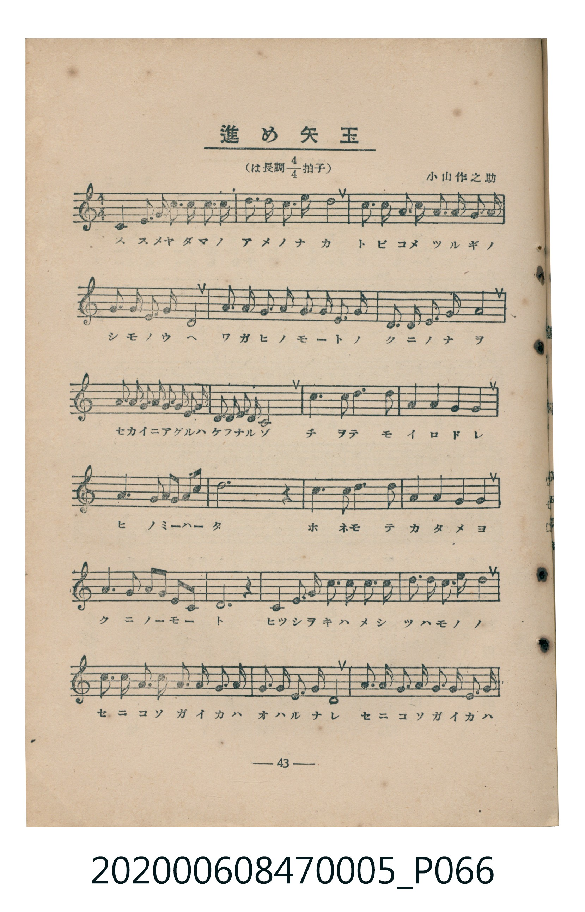
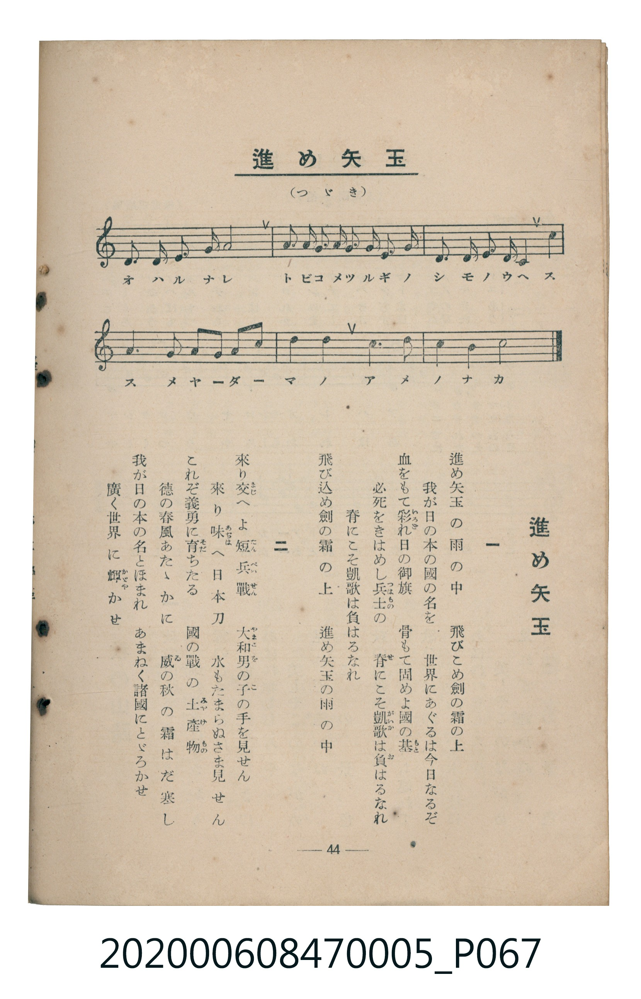

# 進め矢玉

> Re:Shōka 使用 AI 協助辨識與重建樂譜，可能會有錯誤。歡迎回報。

- **鋼琴伴奏版**：<br><audio controls src="susume_yadama.mp3"></audio>
- **NEUTRINO 歌聲合成版**：<br><audio controls src="susume_yadama_neutrino.mp3"></audio>

- 臺灣教育會公認《新定兒童唱歌》尋常科第五學年用（2020.006.0847.0005）

## 說明

原書資訊與歌詞全文（對應 P066.jpg – P067.jpg，書頁 pp. 43–44，參考教材第 9 首）：
調性與拍號：は長調四分之四拍子（C 大調 4/4 拍）
作曲：小山作之助


## 歌詞

```text
一　進め矢玉の雨の中　飛びこめ劍の霜の上
我が日の本の國の名を　世界にあぐるは今日なるぞ
血をもて彩（いろど）れ日の御旗　骨もて固めよ國の基（もと）
必死をきはめし兵士（つはもの）の　脊（せ）にこそ凱歌（がいか）は負（お）はるなれ
脊にこそ凱歌は負はるなれ　飛び込め劍の霜の上
進め矢玉の雨の中

二　來り交（まじ）へよ短兵戰（たんぺいせん）　大和男の子（やまとをのこ）の手を見せん
來り味（あぢは）へ日本刀　水もたまらぬさま見せん
これぞ義勇に育（そだ）ちたる　國の戰の土産物（みやげもの）
德の春風あたゝかに　威（ゐ）の秋の霜はだ寒し
我が日の本の名とほまれ　あまねく諸國にとゞろかせ
廣く世界に輝（かゞや）かせ
```

## ABC

<div class="abc-score" data-abc-src="susume_yadama.abc" aria-label="五線譜載入中"></div>

[下載 ABC 原始檔](susume_yadama.abc)

## TMD 檔案連結

- [主旋律 TMD 檔案](susume_yadama.tmd) [[在 TMD Studio 編輯](https://tmdlang.github.io/Tmd-TS/#tmd=s7IKdvYPcrWy4qpTUCpJTLdSSM7PyUlNLsnMz7MqzsjMK0nNjM_KTMmPL87Iz05Ugisry88pzU21Si9KTEmNN403MjAyiDcwMIs3sDAxBzIMTBFKi_NLi5JTrYqTM_Lzc-JLUitKkvLzsxHyBUX5Zal5iXlANQVFIBtTwIoQClLLMlNSQdKpKZkl-UWZiTlI7kgtKga7FWxJfElRYl5xclFmAcgDCFUlGalAx-Zm5mSWJBZVIsSBhqVn5lnlpmZmZWJxWX5RSUY-0IsFGZVWGZnFILuTE3PisxPzkEICanNBYnqqVYCBmZkukDBX4tLSUnjZsOlxU-Pz-Yue93UqaGlxKdoqGBoacdnbKjhz2Zjom9iBzHjRvut54-JnU2e-aNr0bE7z09Y1L1b1Pm7oejZtw9N1s562Tnq-eunTKRufre153ND9dEP30x07ni-f-HzNmie7pjxdu-Ppzi3Pp6x4v6cDFAN6wBjQA8UAkGFg-n5PpxIXl76Wgi21AJeCgsLTvvnPZu94sbn9xYquFx3tQHe9WDnvaeuKZ9Paga54uqH3WXunAigc9LIK0hUeNUwGccxBnPd7eoA6Xy5oVCgo0FMwMQbKmZgABZ_2N79oaAaGwLO5E4D-UrBUeLlsGtDx7_fMAln4YtX-Zw3LQVZ1976YOR8o-rhx_cup24HiT2fPftrR9mRnN5ABlH26dgLQCc4KT5csB0oqAENYASgKNAlkzJO9c57N3gTU_XRD_9ONG4FckL6ulVxgyR0NjxsakOPrceO6l7NXAMknO9aCpBbPfty4-XHjZKCCp129INk5c8CyXSD9zzomPm7seTZ9KVDo2Zw1QPLpnG4QOaH3cdMkoP4nO6Y9n9rzuHH148amx40THjcBZdc_2d0F1rIKzJ0H9uzCBpCGJqCiZU_3rgR653Fjy-MmoIVAdufjJqgdT_ctfDZ9Oshdq1ZAFc_eBXTa46YOqMXzd4H0gqSAiQMcAE_3tz5buxtkeiPQuPUg1Y3Tn7Zufbp4NdiaJWBBoIZ1IJsa1wFNf9HSBZaaDRYBun3y48a5T9tBiREsDvRQy-PGbrDs-hebFoAFgVpAXLCfgD7rAXurpQtNP0QDsjp4KL_Ytwd7KOOKH0gU7gKZ8GRf2-Omrie7loCdsu9x4wywa3YAA-b5_LVA3z7r2ACWmv-4CeiYXWAPzAayQcoaGoAp5-mknudTtoOCEJyaHjcBFQDNAQYzMODWAb0ACZ1nnd1AkRfLgI4HaQe7AGz304mbwRYAA3IR0HsQ64GxBkwWTztAqezZhi3gYJ4PMrcJKAtMLlOBbBSzwCkNGEjznu9b-bS7HRh4wOIBbO7cx43AcAZqWwj2RDfI1eAoB_oMnO7mP5-y-HknJOnsBzsfkp5A0QpOB_tAvns2Y-nLRcDwAzukCWgo0IjVILNWNIJ9DfQ7yJvPl4OMBsfCeqDFT9cDA2E6jhQPTOvAYGrcDfYXKDLApgPDbu3jxv4Xq3eAnQlMBMCgnAdO0iD_gl20ezFQBTyLvNgzF-x4YAAD1bWAHQJTSnkZBgUKWvpcXMGlxcBKLDIxJTE30SogMzEv36HGoKYaZJGCjaGZlh2Yha0EVQAVwDsaXizsUdAwVgAWKc_XN-jAiz1NLBqA9kEN0wBq1LRSeNy0EyQAoR43LwTiJUDcAMTzgLhPoQYotwgq0wdW0wUUWQ3SBAFABc0dQDwZKLwZbkgLmLUaKLYOrBFqcY2CoYIuGBqDSVMFwzgwBREA0UAlyEJwNciwRsEMSIIwSBmIBaGNFYyg2mrA1vkYgpy_E6oLxoJ5E8RqAJPzwGQf2GSQdyFqYGIgGuJpdFeAfA6SnQw2fTOS6S1QNiQE4KZDXGUE1NnYC3NV43yo64B2NO4Di8wAkzvAoiAbQOpBZQVYeBeYhFrQOBuoBCSO5rAmkDzMuBXwAJgE1QWMlEaIaSDH1YDLLtxJbFcPZUlsO9D7oDQETj9Ny4CsGajpZz1YYg2QNQmcbvqgGvaAQxgiAvIUWF1zN3JSbN4EMgSevEDpAJF0DMHpATVoIDLG0BRjipaSjOFJFKbXCKoDpgI1bW0Hxy0kxUDTCtSDmGllPVQe4k9I-oD4FBo94NQEEYX4FsKD-BeeDoE-RjMbKVUtA9sAMh1Y7kL04Eoi0BQISn-gtAdhNwEx3D2NUBcAUyJIPST9A8tWuHlgvY1tGO4hUGJ1gpOTCbnJCWQ_KF-BCipg2ICKp6YNkLzW3A8OuY1A1lRwaMFKoX2oCa4RygYF5uPmNjhvEVj7EghnLYTqhFBrUNIZcqoB0eAiCiYALoDgLEgyMoSXfIgoMEfigdhGyOUcSABiDwjCaFgahPGR0-JuUIyASymQFyApB8QGp05gCEHKIxDZDzYbFE4g3lQwCU0B0NDCTL2NSHxIGkSkXIgYKB1Agg8mshbO6oSz1qC6HJxqQSn1ceNSsDubwGxQmQgtvppAeoENFIRbGsEuhhZuhFI5shiwRQBWCyrv0dVBchhIDSw9I1I2LO0TTNvALgBFaRtc_kHSG6hkAOYucBnYD6ZBYbsfkY6RASiCZsO19oKjBsZrA2sE19hQ_aAqCkytQEnTsLQFgrDaGETD0zdqikWGBvCApG6ahpaT0FgAl4KgUIHxQekYGn9An2F3WjxCDTCIkE3rBZPY0zAsvhHmQloEEBasQkVOw3ORzWlcACbhOqB1PMRsUK4k4NJGmM8gusG5FlxVI0OQOkgzACQL0wHJHRAWTAfBCn4KZSUyqF6GpChIXQVJtZAaHNJKwplqJz1ubgYlzO1g7cDSuGktNMEDm1FAUZCaFqgIpA0BqfyhAGviBbFRGpGgorcGoy0Ag4jEi7VxCiZAKReUPoGmgLhgAiQGtwolYpAKZUgVCo0QSIEMrcyREx-sKUkgWUBCC6oZ3PaAlMWgQIPlB2jLFSwLCTyEDKKdgnAEmqPh5THc0dCmJCwnQkpoqIMw0iQWRyOan9A0Cml-ggIGkheAHSswOQeqHrkGgJAQeYz2N4GyuHUtZc1WYDsD3L4A92qa9oJbbiAWsN0BLk5hrY1V0OQJEQO10MBtBXgaBxoEzRpAo3AZhOggwdMccgsVuY9DTCsXWS9KVwpmBnq7AdpWgPZhoI6EsCHOhKQ1mI8RaQomA_E3ujsgpkPMh5gOMhtE4jAdkQqbJoBjHdx7AqcJEA2s2qBpDjgEgJYWwSkKWvJCysDHTcCOLFAdpqtgKbEHiMFtGYg9UPNAaZb40nNHM2Y6A481EpnOCKUfpO41rHOJ3LWGdEPgpSOifwXt28NTFiiVwPrHIBZmgxS9VYvchEU0apFLVVjKg5mFnK5ISCUY_WhY_xtSekHatEj9aGj5hlKiAT0OYsN6Xoh-P3LJBnYTuEQC9WMgcb0P2i5EcxO0HIK0MteCSbBfGqc_bmoHMyA9aIggyImwwg44Tgp2QC-YDSm8YE0PSHIjIlk9bV1NWbICRz44ScFGdUCVMmhkB1Ipz4NIgivTx8BOAkI1SBYiDO5BQUspKCBc4yK1F-GtP3gdaYxcWYI5SKpgjUe8NSosWiEJCpJMEF0O0IAOLFHBmvlINS64M4SqG-JbmAikGwRSiVndIIomUMzCTYGmAEQMwxp4qA00eJMSLg_hgZIeyEyESpg8wkyEG2q5uHTtFJDHDBWAfGUuAA)]
- [鋼琴伴奏 TMD 檔案](susume_yadama_piano.tmd) [[在 TMD Studio 編輯](https://tmdlang.github.io/Tmd-TS/#tmd=s7IKdvYPcrWy4qpTUCpJTLdSyC8qychPL0osyKi0ysgsLskvykxOzInPTsxLVIIrKs4vLUpOjS9ITE-1CjAwM9MFEuZKXFpaCi8bNj1uanw-f9Hzvs73ezpedu95PmHLkz1bni7tf97Z8X5Pp4KWFpeirYKhoRGXva2CM5eNib6JHcjgF-27njcufjZ15oumTc_mND9tXfNiVe_jhq5n0zY8XTfraeuk56uXPp2y8dnanscN3U83dD_dseP58onP16x5smvK07U7nu7c8nzKCqCVRgZGBnoGBmZ6BhYm5kCGgSnQViUuruDS4tLc1MjElMTcRKuAzMS8_CAPhxqDmmouBSCwMTTTsgOz9LUUbNGBAsiaHQ0vFvYoaBgrPN3Q_3x9g44CyOd6WQXpmlg0aOmDDatRMFTQBUNjMGmqYBgHpiACIBqoBFkIrgYZ1iiYAUkQBikDsSC0sYIRVFsN2DofwxqFx007obpgrMfNC4F4CZjVACbngck-sMmPmxZB1cDEQHQXUHw1hiseN3eAZSeDTd-MZHoLlL0aKL4OYTrEVUZAnY29MFc1zoe6DmhH4z6wyAwwuQMsCrIBpH7-4yawNY27wCTUgsbZQCUgcTSHNYHkYcatgAfAJKiudUAMMQ3kuBou_DG9q4ecmAZFCSIWDcFRg-pKiIwxNPJM0SLVGJ5aYHqNoDpgKlCjeTs4mCGRB422pmVANigw0aNtPVR-DZANDROgHohuCA8U7BBRkNlQ9c3dqEmieRO62UgRvAxsA8j0x437IXpwxRY0MYCSAigZQNhN0IQA4UFdAEwUIPWQpPi4cTfcPLDexjYM9xDIw53gmDUhLWaR4wlEg_MnTACc--AsSMQZwrM9wtPmSDwQ2wg5k4MEIPaAIIyGxTqMjxz7u0FhAM6ij5sgWbsbzAanh6YNYBGwbHM_2OzHTRvBvKlgEhrm4OwKyjPo6aURiQ-JdURagYiBQh5kKshuiMhaOKsTzlqD6nJwOgGljceNs8DubAKzQQUCNO82gfQ-boTrA7LBLobmbELpClnscVMPWC2osENXB0nTIDWwFIRIS7DURjA1PZ09m5zUBItVEIRVAiAanrJQ0woyNIB7gbqpCVomQP0PzvGPmyHFNCwFQUOuCRIDmDAeoaZ5NoppvWASe-qBhTTCXEhFBGHBynHk1DMX2ZzGBWASrgNatUDMBuUHAi5thPkMohucX8A1BDIEqYPUPiBZmA5IuoSwYDoI1itTKE0vIDZKcwFUztRgVDUwiEgvWJshYAKUWEBJAmgKiAsmQGJwq1DCAqkEgpTQ0DCAlD7QugI5vmGNBgIx0TzpcXMzTDO4aoMUPI-b1oJZoGCHtlHAsiAt4CofKoOoBhGOQHM0vPCBOxraaIAlfkhxBHUQRjLA4mhEQwOaLCANDVDAQJLf40YIOQeqHrm4g5AQeYyWFoGCp3UtWU1ReJwjN0CQW5PENGKQ9aI0WmFmoFdS0IoJ2lps2gtuhkDYS-BFACgeQTpWQdkgEiYDanjAKgSEOyCmQ8yHmA4yG0TiMB0pFUDiHdxOBccJiO6Fx_njxuloaQEco9DCBpLtHzc1gNVhugqWEnqAGFxxQuyBmgdKM8QXGDuaMePZnGA8g-IM1i8AsTDbIugNGuTWC6I9g1zGwNIBzCzkWCYhzjD6D7B-ByQvQ5ozSP0HLM1cUCMXxIY3FeH9HeQYBrsJnD9BjUZIyO-DNgnQ3ATNlZAGxlowCfZL4_THTe1gBqTnABEEORGW9R83rgQ7oBfMhmRlWN0HiXwiIvlp62pyIhlnrYDUjIA3CuDluDFygQ7mIKmCtSnwlvqwwIZEMyTyEG1AUPcSFtWwdhdSrQBunaLqBqlE1BqQdilIJWaRCI9ccHjDTYHGCyLcYfU-ar0Nb2nA5SE8UIKA9R9R5RFmItxQi20cwQd5HMEEMYzwtLv96eL1z-bNeTZ10ZOd3S929wIHL4CNxmfdvU_XTgCOlADj_dnsTZDREaRiOl4h2jAWRmHyTYAMEwjfNB4ogKrNNB4mDhMBqYcbBJKBmQTViGQeWBncBEwRJMORdAEpNEfARFF1GpBrFKYjQEbhtAvNf9iCATOgkEIAlsMwwgE95FGMwrQR1WVY_QK3EpiwdO0UkNNWtA9QAkPMCCymzAUA)]

## 分析

```text
================================================================================
📊 TMD Song Profile: [ 進め矢玉 ]
================================================================================
⏱  Duration:       0:57 (57.9s), 27 measures total
🎼 Key & Tempo:    首調基準 C, != 112.0 BPM, <4/4>
   - 分析範圍：      由實際發聲的音符與和弦推測調性；播放脈絡另行呈現
🎤 人聲音域:    C4 (MIDI 60) – E5 (MIDI 76) [跨度: 16 個半音 / 1.3 個八度, 難度: moderate]
   - 最低音:  C4 in [SusumeYadama #1 @ m.1, 0:00]
   - 最高音: E5 in [SusumeYadama #1 @ m.26, 0:54]
   - 適合: soprano, mezzo-soprano, contralto, tenor, baritone, bass
🏛  結構:      SusumeYadama (57.9s)
⚡ 編曲密度:        Peak 1 軌道同時演奏
🗝  調性診斷：       G 大調（純淨自然大調，未偵測到可信轉調）
   - 風格氣質:    純淨自然大調（陽光明朗、易唱易記，無明顯調外色彩）
   - 轉調歷程:    全曲維持單一推測調性（未偵測到可信轉調）
   - 核心骨幹音:  G, C, D, E, A
   - 調性數值:    G 大調 [相關度: 0.89, 穩定度: Moderate, 自然音純度: 100.0%]
   - 候選調性 (K-S): G 大調 (0.89), C 大調 (0.82), E 小調 (0.67)
   - 五度圈歷程:   +1
   - 各段落調性細節:
     • [SusumeYadama #1]: G 大調 (r: 0.89, 自然音純度: 100.0%)

  [ 五度圈游移軌跡 ]
               C  
         F           [G ]*
      Bb               D  
      Eb               A  
         Ab           E  
            Db       B  
               F# 
     (* = active key center)

  [ 十二半音累積音高分佈 ]
     C  : ██████████████████████    21.7%
     C# :                            0.0%
     D  : █████████████████         17.0%
     D# :                            0.0%
     E  : ███████████████           14.4%
     F  :                            0.0%
     F# :                            0.0%
     G  : ████████████████████████  23.6%
     G# :                            0.0%
     A  : ██████████████            13.9%
     A# :                            0.0%
     B  : ██████████                 9.4%
--------------------------------------------------------------------------------
Assignment 軌道音域：
  - Piano         : C4 – E5 (16 個半音 / 1.3 個八度, 147 個音符)
================================================================================
```


## 原書掃描頁






