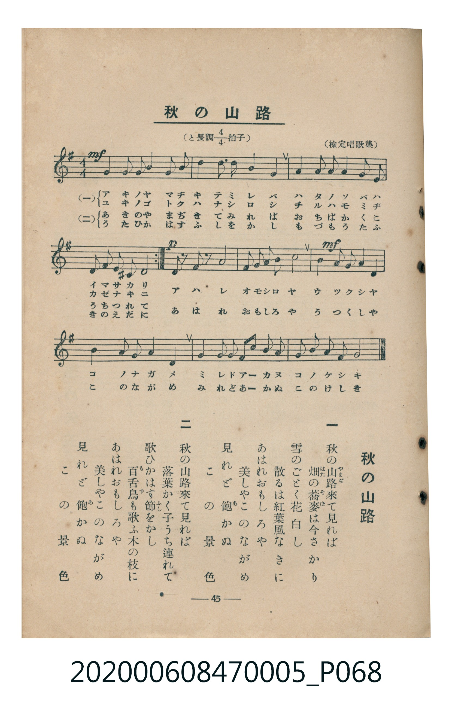

# 秋の山路

<audio controls src="aki_no_yamaji.mp3"></audio>

- 臺灣教育會公認《新定兒童唱歌》尋常科第五學年用（2020.006.0847.0005）

## 說明

原書資訊與歌詞全文（對應 P068.jpg，書頁 p. 45，參考教材第 10 首）：
調性與拍號：と長調四分之四拍子（G 大調 4/4 拍）
出處：（檢定唱歌集）

## 歌詞

```text
一　秋の山路（やまぢ）來て見れば
畑（はた）の蕎麥（そば）は今さかり
雪のごとく花白し
散るは紅葉風なきに
あはれおもしろや
美しやこのながめ
見れど飽（あ）かぬ　この景色

二　秋の山路來て見れば
落葉かく子うち連れて
歌ひかはす節（ふし）をかし
百舌鳥（もず）も歌ふ木の枝に
あはれおもしろや
美しやこのながめ
見れど飽（あ）かぬ　この景色
```

## 原書掃描頁



## 分析

```text
================================================================================
📊 TMD Song Profile: [ 秋の山路 ]
================================================================================
⏱  Duration:       0:35 (35.0s), 14 measures total
🎼 Key & Tempo:    首調基準 G, != 96.0 BPM, <4/4>
   - 分析範圍：      由實際發聲的音符與和弦推測調性；播放脈絡另行呈現
🎤 人聲音域:    D4 (MIDI 62) – E5 (MIDI 76) [跨度: 14 個半音 / 1.2 個八度, 難度: moderate]
   - 最低音:  D4 in [AkiNoYamaji #1 @ m.13, 0:31]
   - 最高音: E5 in [AkiNoYamaji #1 @ m.2, 0:02]
   - 適合: soprano, mezzo-soprano, contralto, tenor, baritone, bass
🏛  結構:      AkiNoYamaji (35.0s)
⚡ 編曲密度:        Peak 1 軌道同時演奏
🗝  調性診斷：       D 大調（純淨自然大調，未偵測到可信轉調）
   - 風格氣質:    純淨自然大調（陽光明朗、易唱易記，無明顯調外色彩）
   - 轉調歷程:    全曲維持單一推測調性（未偵測到可信轉調）
   - 核心骨幹音:  A, B, G, D, E
   - 調性數值:    D 大調 [相關度: 0.67, 穩定度: Moderate, 自然音純度: 98.2%]
   - 候選調性 (K-S): D 大調 (0.67), G 大調 (0.61), B 小調 (0.60)
   - 五度圈歷程:   +2
   - 各段落調性細節:
     • [AkiNoYamaji #1]: D 大調 (r: 0.67, 自然音純度: 98.2%, 調外音: G#)

  [ 五度圈游移軌跡 ]
               C  
         F            G  
      Bb              [D ]*
      Eb               A  
         Ab           E  
            Db       B  
               F# 
     (* = active key center)

  [ 十二半音累積音高分佈 ]
     C  :                            0.0%
     C# :                            0.0%
     D  : ████████████              13.6%
     D# :                            0.0%
     E  : █████████                 10.9%
     F  :                            0.0%
     F# : ██                         2.7%
     G  : ███████████████           17.3%
     G# : ██                         1.8%
     A  : ████████████████████████  27.7%
     A# :                            0.0%
     B  : ██████████████████████    25.9%
--------------------------------------------------------------------------------
Assignment 軌道音域：
  - Piano         : D4 – E5 (14 個半音 / 1.2 個八度, 73 個音符)
================================================================================
```

## ABC

```abc
X:1
T:秋の山路
C:TMD (Chen, Chih-Han / aguai)
M:4/4
L:1/16
Q:1/4=96
K:G

V:V1 name="Piano" snm="Pia"

[V:V1]
b4 d3 b a4 b2 d2 | e4 d2 b2 a4 b4 | b4 a2 b2 g4 a2 g2 | e4 f2 ^g2 a8 |
b4 d3 b a4 b2 d2 | e4 d2 b2 a4 b4 | b4 a2 b2 g4 a2 g2 | e4 f2 ^g2 a8 |
g2 z2 f2 z2 g8 | a2 a2 g2 a2 b8 | d4 e2 d2 b2 a2 g4 | a4 b2 d2 e4 d4 |
b2 a2 g2 e2 d2 b2 a4 | d2 b2 a3 b g8 |
```

- [主旋律 TMD 檔案](aki_no_yamaji.tmd)
- [鋼琴伴奏 TMD 檔案](aki_no_yamaji_piano.tmd)
