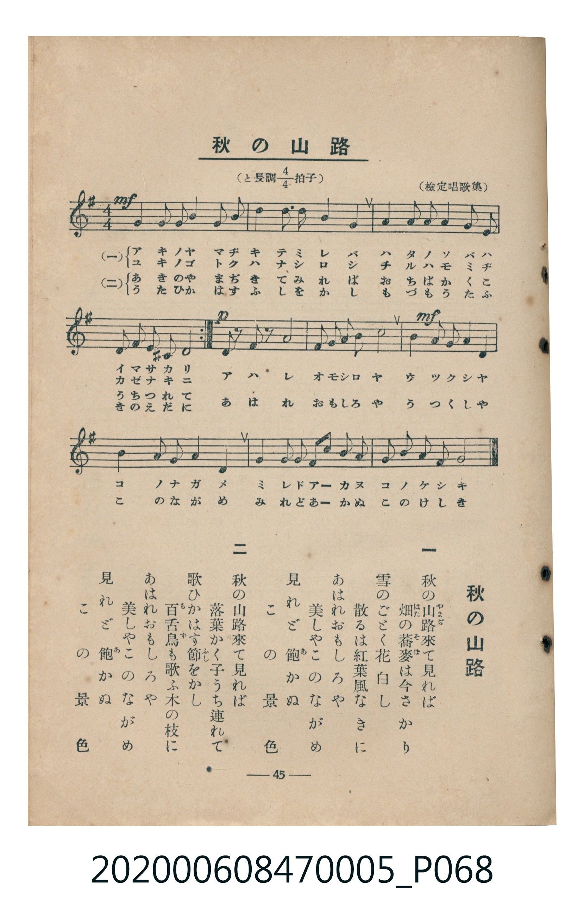

# 秋の山路

> Re:Shōka 使用 AI 協助辨識與重建樂譜，可能會有錯誤。歡迎回報。

- **鋼琴伴奏版**：<br><audio controls src="aki_no_yamaji.mp3"></audio>
- **NEUTRINO 歌聲合成版**：<br><audio controls src="aki_no_yamaji_neutrino.mp3"></audio>

- 臺灣教育會公認《新定兒童唱歌》尋常科第五學年用（2020.006.0847.0005）

## 說明

原書資訊與歌詞全文（對應 P068.jpg，書頁 p. 45，參考教材第 10 首）：
調性與拍號：と長調四分之四拍子（G 大調 4/4 拍）
出處：（檢定唱歌集）


## 歌詞

```text
一　秋の山路（やまぢ）來て見れば
畑（はた）の蕎麥（そば）は今さかり
雪のごとく花白し
散るは紅葉風なきに
あはれおもしろや
美しやこのながめ
見れど飽（あ）かぬ　この景色

二　秋の山路來て見れば
落葉かく子うち連れて
歌ひかはす節（ふし）をかし
百舌鳥（もず）も歌ふ木の枝に
あはれおもしろや
美しやこのながめ
見れど飽（あ）かぬ　この景色
```

## ABC

<div class="abc-score" data-abc-src="aki_no_yamaji.abc" aria-label="五線譜載入中"></div>

[下載 ABC 原始檔](aki_no_yamaji.abc)

## TMD 檔案連結

- [主旋律 TMD 檔案](aki_no_yamaji.tmd) [[在 TMD Studio 編輯](https://tmdlang.github.io/Tmd-TS/#tmd=s7IKdvYPcrWy4qpTUCpJTLdSSM7PyUlNLsnMz7MqzsjMK0nNjM_KTMmPL87Iz05Ugisry88pzU21Si9KTEmNN403MjAyiDcwMIs3sDAxBzIMTBFKi_NLi5JTrYqTM_Lzc-JLUitKkvLzsxHyBUX5Zal5iXlANQVFIBtTwIoQClLLMlNSQdKpKZkl-UWZiTlI7kgtKga7FWxJfElRYl5xclFmAcgDCFUlGalAxxanJhbn5xUTFAZakZ6ZZ5WbmpmVicW9-UUlGflAjxdkVFplZBaDXJScmBOfnZiHFD5Q9xQkpqdaBRiYWShxaWkpPF_e_bhx3dONG19sX6-gpcWlaKtgacZlb6vgzmVjom9iB9L9on3X88bFz6bOfNG06dmc5qeta16s6n3c0PVs2oan62Y9bZ30fPXSp1M2Plvb87ih--mG7qc7djxfPvH5mjVPdk15unbH051bnk9Z8X5PByhG9IAxogeKESDDwPT9nk4lLi59LQVbagEuBQWFp33zn83e8WJz-4sVXS862oHuerFy3tPWFc-mtQNd8XRD77P2TgVQCOhlFaS_39MDVPxyQaNCgZ6CCdBFPU_7m180NAO9-2zuBKAnFAwNFF4umwZ06vs9s0DGv1i1_1nDcpDB3b0vZs4Hij5uXPFy6nag-NPZs592tD3Z2Q1kAGWfrp0AtNBd4emS5UBJBWB4KgBFgSaBXdm-68XMqUDdQCXPVi0ChSQ4DF_ObgOpACl5sqPhcUMDchQB1T5uanncuO9x4yKgqif72h43LnuxrPtxU8_jxg0gPc-nTgQpalz_uBHotE6gzhdT-17uWgoWnAtUBBZc_2R31-PGqY8bgTq7QNpezl4FVPq4cQrQL48b-190bXw-c-_jxukguWdTFz9uArph_fMtrS8mdr5cBFQBVN37uHE1SPpxYxPIOpALuh43AdnTHzf1Al0Jds2-PjAf6OTJYPOB-noeNzWCwxHq7JUvF-8Fu64J7DSgRWuAvoZoeDZz_YvOTZDA2AVMXiiBgcX3LybsBboQbEg_MPQfNwJVLHzZAHQ_UMUysGeAqbRxE1gFMIhmPl_fALZ7K9CZIOubJoGlwP5-PnPfi46el5vBYQfyGDCqgCqawEZsfTYHGAzrns0Dhim9ggGomvIcAgUKWvpcXI7ZmX75kYm5iVmZVgGZiXn5DjUGNdUgexRsDM207MAsbNlTAZS7dzQ8W7cVlKM6e0EJf0M_MDCfdsx9urRfByl7dWLRDbQbarIG0BRNK4XHTYtAAo-b1oLI5j4gXgIWaJ4HxB0KNUCyCaJiPZDZBsRdEPk1IAokPQEivR-ivWkvRHoCEPeD5Jvg5ik_btoK5K8G8SEA2Tm7ekDOaYRY1tgLJtcBlbdABPYpgApKoHlgKSC1DIiBdjb1QLgboM5phDivcSFYDBidEG4_EE8Gy7ch5IEug-pHcU6NgrGCLhiagkljBSMoHyQOEqtRMENSARJFVgGCCDNAMiC2IRIfxAaaEQ8VMgcxDNWRjIHBGrCDfAxB4bgIKgaKKzANjS2oKDCAQWQT2GiYGpBIG5icDybXwEUnwB0KiieYyfuh5oLYe1HUQlRB4hPFRmCcgsjVj5tXYXe8ESjUQc4CawJGH4SGxC1MdB-YBHkREsUw8WVgEuwsYEzBRDcgHA-Mb5joQrgcKNphoiBng-IeohoUGMiqQZ6BlFEYjiciDz7t732xDFhroObEfSvJyonNy9ByYtMWSM7pAGc-SESBBbqAAtuBNEglmAnNiY0Q6dVglY-bITkbGPOgVAGKOXDOe9y0B5KJITbhzonQjDIfTG5CZCVgOdA4ExyYWyEC04FGTULIT4c6pwmalWeBmUjmgTQiZWRgQmjsADEWDJGcCIwoWH5ZC6GhsQXLFx1gufVgo5FyFzDQQeLbwWyIThgfmpiBMQhTuxpMghMvMCJhopBcDMvjIDUQM_Ygmb_2cTMs9aM5HpwTETkAZBiIhsQtTBTkbFAEQ_ILKHNDxKeDDZ8EZiNUg0ShjgdGMkx0FlgtiI9uH8RE1Dy-DkyCA61xAbBSx3A8_py4q-fFwp6n-3qe9na9aN8MzpudQBEFDTMFSIZEZEVNUqpEWG4DV3QQAPLlKnCEwDIgtLpESEMycXMLpMIEqwKrAMlthsiBim1QFgYb_Lh5IVQanFHXAHEn2AmPm4H5FBjFj5vBNRREPySlbQTpAxlNIAdDM-B6MIVc0UHKTUi2BOXeXlg9i5CG5tYl4BIUogqsAiQ3GSIHyrjA0GiE1MBN4NIHJA2plYENK7ATwP4AphhgswqhH6J5ItgYoNGQogDFHzXgrGkAxOA8CWLA8i08YYAzKSwXw3I3qgpIuaELLiWQSwiYWRAzQBBWoiCXJxAVyHrAJYUpiEAuayD2IESMMd2KVpGDTIBkbwgLVjEjXA5KabDMj1xoIKp8ZLXwIgmY8mCFD6JoQeiBJCOYKLiihxYbiKYBqGaEqkVqNoDSJUgdohkCKaJgtTLMZFjzYSNUFSSZYg0NeMsAHAbgkgfMgtf0SD4E1_OwMgVSFvWCSVgbAlktoswB1-_QNgCsrELogSRGmFpIOQQOdWCahqmFFcmQlA1zHSh1g0hEmQcqE0FpHNVkmKkToaogiR09NGq5uHTtFJA6BQpArjIXAA)]
- [鋼琴伴奏 TMD 檔案](aki_no_yamaji_piano.tmd) [[在 TMD Studio 編輯](https://tmdlang.github.io/Tmd-TS/#tmd=s7IKdvYPcrWy4qpTUCpJTLdSyC8qychPL0osyKi0ysgsLskvykxOzInPTsxLVIIrKs4vLUpOjS9ITE-1CjAws1Di0tJSeL68-3HjuqcbN77Yvv79no6X3XueT9jyZM-Wp0v7n3d2vN_TqaClxaVoq2BpxmVvq-DOZWOib2IHMvJF-67njYufTZ35omnTsznNT1vXvFjV-7ih69m0DU_XzXraOun56qVPp2x8trbncUP30w3dT3fseL584vM1a57smvJ07Y6nO7c8n7ICaKORgZGBnoGBmZ6BhYk5kGFgCrRUiYvLMTvTLz8yMTcxK9MqIDMxLz_Iw6HGoKaaSwEIbAzNtOzALH0tBVt0oACyZUfDs3VbgeY_7ex9Onv20w39z9c3PO2YC_SXjgLI93pZBekg72Hq1tIHm1yjYKygC4amYNJYwQjKB4mDxGoUzJBUgESRVYAgwgyQDIhtiMQHsYFmxEOFzEEMQ3UkY2CwBuwgH8MahcdNi6Bij5vWQujmPiBeAhNtngeW2wE2GqYGJN4GJueDyTVw0Qlwhz5u7oebvB9qLoi9F0UtRBXIZHQbt4LJ1Y-bV2F3vBFQU2MTTFNjL5ReB9TUAhfdByZnQKyAqgGJLAOTYGc19cBFNyAc39gFF10Il3vc2A0XBTn7ceNkqGpQYCCrBnkGaDLEIlTHE5HKnvb3vljWhp7W9q0c6mmtGRYaKGmtaQtMtLkDLLcebDRS-mkGRcbjpu1gNkQnjA-NruZGuNrVYBIcPc3wtA1Jp_BUDFIDMWMPkvlrHzfD4hfN8eC0hohjkGEgehNKigA5-3HjTIgVjaDkCxGfDjZ8EpiNUA0ShTq-CZGKZ4HVgvjo9kFMRE3F68AkONAaFzxuhPkK4Xj8aW1Xz4uFPU_39Tzt7XrRvhmc-jqBIgoaZgqQJIdIbJr4khooKRgAMTgNgBiwdAJ3CDhRwFINLDWhqoCkU11wqkROkTCzIGaAICwFI6dfiApkPeCUaQoikNM2xB6EiDGmW9GKRpAJkOQEYcGKOoTLHzeBSihIYkNOpIhCFFktPAs0g0opSGJHJGWEHpDazXBRcNEJTaaIwhZU1kDVIhXEj5s7weoQBTskS8DKOZjJsAJ5I1TVdqTiHS004GUtOAzAKR3MgpedSD4El5ywNAxJ-71gElYqI6tFpHFwiQktVWF5A6EHpBZU1kLUQtI9ONQb4aV3E6wIAKlFlOyPG1eCSUQeA-XBx42wUISZDDN1IlTVdKSchgiNWiztCB_kdoQJohnxvGPvsznTge2hZ9OXgtpDC3ue7OwGFufPunufrp3wdPuyZ53dkIYRUlaKV4g2jAWmWyBtGh8LFDFBEgHSECUgKahSUBkMZJnF58YqGAEZRkAhGhlmgKQRbihcJ4hhgsSHq4Bais09SNYbQEJX104BKYCjfYDq0YWAjgIKKXMBAA)]

## 分析

```text
================================================================================
📊 TMD Song Profile: [ 秋の山路 ]
================================================================================
⏱  Duration:       0:35 (35.0s), 14 measures total
🎼 Key & Tempo:    首調基準 G, != 96.0 BPM, <4/4>
   - 分析範圍：      由實際發聲的音符與和弦推測調性；播放脈絡另行呈現
🎤 人聲音域:    D4 (MIDI 62) – E5 (MIDI 76) [跨度: 14 個半音 / 1.2 個八度, 難度: moderate]
   - 最低音:  D4 in [AkiNoYamaji #1 @ m.13, 0:31]
   - 最高音: E5 in [AkiNoYamaji #1 @ m.2, 0:02]
   - 適合: soprano, mezzo-soprano, contralto, tenor, baritone, bass
🏛  結構:      AkiNoYamaji (35.0s)
⚡ 編曲密度:        Peak 1 軌道同時演奏
🗝  調性診斷：       D 大調（純淨自然大調，未偵測到可信轉調）
   - 風格氣質:    純淨自然大調（陽光明朗、易唱易記，無明顯調外色彩）
   - 轉調歷程:    全曲維持單一推測調性（未偵測到可信轉調）
   - 核心骨幹音:  A, B, G, D, E
   - 調性數值:    D 大調 [相關度: 0.67, 穩定度: Moderate, 自然音純度: 98.2%]
   - 候選調性 (K-S): D 大調 (0.67), G 大調 (0.61), B 小調 (0.60)
   - 五度圈歷程:   +2
   - 各段落調性細節:
     • [AkiNoYamaji #1]: D 大調 (r: 0.67, 自然音純度: 98.2%, 調外音: G#)

  [ 五度圈游移軌跡 ]
               C  
         F            G  
      Bb              [D ]*
      Eb               A  
         Ab           E  
            Db       B  
               F# 
     (* = active key center)

  [ 十二半音累積音高分佈 ]
     C  :                            0.0%
     C# :                            0.0%
     D  : ████████████              13.6%
     D# :                            0.0%
     E  : █████████                 10.9%
     F  :                            0.0%
     F# : ██                         2.7%
     G  : ███████████████           17.3%
     G# : ██                         1.8%
     A  : ████████████████████████  27.7%
     A# :                            0.0%
     B  : ██████████████████████    25.9%
--------------------------------------------------------------------------------
Assignment 軌道音域：
  - Piano         : D4 – E5 (14 個半音 / 1.2 個八度, 73 個音符)
================================================================================
```


## 原書掃描頁




