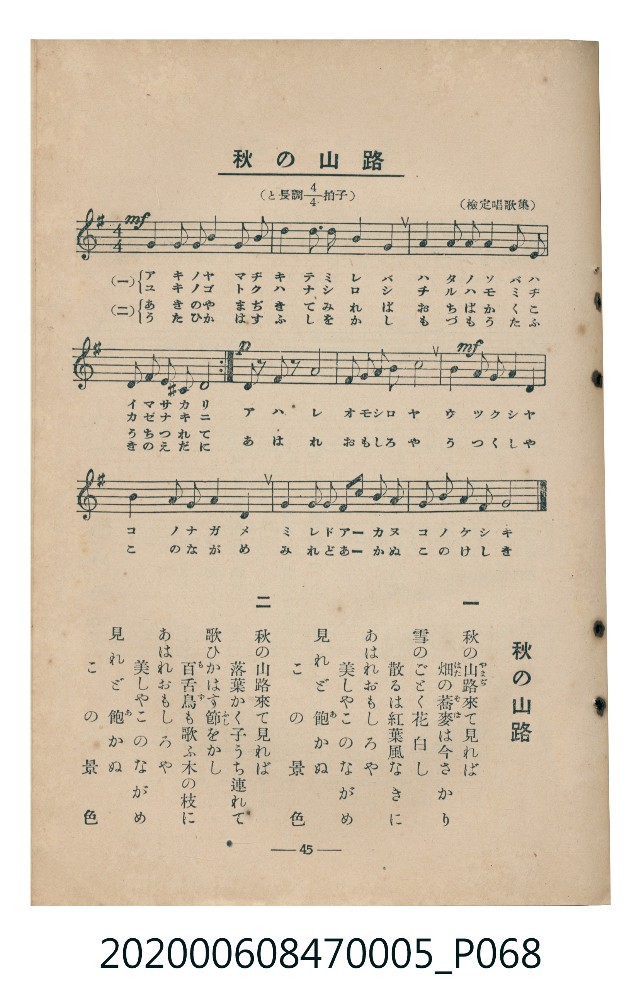

# 秋の山路

> Re:Shōka 使用 AI 協助辨識與重建樂譜，可能會有錯誤。歡迎回報。

- **NEUTRINO 歌聲合成版**：<br><audio controls src="aki_no_yamaji_neutrino.mp3"></audio>
- **鋼琴伴奏版**：<br><audio controls src="aki_no_yamaji.mp3"></audio>


- 臺灣教育會公認《新定兒童唱歌》尋常科第五學年用（2020.006.0847.0005）

## 說明

原書資訊與歌詞全文（對應 P068.jpg，書頁 p. 45，參考教材第 10 首）：
調性與拍號：と長調四分之四拍子（G 大調 4/4 拍）
出處：（檢定唱歌集）


## 歌詞

```text
一　秋の山路（やまぢ）來て見れば
畑（はた）の蕎麥（そば）は今さかり
雪のごとく花白し
散るは紅葉風なきに
あはれおもしろや
美しやこのながめ
見れど飽（あ）かぬ　この景色

二　秋の山路來て見れば
落葉かく子うち連れて
歌ひかはす節（ふし）をかし
百舌鳥（もず）も歌ふ木の枝に
あはれおもしろや
美しやこのながめ
見れど飽（あ）かぬ　この景色
```

## ABC

```abc
X:1
T:秋の山路
M:4/4
L:1/16
Q:1/4=96
K:G
V:V1 name="Piano" snm="Pia"
[V:V1]
B4 d3 B A4 B2 d2 | e4 d2 B2 A4 B4 | B4 A2 B2 G4 A2 G2 | E4 F2 ^G2 A8 |
w: 1.~ア キ ノ ヤ マ ヂ | キ テ ミ レ バ | ハ タ ノ ソ バ ハ | イ マ サ カリ
w: 2.~あ き の や ま ぢ | き て み れ ば | お ち ば か く こ | う ち つ れて
B4 d3 B A4 B2 d2 | e4 d2 B2 A4 B4 | B4 A2 B2 G4 A2 G2 | E4 F2 ^G2 A8 |
w: 1.~ユ キ ノ ゴ ト ク | ハ ナ シ ロ シ | チ ル ハ モ ミ ヂ | カ ゼ ナ キニ
w: 2.~う た ひ か は す | ふ し を か し | も ず も う た ふ | き の え だに
G2 z2 F2 z2 G8 | A2 A2 G2 A2 B8 | d4 e2 d2 B2 A2 G4 | A4 B2 d2 e4 d4 |
w: 1.~ア ハ レ | オ モ シ ロ ヤ | ウ ツ ク シ _ ヤ | コ ノ ナ ガ メ
w: 2.~あ は れ | お も し ろ や | う つ く し _ や | こ の な が め
B2 A2 G2 E2 D2 B2 A4 | d2 B2 A3 B G8 |
w: 1.~ミ レ ド ア _ カ ヌ | コ ノ ケ シ キ
w: 2.~み れ ど あ _ か ぬ | こ の け し き
```

## TMD 檔案連結

- [主旋律 TMD 檔案](aki_no_yamaji.tmd) [[在 TMD Studio 編輯](https://tmdlang.github.io/Tmd-TS/#tmd=s7IKdvYPcrWy4qpTUCpJTLdSSM7PyUlNLsnMz7MqzsjMK0nNjM_KTMmPL87Iz05Ugisry88pzU21Si9KTEmNN403MjAyiDcwMIs3sDAxBzIMTBFKi_NLi5JTrYqTM_Lzc-JLUitKkvLzsxHyBUX5Zal5iXlANQVFIBtTwIoQClLLMlNSQdKpKZkl-UWZiTlI7kgtKga7FWxJfElRYl5xclFmAcgDCFUlGalAxxanJhbn5xUTFAZakZ6ZZ5WbmpmVieReLS2F58u7Hzeue7px44vt6xW0tLgUbRUszbjsbRXcuWxM9E3sQEa8aN_1vHHxs6kzXzRtejan-Wnrmhereh83dD2btuHpullPWyc9X7306ZSNz9b2PG7ofrqh--mOHc-XT3y-Zs2TXVOert3xdOeW51NWvN_TAQpSPWCQ6oGCFMgwMH2_p1OJi0tfS8GWWoBLQUHhad_8Z7N3vNjc_mJF14uOdqC7Xqyc97R1xbNp7UBXPN3Q-6y9UyHAwMxCL6sg_f2eHqDilwsaFQr0FEyALup52t_8oqEZ6N1ncycAPaFgaKDwctk0oFPf75kFMv7Fqv3PGpaDDO7ufTFzPlD0ceOKl1O3A8Wfzp79tKPtyc5uIAMo-3TtBKCF7gpPlywHSioAw1MBKAo0CezK9l0vZk4F6gYqebZqESgkwWH4cnYbSAVIyZMdDY8bGpCjCKj2cVPL48Z9jxsXAVU92df2uHHZi2Xdj5t6HjduAOl5PnUiSFHj-seNQKd1AnW-mNr3ctdSsOBcoCKw4Ponu7seN0593AjU2QXS9nL2KqDSx41TgH553Nj_omvj85l7HzdOB8k9m7r4cRPQDeufb2l9MbHz5SKgCqDq3seNq0HSjxubQNaBXND1uAnInv64qRfoSrBr9vWB-UAnTwabD9TX87ipERyOUGevfLl4L9h1TWCnAS1aA_Q1RMOzmetfdG6CBMYuYPJCCQwsvn8xYS_QhWBD-oGh_7gRqGLhywag-4EqloE9A0yljZvAKoBBNPP5-gaw3VuBzgRZ3zQJLAX29_OZ-1509LzcDA47kMeAUQVU0QQ2YuuzOcBgWPdsHjBM6RUMQNWU5xAoUNDS5-JyzM70y49MzE3MyrQKyEzMy3eoMaipBtmjYGNopmUHZmHLngqg3L2j4dm6raAc1dkLSvgb-oGB-bRj7tOl_TpI2asTi26g3VCTNYCmaFopPG5aBBJ43LQWRDb3AfESsEDzPCDuUKgBkk0QFeuBzDYg7oLIrwFRIOkJEOn9EO1NeyHSE4C4HyTfBDdP-XHTViB_NYgPAcjO2dUDck4jxLLGXjC5Dqi8BSKwTwFUUALNA0sBqWVADLSzqQfC3QB1TiPEeY0LwWLA6IRw-4F4Mli-DSEPdBlUP4pzahSMFXTB0BRMGisYQfkgcZBYjYIZkgqQKLIKEESYAZIBsQ2R-CA20Ix4qJA5iGGojmQMDNaAHeRjCArHRVAxUFyBaWhsQUWBAQwim8BGw9SARNrA5HwwuQYuOgHuUFA8wUzeDzUXxN6LohaiChKfKDYC4xRErn7cvAq7441AoQ5yFlgTMPogNCRuYaL7wCTIi5AohokvA5NgZwFjCia6AeF4YHzDRBfC5UDRDhMFORsU9xDVoMBAVg3yDKSMwnA8EXnwaX_vi2XAWgM1J-5bSVZObF6GlhObtkByTgc480EiCizQBRTYDqRBKsFMaE5shEivBqt83AzJ2cCYB6UKUMyBc97jpj2QTAyxCXdOhGaU-WByEyIrAcuBxpngwNwKEZgONGoSQn461DlN0Kw8C8xEMg-kESkjAxNCYweIsWCI5ERgRMHyy1oIDY0tWL7oAMutBxuNlLuAgQ4S3w5mQ3TC-NDEDIxBmNrVYBKceIERCROF5GJYHgepgZixB8n8tY-bYakfzfHgnIjIASDDQDQkbmGiIGeDIhiSX0CZGyI-HWz4JDAboRokCnU8MJJhorPAakF8dPsgJqLm8XVgEhxojQuAlTqG4_HnxF09Lxb2PN3X87S360X7ZnDe7ASKKGiYKUAyJCIrapJSJcJyG7iigwCQL1eBIwSWAaHVJUIakombWyAVJlgVWAVIbjNEDlRsg7Iw2ODHzQuh0uCMugaIO8FOeNwMzKfAKH7cDK6hIPohKW0jSB_IaAI5GJoB14Mp5IoOUm5CsiUo9_bC6lmENDS3LgGXoBBVYBUguckQOVDGBYZGI6QGbgKXPiBpSK0MbFiBnQD2BzDFAJtVCP0QzRPBxgCNhhQFKP6oAWdNAyAG50kQA5Zv4QkDnElhuRiWu1FVQMoNXXApgVxCwMyCmAGCsBIFuTyBqEDWAy4pTEEEclkDsQchYozpVrSKHGQCJHtDWLCKGeFyUEqDZX7kQgNR5SOrhRdJwJQHK3wQRQtCDyQZwUTBFT202EA0DUA1I1QtUrMBlC5B6hDNEEgRBauVYSbDmg8boaogyRRraMBbBuAwAJc8YBa8pkfyIbieh5UpkLKoF0zC2hDIahFlDrh-h7YBYGUVQg8kMcLUQsohcKgD0zRMLaxIhqRsmOtAqRtEIso8UJkISuOoJsNMnQhVBUns6KFRy8Wla6eA1ClQAHKVuQA)]
- [鋼琴伴奏 TMD 檔案](aki_no_yamaji_piano.tmd) [[在 TMD Studio 編輯](https://tmdlang.github.io/Tmd-TS/#tmd=s7IKdvYPcrWy4tLSUni-vPtx47qnGze-2L7-_Z6Ol917nk_Y8mTPlqdL-593drzf06mgpcWlaKtgacZlb6vgzmVjom9ix1WnoPSifdfzxsXPps580bTp2Zzmp61rXqzqfdzQ9WzahqfrZj1tnfR89dKnUzY-W9vzuKH76Ybupzt2PF8-8fmaNU92TXm6dsfTnVueT1kBtNHIwMhAz8DATM_AwsQcyDAwBVqqxMXlmJ3plx-ZmJuYlWkVkJmYlx_k4VBjUFPNpQAENoZmWnZglr6Wgi06UADZsqPh2bqtQPOfdvY-nT376Yb-5-sbnnbMBfpLRyHAwMxCL6sgHeQ9TN1a-mCTaxSMFXTB0BRMGisYQfkgcZBYjYIZkgqQKLIKEESYAZIBsQ2R-CA20Ix4qJA5iGGojmQMDNaAHeRjWKPwuGkRVOxx01oI3dwHxEtgos3zwGQT2GiYGpBIG5icDybXwEUnwB36uLkfbvJ-qLkg9l4UtRBVIJPRbGzaCiZXP25ehd3xRkBNjSBngTU19kLpdUBNLXDRfWAS5EWQaogakMgyMAl2VlMPXHQDwvGNXXDRhXC5x43dcFGQsx83ToaqBgUGsmqQZ4AmQyxCdTwRqexpf--LZW3oaW3fyqGe1pphoYGS1pq2wESbO8By68FGI6WfZlBkPG7aDmZDdML40OhqboSrXQ0mwdHTDE_b0HQKS8UgNRAz9iCZv_ZxMyx-0RwPTmuIOAYZBqI3oaQIkLMfN86EWNEISr4Q8elgwyeB2QjVIFGo45sQqXgWWC2Ij24fxETUVLwOTIIDrXHB40aYrxCOx5_WdvW8WNjzdF_P096uF-2bwamvEyiioGGmAElyiMSmiS-pgZKCARCD0wCIAUsncIeAEwUs1cBSE6oKSDrVBadK5BQJMwtiBgjCUjBy-oWoQNYDTpmmIAI5bUPsQYgYY7oVrWgEmQBJThAWrKhDuPxxE6iEgiQ25ESKKESR1cKzQDOolIIkdkRSRugBqd0MFwUXndBkiihsQWUNVC1SQfy4uROsDlGwQ7IErJyDmQwrkDdCVW1HKt7RQgNe1oLDAJzSwSx42YnkQ3DJCUvDkLTfCyZhpTKyWkQaB5eY0FIVljcQekBqQWUtRC0k3YNDvRFeejfBigCQWkTJ_rhxJZhE5DFQHnzcCAtFmMkwUydCVU1HymmI0KjF0o7wQW5HmCCaEc879j6bMx3YHno2fSmoPbSw58nObmBx_qy79-naCU-3L3vW2Q1pGCFlpXiFaMNYYLoF0qbxsUAREyQRIA1RApKCKgWVwUCWWXxurIIRkGEEFKKRYQZIGuGGwnWCGCZIfLgKqKXY3INkvQEkdHXtFJACONoHqB5dCOgooJAyFwA)]

## 分析

```text
================================================================================
📊 TMD Song Profile: [ 秋の山路 ]
================================================================================
⏱  Duration:       0:35 (35.0s), 14 measures total
🎼 Key & Tempo:    首調基準 G, != 96.0 BPM, <4/4>
   - 分析範圍：      由實際發聲的音符與和弦推測調性；播放脈絡另行呈現
🎤 人聲音域:    D4 (MIDI 62) – E5 (MIDI 76) [跨度: 14 個半音 / 1.2 個八度, 難度: moderate]
   - 最低音:  D4 in [AkiNoYamaji #1 @ m.13, 0:31]
   - 最高音: E5 in [AkiNoYamaji #1 @ m.2, 0:02]
   - 適合: soprano, mezzo-soprano, contralto, tenor, baritone, bass
🏛  結構:      AkiNoYamaji (35.0s)
⚡ 編曲密度:        Peak 1 軌道同時演奏
🗝  調性診斷：       D 大調（純淨自然大調，未偵測到可信轉調）
   - 風格氣質:    純淨自然大調（陽光明朗、易唱易記，無明顯調外色彩）
   - 轉調歷程:    全曲維持單一推測調性（未偵測到可信轉調）
   - 核心骨幹音:  A, B, G, D, E
   - 調性數值:    D 大調 [相關度: 0.67, 穩定度: Moderate, 自然音純度: 98.2%]
   - 候選調性 (K-S): D 大調 (0.67), G 大調 (0.61), B 小調 (0.60)
   - 五度圈歷程:   +2
   - 各段落調性細節:
     • [AkiNoYamaji #1]: D 大調 (r: 0.67, 自然音純度: 98.2%, 調外音: G#)

  [ 五度圈游移軌跡 ]
               C  
         F            G  
      Bb              [D ]*
      Eb               A  
         Ab           E  
            Db       B  
               F# 
     (* = active key center)

  [ 十二半音累積音高分佈 ]
     C  :                            0.0%
     C# :                            0.0%
     D  : ████████████              13.6%
     D# :                            0.0%
     E  : █████████                 10.9%
     F  :                            0.0%
     F# : ██                         2.7%
     G  : ███████████████           17.3%
     G# : ██                         1.8%
     A  : ████████████████████████  27.7%
     A# :                            0.0%
     B  : ██████████████████████    25.9%
--------------------------------------------------------------------------------
Assignment 軌道音域：
  - Piano         : D4 – E5 (14 個半音 / 1.2 個八度, 73 個音符)
================================================================================
```


## 原書掃描頁




