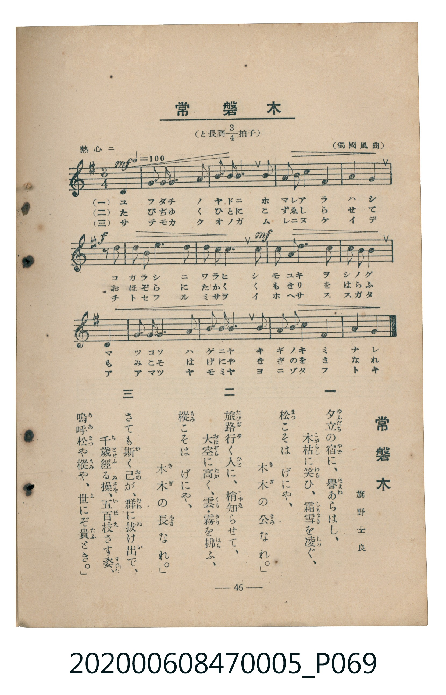

# 常磐木

<audio controls src="tokiwagi.mp3"></audio>

- 臺灣教育會公認《新定兒童唱歌》尋常科第五學年用（2020.006.0847.0005）

## 說明

原書資訊與歌詞全文（對應 P069.jpg，書頁 p. 46，參考教材第 11 首）：
調性與拍號：と長調四分之三拍子（G 大調 3/4 拍），熱心ニ（♩= 100）
出處與作歌：（獨國風曲）、旗野士良

## 歌詞

```text
一　夕立（ゆふだち）の宿（やど）に、譽（ほまれ）あらはし、
木枯（こがらし）に笑（わら）ひ、霜雪（しもゆき）を凌（しの）ぐ、
「松（まつ）こそは　げにや、
木木（きぎ）の公（きみ）なれ。」

二　旅路（たびぢ）行（ゆ）く人（ひと）に、梢（こずゑ）知（し）らせて、
大空（おほぞら）に高（たか）く、雲（くも）・霧（きり）を拂（はら）ふ、
「樅（もみ）こそは　げにや、
木木（きぎ）の長（をさ）なれ。」

三　さても斯（か）く己（おの）が、群（むれ）に拔（ぬ）け出（い）で、
千歲（ちとせ）經（ふ）る操（みさを）、五百枝（いほえ）さす姿（すがた）、
「嗚呼（ああ）松（まつ）や樅（もみ）や、
世（よ）にぞ貴（たふ）とき。」
```

## ABC

```abc
X:1
T:常磐木
C:TMD (Chen, Chih-Han / aguai)
M:3/4
L:1/16
Q:1/4=100
K:G
V:V1 name="Piano" snm="Pia"
[V:V1]
z4 z4 D4 | G3 G G4 A4 | B3 B B6 B2 | A2 B2 c4 F4 |
A4 G4 z2 d2 | d3 B e6 d2 | d2 c2 c6 c2 | c3 A d6 c2 |
c2 B2 B4 D4 | G3 G G4 A4 | B3 B B6 B2 | A2 B2 c4 F4 |
A4 G4 z4 |
```

## TMD 檔案連結

- [主旋律 TMD 檔案](tokiwagi.tmd)
- [鋼琴伴奏 TMD 檔案](tokiwagi_piano.tmd)

## 分析

```text
================================================================================
📊 TMD Song Profile: [ 常磐木 ]
================================================================================
⏱  Duration:       0:23 (23.4s), 13 measures total
🎼 Key & Tempo:    首調基準 G, != 100.0 BPM, <3/4>
   - 分析範圍：      由實際發聲的音符與和弦推測調性；播放脈絡另行呈現
🎤 人聲音域:    D4 (MIDI 62) – E5 (MIDI 76) [跨度: 14 個半音 / 1.2 個八度, 難度: moderate]
   - 最低音:  D4 in [Tokiwagi #1 @ m.1, 0:01]
   - 最高音: E5 in [Tokiwagi #1 @ m.6, 0:09]
   - 適合: soprano, mezzo-soprano, contralto, tenor, baritone, bass
🏛  結構:      Tokiwagi (23.4s)
⚡ 編曲密度:        Peak 1 軌道同時演奏
🗝  調性診斷：       G 大調（純淨自然大調，未偵測到可信轉調）
   - 風格氣質:    純淨自然大調（陽光明朗、易唱易記，無明顯調外色彩）
   - 轉調歷程:    全曲維持單一推測調性（未偵測到可信轉調）
   - 核心骨幹音:  B, C, G, D, A
   - 調性數值:    G 大調 [相關度: 0.81, 穩定度: High, 自然音純度: 100.0%]
   - 候選調性 (K-S): G 大調 (0.81), B 小調 (0.65), D 大調 (0.54)
   - 五度圈歷程:   +1
   - 各段落調性細節:
     • [Tokiwagi #1]: G 大調 (r: 0.81, 自然音純度: 100.0%)

  [ 五度圈游移軌跡 ]
               C  
         F           [G ]*
      Bb               D  
      Eb               A  
         Ab           E  
            Db       B  
               F# 
     (* = active key center)

  [ 十二半音累積音高分佈 ]
     C  : █████████████████         17.6%
     C# :                            0.0%
     D  : ████████████████          16.2%
     D# :                            0.0%
     E  : ████                       4.2%
     F  :                            0.0%
     F# : █████                      5.6%
     G  : ████████████████          16.9%
     G# :                            0.0%
     A  : ██████████████            14.8%
     A# :                            0.0%
     B  : ████████████████████████  24.6%
--------------------------------------------------------------------------------
Assignment 軌道音域：
  - Piano         : D4 – E5 (14 個半音 / 1.2 個八度, 46 個音符)
================================================================================
```


## 原書掃描頁




