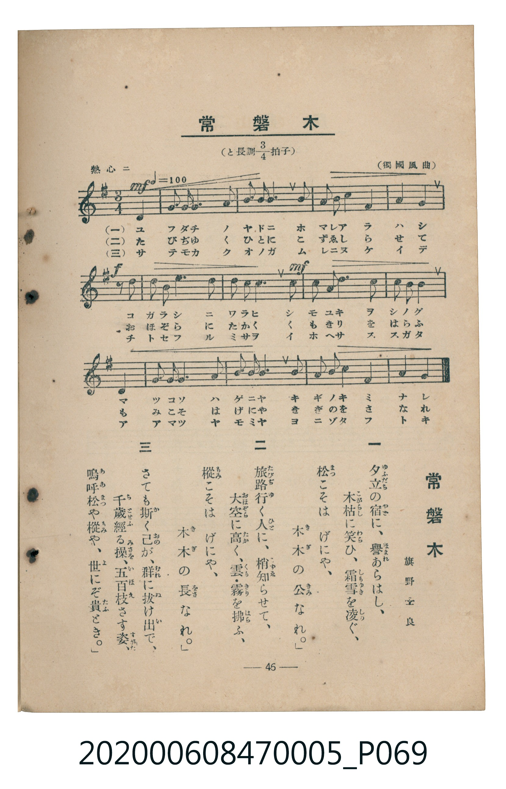

# 常磐木

> Re:Shōka 使用 AI 協助辨識與重建樂譜，可能會有錯誤。歡迎回報。

- **鋼琴伴奏版**：<br><audio controls src="tokiwagi.mp3"></audio>
- **NEUTRINO 歌聲合成版**：<br><audio controls src="tokiwagi_neutrino.mp3"></audio>

- 臺灣教育會公認《新定兒童唱歌》尋常科第五學年用（2020.006.0847.0005）

## 說明

原書資訊與歌詞全文（對應 P069.jpg，書頁 p. 46，參考教材第 11 首）：
調性與拍號：と長調四分之三拍子（G 大調 3/4 拍），熱心ニ（♩= 100）
出處與作歌：（獨國風曲）、旗野士良


## 歌詞

```text
一　夕立（ゆふだち）の宿（やど）に、譽（ほまれ）あらはし、
木枯（こがらし）に笑（わら）ひ、霜雪（しもゆき）を凌（しの）ぐ、
「松（まつ）こそは　げにや、
木木（きぎ）の公（きみ）なれ。」

二　旅路（たびぢ）行（ゆ）く人（ひと）に、梢（こずゑ）知（し）らせて、
大空（おほぞら）に高（たか）く、雲（くも）・霧（きり）を拂（はら）ふ、
「樅（もみ）こそは　げにや、
木木（きぎ）の長（をさ）なれ。」

三　さても斯（か）く己（おの）が、群（むれ）に拔（ぬ）け出（い）で、
千歲（ちとせ）經（ふ）る操（みさを）、五百枝（いほえ）さす姿（すがた）、
「嗚呼（ああ）松（まつ）や樅（もみ）や、
世（よ）にぞ貴（たふ）とき。」
```

## ABC

<div class="abc-score" data-abc-src="tokiwagi.abc" aria-label="五線譜載入中"></div>

[下載 ABC 原始檔](tokiwagi.abc)

## TMD 檔案連結

- [主旋律 TMD 檔案](tokiwagi.tmd) [[在 TMD Studio 編輯](https://tmdlang.github.io/Tmd-TS/#tmd=s7IKdvYPcrWy4qpTUCpJTLdSSM7PyUlNLsnMz7MqzsjMK0nNjM_KTMmPL87Iz05Ugisry88pzU21Si9KTEmNN403MjAyiDcwMIs3sDAxBzIMTBFKi_NLi5JTrYqTM_Lzc-JLUitKkvLzsxHyBUX5Zal5iXlANQVFIBtTwIoQClLLMlNSQdKpKZkl-UWZiTlI7kgtKga7FWxJfElRYl5xclFmAcgDCFUlGalAxxbkJOYhGQs0KT0zzyo3NTMrE4uzoNLlqcUlqUV58bmpOfkplcjSJRn5QO8XZFRaZWQWg9yVnJgTn52YhxRKUFcVJKanWgUYmFkqcWlpKTzdseP54gnP5qxQ0NLiUrRVMDQw4LK3VXDnsjHWN7ED6X3Rvut54-JnU2e-aNr0bE7z09Y1L1b1Pm7oejZtw9N1s562Tnq-eunTKRufre153ND9dEM3yMTlE5-vWfNk15Sna3c83bnl-ZQV7_d0gGJFDxgreqBYATIMTN_v6VTi4tLXUrClFuBSUFB42jf_2ewdLza3v1jR9aKjHeiuFyvnPW1d8WxaO9AVTzf0PmvvVAD5Xy-rIP39nh6g4pcLGhUK9BRMzIDcp_3NLxqagd59NncC0BMKhoYKL5dNAzr1_Z5ZIONfrNr_rGE5yODu3hcz5wNFHzeueDl1O1D86ezZTzvanuzsfrKjEyj7dO0EoIXuCk-XLAdKKgDDUwEoCjap53nbxqf7mx83dwNVPJq5EhzuQBmw-9t3vZg5FWjBk71zgI4HWgBU87x3xdM53S8XrXg2exNQ3eOGxmfTp79s73u6ePWLzvVcIH1PdjQ8bmh4umTq89UgUx83tT1u3Pq4ccHjxoUgHY3rnq7bDxZvedy4EiyyGmjMi7V7QYKNux837nvcBLQNKN70uAlIrn_cOB2oAGQ0MHk8m7cerG7y48YesPR0iBHP10wEG9oPFASLbALqeTlnzsvZq8Dqpz9uAhoHdArI44-bJj1tB9oBFm9cB1Y_AWrH44aeZ3P3geX2PW5cApYDWjYX5JCGhseNk0DuBbod4aI5oFQFNPhxYx_Ug61rYCJAnwJFVgF99Lih6XFDLySEdgF5Dc-mt77YDvHM_MeNmx83LgKqfbEQ7KymNrC-_ie7doEVbALGLTyoni0CqoQEwazHTUBvdz6fvxTiGbDfgMpmP25cBnUhMNafr4SY0gUO3nmwEFr9cvUMmPXAmALZBwozUMQCBYEB2QQSbN79cs5yqHeauiCB96wbKAUUWQ8zaitS4K1oBfugCeZ5EgMPmITB-oFKp2INvB3AVAc0airIi01Nz6ZBghDqgafbN8K8ColWoNbG5_uA0Qg0sgGWsFY_654CVgaMJyB3IjCpg7ktYO5yWMj1Nj9bCwmMhcDwB4YqKKi3TQaLbAWHRPezycD0BOTuBzmoaRIkSwALnOcz9z2bNxdiKDjUO8BGAx098-lycPJvnAlyXCMw44K0QAPv6fRZTyfuAUsDww8U_uhpsakFPYDhwflkB7B4AEpArFoNjOkXm7bAIhjsXpAngEUmOCyBGigv56BAQUufiyskPzuzPDE90yogMzEv36HGoKYaZImCjaGZlh2Yha2EVQAV0DsagOn-RftmcGHdA2QDSzpgEaWgYarwdEP_8_UNOvCCUhOLEUDbocZrAI3StAJxkMHj5mUgqgbImArmNgBxI0SmDyazBMztBOJuuLbZYJl5QLxG4XHTIojgSpiOfjC_aTdMedNmFJfs6sHiksb5UN2Nm8HcRUBtbRAZsHEgmU1g7gogXg3XNhksMwuoeiKQng6xrxOmYzZEEdiXYFYXaph0YnFJ01ao7maQ_Y-bQS4B2_e4aT1UpmkVWKYPyFoD09a8AKwHGB7AcHrc3APRsRGmAxSKQOF2uPJGmEtqFAwUdMEQRpvGQxk1CoZg2hBK6yoYwWWMwbQxlIZAELsGrAbEMoGKmiOMg2mHGQey0RQkA3aJj2GNAkwtjAYlEZhuUCqBiEHSCUxFH5KKJVAxSHpBOA2UZiAq5oF5a0AkMOXAZFcimdEPE23ajuQaUDKCu9QIi0uBSQhuBjAVQcQg6QimAmYyJDVBxCDpCcmlwDQFUTELbOtEsNh0uJs6kcwA-QmiBxZKYJcCkxncpcZYXApMYgjfQlwHS2cwFesRKoCpDRbOoPSGHKYLoGaAQxMc3qCUBzNjI5IZkHgBybcjuxQcizXg-gN3KQQueRQ0TMgrcyB5BBTDoPiEJf9usLvXQ8SbJ8Ez33awOKhEAaW8x01r4To2gf2xHRoOGyCC80AURuECrFhAso3AAgpSFoB5q8FRNh-IgRkUUqqAxfvBBjeB2b1AVhfcMZPAOoCOBJoCrCkggiCFmKXI4-YOsOxuaFkKcR7YymaglcAYB_kAZvASsDiodHrcPANW5IBldoIdsxMcao-b9kMEwQUsvLgAZVhQDjdDSgrgTAwmQbkelvNBEMSugYoYQfWiy4BKC1g5gih84GUCLNXB4hA5BYLSHCQmYbkYFJtIKsDqIXEK0QGJVWQzQDkRErew0gQUvzBZUHmB5B5gzgdFLyTXQSIYySxwToZEM4gHzhHwXA9RAeJBIhzCh0Q5sotB7odEPCy_gyIfJgvRh5y_QXEPkYPEPrLfoO4BpgFYvof4F2EbKGdCUgOEDyyP4OUDRGQn1MUgGhIXoJQBk4WVoYRy8Q5QG5r8XNzcAk6Km4F4LyRxw-rlJnC9DK71wLUcWN1asMw6aG4F52JQIEB0NIOzGKjYggMseRiU-EGFMbCZDFYOjA-I9kZQcQGKamATD2YhMBpBMkDLGoGWAqMQLAjOiSBxUIUNFAbXypgWQnIwOJtBWjVgY6HeQZRHwHyM8GHzCrAM0NdN--A5FZL1ISkCGgzoFtKlTkdKn6D8C_QPJK1AYg-WNpFqQ2AcQsQgsYic-tZCVawDy0NyJ0gMoh6pzgXGKkwUVkuhlSXgvAtJubCIheoA5zWoOcDohYhBIhjJLcBIhqgAuwIY0bDcCpGF5TxIhMPcD6sP0dwCyrfQvAOLc5jrYf5HLrUgcY_kFmD8Q1SAyxhgGkDJlfBSAFE6IIcbwi21XFy6dgqwLoICkK3MBQA)]
- [鋼琴伴奏 TMD 檔案](tokiwagi_piano.tmd) [[在 TMD Studio 編輯](https://tmdlang.github.io/Tmd-TS/#tmd=s7IKdvYPcrWy4qpTUCpJTLdSyC8qychPL0osyKi0ysgsLskvykxOzInPTsxLVIIrKs4vLUpOjS9ITE-1CjAws1Ti0tJSeLpjx_PFE57NWfF-T8fL7j3PJ2x5smfL06X9zzs73u_pVNDS4lK0VTA0MOCyt1Vw57Ix1jexAxn4on3X88bFz6bOfNG06dmc5qeta16s6n3c0PVs2oan62Y9bZ30fPXSp1M2Plvb87ih--mGbpA1yyc-X7Pmya4pT9fueLpzy_MpICuNDIwM9AwMzPQMLEzMgQwDU6CtSlxcIfnZmeWJ6ZlWAZmJeflBHg41BjXVXApAYGNopmUHZulrKdiiAwWQFTsaXizsedG-GWxdD5D9ctm0Z929ChqmCk839D9f36CjAPK_XlZBuiYWI7T0wcbXKBgo6IIhjDaNhzJqFAzBtCGU1lUwgssYg2ljKA2BIHYNWA2IZQIVNUcYB9MOMw5koylIBuwSH8MaBZhaGP24eRlc9-PmqVCxBiBuhKvoQ1KxBCrWCcTdSE573DwbqmIemLcGRDYtgsuuRDKjHybatB3JNY-bNiNcaoTFpY3zEWY0gtSCxBYB9bXBVcBMBqnYBBVbAcSrkV3aOBmqYhbY1olgselwN3UimQHyE0QPLJTALm3sQrjUGItLm7Yi-RbiusfNIJfC3PG4aT1CRdMqqIo-IBsUbogwXQA1Axya4PB-3NwDN2MjkhmQeAHJtyO7FByLNVz40zk4bStomJCWqkHpCpQQzZBcDE5rYBKUOGEJFARB7BqoiBFUL7oMKFHDkjsij8CTLixwQIkJkXQgIqCgAQUUKFghie1x8yRkFWD1IBWQJAlK9o-b1qKYAUowIFtAKiGJ_nHTBrgsKFkjuQeYQB837obINc5DSjYQEVBEg1SAkuzjRnDEwRMnRAWIB7KtCcrvBbJByQrhYpD7QWaA_QQ2_3EjLGHB9CEnw8fNHVC53fCsDHM91D3NYPeAkyfEvwjbQAkIpAKS5B83AbMNPBlDRHZCXQyiIXHxuGk_XBaW1Qklth2d5CQ2OpSTSIEJSmzNLVCPbQbivfCARCphmqAlDDDxwcpFWGCshapYB5aHJCWQGEQ9UjnWDItySB4HQbSED05okGAGlVyPG-fCdIATBtScRkhiByW8x00Ql8NU9UJVgF3RCHYROGlBZGHJBKQCUg6B5GFlDJpbQIkMGtGgDAELIxAP5n_kLDYfPVyaV0BVgDNE0z4wCU9C8CSLSMrI4YZwSy16ve6DXK-bIKr1F31dL9t7n-1a_WzWtCc7u5_u2_50TvfTps3Pt258tmHiizULgKkRWKE_XTvh6fZlzzq7IU2W93t6gO2Nlwt6ns3d92xFK7DJ8XLuJKD2l6tnPNs75dmGxcBki1y5gyAwhcYrRBvGKkSbxsci8YAYWB7GA3kgcVRJoC5Y6oaqNsGmmmjdpNkMDERdOwVYOEb7AIVR-EZofGMwX5kLAA)]

## 分析

```text
================================================================================
📊 TMD Song Profile: [ 常磐木 ]
================================================================================
⏱  Duration:       0:23 (23.4s), 13 measures total
🎼 Key & Tempo:    首調基準 G, != 100.0 BPM, <3/4>
   - 分析範圍：      由實際發聲的音符與和弦推測調性；播放脈絡另行呈現
🎤 人聲音域:    D4 (MIDI 62) – E5 (MIDI 76) [跨度: 14 個半音 / 1.2 個八度, 難度: moderate]
   - 最低音:  D4 in [Tokiwagi #1 @ m.1, 0:01]
   - 最高音: E5 in [Tokiwagi #1 @ m.6, 0:09]
   - 適合: soprano, mezzo-soprano, contralto, tenor, baritone, bass
🏛  結構:      Tokiwagi (23.4s)
⚡ 編曲密度:        Peak 1 軌道同時演奏
🗝  調性診斷：       G 大調（純淨自然大調，未偵測到可信轉調）
   - 風格氣質:    純淨自然大調（陽光明朗、易唱易記，無明顯調外色彩）
   - 轉調歷程:    全曲維持單一推測調性（未偵測到可信轉調）
   - 核心骨幹音:  B, C, G, D, A
   - 調性數值:    G 大調 [相關度: 0.81, 穩定度: High, 自然音純度: 100.0%]
   - 候選調性 (K-S): G 大調 (0.81), B 小調 (0.65), D 大調 (0.54)
   - 五度圈歷程:   +1
   - 各段落調性細節:
     • [Tokiwagi #1]: G 大調 (r: 0.81, 自然音純度: 100.0%)

  [ 五度圈游移軌跡 ]
               C  
         F           [G ]*
      Bb               D  
      Eb               A  
         Ab           E  
            Db       B  
               F# 
     (* = active key center)

  [ 十二半音累積音高分佈 ]
     C  : █████████████████         17.6%
     C# :                            0.0%
     D  : ████████████████          16.2%
     D# :                            0.0%
     E  : ████                       4.2%
     F  :                            0.0%
     F# : █████                      5.6%
     G  : ████████████████          16.9%
     G# :                            0.0%
     A  : ██████████████            14.8%
     A# :                            0.0%
     B  : ████████████████████████  24.6%
--------------------------------------------------------------------------------
Assignment 軌道音域：
  - Piano         : D4 – E5 (14 個半音 / 1.2 個八度, 46 個音符)
================================================================================
```


## 原書掃描頁




