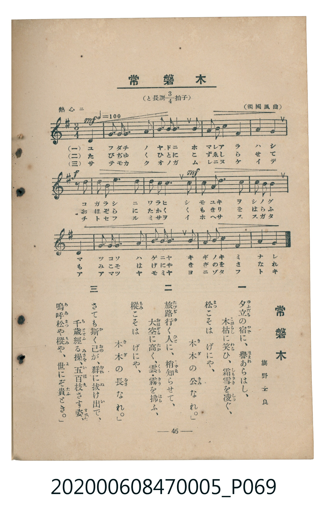

# 常磐木

> Re:Shōka 使用 AI 協助辨識與重建樂譜，可能會有錯誤。歡迎回報。

<audio controls src="tokiwagi.mp3"></audio>

- 臺灣教育會公認《新定兒童唱歌》尋常科第五學年用（2020.006.0847.0005）

## 說明

原書資訊與歌詞全文（對應 P069.jpg，書頁 p. 46，參考教材第 11 首）：
調性與拍號：と長調四分之三拍子（G 大調 3/4 拍），熱心ニ（♩= 100）
出處與作歌：（獨國風曲）、旗野士良


## 歌詞

```text
一　夕立（ゆふだち）の宿（やど）に、譽（ほまれ）あらはし、
木枯（こがらし）に笑（わら）ひ、霜雪（しもゆき）を凌（しの）ぐ、
「松（まつ）こそは　げにや、
木木（きぎ）の公（きみ）なれ。」

二　旅路（たびぢ）行（ゆ）く人（ひと）に、梢（こずゑ）知（し）らせて、
大空（おほぞら）に高（たか）く、雲（くも）・霧（きり）を拂（はら）ふ、
「樅（もみ）こそは　げにや、
木木（きぎ）の長（をさ）なれ。」

三　さても斯（か）く己（おの）が、群（むれ）に拔（ぬ）け出（い）で、
千歲（ちとせ）經（ふ）る操（みさを）、五百枝（いほえ）さす姿（すがた）、
「嗚呼（ああ）松（まつ）や樅（もみ）や、
世（よ）にぞ貴（たふ）とき。」
```

## ABC

```abc
X:1
T:常磐木
M:3/4
L:1/16
Q:1/4=100
K:G
V:V1 name="Piano" snm="Pia"
[V:V1]
z4 z4 D4 | G3 G G4 A4 | B3 B B6 B2 | A2 B2 c4 F4 |
w: 1.~ユ | フ ダ チ ノ | ヤ ド ニ ホ | マ レ ア ラ
w: 2.~た | び ぢ ゆ く | ひ と に こ | ず ゑ し ら
w: 3.~サ | テ モ カ ク | オ ノ ガ ム | レ ニ ヌ ケ
A4 G4 z2 d2 | d3 B e6 d2 | d2 c2 c6 c2 | c3 A d6 c2 |
w: 1.~ハ シ コ | ガ ラ シ ニ | ワ ラ ヒ シ | モ ユ キ ヲ
w: 2.~せ て お | ほ ぞ ら に | た か く く | も き り を
w: 3.~イ デ チ | ト セ フ ル | ミ サ ヲ イ | ホ エ サ ス
c2 B2 B4 D4 | G3 G G4 A4 | B3 B B6 B2 | A2 B2 c4 F4 |
w: 1.~シ ノ グ マ | ツ コ ソ ハ | ゲ ニ ヤ キ | ギ ノ キ ミ
w: 2.~は ら ふ も | み こ そ は | げ に や き | ぎ の を さ
w: 3.~ス ガ タ ア | ア マ ツ ヤ | モ ミ ヤ ヨ | ニ ゾ タ フ
A4 G4 z4 |
w: 1.~ナ レ
w: 2.~な れ
w: 3.~ト キ
```

## TMD 檔案連結

- [主旋律 TMD 檔案](tokiwagi.tmd) [[在 TMD Studio 編輯](https://tmdlang.github.io/Tmd-TS/#tmd=s7IKdvYPcrWy4qpTUCpJTLdSSM7PyUlNLsnMz7MqzsjMK0nNjM_KTMmPL87Iz05Ugisry88pzU21Si9KTEmNN403MjAyiDcwMIs3sDAxBzIMTBFKi_NLi5JTrYqTM_Lzc-JLUitKkvLzsxHyBUX5Zal5iXlANQVFIBtTwIoQClLLMlNSQdKpKZkl-UWZiTlI7kgtKga7FWxJfElRYl5xclFmAcgDCFUlGalAxxbkJOYBjdXSUni6Y8fzxROezVmhoKXFpWirYGhgwGVvq-DOZWOsb2IH0vaifdfzxsXPps580bTp2Zzmp61rXqzqfdzQ9WzahqfrZj1tnfR89dKnUzY-W9vzuKH76YZukInLJz5fs-bJrilP1-54unPL8ykr3u_pAAWMHjBg9EABA2QYmL7f06nExaWvpWBLLcCloKDwtG_-s9k7Xmxuf7Gi60VHO9BdL1bOe9q64tm0dqArnm7ofdbeqRBgYGapl1WQ_n5PD1DxywWNCgV6CiZmQO7T_uYXDc1A7z6bOwHoCQVDQ4WXy6YBnfp-zyyQ8S9W7X_WsBxkcHfvi5nzgaKPG1e8nLodKP509uynHW1PdnY_2dEJlH26dgLQQneFp0uWAyUVgOGpABQFm9TzvG3j0_3Nj5u7gSoezVwJDnegDNj97btezJwKtODJ3jlAxwMtAKp53rvi6Zzul4tWPJu9CajucUPjs-nTX7b3PV28-kXnei6Qvic7Gh43NDxdMvX5apCpj5vaHjdufdy44HHjQpCOxnVP1-0Hi7c8blwJFlkNNObF2r0gwcbdjxv3PW4C2gYUb3rcBCTXP26cDlQAMhqYPJ7NWw9WN_lxYw9YejrEiOdrJoIN7QcKgkU2AfW8nDPn5exVYPXTHzcBjQM6BeTxx02TnrYD7QCLN64Dq58AteNxQ8-zufvAcvseNy4BywEtmwtySEPD48ZJIPcC3Y5w0RxQqgIa_LixD-rB1jUwEaBPgSKrgD563ND0uKEXEkK7gLyGZ9NbX2yHeGb-48bNjxsXAdW-WAh2VlMbWF__k127wAo2AeMWHlTPFgFVQoJg1uMmoLc7n89fCvEM2G9AZbMfNy6DuhAY689XQkzpAgfvPFgIrX65egbMemBMgewDhRkoYoGCwIBsAgk27345ZznUO01dkMB71g2UAoqshxm1FSnwVrSCfdAE8zyJgQdMwmD9QKVTsQbeDmCqAxo1FeTFpqZn0yBBCPXA0-0bYV6FRCtQa-PzfcBoBBrZAEtYq591TwErA8YTkDsRmNTB3BYwdzks5Hqbn62FBMZCYPgDQxUU1Nsmg0W2gkOi-9lkYHoCcveDHNQ0CZIlgAXO85n7ns2bCzEUHOodYKOBjp75dDk4-TfOBDmuEZhxQVqggfd0-qynE_eApYHhBwp_9LTY1IIewPDgfLIDWDwAJSBWrQbG9ItNW2ARDHYvyBPAIhMclkANlJdzUKCgpc_FFZKfnVmemJ5pFZCZmJfvUGNQUw2yRMHG0EzLDszCVsIqgAroHQ3AdP-ifTO4sO4BsoElHbCIUtAwVXi6of_5-gYdeEGpicUIoO1Q4zWARmlagTjI4HHzMhBVA2RMBXMbgLgRItMHk1kC5nYCcTdc22ywzDwgXqPwuGkRRHAlTEc_mN-0G6a8aTOKS3b1YHFJ43yo7sbNYO4ioLY2iAzYOJDMJjB3BRCvhmubDJaZBVQ9EUhPh9jXCdMxG6II7Eswqws1TDqxuKRpK1R3M8j-x80gl4Dte9y0HirTtAos0wdkrYFpa14A1gMMD2A4PW7ugejYCNMBCkWgcDtceSPMJTUKBgq6YAijTeOhjBoFQzBtCKV1FYzgMsZg2hhKQyCIXQNWA2KZQEXNEcbBtMOMA9loCpIBu8THsEYBphZGg5IITDcolUDEIOkEpqIPScUSqBgkvSCcBkozEBXzwLw1IBKYcmCyK5HM6IeJNm1Hcg0oGcFdaoTFpcAkBDcDmIogYpB0BFMBMxmSmiBikPSE5FJgmoKomAW2dSJYbDrcTZ1IZoD8BNEDCyWwS4HJDO5SYywuBSYxhG8hroOlM5iK9QgVwNQGC2dQekMO0wVQM8ChCQ5vUMqDmbERyQxIvIDk25FdCo7FGnD9gbsUApc8Chom5JU5kDwCimFQfMKSfzfY3esh4s2T4JlvO1gcVKKAUt7jprVwHZvA_tgODYcNEMF5IAqjcAFWLCDZRmABBSkLwLzV4CibD8TADAopVcDi_WCDm8DsXiCrC-6YSWAdQEcCTQHWFBBBkELMUuRxcwdYdje0LIU4D2xlM9BKYIyDfAAzeAlYHFQ6PW6eAStywDI7wY7ZCQ61x037IYLgAhZeXIAyLCiHmyElBXAmBpOgXA_L-SAIYtdARYygetFlQKUFrBxBFD7wMgGW6mBxiJwCQWkOEpOwXAyKTSQVYPWQOIXogMQqshmgnAiJW1hpAopfmCyovEByDzDng6IXkusgEYxkFjgnQ6IZxAPnCHiuh6gA8SARDuFDohzZxSD3QyIelt9BkQ-ThehDzt-guIfIQWIf2W9Q9wDTACzfQ_yLsA2UMyGpAcIHlkfw8gEishPqYhANiQtQyoDJwspQQrl4B6gNTX4ubm4BJ8XNQLwXkrhh9XITuF4G13rgWg6sbi1YZh00t4JzMSgQIDqawVkMVGzBAZY8DEr8oMIY2EwGKwfGB0R7I6i4AEU1sIkHsxAYjSAZoGWNQEuBUQgWBOdEkDiowgYKg2tlTAshORiczSCtGrCxUO8gyiNgPkb4sHkFWAbo66Z98JwKyfqQFAENBnQL6VKnI6VPUP4F-geSViCxB0ubSLUhMA4hYpBYRE59a6Eq1oHlIbkTJAZRj1TnAmMVJgqrpdDKEnDehaRcWMRCdYDzGtQcYPRCxCARjOQWYCRDVIBdAYxoWG6FyMJyHiTCYe6H1YdobgHlW2jegcU5zPUw_yOXWpC4R3ILMP4hKsBlDDANoORKeCmAKB2Qww3hllouLl07BVgXQQHIVuYCAA)]
- [鋼琴伴奏 TMD 檔案](tokiwagi_piano.tmd) [[在 TMD Studio 編輯](https://tmdlang.github.io/Tmd-TS/#tmd=s7IKdvYPcrWy4tLSUni6Y8fzxROezVnxfk_Hy-49zydsebJny9Ol_c87O97v6VTQ0uJStFUwNDDgsrdVcOeyMdY3seOqU1B60b7reePiZ1Nnvmja9GxO89PWNS9W9T5u6Ho2bcPTdbOetk56vnrp0ykbn63tedzQ_XRDN8ia5ROfr1nzZNeUp2t3PN255fkUkJVGBkYGegYGZnoGFibmQIaBKdBWJS6ukPzszPLE9EyrgMzEvPwgD4cag5pqLgUgsDE007IDs_S1FGzRgQLIih0NLxb2vGjfDLauB8h-uWzas-5eBQ1Thacb-p-vb9BRCDAws9TLKkjXxGKElj7Y-BoFAwVdMITRpvFQRo2CIZg2hNK6CkZwGWMwbQylIRDErgGrAbFMoKLmCONg2mHGgWw0BcmAXeJjWKMAUwujHzcvg-t-3DwVKtYAxI1wFX1IKpZAxTqBuBvJaY-bZ0NVzAPz1oDIpkVw2ZVIZvTDRJu2I7nmcdNmhEuNsLi0cT7CjEaQWpDYIqC-NrgKmMkgFZugYiuAeDWySxsnQ1XMAts6ESw2He6mTiQzQH6C6IGFEtiljV0IlxpjcWnTViTfQlz3uBnkUpg7HjetR6hoWgVV0Qdkg8INEaYLoGaAQxMc3o-be-BmbEQyAxIvIPl2ZJeCY7GGC386B6dtBQ0T0lI1KF2BEqIZkovBaQ1MghInLIGCIIhdAxUxgupFlwElalhyR-QReNKFBQ4oMSGSDkQEFDSggAIFKySxPW6ehKwCrB6kApIkQcn-cdNaFDNACQZkC0glJNE_btoAlwUlayT3ABPo48bdELnGeUjJBiICimiQClCSfdwIjjh44oSoAPFAtjVB-b1ANihZIVwMcj_IDLCfwOY_boQlLJg-5GT4uLkDKrcbnpVhroe6pxnsHnDyhPgXYRsoAYFUQJL84yZgtoEnY4jITqiLQTQkLh437YfLwrI6ocS2o5OcxEaHchIpMEGJrbkF6rHNQLwXHpBIJUwTtIQBJj5YuQgLjLVQFevA8pCkBBKDqEcqx5phUQ7J4yCIlvDBCQ0SzKCS63HjXJgOcMKAmtMISeyghPe4CeJymKpeqAqwKxrBLgInLYgsLJmAVEDKIZA8rIxBcwsokUEjGpQhYGEE4sH8j5zF5qOHS_MKqApwhmjaBybhSQieZBFJGTncEG6pRa_XfZDrdRNEtf6ir-tle--zXaufzZr2ZGf3033bn87pftq0-fnWjc82THyxZgEwNQIr9KdrJzzdvuxZZzekyfJ-Tw-wvfFyQc-zufuerWgFNjlezp0E1P5y9Yxne6c827AYmGyRK3cQBKbQeIVow1iFaNP4WCQeEAPLw3ggDySOKgnUBUvdUNUm2FQTrZs0m4GBqGunAAvHaB-gMArfCI1vDOYrcwEA)]

## 分析

```text
================================================================================
📊 TMD Song Profile: [ 常磐木 ]
================================================================================
⏱  Duration:       0:23 (23.4s), 13 measures total
🎼 Key & Tempo:    首調基準 G, != 100.0 BPM, <3/4>
   - 分析範圍：      由實際發聲的音符與和弦推測調性；播放脈絡另行呈現
🎤 人聲音域:    D4 (MIDI 62) – E5 (MIDI 76) [跨度: 14 個半音 / 1.2 個八度, 難度: moderate]
   - 最低音:  D4 in [Tokiwagi #1 @ m.1, 0:01]
   - 最高音: E5 in [Tokiwagi #1 @ m.6, 0:09]
   - 適合: soprano, mezzo-soprano, contralto, tenor, baritone, bass
🏛  結構:      Tokiwagi (23.4s)
⚡ 編曲密度:        Peak 1 軌道同時演奏
🗝  調性診斷：       G 大調（純淨自然大調，未偵測到可信轉調）
   - 風格氣質:    純淨自然大調（陽光明朗、易唱易記，無明顯調外色彩）
   - 轉調歷程:    全曲維持單一推測調性（未偵測到可信轉調）
   - 核心骨幹音:  B, C, G, D, A
   - 調性數值:    G 大調 [相關度: 0.81, 穩定度: High, 自然音純度: 100.0%]
   - 候選調性 (K-S): G 大調 (0.81), B 小調 (0.65), D 大調 (0.54)
   - 五度圈歷程:   +1
   - 各段落調性細節:
     • [Tokiwagi #1]: G 大調 (r: 0.81, 自然音純度: 100.0%)

  [ 五度圈游移軌跡 ]
               C  
         F           [G ]*
      Bb               D  
      Eb               A  
         Ab           E  
            Db       B  
               F# 
     (* = active key center)

  [ 十二半音累積音高分佈 ]
     C  : █████████████████         17.6%
     C# :                            0.0%
     D  : ████████████████          16.2%
     D# :                            0.0%
     E  : ████                       4.2%
     F  :                            0.0%
     F# : █████                      5.6%
     G  : ████████████████          16.9%
     G# :                            0.0%
     A  : ██████████████            14.8%
     A# :                            0.0%
     B  : ████████████████████████  24.6%
--------------------------------------------------------------------------------
Assignment 軌道音域：
  - Piano         : D4 – E5 (14 個半音 / 1.2 個八度, 46 個音符)
================================================================================
```


## 原書掃描頁




