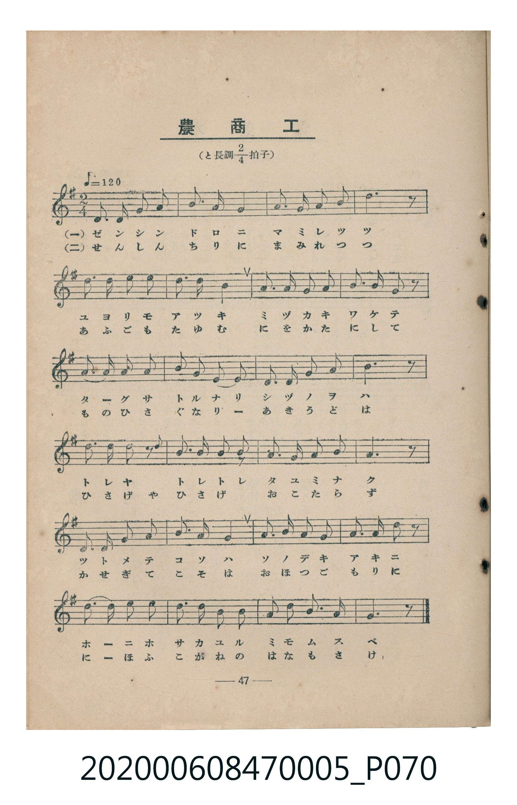
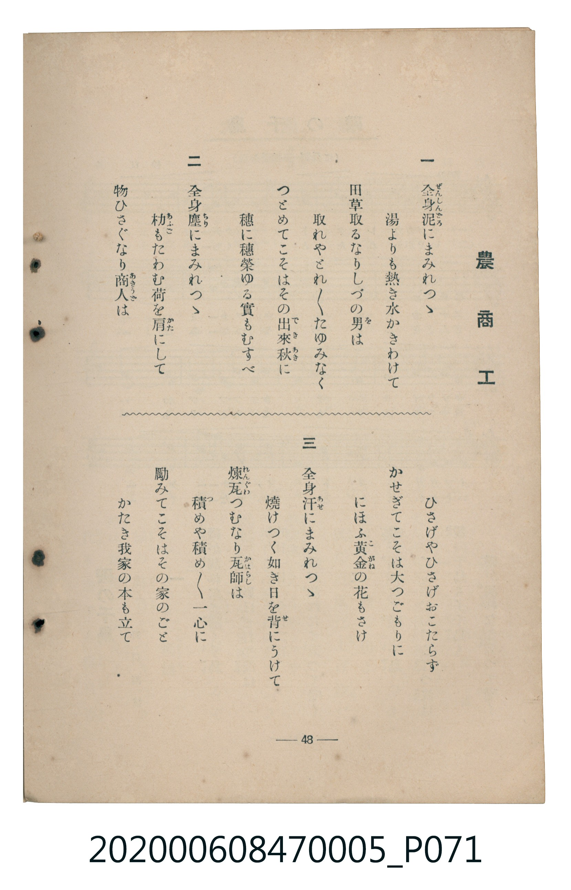

# 農商工

> Re:Shōka 使用 AI 協助辨識與重建樂譜，可能會有錯誤。歡迎回報。

- **鋼琴伴奏版**：<br><audio controls src="noshoko.mp3"></audio>
- **NEUTRINO 歌聲合成版**：<br><audio controls src="noshoko_neutrino.mp3"></audio>

- 臺灣教育會公認《新定兒童唱歌》尋常科第五學年用（2020.006.0847.0005）

## 說明

原書資訊與歌詞全文（對應 P070.jpg – P071.jpg，書頁 pp. 47–48，參考教材第 12 首）：
調性與拍號：と長調四分之二拍子（G 大調 2/4 拍），♩= 120


## 歌詞

```text
一　全身泥（ぜんしんどろ）にまみれつゝ
湯よりも熱き水かきわけて
田草取るなりしづの男（を）は
取れやとれ〳〵たゆみなく
つとめてこそはその出來秋（できあき）に
穗に穗榮ゆる實もむすべ

二　全身塵（ちり）にまみれつゝ
朸（あふご）もたわむ荷を肩（かた）にして
物ひさぐなり商人（あきうど）は
ひさげやひさげおこたらず
かせぎてこそは大つごもりに
にほふ黃金（こがね）の花もさけ

三　全身汗（あせ）にまみれつゝ
燒けつく如き日を背（せ）にうけて
煉瓦（れんぐわ）つむなり瓦師（かはらし）は
積（つ）めや積め〳〵一心に
勵みてこそはその家のごと
かたき我家の本も立て
```

## ABC

<div class="abc-score" data-abc-src="noshoko.abc" aria-label="五線譜載入中"></div>

[下載 ABC 原始檔](noshoko.abc)

## TMD 檔案連結

- [主旋律 TMD 檔案](noshoko.tmd) [[在 TMD Studio 編輯](https://tmdlang.github.io/Tmd-TS/#tmd=s7IKdvYPcrWy4qpTUCpJTLdSSM7PyUlNLsnMz7MqzsjMK0nNjM_KTMmPL87Iz05Ugisry88pzU21Si9KTEmNN403MjAyiDcwMIs3sDAxBzIMTBFKi_NLi5JTrYqTM_Lzc-JLUitKkvLzsxHyBUX5Zal5iXlANQVFIBtTwIoQClLLMlNSQdKpKZkl-UWZiTlI7kgtKga7FWxJfElRYl5xclFmAcgDCFUlGalAx5bnFyFZCzQoPTPPqiQxszwxLz4_LS0zGcXk_KKSjHyg_woyKq0yMotBFicn5sRnJ-YhBQPU2oLE9FSrAANzA10gYajEpaWl8GLfpqdT255uX6qgpcWlaKtgaGTAZW-r4M5lY6RvYgcy4EX7rueNi59NnfmiadOzOc1PW9e8WNX7uKHr2bQNT9fNeto66fnqpU-nbHy2tudxQ_fTDd1Pd-x4vnzi8zVrnuya8nTtjqc7tzyfsuL9ng5Q2OsBw14PFPZAhoHp-z2dSlxc-loKttQCXAoKCk_75j-bvePF5vYXK7pedLQD3fVi5bynrSueTWsHuuLpht5n7Z0KoEDQyypIV3jUMBnEMQRx3u_pAep8uaBRoaBAT8HEHChnYgEUfNrf_KKhGRgCz-ZOAPoLGEYKL5dNA7r-_Z5ZIBtfrNr_rGE5yK7u3hcz5wNFHzeueDl1O1D86ezZTzvanuzsfrKrByj7dO0EoBvcFZ4uWQ6UVAAGsQJQFGxSz6OZKyHBDzLyyY6Gxw0NQFe_2LX62ealQE2PG-c8bpr8uHE6mFz5uAmk7XHj6seN-x437n_c1PO4ccnjprkgzc92rn_c1PG4qetxU9Pzto2PG3ufbdjyuLEbyHjc1P-4ceLjxmUgdc-nbHjR2_m0f9rjJqDcKpAGoPGNSx83rns-ZTvIzqZJYEvWg8MVpK7ncVML0HMgRsPmxw1bHzfOf9zUBnIAUH9jP0gdyB0gFY1AWx43At06F2gAmFz3tH3Xk31tz5d3g_2zHOSexiYgCfEJ2EkrgQ5YDSSfLVsHMrip--n6ZUBvPG5qeNw483HjTkjo7AJaDw2dpwu3gk1bCHQ-7hCZswOsCGgZ0MlTQOqAZoLc3g80-UXvdqBPXzStBKsBBgUwCiEGAR0DCanOlY8bNz1unPq4cQIkpICZ5smuXTBDgf4ABgJQPyywYKongcMLxm4EBjAwQIDWAtWBkw7YutmPG_uQAwuYOsCBOAXscaAecNCAHbQb6IGXu5tftk8EWw3UAPTlWrC96150bQT7CmjVRGgi6kQkoo3TYY6djTOYnrcD3QhMHUC7-58uA_nr2fSloKBp7gFrhusEehaeiFo7n09eBk4swMQBdNAEYKCC1QFNBUYaKLCACp7uWA0LXWDiBMoCnQMLrOcrgSkAKLcEHC-NwCADioAY4CQGzApP9zdDA-FpNzD-gIkNI2Wt2wYkQUHWuAIervNBHuiYCJF7NmcNKDusBoqD3U15YQMFClr6XFx--aCKJ98qIDMxL9-hxqCmGmSHgo2hmZYdmIWtlFMAFZI7Gl4s7FHQMFF4uqH_-foGHXjRpIlFA9AqqGEaQI2aVgqPm_aAfNu8GcjaDmXVAMlOMHstEHeDNCiABeeBBecD8RowqwUs2gJRAAPIVuzqAVnROAekumkykDUdygLqa1wIZneB0iXcisZ94LDfD5TogRQFYNElWK2oUTCNV9AFQiBlBmEBqRoFQzDTCErrAkWgsoZAQRBtDNIKlQRBA5AisJE-hkDrgEECEoUFCowNCRYIDxIwMONBIQMRh4QNhA0LHYQ9IFdA7TECeWsORCU0ZGBsSNhAeJDQgdsDDB6wODSAIGxYEGG1xxivf5oWQe3ZTYF_8CfPXT0UJc_mZeCUtgKIV4FZi6DuhqS_x01rEclzPliwFSgISlAgKZDoejB7I5DVhjOBNoHT2lYgngJW3QQOUrB5TW1A3IBIoBCjJ4EKCLCm-QhRYBwCywa0JGoGDikzaHpDpDxjaFoEhTdqgkVJw-CUi5Y-gWECiRFIqEDYsHCBxRXI-4j4nA8VhwQOJM5hwQPhQQIIM402QVMZJHAgamHBA-FBAgiRRmHmQ8IIohsWShAeJJww0mkzJA1D3AJJZ4-b1oP9tQXq_g40f02Cim8Cp2EIuxusAxpGaP4iUJR2UlaU7gcnwD1A1gZwKtkKdmMHWHQ1EHeBWavA7oMUtsD4aO4DszaB1fZDUg8MYCZVYNiDUto6UAMBzJoKDtkJYPYqcIkBcQMk7kCivUAMSvrA9gVYFJQhMO2AJTlYGWkEFDEGs0yRRBDFLCyBwlRBIHpJuh8qDgoRCA0LE0hcQUIFwoaFCzylAkMGFruQsEEveeCpFBgqkJQFCRcIGxYyEB4kbBCpFKYDEjoQNix8sNoDTqGwshBUkkJ9BMxBiHLxcfMCDB9BUz3Q_Y-bV0JDYTsOH-FNn8C-AGVlKSQlrgHnNDBAJE-QIIwFiTgQexm8VO0Ci2JPOsglKSxRAlurIFYTuNJAE4VY3AhOqY2gug9S0HaCRWfhSJ2QUhNSjoJTGUrqBGH0FAwqa6HpFWvihCdCSIBAowBNHMSGRDsiOcPCBcKGhQzOxImUICHteYRVqFJQ7ZCwgYhDQgeSZmDhgzt1wtLgQjQPIYuD2CAWxEPQEhdcX6C2dGCtASLTJrCvTlnaBLUiweU70G0gVhvYfZvBKWMvomQECe4FK-gD4nawNLgigzQJgGx4ixVL6oRU2bOBGFzoAishUJBOBrPnIopGROoEtovAjU9Q3QcpZ9DarOQ2ReElqCFQDJZeQTR6IoXFHSRkIGxY2EDSBSR04GkHyIeoggQQRA0siGA8SPyiJ1RYbQ0JIAgbFkQQHiSQMNMpJJwgbFhIQeyCtWDR0yrExY-bgDU3PCsR7S94up0BTqtQtwJbCZAMS0xZ2rqWsvQ6G5wIgXU9OLmB-CA3bgWnD1CtBmm3rga7D1KELgLiBWD5nWDRmZAUBANYkiu4VQmyAxi-kAYqIrn2ADGo7Quq82C1OqSWg9T6kNpvIlY7YKWpKbwMhbVTYSKgeh3eGkUUp7BkDILoCXU2VBxWdCCCBBI5kECByMCCBcKDBAxEFSxosBZy4EQK6w6BAgVCw4IFwoMEDIQNCxoIDxI4EDYseLDaA-40we2BlfpoDWZYrQFJkiAZWOMblFVhWW0_WAbSwEC2p5aLS9dOAdrrVwAylbkA)]
- [鋼琴伴奏 TMD 檔案](noshoko_piano.tmd) [[在 TMD Studio 編輯](https://tmdlang.github.io/Tmd-TS/#tmd=s7IKdvYPcrWy4qpTUCpJTLdSyC8qychPL0osyKi0ysgsLskvykxOzInPTsxLVIIrKs4vLUpOjS9ITE-1CjAwN9AFEoZKXFpaCi_2bXo6te3p9qXv93S87N7zfMKWJ3u2PF3a_7yz4_2eTgUtLS5FWwVDIwMue1sFdy4bI30TO5CpL9p3PW9c_GzqzBdNm57NaX7auubFqt7HDV3Ppm14um7W09ZJz1cvfTpl47O1PY8bup9u6H66Y8fz5ROfr1nzZNeUp2t3PN255fmUFUArjQyMDPQMDMz0DCxMzIEMA1OgrUpcXH75xRn52flWAZmJeflBHg41BjXVXApAYGNopmUHZulrKdiiAwWQDTsaXizsUdAwUXi6of_5-gYdBZCP9bIK0jWxaNDSBxtWo2Aar6ALhEDKDMICUjUKhmCmEZTWBYpAZQ2BgiDaGKQVKgmCBiBFYCN9DGsUHjftAYs-bt4MZG-Hs4EyzZ1Q3log7oYb_7h5HlR8PhCvgbJbwDItSPaAXAG1xwgo1zgHorJpMpA9Hc4GySyE8rqA7NUIexr3QcQb9wPleqDsJWCZJdjtMcbrn6ZFUHt2U-Af_BG7q4eciDUDm28GjSVEfBlDYxDkStRoRol5cHyjxWrzMqg_VgDxKih7EXIoAP32uGktUijMh4q3AsUhsQCSB8msh_I2AtltqCEOjtkmaNxsBeIpULVN4HiCmtnUBsQNCLugsfy4aRKQDYkJkFokGWAKedwI8gNa7DZDYh7iFkjsPG5aD_bXFqj7O9D8NQkqvgkc8xB2N1gHNIzQ_EUg63aSE8OQqILlSCOgiDGYZYokgsjUsIiFqYJA9Hy7Hyr-uGkDlN4K9m8H1I-rgbgLyl4F9i8sNwBjuLkPHiogPf1I9qDFLjAmITGyDog3QdlTwXE1AcpbBc67iNiF6egFYlC4gtgrwTKQlIRhDzhmYTkPlG-hPgKmPEQufNy8AMNH0NQCdP_j5pXQUNiOw0d44_Xp7NlkFclg8yE5Fxw_KPEKwuhxD8rd0JjGGq3w6FsDTexgx6OJg9iQAEMkBFCWR2TiLrAMjuAGZ1pEVD5unPS4CRTGUKtQpaDaQeLQsG8EleCwnN0JlpmF3SJwvMJibyGah5DFQWwQC-IhaB4Hl1CoNRKs1CYyVoFVOR0qWniONQSKwWIZRKNHLczHwBIK7FcQuw3s483Q0NyLlHJB4nuhqvqAuB2qBlwmw-uytdBQQY9eWKk6G4iheR1YnoJkJkN5c5HyI3LsAmtHaP0KKs2RSgB4_YwewxAXP24ClrDwBEi0v-CxPQMcw1C3AktzSDInJu-2riU_75rCcyysHoaJgMpfeG2LyLyw6AdB9AieDRWHJVSQCMi7W6GeAhXJsIp5NUqluwhcvEFU7QTLzESyBz1yYY0kUGRBaHDRD4_aHiBeC2WvQyp4IUU1rHiGFOITsdsDbkrB7YGVMWgNAlgZBYlKkAyscQFK4rAkuh8sA6kIkO2pRWtE-yA3ok0Qbein3Uuednc-m9H3dP_qJzu7gY2sZ929T9dOeLp92bPObkhn4P2eHmBL_uWCHnhv4fnMfc-Wrn2xbzZQ-4uGqS8aZrzoaH-xccKzKduQ6uV4hWjDWGSGCZBhlAsVMoCGBkQYrtA0HsYyiwcrNUJWiqoCwjKLRyg2BrJRVWMxGKENh1K4Y8EMU-wK4fJg--Gmg1QCA1_XTgEa_tE-QFXIXCNUrjGYq8wFAA)]

## 分析

```text
================================================================================
📊 TMD Song Profile: [ 農商工 ]
================================================================================
⏱  Duration:       0:24 (24.0s), 24 measures total
🎼 Key & Tempo:    首調基準 G, != 120.0 BPM, <2/4>
   - 分析範圍：      由實際發聲的音符與和弦推測調性；播放脈絡另行呈現
🎤 人聲音域:    D4 (MIDI 62) – E5 (MIDI 76) [跨度: 14 個半音 / 1.2 個八度, 難度: moderate]
   - 最低音:  D4 in [Noshoko #1 @ m.1, 0:00]
   - 最高音: E5 in [Noshoko #1 @ m.5, 0:04]
   - 適合: soprano, mezzo-soprano, contralto, tenor, baritone, bass
🏛  結構:      Noshoko (24.0s)
⚡ 編曲密度:        Peak 1 軌道同時演奏
🗝  調性診斷：       G 大調（純淨自然大調，未偵測到可信轉調）
   - 風格氣質:    純淨自然大調（陽光明朗、易唱易記，無明顯調外色彩）
   - 轉調歷程:    全曲維持單一推測調性（未偵測到可信轉調）
   - 核心骨幹音:  G, E, A, D, B
   - 調性數值:    G 大調 [相關度: 0.80, 穩定度: Moderate, 自然音純度: 100.0%]
   - 候選調性 (K-S): G 大調 (0.80), E 小調 (0.73), D 大調 (0.69)
   - 五度圈歷程:   +1
   - 各段落調性細節:
     • [Noshoko #1]: G 大調 (r: 0.80, 自然音純度: 100.0%)

  [ 五度圈游移軌跡 ]
               C  
         F           [G ]*
      Bb               D  
      Eb               A  
         Ab           E  
            Db       B  
               F# 
     (* = active key center)

  [ 十二半音累積音高分佈 ]
     C  :                            0.0%
     C# :                            0.0%
     D  : █████████████████         18.5%
     D# :                            0.0%
     E  : ███████████████████       20.8%
     F  :                            0.0%
     F# :                            0.0%
     G  : ████████████████████████  27.0%
     G# :                            0.0%
     A  : ██████████████████        20.2%
     A# :                            0.0%
     B  : ████████████              13.5%
--------------------------------------------------------------------------------
Assignment 軌道音域：
  - Piano         : D4 – E5 (14 個半音 / 1.2 個八度, 78 個音符)
================================================================================
```


## 原書掃描頁






