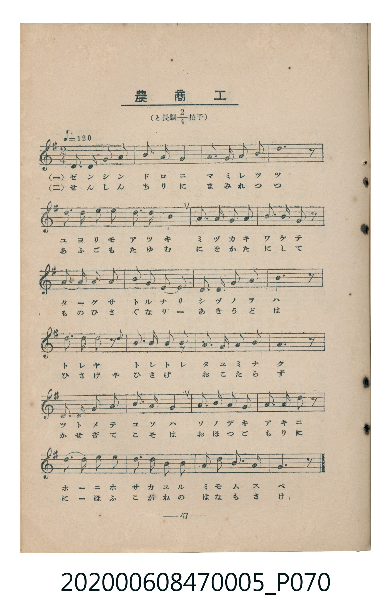
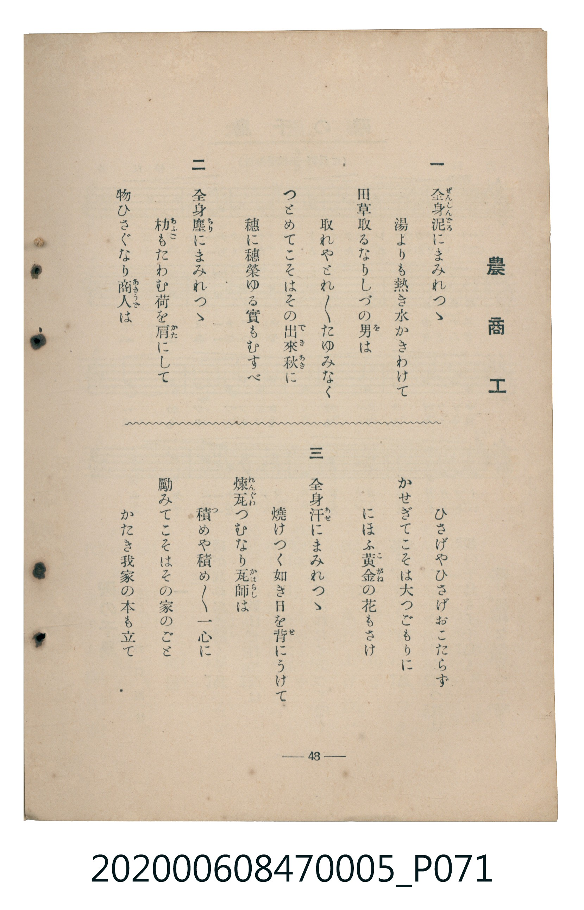

# 農商工

<audio controls src="noshoko.mp3"></audio>

- 臺灣教育會公認《新定兒童唱歌》尋常科第五學年用（2020.006.0847.0005）

## 說明

原書資訊與歌詞全文（對應 P070.jpg – P071.jpg，書頁 pp. 47–48，參考教材第 12 首）：
調性與拍號：と長調四分之二拍子（G 大調 2/4 拍），♩= 120

## 歌詞

```text
一　全身泥（ぜんしんどろ）にまみれつゝ
湯よりも熱き水かきわけて
田草取るなりしづの男（を）は
取れやとれ〳〵たゆみなく
つとめてこそはその出來秋（できあき）に
穗に穗榮ゆる實もむすべ

二　全身塵（ちり）にまみれつゝ
朸（あふご）もたわむ荷を肩（かた）にして
物ひさぐなり商人（あきうど）は
ひさげやひさげおこたらず
かせぎてこそは大つごもりに
にほふ黃金（こがね）の花もさけ

三　全身汗（あせ）にまみれつゝ
燒けつく如き日を背（せ）にうけて
煉瓦（れんぐわ）つむなり瓦師（かはらし）は
積（つ）めや積め〳〵一心に
勵みてこそはその家のごと
かたき我家の本も立て
```

## 原書掃描頁





## 分析

```text
================================================================================
📊 TMD Song Profile: [ 農商工 ]
================================================================================
⏱  Duration:       0:24 (24.0s), 24 measures total
🎼 Key & Tempo:    首調基準 G, != 120.0 BPM, <2/4>
   - 分析範圍：      由實際發聲的音符與和弦推測調性；播放脈絡另行呈現
🎤 人聲音域:    D4 (MIDI 62) – E5 (MIDI 76) [跨度: 14 個半音 / 1.2 個八度, 難度: moderate]
   - 最低音:  D4 in [Noshoko #1 @ m.1, 0:00]
   - 最高音: E5 in [Noshoko #1 @ m.5, 0:04]
   - 適合: soprano, mezzo-soprano, contralto, tenor, baritone, bass
🏛  結構:      Noshoko (24.0s)
⚡ 編曲密度:        Peak 1 軌道同時演奏
🗝  調性診斷：       G 大調（純淨自然大調，未偵測到可信轉調）
   - 風格氣質:    純淨自然大調（陽光明朗、易唱易記，無明顯調外色彩）
   - 轉調歷程:    全曲維持單一推測調性（未偵測到可信轉調）
   - 核心骨幹音:  G, E, A, D, B
   - 調性數值:    G 大調 [相關度: 0.80, 穩定度: Moderate, 自然音純度: 100.0%]
   - 候選調性 (K-S): G 大調 (0.80), E 小調 (0.73), D 大調 (0.69)
   - 五度圈歷程:   +1
   - 各段落調性細節:
     • [Noshoko #1]: G 大調 (r: 0.80, 自然音純度: 100.0%)

  [ 五度圈游移軌跡 ]
               C  
         F           [G ]*
      Bb               D  
      Eb               A  
         Ab           E  
            Db       B  
               F# 
     (* = active key center)

  [ 十二半音累積音高分佈 ]
     C  :                            0.0%
     C# :                            0.0%
     D  : █████████████████         18.5%
     D# :                            0.0%
     E  : ███████████████████       20.8%
     F  :                            0.0%
     F# :                            0.0%
     G  : ████████████████████████  27.0%
     G# :                            0.0%
     A  : ██████████████████        20.2%
     A# :                            0.0%
     B  : ████████████              13.5%
--------------------------------------------------------------------------------
Assignment 軌道音域：
  - Piano         : D4 – E5 (14 個半音 / 1.2 個八度, 78 個音符)
================================================================================
```

## ABC

```abc
X:1
T:農商工
C:TMD (Chen, Chih-Han / aguai)
M:2/4
L:1/16
Q:1/4=120
K:G
V:V1 name="Piano" snm="Pia"
[V:V1]
d3 d e3 e | g3 a g4 | e3 g a3 b | d6 z2 |
e3 e d3 b | d3 b a4 | g3 a g3 e | g3 a e2 z2 |
g3 g a3 a | b3 d a3 a | e3 e g3 a | b6 z2 |
d3 e d2 z2 | b3 d a2 a2 | g3 g a3 b | e6 z2 |
d3 d e3 e | g3 a g4 | e3 e g3 g | a3 b a2 z2 |
d3 d b3 d | e3 d b3 a | g3 e a3 b | g6 z2 |
```

- [主旋律 TMD 檔案](noshoko.tmd)
- [鋼琴伴奏 TMD 檔案](noshoko_piano.tmd)
