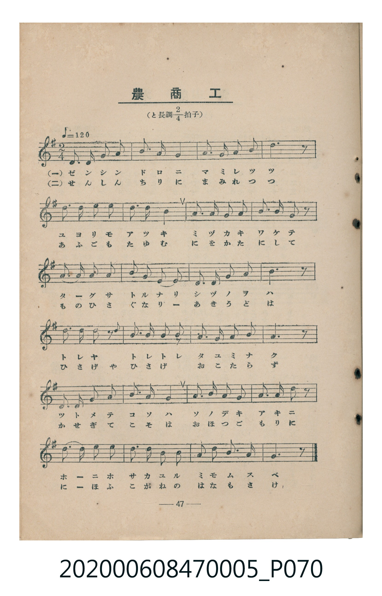
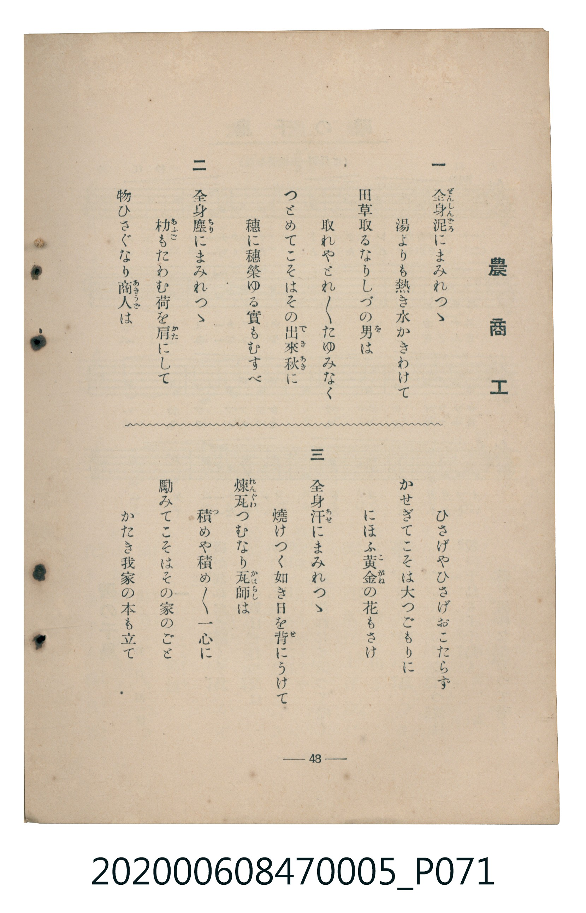

# 農商工

> Re:Shōka 使用 AI 協助辨識與重建樂譜，可能會有錯誤。歡迎回報。

- **鋼琴伴奏版**：<br><audio controls src="noshoko.mp3"></audio>
- **NEUTRINO 歌聲合成版**：<br><audio controls src="noshoko_neutrino.mp3"></audio>

- 臺灣教育會公認《新定兒童唱歌》尋常科第五學年用（2020.006.0847.0005）

## 說明

原書資訊與歌詞全文（對應 P070.jpg – P071.jpg，書頁 pp. 47–48，參考教材第 12 首）：
調性與拍號：と長調四分之二拍子（G 大調 2/4 拍），♩= 120


## 歌詞

```text
一　全身泥（ぜんしんどろ）にまみれつゝ
湯よりも熱き水かきわけて
田草取るなりしづの男（を）は
取れやとれ〳〵たゆみなく
つとめてこそはその出來秋（できあき）に
穗に穗榮ゆる實もむすべ

二　全身塵（ちり）にまみれつゝ
朸（あふご）もたわむ荷を肩（かた）にして
物ひさぐなり商人（あきうど）は
ひさげやひさげおこたらず
かせぎてこそは大つごもりに
にほふ黃金（こがね）の花もさけ

三　全身汗（あせ）にまみれつゝ
燒けつく如き日を背（せ）にうけて
煉瓦（れんぐわ）つむなり瓦師（かはらし）は
積（つ）めや積め〳〵一心に
勵みてこそはその家のごと
かたき我家の本も立て
```

## ABC

<div class="abc-score" data-abc-src="noshoko.abc" aria-label="五線譜載入中"></div>

[下載 ABC 原始檔](noshoko.abc)

## TMD 檔案連結

- [主旋律 TMD 檔案](noshoko.tmd) [[在 TMD Studio 編輯](https://tmdlang.github.io/Tmd-TS/#tmd=s7IKdvYPcrWy4qpTUCpJTLdSSM7PyUlNLsnMz7MqzsjMK0nNjM_KTMmPL87Iz05Ugisry88pzU21Si9KTEmNN403MjAyiDcwMIs3sDAxBzIMTBFKi_NLi5JTrYqTM_Lzc-JLUitKkvLzsxHyBUX5Zal5iXlANQVFIBtTwIoQClLLMlNSQdKpKZkl-UWZiTlI7kgtKga7FWxJfElRYl5xclFmAcgDCFUlGalAx5bnFyFZCzQoPTPPqiQxszwxLz4_LS0zGWyylpbCi32bnk5te7p9qYKWFpeirYKhkQGXva2CO5eNkb6JHciEF-27njcufjZ15oumTc_mND9tXfNiVe_jhq5n0zY8XTfraeuk56uXPp2y8dnanscN3U83dD_dseP58onP16x5smvK07U7nu7c8nzKivd7OkDhpgcMNz1QuAEZBqbv93QqcXHpaynYUgtwKSgoPO2b_2z2jheb21-s6HrR0Q5014uV8562rng2rR3oiqcbep-1dyoEGJgb6GUVpCs8apgM4hiCOO_39AB1vlzQqFBQoKdgYg6UM7EACj7tb37R0AwMgWdzJwD9BQwjhZfLpgFd_37PLJCNL1btf9awHGRXd--LmfOBoo8bV7ycuh0o_nT27KcdbU92dj_Z1QOUfbp2AtAN7gpPlywHSioAg1gBKAo2qefRzJWQ4AcZ-WRHw-OGBqCrX-xa_WzzUqCmx41zHjdNftw4HUyufNwE0va4cfXjxn2PG_c_bup53LjkcdNckOZnO9c_bup43NT1uKnpedvGx429zzZsedzYDWQ8bup_3DjxceMykLrnUza86O182j_tcRNQbhVIA9D4xqWPG9c9n7IdZGfTJLAl68HhClLX87ipBeg5EKNh8-OGrY8b5z9uagM5AKi_sR-kDuQOkIpGoC2PG4FunQs0AEyue9q-68m-tufLu8H-WQ5yT2MTkIT4BOyklUAHrAaSz5atAxnc1P10_TKgNx43NTxunPm4cSckdHYBrYeGztOFW8GmLQQ6H3eIzNkBVgS0DOjkKSB1QDNBbu8HmvyidzvQpy-aVoLVAIMCGIUQg4COgYRU58rHjZseN0593DgBElLATPNk1y6YoUB_AAMBqB8WWDDVk8DhBWM3AgMYGCBAa4HqwEkHbN3sx419yIEFTB3gQJwC9jhQDzhowA7aDfTAy93NL9sngq0GagD6ci3Y3nUvujaCfQW0aiI0EXUiEtHG6TDHzsYZTM_bgW4Epg6g3f1Pl4H89Wz6UlDQNPeANcN1Aj0LT0Stnc8nLwMnFmDiADpoAjBQweqApgIjDRRYQAVPd6yGhS4wcQJlgc6BBdbzlcAUAJRbAo6XRmCQAUVADHASA2aFp_uboYHwtBsYf8DEhpGy1m0DkqAga1wBD9f5IA90TITIPZuzBpQdVgPFwe6mvLCBAgUtfS4uv3xQpZFvFZCZmJfvUGNQUw2yQ8HG0EzLDszCVsopgArJHQ0vFvYoaJgoPN3Q_3x9gw68aNLEogFoFdQwDaBGTSuFx017QL5t3gxkbYeyaoBkJ5i9Foi7QRoUwILzwILzgXgNmNUCFm2BKIABZCt29YCsaJwDUt00GciaDmUB9TUuBLO7QOkSbkXjPnDY7wdK9ECKArDoEqxW1CiYxivoAiGQMoOwgFSNgiGYaQSldYEiUFlDoCCINgZphUqCoAFIEdhIH0OgdcAgAYnCAgXGhgQLhAcJGJjxoJCBiEPCBsKGhQ7CHpAroPYYgbw1B6ISGjIwNiRsIDxI6MDtAQYPWBwaQBA2LIiw2mOM1z9Ni6D27KbAP_iT564eipJn8zJwSlsBxKvArEVQd0PS3-OmtYjkOR8s2AoUBCUokBRIdD2YvRHIasOZQJvAaW0rEE8Bq24CBynYvKY2IG5AJFCI0ZNABQRY03yEKDAOgWUDWhI1A4eUGTS9IVKeMTQtgsIbNcGipGFwykVLn8AwgcQIJFQgbFi4wOIK5H1EfM6HikMCBxLnsOCB8CABhJlGm6CpDBI4ELWw4IHwIAGESKMw8yFhBNENCyUIDxJOGOm0GZKGIW6BpLPHTevB_toCdX8Hmr8mQcU3gdMwhN0N1gENIzR_EShKOykrSveDE-AeIGsDOJVsBbuxAyy6Goi7wKxVYPdBCltgfDT3gVmbwGr7IakHBjCTKjDsQSltHaiBAGZNBYfsBDB7FbjEgLgBEncg0V4gBiV9YPsCLArKEJh2wJIcrIw0AooYg1mmSCKIYhaWQGGqIBC9JN0PFQeFCISGhQkkriChAmHDwgWeUoEhA4tdSNiglzzwVAoMFUjKgoQLhA0LGQgPEjaIVArTAQkdCBsWPljtAadQWFkIKkmhPgLmIES5-Lh5AYaPoKke6P7HzSuhobAdh4_wpk9gX4CyshSSEteAcxoYIJInSBDGgkQciL0MXqp2gUWxJx3kkhSWKIGtVRCrCVxpoIlCLG4Ep9RGUN0HKWg7waKzcKROSKkJKUfBqQwldYIwegoGlbXQ9Io1ccITISRAoFGAJg5iQ6IdkZxh4QJhw0IGZ-JESpCQ9jzCKlQpqHZI2EDEIaEDSTOw8MGdOmFpcCGah5DFQWwQC-IhaIkLri9QWzqw1gCRaRPYV6csbYJakeDyHeg2EKsN7L7N4JSxF1EyggT3ghX0AXE7WBpckUGaBEA2vMWKJXVCquzZQAwudIGVEChIJ4PZcxFFIyJ1AttF4MYnqO6DlDNobVZym6LwEtQQKAZLryAaPZHC4g4SMhA2LGwg6QISOvC0A-RDVEECCKIGFkQwHiR-0RMqrLaGBBCEDQsiCA8SSJjpFBJOEDYspCB2wVqw6GkV4uLHTcCaG56ViPYXPN3OAKdVqFuBrQRIhiWmLG1dS1l6nQ1OhMC6HpzcQHyQG7eC0weoVoO0W1eD3QcpQhcB8QKw_E6w6ExICoIBLMkV3KoE2QEMX0gDFZFce4AY1PYF1XmwWh1Sy0FqfUjtNxGrHbDS1BRehsLaqTARUL0Ob40iilNYMgZB9IQ6GyoOKzoQQQKJHEigQGRgwQLhQQIGogoWNFgLOXAihXWHQIECoWHBAuFBAgbChgUNhAcJHAgbFjxY7QF3muD2wEp9tAYzrNaAJEmQDKzxDcqqsKy2HywDaWAg21PLxaVrpwDt9SsAmcpcAA)]
- [鋼琴伴奏 TMD 檔案](noshoko_piano.tmd) [[在 TMD Studio 編輯](https://tmdlang.github.io/Tmd-TS/#tmd=s7IKdvYPcrWy4tLSUnixb9PTqW1Pty99v6fjZfee5xO2PNmz5enS_uedHe_3dCpoaXEp2ioYGhlw2dsquHPZGOmb2HHVKSi9aN_1vHHxs6kzXzRtejan-Wnrmhereh83dD2btuHpullPWyc9X7306ZSNz9b2PG7ofrqh--mOHc-XT3y-Zs2TXVOert3xdOeW51NWAK00MjAy0DMwMNMzsDAxBzIMTIG2KnFx-eUXZ-Rn51sFZCbm5Qd5ONQY1FRzKQCBjaGZlh2Ypa-lYIsOFEA27Gh4sbBHQcNE4emG_ufrG3QUAgzMDfSyCtI1sWjQ0gcbVqNgGq-gC4RAygzCAlI1CoZgphGU1gWKQGUNgYIg2hikFSoJggYgRWAjfQxrFB437QGLPm7eDGRvh7OBMs2dUN5aIO6GG_-4eR5UfD4Qr4GyW8AyLUj2gFwBtccIKNc4B6KyaTKQPR3OBskshPK6gOzVCHsa90HEG_cD5Xqg7CVgmSXY7THG65-mRVB7dlPgH_wRu6uHnIg1A5tvBo0lRHwZQ2MQ5ErUaEaJeXB8o8Vq8zKoP1YA8SooexFyKAD99rhpLVIozIeKtwLFIbEAkgfJrIfyNgLZbaghDo7ZJmjcbAXiKVC1TeB4gprZ1AbEDQi7oLH8uGkSkA2JCZBaJBlgCnncCPIDWuw2Q2Ie4hZI7DxuWg_21xao-zvQ_DUJKr4JHPMQdjdYBzSM0PxFIOt2khPDkKiC5UgjoIgxmGWKJILI1LCIhamCQPR8ux8q_rhpA5TeCvZvB9SPq4G4C8peBfYvLDcAY7i5Dx4qID39SPagxS4wJiExsg6IN0HZU8FxNQHKWwXOu4jYhenoBWJQuILYK8EykJSEYQ84ZmE5D5RvoT4CpjxELnzcvADDR9DUAnT_4-aV0FDYjsNHeOP16ezZZBXJYPMhORccPyjxCsLocQ_K3dCYxhqt8OhbA03sYMejiYPYkABDJARQlkdk4i6wDI7gBmdaRFQ-bpz0uAkUxlCrUKWg2kHi0LBvBJXgsJzdCZaZhd0icLzCYm8hmoeQxUFsEAviIWgeB5dQqDUSrNQmMlaBVTkdKlp4jjUEisFiGUSjRy3Mx8ASCuxXELsN7OPN0NDci5RyQeJ7oar6gLgdqgZcJsPrsrXQUEGPXlipOhuIoXkdWJ6CZCZDeXOR8iNy7AJrR2j9CirNkUoAeP2MHsMQFz9uApaw8ARItL_gsT0DHMNQtwJLc0gyJybvtq4lP--awnMsrB6GiYDKX3hti8i8sOgHQfQIng0VhyVUkAjIu1uhngIVybCKeTVKpbsIXLxBVO0Ey8xEsgc9cmGNJFBkQWhw0Q-P2h4gXgtlr0MqeCFFNax4hhTiE7HbA25Kwe2BlTFoDQJYGQWJSpAMrHEBSuKwJLofLAOpCJDtqUVrRPsgN6JNEG3op91LnnZ3PpvR93T_6ic7u4GNrGfdvU_XTni6fdmzzm5IZ-D9nh5gS_7lgh54b-H5zH3Plq59sW82UPuLhqkvGma86Gh_sXHCsynbkOrleIVow1hkhgmQYZQLFTKAhgZEGK7QNB7GMosHKzVCVoqqAsIyi0coNgayUVVjMRihDYdSuGPBDFPsCuHyYPvhpoNUAgNf104BGv7RPkBVyFwjVK4xmKvMBQA)]

## 分析

```text
================================================================================
📊 TMD Song Profile: [ 農商工 ]
================================================================================
⏱  Duration:       0:24 (24.0s), 24 measures total
🎼 Key & Tempo:    首調基準 G, != 120.0 BPM, <2/4>
   - 分析範圍：      由實際發聲的音符與和弦推測調性；播放脈絡另行呈現
🎤 人聲音域:    D4 (MIDI 62) – E5 (MIDI 76) [跨度: 14 個半音 / 1.2 個八度, 難度: moderate]
   - 最低音:  D4 in [Noshoko #1 @ m.1, 0:00]
   - 最高音: E5 in [Noshoko #1 @ m.5, 0:04]
   - 適合: soprano, mezzo-soprano, contralto, tenor, baritone, bass
🏛  結構:      Noshoko (24.0s)
⚡ 編曲密度:        Peak 1 軌道同時演奏
🗝  調性診斷：       G 大調（純淨自然大調，未偵測到可信轉調）
   - 風格氣質:    純淨自然大調（陽光明朗、易唱易記，無明顯調外色彩）
   - 轉調歷程:    全曲維持單一推測調性（未偵測到可信轉調）
   - 核心骨幹音:  G, E, A, D, B
   - 調性數值:    G 大調 [相關度: 0.80, 穩定度: Moderate, 自然音純度: 100.0%]
   - 候選調性 (K-S): G 大調 (0.80), E 小調 (0.73), D 大調 (0.69)
   - 五度圈歷程:   +1
   - 各段落調性細節:
     • [Noshoko #1]: G 大調 (r: 0.80, 自然音純度: 100.0%)

  [ 五度圈游移軌跡 ]
               C  
         F           [G ]*
      Bb               D  
      Eb               A  
         Ab           E  
            Db       B  
               F# 
     (* = active key center)

  [ 十二半音累積音高分佈 ]
     C  :                            0.0%
     C# :                            0.0%
     D  : █████████████████         18.5%
     D# :                            0.0%
     E  : ███████████████████       20.8%
     F  :                            0.0%
     F# :                            0.0%
     G  : ████████████████████████  27.0%
     G# :                            0.0%
     A  : ██████████████████        20.2%
     A# :                            0.0%
     B  : ████████████              13.5%
--------------------------------------------------------------------------------
Assignment 軌道音域：
  - Piano         : D4 – E5 (14 個半音 / 1.2 個八度, 78 個音符)
================================================================================
```


## 原書掃描頁






