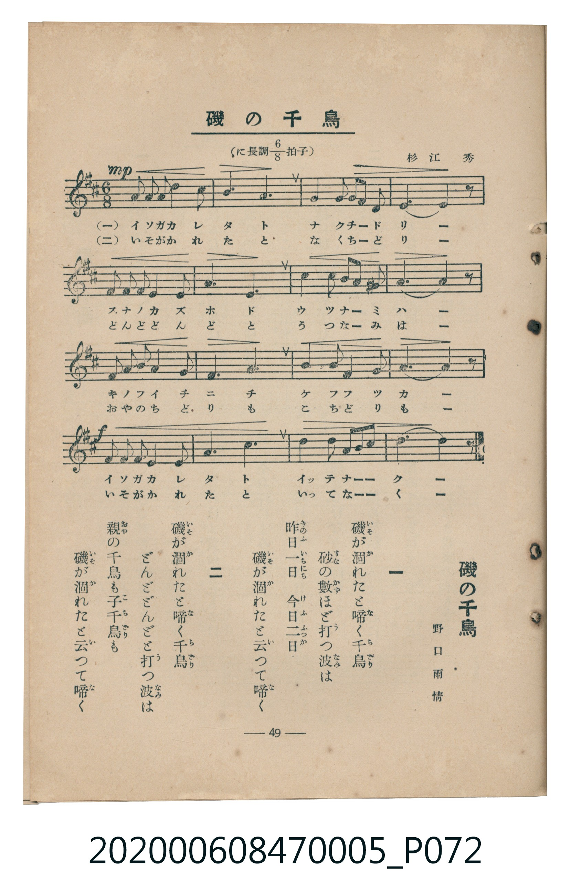

# 磯の千鳥

> Re:Shōka 使用 AI 協助辨識與重建樂譜，可能會有錯誤。歡迎回報。

<audio controls src="iso_no_chidori.mp3"></audio>

- 臺灣教育會公認《新定兒童唱歌》尋常科第五學年用（2020.006.0847.0005）

## 說明

原書資訊與歌詞全文（對應 P072.jpg，書頁 p. 49，參考教材第 13 首）：
調性與拍號：に長調八分之六拍子（D 大調 6/8 拍）
作曲與作歌：杉江秀、野口雨情

## 歌詞

```text
一　磯（いそ）が涸（か）れたと啼（な）く千鳥（ちどり）
砂（すな）の數（かず）ほど打（う）つ波（なみ）は
昨日一日（きのふいちにち）　今日二日（けふふつか）
磯（いそ）が涸（か）れたと云（い）つて啼（な）く

二　磯（いそ）が涸（か）れたと啼（な）く千鳥（ちどり）
どんどどんどと打（う）つ波（なみ）は
親（おや）の千鳥も子千鳥（こちどり）も
磯（いそ）が涸（か）れたと云（い）つて啼（な）く
```

## ABC

```abc
X:1
T:磯の千鳥
M:6/8
L:1/16
Q:3/8=64
K:D
V:V1 name="Piano" snm="Pia"
[V:V1]
F2 F2 E2 D4 D2 | E4 B2 A6 | F4 F2 E2 F2 A2 | D6 D4 z2 |
w: 1.~イ ソ ガ カ レ | タ _ ト | ナ ク チ _ ド | リ _
w: 2.~い そ が か れ | た _ と | な く ち _ ど | り _
E2 E2 F2 E4 D2 | B,4 D2 E6 | F4 F2 A2 F2 E2 | D6 D4 z2 |
w: 1.~ス ナ ノ カ ズ | ホ _ ド | ウ ツ ナ _ ミ | ハ _
w: 2.~ど ん ど ど ん | ど _ と | う つ な _ み | は _
B2 B2 A2 B4 B2 | A4 B2 A6 | F4 F2 E4 F2 | A6 A4 z2 |
w: 1.~キ ノ フ イ チ | ニ _ チ | ケ フ フ ツ | カ _
w: 2.~お や の ち ど | り _ も | こ ち ど り | も _
B2 B2 A2 F4 A2 | E4 A2 B6 | F3 F E2 F2 E2 B,2 | D6 D4 z2 |
w: 1.~イ ソ ガ カ レ | タ _ ト | イッ _ テ ナ _ _ | ク _
w: 2.~い そ が か れ | た _ と | いっ _ て な _ _ | く _
```

## TMD 檔案連結

- [主旋律 TMD 檔案](iso_no_chidori.tmd) [[在 TMD Studio 編輯](https://tmdlang.github.io/Tmd-TS/#tmd=s7IKdvYPcrWy4qpTUCpJTLdSSM7PyUlNLsnMz7MqzsjMK0nNjM_KTMmPL87Iz05Ugisry88pzU21Si9KTEmNN403MjAyiDcwMIs3sDAxBzIMTBFKi_NLi5JTrYqTM_Lzc-JLUitKkvLzsxHyBUX5Zal5iXlANQVFIBtTwIoQClLLMlNSQdKpKZkl-UWZiTlI7kgtKga7FWxJfElRYl5xclFmAcgDCFUlGalAx-YllpQWpaKLlieWpBYpcWlpKTxfvP5x47qnvc0vNy9V0NLiUrRVsDTjsrdVcOGyMdO3sANpfNG-63nj4mdTZ75o2vRsTvPT1jUvVvU-buh6Nm3D03WznrZOer566dMpG5-t7Xnc0P10Q_fTHTueL5_4fM2aJ7umPF274-nOLc-nrHi_pwMUYHrAANMDBRiQYWD6fk-nEheXvpaCLbUAl4KCwtO--c9m73ixuf3Fiq4XHe1Ad71YOe9p64pn09qBrni6ofdZe6dCgIG5kV5WQfr7PT1AxS8XNCoU6CmYWAK5T_ubXzQ0A737bO4EoCcUDI0VXi6bBnTq-z2zQMa_WLX_WcNykMHdvS9mzgeKPm5c_XLqdqD409bVTzvanuzsftq6Fij7dO0EoIUuCk-XLAdKKgDDUwEoCjQJZMyTvXOezd4ENAbEWNsDNObZ3M5nG-c_X97wuKHxZXvf0_7FL2eveNbcygVWvgMo3ACMLqCJjxtbHjfOBZrzuLHn2bYdYJFuELep53Hj_MeNK55O3QMWXAVW0w-JXrDIwseNKx83dUHd8HxBE1h0JkzpumdTocY9bpwFFtkN1PCsczJYsA0ssuTZ5kUQ0x837geLrAeZ9WzGimfTlwKdCSTB0r1A4x43bgU7FmjtaiAJUt3Q8GR3F0jlrh6YyolgZUC0BOIPsNOI8-mTXRMhyiBOe9y4DM3vkMDbBUya1A48MGcyiEQwVhAVVC-WAc0GinY9boK4G5oBHzc1AZMMkoVAQxF2AmWpGjBAsyjPb1CgoKXPxeVZnO-X75wBLDmLMq0CMhPz8h1qDGqqQRYp2BiaadmBWdhyuwKosNjR8GJhj4KGicLTDf3P1zfowLOoJhYNQPughmkANWpaKTxuWgLEe4F4DRCvBkk-bl6jUAPk7IdwOkAUBABFm7vAok3rgcxGIN4DxJ1giVVQRSAxCEC2bFcPyLLGFiCeC8Q9QNwNMakHpLtxPpjTuALFskawmcBAB-KFEMsaV4LdBnYFNstqFIwVdMHYCIgNgRgEQXQNWAQEzYDYFMoGQYgeEITpA9EgFTVwE2CmgKABSAZsm48hyDFLgHxQGILINWByNVQlKChBpoACE2EOKEyRbQcFKlQGGK4g-Ua4yk6oilVIOmAwHuEOI1BotYB0AIMXRPaAyW64uSA-JJyR3AEMbhR3AMMbJtMPJhfC-Suh_oC5FNMd-FPprh7KUulOcCg9bu6Dp9KmXeCAmQ1JBp0oCadpGUQUmNzAukCpdD5YeT8xqXQl0ITJEBqIwZZNBocPhIOeStsgosCMBAxASCrdD5ZYjzuVglIZLKXB0iUklZqBghPGhUlhJlNQ8oRpJi6Z7gRFJDipgYIRJZkCwxKSzGYjmQNJfEjJAxiqMBlwUkMkW2DgQvSDkg2hZApKSqAAhSUrCAlxB0gUpgZ3Mm2Dy4CzHlKyBWUzSMiTl0x3dFKWTNdCkmjzVHCxAI76RnDAQAo7IAclmW6EiAJVAzE0xYLEwSmcUCoFJuwmUHm6DpxRwUkQqXAEVnuoqXQyRAmwHIWl6S6wapgyLIkUVFDCCksQDYIgugZefBIuSmFshB4QhLHR0-haUCxCUicwREApAhTDkDQGKhQhQYmcRmFFJSyNboTLgPWDSQgflGYhgUs4jYJzCTB0QWlqHZjEXxSCghE1jYJSMkQ9SCdyGgfpgwQ8WWn06ezZ9Kzwm5Y8bm4GCbchlaV7wDI4izcKanxg82wxSHgZojCF2AaskYhKp7D0B6m-YSkQOQUjp1NjlEIYXPTSqc6HhCtMElSiIcpTmBLcpRgipVJe6YODHCYJKuIRBSpMCe5ivZaLS9dOAbkJqwDkK3MBAA)]
- [鋼琴伴奏 TMD 檔案](iso_no_chidori_piano.tmd) [[在 TMD Studio 編輯](https://tmdlang.github.io/Tmd-TS/#tmd=s7IKdvYPcrWy4tLSUni-eP3jxnVPe5tfbl76fk_Hy-49zydsebJny9Ol_c87O97v6VTQ0uJStFWwNOOyt1Vw4bIx07ew46pTUHrRvut54-JnU2e-aNr0bE7z09Y1L1b1Pm7oejZtw9N1s562Tnq-eunTKRufre153ND9dEP30x07ni-f-HzNmie7pjxdu-Ppzi3Pp6wA2mhkYGSgZ2BgpmdgYWIOZBiYAi1V4uLyLM73y3fOyEzJL8q0CshMzMsP8nCoMaip5lIAAhtDMy07MEtfS8EWHSiArNnR8GJhj4KGicLTDf3P1zfoKAQYmBvpZRWka2LRoKUPNqxGwVhBF4yNgNgQiEEQRNeARUDQDIhNoWwQhOgBQZg-EA1SUQM3AWYKCBqAZMC2-RjWKDxuWgLkP27aCybXgMnVUJWPm0F8kJr9SOY8bu5Asf1xcxdMpmk9WL4RrrITqmIVkg4YjEe4wwioprEFpKNxLpjsAZPdcHNBfJCa-cjuaFyB6o5GmC2PG_vB5EI4fyXUHzCXYroDf1zu6iEnLkFxAYsPWOxB4tIMZCmMC5PCjExQJMI0ExeZO0HeBUfI4-Y-cNDBI7NpFyQQmmcjmQOJIqRAbFoGlwFHCCJym0GBD9IPClxCkQkK8MdNk0EkhA0mIe4AicLU4I7MNrgMOIEiRS4oMYJUgBIbOZG5o5OcyARlO1jWA9EgCKJr4JmRcMaEsRF6QBDGRo_LtSDfQmKxeSqIBGdVSFyAshgoLmBZBCGKHJcb4TJg_WASwgfFLUgFLHXgi0twamqCZM91YBJ_xnrc1ITqjkZQjEPUg3QipwWQPpB-ZB0kxOXT2bMpjUtYHEEKTFgsIccyclwao2RocDamUynbtORxczNcEpQ7EHkTpgR3jqBmMdvyuHExXBJUXCAyJ0wJ7iKiFlvN6oNcs1ogKtYXe6Y-mz_lWXfv0007nuzsVgDW_QpA3rMJ057N3gxpJLzfAyyaVzzv3_ds6_Zn-zc-27rqRdfGFx3tkBbFs6ZNLzdvAWoFNgZerFnwrKX_6aJmRDowjFeINowFYyQmMBUAOUa5QB6IMI0H8kzjgTwQgaIJjxSUaQANe2COR1GLrtMMxDeLB9kJJlFcQLadJkABE6AcECMxcfsbiYPmAByux2oVipGoGtG9SYbPgAlI104BOQ1F-wClMMSMwGLKXAA)]

## 分析

```text
================================================================================
📊 TMD Song Profile: [ 磯の千鳥 ]
================================================================================
⏱  Duration:       0:30 (30.0s), 16 measures total
🎼 Key & Tempo:    首調基準 D, != 96.0 BPM, <6/8>
   - 分析範圍：      由實際發聲的音符與和弦推測調性；播放脈絡另行呈現
🎤 人聲音域:    B3 (MIDI 59) – B4 (MIDI 71) [跨度: 12 個半音 / 1.0 個八度, 難度: easy]
   - 最低音:  B3 in [IsoNoChidori #1 @ m.6, 0:09]
   - 最高音: B4 in [IsoNoChidori #1 @ m.2, 0:02]
   - 適合: soprano, mezzo-soprano, contralto, tenor, baritone, bass
🏛  結構:      IsoNoChidori (30.0s)
⚡ 編曲密度:        Peak 1 軌道同時演奏
🗝  調性診斷：       D 大調（純淨自然大調，未偵測到可信轉調）
   - 風格氣質:    純淨自然大調（陽光明朗、易唱易記，無明顯調外色彩）
   - 轉調歷程:    全曲維持單一推測調性（未偵測到可信轉調）
   - 核心骨幹音:  D, F#, A, E, B
   - 調性數值:    D 大調 [相關度: 0.80, 穩定度: Moderate, 自然音純度: 100.0%]
   - 候選調性 (K-S): D 大調 (0.80), A 大調 (0.73), B 小調 (0.66)
   - 五度圈歷程:   +2
   - 各段落調性細節:
     • [IsoNoChidori #1]: D 大調 (r: 0.80, 自然音純度: 100.0%)

  [ 五度圈游移軌跡 ]
               C  
         F            G  
      Bb              [D ]*
      Eb               A  
         Ab           E  
            Db       B  
               F# 
     (* = active key center)

  [ 十二半音累積音高分佈 ]
     C  :                            0.0%
     C# :                            0.0%
     D  : ████████████████████████  21.7%
     D# :                            0.0%
     E  : ██████████████████████    19.6%
     F  :                            0.0%
     F# : ████████████████████████  21.7%
     G  :                            0.0%
     G# :                            0.0%
     A  : ███████████████████████   20.7%
     A# :                            0.0%
     B  : ██████████████████        16.3%
--------------------------------------------------------------------------------
Assignment 軌道音域：
  - Piano         : B3 – B4 (12 個半音 / 1.0 個八度, 60 個音符)
================================================================================
```


## 原書掃描頁




