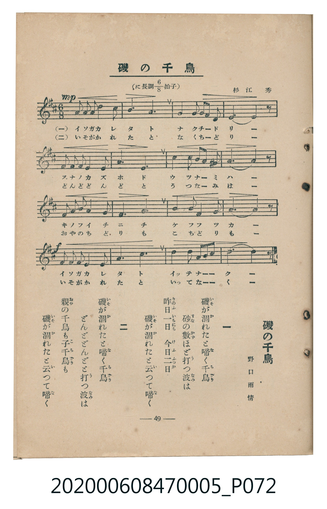

# 磯の千鳥

> Re:Shōka 使用 AI 協助辨識與重建樂譜，可能會有錯誤。歡迎回報。

- **鋼琴伴奏版**：<br><audio controls src="iso_no_chidori.mp3"></audio>
- **NEUTRINO 歌聲合成版**：<br><audio controls src="iso_no_chidori_neutrino.mp3"></audio>

- 臺灣教育會公認《新定兒童唱歌》尋常科第五學年用（2020.006.0847.0005）

## 說明

原書資訊與歌詞全文（對應 P072.jpg，書頁 p. 49，參考教材第 13 首）：
調性與拍號：に長調八分之六拍子（D 大調 6/8 拍）
作曲與作歌：杉江秀、野口雨情


## 歌詞

```text
一　磯（いそ）が涸（か）れたと啼（な）く千鳥（ちどり）
砂（すな）の數（かず）ほど打（う）つ波（なみ）は
昨日一日（きのふいちにち）　今日二日（けふふつか）
磯（いそ）が涸（か）れたと云（い）つて啼（な）く

二　磯（いそ）が涸（か）れたと啼（な）く千鳥（ちどり）
どんどどんどと打（う）つ波（なみ）は
親（おや）の千鳥も子千鳥（こちどり）も
磯（いそ）が涸（か）れたと云（い）つて啼（な）く
```

## ABC

<div class="abc-score" data-abc-src="iso_no_chidori.abc" aria-label="五線譜載入中"></div>

[下載 ABC 原始檔](iso_no_chidori.abc)

## TMD 檔案連結

- [主旋律 TMD 檔案](iso_no_chidori.tmd) [[在 TMD Studio 編輯](https://tmdlang.github.io/Tmd-TS/#tmd=s7IKdvYPcrWy4qpTUCpJTLdSSM7PyUlNLsnMz7MqzsjMK0nNjM_KTMmPL87Iz05Ugisry88pzU21Si9KTEmNN403MjAyiDcwMIs3sDAxBzIMTBFKi_NLi5JTrYqTM_Lzc-JLUitKkvLzsxHyBUX5Zal5iXlANQVFIBtTwIoQClLLMlNSQdKpKZkl-UWZiTlI7kgtKga7FWxJfElRYl5xclFmAcgDCFUlGalAx-YllpQWpaKLlieWpBYhBIHmp2fmWZUkZgJ9DPJ1eWJ8bmJmXk5iXgqyqpKMfKDnCzIqrTIyi0GuSk7Mic9OzEMKI6ibChLTU60CDMyNlLi0tBSeL17_uHHd097ml5uXKmhpcSnaKliacdnbKrhw2ZjpW9iBdL9o3_W8cfGzqTNfNG16Nqf5aeuaF6t6Hzd0PZu24em6WU9bJz1fvfTplI3P1vY8buh-uqH76Y4dz5dPfL5mzZNdU56u3fF055bnU1a839MBihU9YKzogWIFyDAwfb-nU4mLS19LwZZagEtBQeFp3_xns3e82Nz-YkXXi452oLterJz3tHXFs2ntQFc83dD7rL1TARQCelkF6e_39AAVv1zQqFCgp2BiCeQ-7W9-0dAM9O6zuROAnlAwNFZ4uWwa0Knv98wCGf9i1f5nDctBBnf3vpg5Hyj6uHH1y6nbgeJPW1c_7Wh7srP7aetaoOzTtROAFrooPF2yHCipAAxPBaAo0CSQMU_2znk2exPQGBBjbQ_QmGdzO59tnP98ecPjhsaX7X1P-xe_nL3iWXMrF1j5DqBwAzC6gCY-bmx53DgXaM7jxp5n23aARbpB3Kaex43zHzeueDp1D1hwFVhNPyR6wSILHzeufNzUBXXD8wVNYNGZMKXrnk2FGve4cRZYZDdQw7POyWDBNrDIkmebF0FMf9y4HyyyHmTWsxkrnk1fCnQmkARL9wKNe9y4FexYoLWrgSRIdUPDk91dIJW7emAqJ4KVAdESiD_ATiPOp092TYQogzjtceMyNL9DAm8XMGlSO_DAnMkgEsFYQVRQvVgGNBso2vW4CeJuaAZ83NQETDJIFgINRdgJlKVqwADNojy_QYGClj4Xl2dxvl--cwaweC7KtArITMzLd6gxqKkGWaRgY2imZQdmYcvtCqDCYkfDi4U9ChomCk839D9f36ADz6KaWDQA7YMapgHUqGml8LhpCRDvBeI1QLwaJPm4eY1CDZCzH8LpAFEQABRt7gKLNq0HMhuBeA8Qd4IlVkEVgcQgANmyXT0gyxpbgHguEPcAcTfEpB6Q7sb5YE7jChTLGsFmAgMdiBdCLGtcCXYb2BXYLKtRMFbQBWMjIDYEYhAE0TVgERA0A2JTKBsEIXpAEKYPRINU1MBNgJkCggYgGbBtPoYgxywB8kFhCCLXgMnVUJWgoASZAgpMhDmgMEW2HRSoUBlguILkG-EqO6EqViHpgMF4hDuMQKHVAtIBDF4Q2QMmu-HmgviQcEZyBzC4UdwBDG-YTD-YXAjnr4T6A-ZSTHfgT6W7eihLpTvBofS4uQ-eSpt2gQNmNiQZdKIknKZlEFFgcgPrAqXS-WDl_cSk0pVAEyZDaCAGWzYZHD4QDnoqbYOIAjMSMAAhqXQ_WGI97lQKSmWwlAZLl5BUagYKThgXJoWZTEHJE6aZuGS6ExSR4KQGCkaUZAoMS0gym41kDiTxISUPYKjCZMBJDZFsgYEL0Q9KNoSSKSgpgQIUlqwgJMQdIFGYGtzJtA0uA856SMkWlM0gIU9eMt3RSVkyXQtJos1TwcUCOOobwQEDKeyAHJRkuhEiClQNxNAUCxIHp3BCqRSYsJtA5ek6cEYFJ0GkwhFY7aGm0skQJcByFJamu8CqYcqwJFJQQQkrLEE0CILoGnjxSbgohbERekAQxkZPo2tBsQhJncAQAaUIUAxD0hioUIQEJXIahRWVsDS6ES4D1g8mIXxQmoUELuE0Cs4lwNAFpal1YBJ_UQgKRtQ0CkrJEPUgnchpHKQPEvBkpdGns2fTs8JvWvK4uRkk3IZUlu4By-As3iio8YHNs8Ug4WWIwhRiG7BGIiqdwtIfpPqGpUDkFIycTo1RCmFw0UunOh8SrjBJUImGKE9hSnCXYoiUSnmlDw5ymCSoiEcUqDAluIv1Wi4uXTsF5CasApCvzAUA)]
- [鋼琴伴奏 TMD 檔案](iso_no_chidori_piano.tmd) [[在 TMD Studio 編輯](https://tmdlang.github.io/Tmd-TS/#tmd=s7IKdvYPcrWy4qpTUCpJTLdSyC8qychPL0osyKi0ysgsLskvykxOzInPTsxLVIIrKs4vLUpOjS9ITE-1CjAwN1Li0tJSeL54_ePGdU97m19uXvp-T8fL7j3PJ2x5smfL06X9zzs73u_pVNDS4lK0VbA047K3VXDhsjHTt7ADGfmifdfzxsXPps580bTp2Zzmp61rXqzqfdzQ9WzahqfrZj1tnfR89dKnUzY-W9vzuKH76Ybupzt2PF8-8fmaNU92TXm6dsfTnVueT1kBtNHIwMhAz8DATM_AwsQcyDAwBVqqxMXlWZzvl--ckZkC9ItVQGZiXn6Qh0ONQU01lwIQ2BiaadmBWfpaCrboQAFkzY6GFwt7FDRMFJ5u6H--vkFHAeRnvayCdE0sGrT0wYbVKBgr6IKxERAbAjEIgugasAgImgGxKZQNghA9IAjTB6JBKmrgJsBMAUEDkAzYNh_DGoXHTUuA_MdNe8HkGjC5GqrycTOID1KzH8mcx80dKLY_bu6CyTStB8s3wlV2QlWsQtIBg_EIdxgB1TS2gHQ0zgWTPWCyG24uiA9SMx_ZHY0rUN3RCLPlcWM_mFwI56-E-gPmUkx34I_LXT3kxCUoLmDxAYs9SFyagSyFcWFSmJEJikSYZuIicyfIu-AIedzcBw46eGQ27YIEQvNsJHMgUYQUiE3L4DLgCEFEbjMo8EH6QYFLKDJBAf64aTKIhLDBJMQdIFGYGtyR2QaXASdQpMgFJUaQClBiIycyd3SSE5mgbAfLeiAaBEF0DTwzEs6YMDZCDwjC2OhxuRbkW0gsNk8FkeCsCokLUBYDxQUsiyBEkeNyI1wGrB9MQviguAWpgKUOfHEJTk1NkOy5Dkziz1iPm5pQ3dEIinGIepBO5LQA0gfSj6yDhLh8Ons2pXEJiyNIgQmLJeRYRo5LY5QMDc7GdCplm5Y8bm6GS4JyByJvwpTgzhHULGZbHjcuhkuCigtE5oQpwV1E1GKrWX2Qa1YLRMX6Ys_UZ_OnPOvufbppx5Od3QrAul8ByHs2Ydqz2ZshjYT3e4BF84rn_fuebd3-bP_GZ1tXveja-KKjHdKieNa06eXmLUCtwMbAizULnrX0P13UjEgHhvEK0YaxYIzEBKYCIMcoF8gDEabxQJ5pPJAHIlA04ZGCMg2gYQ_M8Shq0XWagfhm8SA7wSSKC8i20wQoYAKUA2IkJm5_I3HQHIDD9VitQjESVSO6N8nwGTAB6dopIKehaB-gFIaYEVhMmQsA)]

## 分析

```text
================================================================================
📊 TMD Song Profile: [ 磯の千鳥 ]
================================================================================
⏱  Duration:       0:30 (30.0s), 16 measures total
🎼 Key & Tempo:    首調基準 D, != 96.0 BPM, <6/8>
   - 分析範圍：      由實際發聲的音符與和弦推測調性；播放脈絡另行呈現
🎤 人聲音域:    B3 (MIDI 59) – B4 (MIDI 71) [跨度: 12 個半音 / 1.0 個八度, 難度: easy]
   - 最低音:  B3 in [IsoNoChidori #1 @ m.6, 0:09]
   - 最高音: B4 in [IsoNoChidori #1 @ m.2, 0:02]
   - 適合: soprano, mezzo-soprano, contralto, tenor, baritone, bass
🏛  結構:      IsoNoChidori (30.0s)
⚡ 編曲密度:        Peak 1 軌道同時演奏
🗝  調性診斷：       D 大調（純淨自然大調，未偵測到可信轉調）
   - 風格氣質:    純淨自然大調（陽光明朗、易唱易記，無明顯調外色彩）
   - 轉調歷程:    全曲維持單一推測調性（未偵測到可信轉調）
   - 核心骨幹音:  D, F#, A, E, B
   - 調性數值:    D 大調 [相關度: 0.80, 穩定度: Moderate, 自然音純度: 100.0%]
   - 候選調性 (K-S): D 大調 (0.80), A 大調 (0.73), B 小調 (0.66)
   - 五度圈歷程:   +2
   - 各段落調性細節:
     • [IsoNoChidori #1]: D 大調 (r: 0.80, 自然音純度: 100.0%)

  [ 五度圈游移軌跡 ]
               C  
         F            G  
      Bb              [D ]*
      Eb               A  
         Ab           E  
            Db       B  
               F# 
     (* = active key center)

  [ 十二半音累積音高分佈 ]
     C  :                            0.0%
     C# :                            0.0%
     D  : ████████████████████████  21.7%
     D# :                            0.0%
     E  : ██████████████████████    19.6%
     F  :                            0.0%
     F# : ████████████████████████  21.7%
     G  :                            0.0%
     G# :                            0.0%
     A  : ███████████████████████   20.7%
     A# :                            0.0%
     B  : ██████████████████        16.3%
--------------------------------------------------------------------------------
Assignment 軌道音域：
  - Piano         : B3 – B4 (12 個半音 / 1.0 個八度, 60 個音符)
================================================================================
```


## 原書掃描頁




