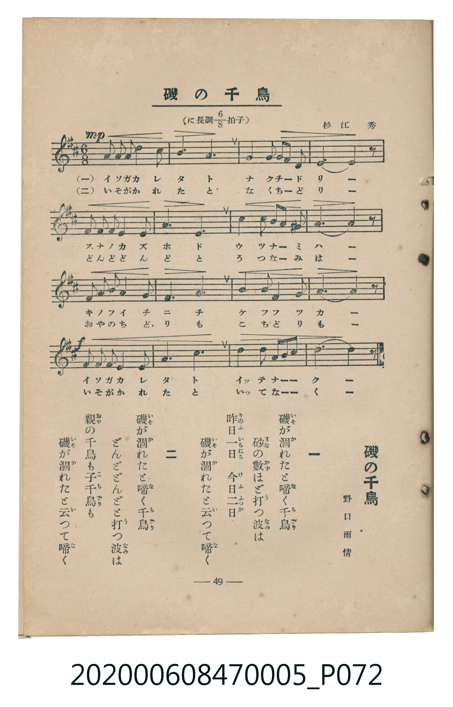

# 磯の千鳥

<audio controls src="iso_no_chidori.mp3"></audio>

- 臺灣教育會公認《新定兒童唱歌》尋常科第五學年用（2020.006.0847.0005）

## 說明

原書資訊與歌詞全文（對應 P072.jpg，書頁 p. 49，參考教材第 13 首）：
調性與拍號：に長調八分之六拍子（D 大調 6/8 拍）
作曲與作歌：杉江秀、野口雨情

## 歌詞

```text
一　磯（いそ）が涸（か）れたと啼（な）く千鳥（ちどり）
砂（すな）の數（かず）ほど打（う）つ波（なみ）は
昨日一日（きのふいちにち）　今日二日（けふふつか）
磯（いそ）が涸（か）れたと云（い）つて啼（な）く

二　磯（いそ）が涸（か）れたと啼（な）く千鳥（ちどり）
どんどどんどと打（う）つ波（なみ）は
親（おや）の千鳥も子千鳥（こちどり）も
磯（いそ）が涸（か）れたと云（い）つて啼（な）く
```

## ABC

```abc
X:1
T:磯の千鳥
M:6/8
L:1/16
Q:3/8=64
K:D
V:V1 name="Piano" snm="Pia"
[V:V1]
F2 F2 E2 D4 D2 | E4 B2 A6 | F4 F2 E2 F2 A2 | D6 D4 z2 |
E2 E2 F2 E4 D2 | B,4 D2 E6 | F4 F2 A2 F2 E2 | D6 D4 z2 |
B2 B2 A2 B4 B2 | A4 B2 A6 | F4 F2 E4 F2 | A6 A4 z2 |
B2 B2 A2 F4 A2 | E4 A2 B6 | F3 F E2 F2 E2 B,2 | D6 D4 z2 |
```

## TMD 檔案連結

- [主旋律 TMD 檔案](iso_no_chidori.tmd) [[在 TMD Studio 編輯](https://tmdlang.github.io/Tmd-TS/#tmd=s7IKdvYPcrWy4tLSUni-eP3jxnVPe5tfbl6qoKXFpWirYGnGZW-r4MJlY6ZvYcdVp6D0on3X88bFz6bOfNG06dmc5qeta16s6n3c0PVs2oan62Y9bZ30fPXSp1M2Plvb87ih--mG7qc7djxfPvH5mjVPdk15unbH051bnk9Z8X5Ph5GBkYGegYGZnoGFiTmQYWD6fk-nEheXvpaCLbUAl4KCwtO--c9m73ixuf3Fiq4XHe1Ad71YOe9p64pn09qBrni6ofdZe6dCgIG5kV5WQfr7PT1AxS8XNCoU6CmYWAK5T_ubXzQ0A737bO4EoCcUDI0VXi6bBnTq-z2zQMa_WLX_WcNykMHdvS9mzgeKPm5c_XLqdqD409bVTzvanuzsftq6Fij7dO0EoIUuCk-XLAdKKgDDUwEoCjQJZMyTvXOezd4ENAbEWNsDNObZ3M5nG-c_X97wuKHxZXvf0_7FL2eveNbcygVWvgMo3ACMLqCJjxtbHjfOBZrzuLHn2bYdYJFuELep53Hj_MeNK55O3QMWXAVW0w-JXrDIwseNKx83dUHd8HxBE1h0JkzpumdTocY9bpwFFtkN1PCsczJYsA0ssuTZ5kUQ0x837geLrAeZ9WzGimfTlwKdCSTB0r1A4x43bgU7FmjtaiAJUt3Q8GR3F0jlrh6YyolgZUC0BOIPsNOI8-mTXRMhyiBOe9y4DM3vkMDbBUya1A48MGcyiEQwVhAVVC-WAc0GinY9boK4G5oBHzc1AZMMkoVAQxF2AmWpGjBAsyjPb1CgoKXPxeVZnO-X75yRmZJflGkVkJmYl-9QY1CjUA2yScHG0EzLDszClt0VQKXFjoYXC3sUNEwUnm7of76-QQeeRzWxaABaCDVMA6hR00rhcdMSIN4LxGuAeDVI8nHzGoUaIGc_hNMBoiAAKNrcBRZtWg9kNgLxHiDuBEusgioCiUEAsmW7ekCWNbYA8Vwg7gHibohJPSDdjfPBnMYVKJY1gs0EhjoQL4RY1rgS7DawK7BZVqNgrKALxkZAbAjEIAiia8AiIGgGxKZQNghC9IAgTB-IBqmogZsAMwUEDUAy4ByCO1Z29VAWKzvBQf24uQ8eK027wME8G-LtTpSAaloGEQUGL1gXKFbmg5X3ExMrK4EmTIbQQAy2bDI4_CEc9Fhpg4gCEw4wgiCxsh8ssR53rIBCFRaysHiAxIpZPBIXJoUZLaDogGkmP1p2dFIWLWshUdI8FZxxwF5tBIczJDEDOSjRshEiClQNxNAYAomDY5RQrAAjsgmUX9aBUz84yJESP7BcQ42VyRAlwHwCi8MusGqYMiyRAsoIsMwAomGZowaePQhnFRgboQcEYWwi4uTp7Nn0LMCaljxubgYJtyHllT1gGZzJl4ISDFjfLAYJL0NkFohtwEKNqHiBhTekOIKFOHKMIceLMUomA2ctfJmllotL104BuQZSAPKVubgA)]
- [鋼琴伴奏 TMD 檔案](iso_no_chidori_piano.tmd) [[在 TMD Studio 編輯](https://tmdlang.github.io/Tmd-TS/#tmd=s7IKdvYPcrWy4tLSUni-eP3jxnVPe5tfbl76fk_Hy-49zydsebJny9Ol_c87O97v6VTQ0uJStFWwNOOyt1Vw4bIx07ew46pTUHrRvut54-JnU2e-aNr0bE7z09Y1L1b1Pm7oejZtw9N1s562Tnq-eunTKRufre153ND9dEP30x07ni-f-HzNmie7pjxdu-Ppzi3Pp6wA2mhkYGSgZ2BgpmdgYWIOZBiYAi1V4uLyLM73y3fOyEzJL8q0CshMzMsP8nCoMahRqOZSAAIbQzMtOzBLX0vBFh0ogOzZ0fBiYY-ChonC0w39z9c36CgEGJgb6WUVpGti0aClDzasRsFYQReMjYDYEIhBEETXgEVA0AyITaFsEIToAUGYPhANUlEDNwFmCggagGS48Lt9Vw85bgfZDbMf5lqI283ikbgwKUzHgxwN00y-43d0kuN4ULDCghZEw4K6Bh7YhAMexkboAUEYmwi3P509m1K3w9wESQAwVyH7CtntxigRBo4mfAFfiy1j-KBkDAtEvnixZ-qz-VOedfc-3bTjyc5uBWDeVQDynk2Y9mz2Zkgmf78HmNJWPO_f92zr9mf7Nz7buupF18YXHe2QEuFZ06aXm7cAtQIz84s1C5619D9d1IzwtmG8QrRhLBgjMYGeBnKMcoE8EGEaD-SZxgN5IAJFEx4pKNMA6GeIXahq0XWagfhm8SA7wSSKC8i20wQoYAKUA2IkJm5_I3HQHIDD9VitQjESVSO6N8nwGTAF6dopICciBSx8ZS4uAA)]

## 分析

```text
================================================================================
📊 TMD Song Profile: [ 磯の千鳥 ]
================================================================================
⏱  Duration:       0:30 (30.0s), 16 measures total
🎼 Key & Tempo:    首調基準 D, != 96.0 BPM, <6/8>
   - 分析範圍：      由實際發聲的音符與和弦推測調性；播放脈絡另行呈現
🎤 人聲音域:    B3 (MIDI 59) – B4 (MIDI 71) [跨度: 12 個半音 / 1.0 個八度, 難度: easy]
   - 最低音:  B3 in [IsoNoChidori #1 @ m.6, 0:09]
   - 最高音: B4 in [IsoNoChidori #1 @ m.2, 0:02]
   - 適合: soprano, mezzo-soprano, contralto, tenor, baritone, bass
🏛  結構:      IsoNoChidori (30.0s)
⚡ 編曲密度:        Peak 1 軌道同時演奏
🗝  調性診斷：       D 大調（純淨自然大調，未偵測到可信轉調）
   - 風格氣質:    純淨自然大調（陽光明朗、易唱易記，無明顯調外色彩）
   - 轉調歷程:    全曲維持單一推測調性（未偵測到可信轉調）
   - 核心骨幹音:  D, F#, A, E, B
   - 調性數值:    D 大調 [相關度: 0.80, 穩定度: Moderate, 自然音純度: 100.0%]
   - 候選調性 (K-S): D 大調 (0.80), A 大調 (0.73), B 小調 (0.66)
   - 五度圈歷程:   +2
   - 各段落調性細節:
     • [IsoNoChidori #1]: D 大調 (r: 0.80, 自然音純度: 100.0%)

  [ 五度圈游移軌跡 ]
               C  
         F            G  
      Bb              [D ]*
      Eb               A  
         Ab           E  
            Db       B  
               F# 
     (* = active key center)

  [ 十二半音累積音高分佈 ]
     C  :                            0.0%
     C# :                            0.0%
     D  : ████████████████████████  21.7%
     D# :                            0.0%
     E  : ██████████████████████    19.6%
     F  :                            0.0%
     F# : ████████████████████████  21.7%
     G  :                            0.0%
     G# :                            0.0%
     A  : ███████████████████████   20.7%
     A# :                            0.0%
     B  : ██████████████████        16.3%
--------------------------------------------------------------------------------
Assignment 軌道音域：
  - Piano         : B3 – B4 (12 個半音 / 1.0 個八度, 60 個音符)
================================================================================
```


## 原書掃描頁




