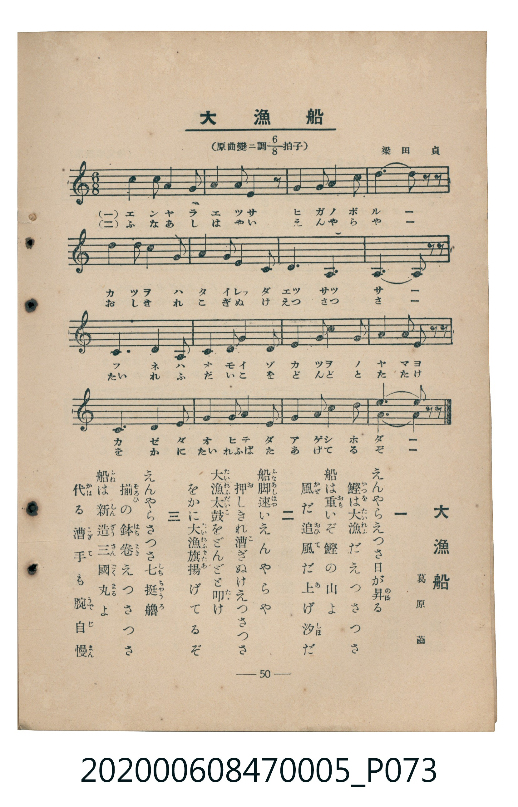

# 大漁船

> Re:Shōka 使用 AI 協助辨識與重建樂譜，可能會有錯誤。歡迎回報。

- **鋼琴伴奏版**：<br><audio controls src="tairyobune.mp3"></audio>
- **NEUTRINO 歌聲合成版**：<br><audio controls src="tairyobune_neutrino.mp3"></audio>

- 臺灣教育會公認《新定兒童唱歌》尋常科第五學年用（2020.006.0847.0005）

## 說明

原書資訊與歌詞全文（對應 P073.jpg，書頁 p. 50，參考教材第 14 首）：
調性與拍號：原曲變ホ調八分之六拍子（譜面記為一降記號 D 民謠調式／F 調音階 6/8 拍）
作曲與作歌：梁田貞、葛原𦱳


## 歌詞

```text
一　えんやらえつさ日が昇（のぼ）る
鰹（かつを）は大漁（たいれふ）だえつさつさ
船は重（おも）いぞ鰹の山よ
風（かぜ）だ追風（おひて）だ上（あ）げ汐（しほ）だ

二　船脚速（ふなあしはや）いえんやらや
押（お）しきれ漕ぎぬけえつさつさ
大漁太鼓（たいれふだいこ）をどんどと叩（たゝ）け
をかに大漁旗（たいれふばた）揚（あ）げてるぞ

三　えんやらさつさ七挺艪（しちちゃうろ）
揃（そろ）ひの鉢卷（はちまき）えつさつさ
船（ふね）は新造三國丸（しんざうさんごくまる）よ
代（かは）る漕手（こぎて）も腕自慢（うでじまん）
```

## ABC

<div class="abc-score" data-abc-src="tairyobune.abc" aria-label="五線譜載入中"></div>

[下載 ABC 原始檔](tairyobune.abc)

## TMD 檔案連結

- [主旋律 TMD 檔案](tairyobune.tmd) [[在 TMD Studio 編輯](https://tmdlang.github.io/Tmd-TS/#tmd=s7IKdvYPcrWy4qpTUCpJTLdSSM7PyUlNLsnMz7MqzsjMK0nNjM_KTMmPL87Iz05Ugisry88pzU21Si9KTEmNN403MjAyiDcwMIs3sDAxBzIMTBFKi_NLi5JTrYqTM_Lzc-JLUitKkvLzsxHyBUX5Zal5iXlANQVFIBtTwIoQClLLMlNSQdKpKZkl-UWZiTlI7kgtKga7FWxJfElRYl5xclFmAcgDCFUlGalAx4IlC_KLkIyGSJQnlqQWIQSBVqRn5lmVJGYCPQ3yeHlifG5iZl5OYl6KEpeWlsLTJcuf7Wl80bFTQUuLS9FWwdDAgsveVsGNKzu10lbBJZfLxkzfwg5k3ov2Xc8bFz-bOvNF06Znc5qftq55sar3cUPXs2kbnq6b9bR10vPVS59O2fhsbc_jhu6nG7qf7tjxfPnE52vWPNk15enaHU93bnk-ZcX7PR2g8NUDhq8eKHyBDAPT93s6lbi49LUUbKkFuBQUFJ72zX82e8eLze0vVnS96GgHuuvFynlPW1c8m9YOdMXTDb3P2jsVAgzMjfWyCtLf7-kBKn65oFGhQE_B1ADIfdrf_KKhGejdZ3MnAD2hYGii8HLZNKBT3--ZBTL-xar9zxqWgwzu7n0xcz5QFGzhphfruh43zwbKPm1d_bSj7cnO7qeta4Fqnq6dALT2xdo5L-cuerFixvOmXU92NLyc2QtkA7UruCg82zDxxZoFII17-t_v6XcD2fBy_uaXs_oUgFGgADQCaDnI5id754Ds6WgHMdb2AG1-tqjx-ZQNLzbNe9zQ-GLibKBDPizbuJkLrHhHw-OGhseNHY-bJj9uannc1AliNy553Dj12fSljxt7ns0ABcfjxnWPG_cALXjc1A3S9nLDTrBoN0hp0ySQRON6SFoBi89_3Ag0q-dx41aw1AK4oRASHEAdO4F6XrYDnQ2U63rc1ARW2vK4cR7QdKCFTzdufNzUAbZtEShhgG2bAzHvxf69MMGux42bHjcug4g_2dEFFoSYNenZRlCgPm6c_rhxN0QBxNO7gGmwAeiAFy2zXjYA4waoZOvjxlVAfWC164EhAXMMUsA0tYA0P-sChgPIXrAKoOpeoEef7QH6rO9x45rHjROx-BUSMk-XrHq5ZzJa-IADB2gPUBxow6THjStBFgLJxhVP-1dCFTfNBVs2EWQWWBEwJFZDDH02fTqGiRuAXKCGZ_2zkAMDGEjA2AMGLzTiOzEiHuriJzuan_XsetG5ChZ2C0GoqflxY9vjJlgqe9bfDJaeCxECR8K6l52LnvZuB4uvB2vbBwwesCy26IeF-1pI8gEWFC8bgDHY-XRO95MdO6CWgwJjGshmoGYQe8rjxn6QuU3d4AADp48nuxfD0sd6SBoFxsezTqAKoCBQDzBiwOmjqelF69QX7auetS4CSwENXf64cQbYOFD4g8yivHCBAgUtfS6ukMTMosr8pNK8VKuAzMS8fIcag5pqkDUKNhZadmAGtnJNAVQs7mh4sbBHQcNE4emG_ufrG3TghZEmFg1Ay6CGaQA1aloBk8kKkMDj5s1AvATCXKlQgxBvATK3gphAABRungQWbloDZPYB8RyY-GqomsfNe6AsZLt29YDsagQbBMxBQNwEYU4HaW5cDzEUaFdjC8Kuxg6I8GSIVFMnVBzIwWFXjYJZvIIuiDACUkZAvjGQNgWTBiiyxmBZMyAXKACUA8qCTfAxhPhdFx4kIBYsREBsSIDoKsRDgwMoBg0NkOwcaGCAzAWpAaqCmGsE8hBIH8z7IBbM9yAzIJ6Hmgv0OkgM4nMQqxPqcQxzjXG7F2wbqnubtoPFGkH4cfNisNHLwE5ei2I0_iS3q4eyJAdOK2CXNW-CMPvBjtsPie8lQAFQiC4H4gZoyINUgyW3wpgQHxKR6LpgKQ1YyEDM6AEH8WSIODAVN66BMCdCgx5Y_EAEpsKYIPGpuFOdKTgVgUhjIA-U9ozBqQ6cxuJByEDBOB6EQKkQSIFCGsxDTXegdAMLFxALFiygaAKHyuPmqWAJ5GCJh4cKJIpBkY0t8XVBkxwoGEAGwkIBJAoJBBALOQyAJkODAJIoQXZjS357wW5aC8sOwKwASlH98KQ2D2zfWqLdTKDA66Qo9QFDEBaPkOQADeVVEM4icFCDk8k-sDhmYoV4D1pYzgNicFGJPfHNh1kGzNugIAeVAaCgXAAXhKbDpklg8ZUQDjDjQ5mNK8DiYHNAFCiG0FIfKL2BSjlw0QZMjEhFICw5GoGlEQUiRpEHTleg-AKnDXiQgNiQEAHFICxAUBMpLDhAbEhooKc8UKMDYjwwBECJDBYGIDYkCEBysBCAlnwQFtz_IDbE-2jJD6vTIeUcsERs2oYo5KAlIkh0C1h0Pdjp4OQJLLMRTsebAJ_Onk2F4g8czeCCBJaboQlwEhC3gQXBkfu4aRFE7Sawr4CdAqg4RAFYC-7CDximsPTXDaFWIycnRJoEtgbBEtBqGeiIxmVASbAmkPg8XJZBCj9QSoOkL-Qq1hRaxYKKRnhhCK5xsRd9oCjZg1S-QdIfJEAQoovA6iDBARKdDQ0NrKUeMADA5gK9DyKhvoekR2S_g4IE4n-QMoj3QSq6ob7HXvBBHQ0t6sCGN20G61sHd_QisCjYtOZ2IGsHNKOAHA1SizC3lotL104B0RZUAPKUuQA)]
- [鋼琴伴奏 TMD 檔案](tairyobune_piano.tmd) [[在 TMD Studio 編輯](https://tmdlang.github.io/Tmd-TS/#tmd=s7IKdvYPcrWy4tLSUni6ZPmzPY0vOna-39PxsnvP8wlbnuzZ8nRp__POjvd7OhW0tLgUbRUMDSy47G0V3LiyUyttFVxyuWzM9C3suOoUlF6073reuPjZ1JkvmjY9m9P8tHXNi1W9jxu6nk3b8HTdrKetk56vXvp0ysZna3seN3Q_3dD9dMeO58snPl-z5smuKU_X7ni6c8vzKSuAVhsZGBnoGRiY6RlYmJgDGQamQNuVuLhCEjOLKvOTSvNSrQIyE_PygzwcagxqqrkUgMDGQssOzNDXUrBFBwogO3Y0vFjYo6BhovB0Q__z9Q06CgEG5sZ6WQXpmlg0aOmDDatRMItX0AURRkDKCMg3BtKmYNIARdYYLGsG5AIFgHJAWbAJPoY1Co-bVgBFHzdvBuIlYNZKoFqYaAuQtRXIigeJNU8CiTWtAbL6wLJzwKKrweaC1ABVQcw1Aoo3gvQ9blwFxE1g1nSQ6sb1YDOA5ja2wMxt7ACLTQaLg1idYBeA2GjmGuN2L9g2VPc2bQeLNYLw4-bFYKOXgZ28FsVo_FGzq4ecqDEFBzWINAbyQBFkDI4acETEg5CBgnE8CIGiCkiBnAPmoUYOKHDB3mreBGb1gz22H-yXJUD-msfNU8ESDdBYAymOB4cChAULG2wx1AWNl8eNvWADe8CxMRks2gfEa8CsidA4ety4BGRy41QoCyQKshtbHO0Fu2ktLM0A0wso2Pvh8TEPbN9aot1MIPd0khNFoEgB5RdwJgHGGFJmgsWZEVgakbUwMg848EGeAgcgNHZWgdmLwDEE8uY-sCh6TEKCBJKE5wHxCozomQ_JI5CYAcXEVnCYLwCzQTkIHFNNk8CiK2F5CMJqXAEWnQ9mzwfHIlocYXU6JMcA81bTNkR2geYtkOgWsOh6sNPBcQjM_Qin442lp7Nnk5uRQBECiQbkMs0UWqaBshk8Y4GLOOzZCOTyPUh5BRJNk4C4DUl0EVjdJnhYzAb7tQF7DgKGPdjcxm4wuRoS5pBoA0UaKMoeN24ARwFIClIQAq1sXAZW0Q0WBQUktkwEdTQ024ANb9oM1rcO7uhFYFGwac3tQNYOaHoCORqkFmFuLWYd5YOjjnqxcdXLpsZnczqfds1-srMbWO0Cq0UFYE2q8Ky7F1gDA3mQuvf9np6nG6c-79_3bPf-F3s6X27Y-XLtrMcNjc8mN73cM_nZ2h0vOlaBDFi78OWKDc82LH7avQi59opXiDaLz42FkkZArhGIByJAZSKQbwyWBpMIPqRyw6sZXRrER6SJGgVDoLQhUBKIkZjATI9sDE4zQUU3smOwORXZNhSDUOxD4qDZhlsPum14_IaulORwIzpYgalL104BkcCifYDWo4kYYYgYg0WUuQA)]

## 分析

```text
================================================================================
📊 TMD Song Profile: [ 大漁船 ]
================================================================================
⏱  Duration:       0:26 (26.7s), 16 measures total
🎼 Key & Tempo:    首調基準 F, != 108.0 BPM, <6/8>
   - 分析範圍：      由實際發聲的音符與和弦推測調性；播放脈絡另行呈現
🎤 人聲音域:    A3 (MIDI 57) – D5 (MIDI 74) [跨度: 17 個半音 / 1.4 個八度, 難度: challenging]
   - 最低音:  A3 in [Tairyobune #1 @ m.7, 0:10]
   - 最高音: D5 in [Tairyobune #1 @ m.4, 0:05]
   - 適合: soprano, mezzo-soprano, contralto, tenor, baritone, bass
🏛  結構:      Tairyobune (26.7s)
⚡ 編曲密度:        Peak 1 軌道同時演奏
🗝  調性診斷：       G 大調（純淨自然大調，未偵測到可信轉調）
   - 風格氣質:    純淨自然大調（陽光明朗、易唱易記，無明顯調外色彩）
   - 轉調歷程:    全曲維持單一推測調性（未偵測到可信轉調）
   - 核心骨幹音:  D, A, G, C
   - 調性數值:    G 大調 [相關度: 0.73, 穩定度: Moderate, 自然音純度: 100.0%]
   - 候選調性 (K-S): G 大調 (0.73), D 大調 (0.66), C 大調 (0.58)
   - 五度圈歷程:   +1
   - 各段落調性細節:
     • [Tairyobune #1]: G 大調 (r: 0.73, 自然音純度: 100.0%)

  [ 五度圈游移軌跡 ]
               C  
         F           [G ]*
      Bb               D  
      Eb               A  
         Ab           E  
            Db       B  
               F# 
     (* = active key center)

  [ 十二半音累積音高分佈 ]
     C  : █████████████████         21.2%
     C# :                            0.0%
     D  : ████████████████████████  30.6%
     D# :                            0.0%
     E  :                            0.0%
     F  :                            0.0%
     F# :                            0.0%
     G  : ██████████████████        23.5%
     G# :                            0.0%
     A  : ███████████████████       24.7%
     A# :                            0.0%
     B  :                            0.0%
--------------------------------------------------------------------------------
Assignment 軌道音域：
  - Piano         : A3 – D5 (17 個半音 / 1.4 個八度, 58 個音符)
================================================================================
```


## 原書掃描頁




