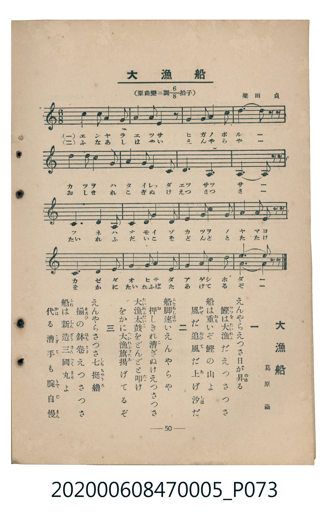

# 大漁船

> Re:Shōka 使用 AI 協助辨識與重建樂譜，可能會有錯誤。歡迎[回報](https://github.com/TMDLang/reshoka/issues)。

- **鋼琴伴奏版**：<br><audio controls src="tairyobune.mp3"></audio>
- **NEUTRINO 歌聲合成版**：<br><audio controls src="tairyobune_neutrino.mp3"></audio>

- 臺灣教育會公認《新定兒童唱歌》尋常科第五學年用（2020.006.0847.0005）

## 說明

原書資訊與歌詞全文（對應 P073.jpg，書頁 p. 50，參考教材第 14 首）：
調性與拍號：原曲變ホ調八分之六拍子（譜面記為一降記號 D 民謠調式／F 調音階 6/8 拍）
作曲與作歌：梁田貞、葛原𦱳


## 歌詞

```text
一　えんやらえつさ日が昇（のぼ）る
鰹（かつを）は大漁（たいれふ）だえつさつさ
船は重（おも）いぞ鰹の山よ
風（かぜ）だ追風（おひて）だ上（あ）げ汐（しほ）だ

二　船脚速（ふなあしはや）いえんやらや
押（お）しきれ漕ぎぬけえつさつさ
大漁太鼓（たいれふだいこ）をどんどと叩（たゝ）け
をかに大漁旗（たいれふばた）揚（あ）げてるぞ

三　えんやらさつさ七挺艪（しちちゃうろ）
揃（そろ）ひの鉢卷（はちまき）えつさつさ
船（ふね）は新造三國丸（しんざうさんごくまる）よ
代（かは）る漕手（こぎて）も腕自慢（うでじまん）
```

## ABC

<div class="abc-score" data-abc-src="tairyobune.abc" aria-label="五線譜載入中"></div>

[下載 ABC 原始檔](tairyobune.abc)

## TMD 檔案連結

- [主旋律 TMD 檔案](tairyobune.tmd) [[在 TMD Studio 編輯](https://tmdlang.github.io/Tmd-TS/#tmd=s7IKdvYPcrWy4qpTUCpJTLdSSM7PyUlNLsnMz7MqzsjMK0nNjM_KTMmPL87Iz05Ugisry88pzU21Si9KTEmNN403MjAyiDcwMIs3sDAxBzIMTBFKi_NLi5JTrYqTM_Lzc-JLUitKkvLzsxHyBUX5Zal5iXlANQVFIBtTwIoQClLLMlNSQdKpKZkl-UWZiTlI7kgtKga7FWxJfElRYl5xclFmAcgDCFUlGalAx4IlC_KLkIyGSJQnlqQWIQSBVqRn5lmVJGYCPQ3yeHlifG5iZl5OYl4KsqqSjHyg_wsyKq0yMotBDktOzInPTsxDCiaoswoS01OtAgzMjZW4tLQUni5Z_mxP44uOnQpaWlyKtgqGBhZc9rYKblzZqZW2Ci65XDZm-hZ2IDNetO963rj42dSZL5o2PZvT_LR1zYtVvY8bup5N2_B03aynrZOer176dMrGZ2t7Hjd0P93Q_XTHjufLJz5fs-bJrilP1-54unPL8ykr3u_pAEWPHjB69EDRA2QYmL7f06nExaWvpWBLLcCloKDwtG_-s9k7Xmxuf7Gi60VHO9BdL1bOe9q64tm0dqArnm7ofdbeqQAKB72sgvT3e3qAil8uaFQo0FMwNQByn_Y3v2hoBnr32dwJQE8oGJoovFw2DejU93tmgYx_sWr_s4blIIO7e1_MnA8UBVu46cW6rsfNs4GyT1tXP-1oe7Kz-2nrWqCap2snAK19sXbOy7mLXqyY8bxp15MdDS9n9gLZQO0KLgrPNkx8sWYBSOOe_vd7-t1ANrycv_nlrD4FYBQoAI0AWg6y-cneOSB7OtpBjLU9QJufLWp8PmXDi03zHjc0vpg4G-iQD8s2buYCK97R8Lih4XFjx-OmyY-bWh43dYLYjUseN059Nn3p48aeZzNAwfG4cd3jxj1ACx43dYO0vdywEyzaDVLaNAkk0bgeklbA4vMfNwLN6nncuBUstQBuKIQEB1DHTqCel-1AZwPluh43NYGVtjxunAc0HWjh040bHzd1gG1bBEoYYNvmQMx7sX8vTLDrceOmx43LIOJPdnSBBSFmTXq2ERSojxunP27cDVEA8fQuYBpsADrgRcuslw3AuAEq2fq4cRVQH1jtemBIwByDFDBNLSDNz7qA4QCyF6wCqLoX6NFne4A-63vcuOZx40QsfoWEzNMlq17umYwWPuDAAdoDFAfaMOlx40qQhUCyccXT_pVQxU1zwZZNBJkFVgQMidUQQ59Nn45h4gYgF6jhWf8s5MAABhIw9oDBC434ToyIh7r4yY7mZz27XnSugoXdQhBqan7c2Pa4CZbKnvU3g6XnQoTAkbDuZeeip73bweLrwdr2AYMHLIst-mHhvhaSfIAFxcsGYAx2Pp3T_WTHDqjloMCYBrIZqBnEnvK4sR9kblM3OMDA6ePJ7sWw9LEekkaB8fGsE6gCKAjUA4wYcPpoanrROvVF-6pnrYvAUkBDlz9unAE2DhT-ILMoL1ygQEFLn4srJDGzqDI_qTQPWKRmJublO9QY1FSDrFGwsdCyAzOwlWsKoGJxR8OLhT0KGiYKTzf0P1_foAMvjDSxaABaBjVMA6hR0wqYTFaABB43bwbiJRDmSoUahHgLkLkVxAQCoHDzJLBw0xogsw-I58DEV0PVPG7eA2Uh27WrB2RXI9ggYA4C4iYIczpIc-N6iKFAuxpbEHY1dkCEJ0Okmjqh4kAODrtqFMziFXRBhBGQMgLyjYG0KZg0QJE1BsuaAblAAaAcUBZsgo8hxO-68CABsWAhAmJDAkRXIR4aHEAxaGiAZOdAAwNkLkgNUBXEXCOQh0D6YN4HsWC-B5kB8TzUXKDXQWIQn4NYnVCPY5hrjNu9YNtQ3du0HSzWCMKPmxeDjV4GdvJaFKPxJ7ldPZQlOXBaAbuseROE2Q923H5IfC8BCoBCdDkQN0BDHqQaLLkVxoT4kIhE1wVLacBCBmJGDziIJ0PEgam4cQ2EOREa9MDiByIwFcYEiU_FnepMwakIRBoDeaC0ZwxOdeA0Fg9CBgrG8SAESoVAChTSYB5qugOlG1i4gFiwYAFFEzhUHjdPBUsgB0s8PFQgUQyKbGyJrwua5EDBADIQFgogUUgggFjIYQA0GRoEkEQJshtb8tsLdtNaWHYAZgVQiuqHJ7V5YPvWEu1mAgVeJ0WpDxiCsHiEJAdoKK-CcBaBgxqcTPaBxTETK8R70MJyHhCDi0rsiW8-zDJg3gYFOagMAAXlArggNB02TQKLr4RwgBkfymxcARYHmwOiQDGElvpA6Q1UyoGLNmBiRCoCYcnRCCyNKBAxijxwugLFFzhtwIMExIaECCgGYQGCmkhhwQFiQ0IDPeWBGh0Q44EhAEpksDAAsSFBAJKDhQC05IOw4P4HsSHeR0t-WJ0OKeeAJWLTNkQhBy0RQaJbwKLrwU4HJ09gmY1wOt4E-HT2bCoUf-BoBhcksNwMTYCTgLgNLAiO3MdNiyBqN4F9BewUQMUhCsBacBd-wDCFpb9uCLUaOTkh0iSwNQiWgFbLQEc0LgNKgjWBxOfhsgxS-IFSGiR9IVexptAqFlQ0wgtDcI2LvegDRckepPINkv4gAYIQXQRWBwkOkOhsaGhgLfWAAQA2F-h9EAn1PSQ9IvsdFCQQ_4OUQbwPUtEN9T32gg_qaGhRBza8aTNY3zq4oxeBRcGmNbcDWTugGQXkaJBahLm1XFy6dgqItqACkKfMBQA)]
- [鋼琴伴奏 TMD 檔案](tairyobune_piano.tmd) [[在 TMD Studio 編輯](https://tmdlang.github.io/Tmd-TS/#tmd=s7IKdvYPcrWy4qpTUCpJTLdSyC8qychPL0osyKi0ysgsLskvykxOzInPTsxLVIIrKs4vLUpOjS9ITE-1CjAwN1bi0tJSeLpk-bM9jS86dr7f0_Gye8_zCVue7NnydGn_886O93s6FbS0uBRtFQwNLLjsbRXcuLJTK20VXHK5bMz0LexABr9o3_W8cfGzqTNfNG16Nqf5aeuaF6t6Hzd0PZu24em6WU9bJz1fvfTplI3P1vY8buh-uqH76Y4dz5dPfL5mzZNdU56u3fF055bnU1YArTYyMDLQMzAw0zOwMDEHMgxMgbYrcXGFJGYWVeYnleYBnZyZmJcf5OFQY1BTzaUABDYWWnZghr6Wgi06UADZsaPhxcIeBQ0Thacb-p-vb9BRAHlbL6sgXROLBi19sGE1CmbxCrogwghIGQH5xkDaFEwaoMgag2XNgFygAFAOKAs2wcewRuFx0wqg6OPmzUC8BMxaCVQLE20BsrYCWfEgseZJILGmNUBWH1h2Dlh0NdhckBqgKoi5RkDxRpC-x42rgLgJzJoOUt24HmwG0NzGFpi5jR1gsclgcRCrE-wCEBvNXGPc7gXbhurepu1gsUYQfty8GGz0MrCT16IYjT9qdvWQEzWm4KAGkcZAHiiCjMFRA46IeBAyUDCOByFQVAEpkHPAPNTIAQUu2FvNm8CsfrDH9oP9sgTIX_O4eSpYogEaayDF8eBQgLBgYYMthrqg8fK4sRdsYA84NiaDRfuAeA2YNREaR48bl4BMbpwKZYFEQXZji6O9YDethaUZYHoBBXs_PD7mge1bS7SbCeSeTnKiCBQpoPwCziTAGEPKTLA4MwJLI7IWRuYBBz7IU-AAhMbOKjB7ETiGQN7cBxZFj0lIkECS8DwgXoERPfMheQQSM6CY2AoO8wVgNigHgWOqaRJYdCUsD0FYjSvAovPB7PngWESLI6xOh-QYYN5q2obILtC8BRLdAhZdD3Y6OA6BuR_hdLyx9HT2bHIzEihCINGAXKaZQss0UDaDZyxwEYc9G4Fcvgcpr0CiaRIQtyGJLgKr2wQPi9lgvzZgz0HAsAeb29gNJldDwhwSbaBIA0XZ48YN4CgASUEKQqCVjcvAKrrBoqCAxJaJoI6GZhuw4U2bwfrWwR29CCwKNq25HcjaAU1PIEeD1CLMrcWso3xw1FEvNq562dT4bE7n067ZT3Z2A6tdYLWoAKxJFZ519wJrYCAPUve-39PzdOPU5_37nu3e_2JP58sNO1-unfW4ofHZ5KaXeyY_W7vjRccqkAFrF75cseHZhsVPuxch117xCtFm8bmxUNIIyDUC8UAEqEwE8o3B0mASwYdUbng1o0uD-Ig0UaNgCJQ2BEoCMRITmOmRjcFpJqjoRnYMNqci24ZiEIp9SBw023DrQbcNj9_QlZIcbkQHKzB16dopIBJYtA_QejQRIwwRY7CIMhcA)]

## 分析

```text
================================================================================
📊 TMD Song Profile: [ 大漁船 ]
================================================================================
⏱  Duration:       0:26 (26.7s), 16 measures total
🎼 Key & Tempo:    首調基準 F, != 108.0 BPM, <6/8>
   - 分析範圍：      由實際發聲的音符與和弦推測調性；播放脈絡另行呈現
🎤 人聲音域:    A3 (MIDI 57) – D5 (MIDI 74) [跨度: 17 個半音 / 1.4 個八度, 難度: challenging]
   - 最低音:  A3 in [Tairyobune #1 @ m.7, 0:10]
   - 最高音: D5 in [Tairyobune #1 @ m.4, 0:05]
   - 適合: soprano, mezzo-soprano, contralto, tenor, baritone, bass
🏛  結構:      Tairyobune (26.7s)
⚡ 編曲密度:        Peak 1 軌道同時演奏
🗝  調性診斷：       G 大調（純淨自然大調，未偵測到可信轉調）
   - 風格氣質:    純淨自然大調（陽光明朗、易唱易記，無明顯調外色彩）
   - 轉調歷程:    全曲維持單一推測調性（未偵測到可信轉調）
   - 核心骨幹音:  D, A, G, C
   - 調性數值:    G 大調 [相關度: 0.73, 穩定度: Moderate, 自然音純度: 100.0%]
   - 候選調性 (K-S): G 大調 (0.73), D 大調 (0.66), C 大調 (0.58)
   - 五度圈歷程:   +1
   - 各段落調性細節:
     • [Tairyobune #1]: G 大調 (r: 0.73, 自然音純度: 100.0%)

  [ 五度圈游移軌跡 ]
               C  
         F           [G ]*
      Bb               D  
      Eb               A  
         Ab           E  
            Db       B  
               F# 
     (* = active key center)

  [ 十二半音累積音高分佈 ]
     C  : █████████████████         21.2%
     C# :                            0.0%
     D  : ████████████████████████  30.6%
     D# :                            0.0%
     E  :                            0.0%
     F  :                            0.0%
     F# :                            0.0%
     G  : ██████████████████        23.5%
     G# :                            0.0%
     A  : ███████████████████       24.7%
     A# :                            0.0%
     B  :                            0.0%
--------------------------------------------------------------------------------
Assignment 軌道音域：
  - Piano         : A3 – D5 (17 個半音 / 1.4 個八度, 58 個音符)
================================================================================
```


## 原書掃描頁




