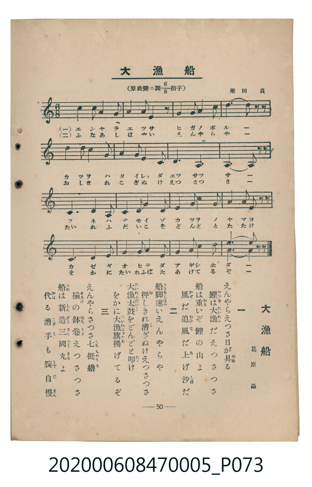

# 大漁船

> Re:Shoka 使用 AI 辨識樂譜，可能會有錯誤。歡迎回報。

<audio controls src="tairyobune.mp3"></audio>

- 臺灣教育會公認《新定兒童唱歌》尋常科第五學年用（2020.006.0847.0005）

## 說明

原書資訊與歌詞全文（對應 P073.jpg，書頁 p. 50，參考教材第 14 首）：
調性與拍號：原曲變ホ調八分之六拍子（譜面記為一降記號 D 民謠調式／F 調音階 6/8 拍）
作曲與作歌：梁田貞、葛原𦱳

## 歌詞

```text
一　えんやらえつさ日が昇（のぼ）る
鰹（かつを）は大漁（たいれふ）だえつさつさ
船は重（おも）いぞ鰹の山よ
風（かぜ）だ追風（おひて）だ上（あ）げ汐（しほ）だ

二　船脚速（ふなあしはや）いえんやらや
押（お）しきれ漕ぎぬけえつさつさ
大漁太鼓（たいれふだいこ）をどんどと叩（たゝ）け
をかに大漁旗（たいれふばた）揚（あ）げてるぞ

三　えんやらさつさ七挺艪（しちちゃうろ）
揃（そろ）ひの鉢卷（はちまき）えつさつさ
船（ふね）は新造三國丸（しんざうさんごくまる）よ
代（かは）る漕手（こぎて）も腕自慢（うでじまん）
```

## ABC

```abc
X:1
T:大漁船
M:6/8
L:1/16
Q:3/8=72
K:Dm
V:V1 name="Piano" snm="Pia"
[V:V1]
D4 D2 G4 G2 | A4 c2 A4 z2 | D4 D2 G2 A2 G2 | d6 d2 z2 z2 |
c4 d2 c4 A2 | G4 A2 c2 A2 G2 | D2 D2 z2 A,2 A,2 z2 | A,6 A,2 z2 z2 |
G6 c4 D2 | C4 D2 G4 A2 | G4 G2 c4 G2 | A4 c2 d2 z2 z2 |
c6 A4 G2 | D4 D2 G2 A2 c2 | d4 d2 c2 A2 G2 | D6 D2 z2 z2 |
```

## TMD 檔案連結

- [主旋律 TMD 檔案](tairyobune.tmd) [[在 TMD Studio 編輯](https://tmdlang.github.io/Tmd-TS/#tmd=s7IKdvYPcrWy4qpTUCpJTLdSSM7PyUlNLsnMz7MqzsjMK0nNjM_KTMmPL87Iz05Ugisry88pzU21Si9KTEmNN403MjAyiDcwMIs3sDAxBzIMTBFKi_NLi5JTrYqTM_Lzc-JLUitKkvLzsxHyBUX5Zal5iXlANQVFIBtTwIoQClLLMlNSQdKpKZkl-UWZiTlI7kgtKga7FWxJfElRYl5xclFmAcgDCFUlGalAx4IlC_KLkIyGSJQnlqQWKXFpaSk8XbL82Z7GFx07FbS0uBRtFQwNLLjsbRXcuLJTK20VXHK5bMz0LexA2l-073reuPjZ1JkvmjY9m9P8tHXNi1W9jxu6nk3b8HTdrKetk56vXvp0ysZna3seN3Q_3dD9dMeO58snPl-z5smuKU_X7ni6c8vzKSve7-kAhZweMOT0QCEHZBiYvt_TqcTFpa-lYEstwKWgoPC0b_6z2TtebG5_saLrRUc70F0vVs572rri2bR2oCuebuh91t6pEGBgbqyXVZD-fk8PUPHLBY0KBXoKpgZA7tP-5hcNzUDvPps7AegJBUMThZfLpgGd-n7PLJDxL1btf9awHGRwd--LmfOBomALN71Y1_W4eTZQ9mnr6qcdbU92dj9tXQtU83TtBKC1L9bOeTl30YsVM5437Xqyo-HlzF4gG6hdwUXh2YaJL9YsAGnc0_9-T78byIaX8ze_nNWnAIwCBaARQMtBNj_ZOwdkT0c7iLG2B2jzs0WNz6dseLFp3uOGxhcTZwMd8mHZxs1cYMU7Gh43NDxu7HjcNPlxU8vjpk4Qu3HJ48apz6YvfdzY82wGKDgeN6573LgHaMHjpm6QtpcbdoJFu0FKmyaBJBrXQ9IKWHz-40agWT2PG7eCpRbADYWQ4ADq2AnU87Id6GygXNfjpiaw0pbHjfOApgMtfLpx4-OmDrBti0AJA2zbHIh5L_bvhQl2PW7c9LhxGUT8yY4usCDErEnPNoIC9XHj9MeNuyEKIJ7eBUyDDUAHvGiZ9bIBGDdAJVsfN64C6gOrXQ8MCZhjkAKmqQWk-VkXMBxA9oJVAFX3Aj36bA_QZ32PG9c8bpyIxa-QkHm6ZNXLPZPRwgccOEB7gOJAGyY9blwJshBINq542r8SqrhpLtiyiSCzwIqAIbEaYuiz6dMxTNwA5AI1POufhRwYwEACxh4weKER34kR8VAXP9nR_Kxn14vOVbCwWwhCTc2PG9seN8FS2bP-ZrD0XIgQOBLWvexc9LR3O1h8PVjbPmDwgGWxRT8s3NdCkg-woHjZAIzBzqdzup_s2AG1HBQY00A2AzWD2FMeN_aDzG3qBgcYOH082b0Ylj7WQ9IoMD6edQJVAAWBeoARA04fTU0vWqe-aF_1rHURWApo6PLHjTPAxoHCH2QW5YULFCho6XNxhSRmFlXmJ5XmpVoFZCbm5TvUGNQoVIPsUbAxNNOyA7OwlWwKoIJxR8OLhT0KGiYKTzf0P1_foAMvjjSxaABaBzVMA6hR0wqYUFaABB43bwbiJRDmSoUahHgLkLkVxAQCoHDzJLBw0xogsw-I58DEV0PVPG7eA2Uh27WrB2RXI9ggYB4C4iYIczpIc-N6iKFAuxpbEHY1dkCEJ0Okmjqh4kAODrtqFMziFXTBEMwwgnJAdI2CMZRnCsQwtgFYBlMXSB6iywwqBZaG6gDrAucQ3PGyq4eyeAEHKDj8mzdBmP1gz--HBMoSoAAoEpYDcQM0wkCqwZJbYUyQOCz28MZMFyw6gHkRYkYPOAomQ8SBUd24BsKcCI0aYC6FCEyFMUHiU3FHDSjYYYEIY4OCuQYeTSAeLHKggQ-KDzABCnJjEANMQKINzIRBuDgxkbOjk6LIaUZ4ExJa0LhZBeEsAscPOBT3gcUx47IPnGmgGW4eEIOzG_a4mQ-zDJg5QPECykegsF4AF4RGU9MksPhKCAeYbaDMxhVgcbA5IAoUiWiRA4sCWP6AZwZgvGHNUqgxB6Jh2jAzGwnZ5uns2VTINmD_gxMgLHNAY2YSELeBBcG-fty0CKJ2ExBvB4rPhopDFIC14M40wOCGRUw3hFqNHM6IyAJWtmAJaJkHdETjMqAkWBNIfB4uyxCZBhbkiADGXmaB1CPKLFhWQ8tQ8OIMNcvUcnHp2ikgaiMFIE-ZiwsA)]
- [鋼琴伴奏 TMD 檔案](tairyobune_piano.tmd) [[在 TMD Studio 編輯](https://tmdlang.github.io/Tmd-TS/#tmd=s7IKdvYPcrWy4tLSUni6ZPmzPY0vOna-39PxsnvP8wlbnuzZ8nRp__POjvd7OhW0tLgUbRUMDSy47G0V3LiyUyttFVxyuWzM9C3suOoUlF6073reuPjZ1JkvmjY9m9P8tHXNi1W9jxu6nk3b8HTdrKetk56vXvp0ysZna3seN3Q_3dD9dMeO58snPl-z5smuKU_X7ni6c8vzKSuAVhsZGBnoGRiY6RlYmJgDGQamQNuVuLhCEjOLKvOTSvNSrQIyE_PygzwcagxqFKq5FIDAxtBMyw7M0tdSsEUHCiBbdjS8WNijoGGi8HRD__P1DToKAQbmxnpZBemaWDRo6YMNq1Ewi1fQBUMwwwjKAdE1CsZQnikQw9gGYBlMXSB5iC4zqBRYGqoDrIsLv_t39ZDjfpDbYDbB2CC31MD9AuLBfAB1IcjRYALkLmMQA0xA_AZmwiBcnBgf7Ogkxwcwd8JCGh6sQM9hjRxU74FomDbMaCMhAp7Onk1JBMBchnAH9kQCUo9IJLBoQ4scePpBDf5azFzig5JLLBCZ5MXGVS-bGp_N6XzaNfvJzm5gzgfmTAVgZlZ41t0LLASAPEj2f7-n5-nGqc_79z3bvf_Fns6XG3a-XDvrcUPjs8lNL_dMfrZ2x4uOVSAD1i58uWLDsw2Ln3YvQs4-8QrRZvG5sVDSCMg1AvFABCgtAfnGYGkwieAbENaMLg3iG4A0Qu02BEobAiWBGIkJTBnIxuA00wDNMdicimwbikEo9iFx0GzDrQfdNjx-Q1dKcrgRHazA5KVrp4BIYQoYPGUuLgA)]

## 分析

```text
================================================================================
📊 TMD Song Profile: [ 大漁船 ]
================================================================================
⏱  Duration:       0:26 (26.7s), 16 measures total
🎼 Key & Tempo:    首調基準 F, != 108.0 BPM, <6/8>
   - 分析範圍：      由實際發聲的音符與和弦推測調性；播放脈絡另行呈現
🎤 人聲音域:    A3 (MIDI 57) – D5 (MIDI 74) [跨度: 17 個半音 / 1.4 個八度, 難度: challenging]
   - 最低音:  A3 in [Tairyobune #1 @ m.7, 0:10]
   - 最高音: D5 in [Tairyobune #1 @ m.4, 0:05]
   - 適合: soprano, mezzo-soprano, contralto, tenor, baritone, bass
🏛  結構:      Tairyobune (26.7s)
⚡ 編曲密度:        Peak 1 軌道同時演奏
🗝  調性診斷：       G 大調（純淨自然大調，未偵測到可信轉調）
   - 風格氣質:    純淨自然大調（陽光明朗、易唱易記，無明顯調外色彩）
   - 轉調歷程:    全曲維持單一推測調性（未偵測到可信轉調）
   - 核心骨幹音:  D, A, G, C
   - 調性數值:    G 大調 [相關度: 0.73, 穩定度: Moderate, 自然音純度: 100.0%]
   - 候選調性 (K-S): G 大調 (0.73), D 大調 (0.66), C 大調 (0.58)
   - 五度圈歷程:   +1
   - 各段落調性細節:
     • [Tairyobune #1]: G 大調 (r: 0.73, 自然音純度: 100.0%)

  [ 五度圈游移軌跡 ]
               C  
         F           [G ]*
      Bb               D  
      Eb               A  
         Ab           E  
            Db       B  
               F# 
     (* = active key center)

  [ 十二半音累積音高分佈 ]
     C  : █████████████████         21.2%
     C# :                            0.0%
     D  : ████████████████████████  30.6%
     D# :                            0.0%
     E  :                            0.0%
     F  :                            0.0%
     F# :                            0.0%
     G  : ██████████████████        23.5%
     G# :                            0.0%
     A  : ███████████████████       24.7%
     A# :                            0.0%
     B  :                            0.0%
--------------------------------------------------------------------------------
Assignment 軌道音域：
  - Piano         : A3 – D5 (17 個半音 / 1.4 個八度, 58 個音符)
================================================================================
```


## 原書掃描頁




