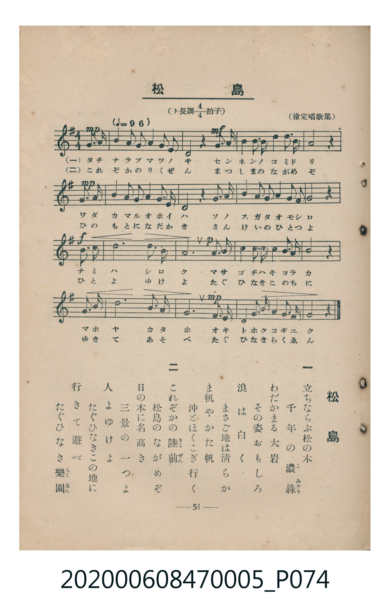

# 松島

<audio controls src="matsushima.mp3"></audio>

- 臺灣教育會公認《新定兒童唱歌》尋常科第五學年用（2020.006.0847.0005）

## 說明

原書資訊與歌詞全文（對應 P074.jpg，書頁 p. 51，參考教材第 15 首）：
調性與拍號：ト長調四分之四拍子（G 大調 4/4 拍），♩= 96
出處：（檢定唱歌集）

## 跨冊／重複收錄參照

> 同曲（〈松島〉；收錄於《新定兒童唱歌》五年級與《唱歌帖》P215《小公學校唱歌教材集》抄譜）

- **[同曲]** 楊金土手抄《唱歌帖》第 10 冊・X（2020.006.0843）：[**〈松島 (松島)〉**](../../../shokacho/vol_10/p215_matsushima/index.md)（`G` / `4/4` — [原始 TMD](../../../shokacho/vol_10/p215_matsushima/matsushima.tmd)）
- 總表：[跨冊重複與同名歌曲總索引](../../../duplicate_songs.md)

## 歌詞

```text
一　立ちならぶ松の木
千年の濃綠（こみどり）
わだかまる大岩
その姿おもしろ
浪は白く
まさご地は清らか
ま帆やかた帆
沖とほくこぎ行く

二　これぞかの陸前（りくぜん）
松島のながめぞ
日の本に名高き
三景の一つよ
人よゆけよ
たぐひなきこの地に
行きて遊べ
たぐひなき樂園（らくゑん）
```

## ABC

```abc
X:1
T:松島
M:4/4
L:1/16
Q:1/4=96
K:G
V:V1 name="Piano" snm="Pia"
[V:V1]
d3 B A3 G A3 B G2 E2 | D8 z4 G3 A | B3 d e3 e d3 e d2 B2 | A12 z4 |
B3 B A3 G A3 B G2 E2 | D8 z4 A3 B | G3 G E3 G A3 B A2 F2 | G12 z4 |
B3 d e8 e3 d | B12 B3 A | G3 A B3 d e3 d B2 A2 | B12 z4 |
B3 d e8 e3 d | B12 B3 A | G3 G E3 G A3 B A2 F2 | G12 z4 |
```

## TMD 檔案連結

- [主旋律 TMD 檔案](matsushima.tmd) [[在 TMD Studio 編輯](https://tmdlang.github.io/Tmd-TS/#tmd=s7IKdvYPcrWy4tLSUng2d9_TzdsUtLS4FG0VLM247G0V3LlsTPRN7LjqFJRetO963rj42dSZL5o2PZvT_LR1zYtVvY8bup5N2_B03aynrZOer176dMrGZ2t7Hjd0P93Q_XTHjufLJz5fs-bJrilP1-54unPL8ykr3u_pMDIwMtAzMDDTM7AwMQcyDEzf7-lU4uLS11KwpRbgUlBQeNo3_9nsHS82t79Y0fWiox3orhcr5z1tXfFsWjvQFU839D5r71QIMDA30csqSH-_pweo-OWCRoUCPQVTQyD3aX_zi4ZmoHefzZ0A9ISCoanCy2XTgE59v2cWyPgXq_Y_a1gOMri798XM-UDRx80dL6duB4o_nT37aUfbk53dQAZQ9unaCUAL3RWeLlkOlFQAhqcCUBRsUs-jmSvBQQ1yb_uuFzOnAs0BKn62ahEoTMGh-XJ2G1AtF0jJkx0Njxsanq_ufty48HHjqsdNnY8btwFj7XHjumdzVoAN6W0GBjSIv7_5-bYFQKMeN05-3Lj_cePKx01dIHOAih439T9uXPC4EWjMvsdN3UB3Pd20EizROBeo9elyoPKux01NjxunP27qBUk827rqceP65zP3Pm7shygE2jn1ceOUp3M2ACWe7WgFu6UbKvd0R9vjphawBfOBbLAJm6Y9blzxuHE30ASwk_peLOwBmQb21y5gmmkACTcBxeaBNa57OXPH005gMHUAHQ7WNOdx02SoDyApFagIFAqNPY-bGoHawBLTl4IDY83jxtVPJ_S-XD3jcSPYB092dD6buR4oBwrDxiWPmzogFu8Csh43tT1unAgVAjr5ceOEx42bwEb3gt26DuzN1eBoB7kaKLrsJTCIGndi0fFsRdPTOZPA7gYGSf_jJqDJMHdTnrKhQEFLn4vLN7GkuLQ4IzM30SogMzEv36HGoEahGmSPgo2hmZYdmIUtWymAcuWOBqBfFDRMFJ5u6H--vkEHnhc0sWgAWgc1TAOoUdMKmIb2g7ze3AjEXWDWSiCeBmbNA-IWIO5TqAGqWwvSiAweN-0GK9sMkm7uhbJBykFyINZ8sFgnWH4VunYIQHbQrh6Qgxong_X3AFnzwLHSDcTrwGJdQFY_EM8BOwikDtVBjfvA5BKQdON0qAhUc-MqIO4BG9MIlgcZjttBNQqmCrpAaKxgBKYNobQxkKWrYBYPJIBKQBQyNIDSIDW6QB01QPUglqmCGZg2g5oKoUFyNVBzMSHMrBpw1sId_7t6KIr_5vWgMGluAIbLajALFOtgVhMwxJpnA2lweDb3YwR3016wBkjy2AkWWQNLUGDNi8Cs7WDtGMkHJbiR438TSBcw0oAlF5i1AojBDgJH4QJwigBFICjFoTqocSrYwslg6YlgEWD6hcb_JrBR8PTR1IHXQbCYIy_-YWproCnBEKID2RgQbQ4xBqKG_BSwo5OyFADJ9_NR4xgUbyDhteDAAiUS1LAGphOQoq1g6S1gkSaoCaCy4nEzOKyBpQlIHhR9uMMaM_KBUY4cP8CCHSw8EXvEAQtuMDkBHO8QE0BJBVwkAYsTWApYCJbH7xb0HIuAEL4pXAUmhIiDcj0s_6OaZQrmgyIetxlExjmwRUJZnINjD5S7m5cghzMk4-8H59jZGOEMzNSQ2AVJg6IBUj6ASxBQgd8EDufmZdiTDEo4I8U5NHJ7gXgZkmWNkNw_FxxpoNIF1S344rypE1xRgFiQJINRVaC4hZpxTmlOr-Xi0rVTQLQIFIA8ZS4uAA)]
- [鋼琴伴奏 TMD 檔案](matsushima_piano.tmd) [[在 TMD Studio 編輯](https://tmdlang.github.io/Tmd-TS/#tmd=s7IKdvYPcrWy4tLSUng2d9_Tzdve7-l42b3n-YQtT_Zsebq0_3lnx_s9nQpaWlyKtgqWZlz2tgruXDYm-iZ2XHUKSi_adz1vXPxs6swXTZuezWl-2rrmxarexw1dz6ZteLpu1tPWSc9XL306ZeOztT2PG7qfbuh-umPH8-UTn69Z82TXlKdrdzzdueX5lBVAG40MjAz0DAzM9AwsTMyBDANToKVKXFy-iSXFpcUZmbmJVgGZiXn5QR4ONQY1CtVcCkBgY2imZQdm6Wsp2KIDBZAtOxpeLOxR0DBReLqh__n6Bh2FAANzE72sgnRNLBq09MGG1SiYKugCobGCEZg2hNLGQJauglk8kAAqAVHI0ABKg9ToAnXUANWDWKYKZmDaDGoqhAbJ1UDNxYQws2q48PtuVw85voO4izzfwdTWQP1pCNGBbAyINocYA1FDvv92dJLvP1i4IyCEbwpXgQkh4qC4g8UiqlmmYD7Ig7jNINJvT2fPHli_URpztZiZ0wclc5og8ubTllXP9_U9Xb_m6e7FT3Z2A_3-rLv36doJT7cve9bZDSln3u_pedbf_3znqmfTlz6bA4r7ZzPXQ0qkl3MnARnPZ-59tnXV44ZGIOPpjraXjQue7t0IMq17LlAlIogM4xWiDWOBSRhCgxIzkGUajywEUmMSC1OKpsQA6DuijAIxIIrM4nMxxIAagBSGYSYQq5HVoGoCKaDQFPzOAcacrp0CIvIUMHjKXFwA)]

## 分析

```text
================================================================================
📊 TMD Song Profile: [ 松島 ]
================================================================================
⏱  Duration:       0:40 (40.0s), 16 measures total
🎼 Key & Tempo:    首調基準 G, != 96.0 BPM, <4/4>
   - 分析範圍：      由實際發聲的音符與和弦推測調性；播放脈絡另行呈現
🎤 人聲音域:    D4 (MIDI 62) – E5 (MIDI 76) [跨度: 14 個半音 / 1.2 個八度, 難度: moderate]
   - 最低音:  D4 in [Matsushima #1 @ m.2, 0:02]
   - 最高音: E5 in [Matsushima #1 @ m.3, 0:05]
   - 適合: soprano, mezzo-soprano, contralto, tenor, baritone, bass
🏛  結構:      Matsushima (40.0s)
⚡ 編曲密度:        Peak 1 軌道同時演奏
🗝  調性診斷：       E 調性不明確（純淨自然大調，未偵測到可信轉調）
   - 風格氣質:    純淨自然大調（陽光明朗、易唱易記，無明顯調外色彩）
   - 轉調歷程:    全曲維持單一推測調性（未偵測到可信轉調）
   - 核心骨幹音:  B, G, A, E, D
   - 調性數值:    E 調性不明確 [相關度: 0.71, 穩定度: Ambiguous, 自然音純度: 100.0%]
   - 候選調性 (K-S): E 小調 (0.71), G 大調 (0.70), B 小調 (0.68)
   - 五度圈歷程:   +4
   - 各段落調性細節:
     • [Matsushima #1]: E 調性不明確 (r: 0.71, 自然音純度: 100.0%)

  [ 五度圈游移軌跡 ]
               C  
         F            G  
      Bb               D  
      Eb               A  
         Ab          [E ]*
            Db       B  
               F# 
     (* = active key center)

  [ 十二半音累積音高分佈 ]
     C  :                            0.0%
     C# :                            0.0%
     D  : ███████████               13.4%
     D# :                            0.0%
     E  : ██████████████            17.2%
     F  :                            0.0%
     F# : █                          1.7%
     G  : ████████████████          19.8%
     G# :                            0.0%
     A  : ███████████████           18.5%
     A# :                            0.0%
     B  : ████████████████████████  29.3%
--------------------------------------------------------------------------------
Assignment 軌道音域：
  - Piano         : D4 – E5 (14 個半音 / 1.2 個八度, 74 個音符)
================================================================================
```


## 原書掃描頁




