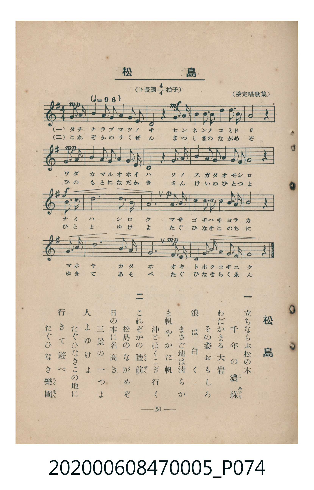

# 松島

> Re:Shōka 使用 AI 協助辨識與重建樂譜，可能會有錯誤。歡迎回報。

- **鋼琴伴奏版**：<br><audio controls src="matsushima.mp3"></audio>
- **NEUTRINO 歌聲合成版**：<br><audio controls src="matsushima_neutrino.mp3"></audio>

- 臺灣教育會公認《新定兒童唱歌》尋常科第五學年用（2020.006.0847.0005）

## 說明

原書資訊與歌詞全文（對應 P074.jpg，書頁 p. 51，參考教材第 15 首）：
調性與拍號：ト長調四分之四拍子（G 大調 4/4 拍），♩= 96
出處：（檢定唱歌集）


## 歌詞

```text
一　立ちならぶ松の木
千年の濃綠（こみどり）
わだかまる大岩
その姿おもしろ
浪は白く
まさご地は清らか
ま帆やかた帆
沖とほくこぎ行く

二　これぞかの陸前（りくぜん）
松島のながめぞ
日の本に名高き
三景の一つよ
人よゆけよ
たぐひなきこの地に
行きて遊べ
たぐひなき樂園（らくゑん）
```

## ABC

```abc
X:1
T:松島
M:4/4
L:1/16
Q:1/4=96
K:G
V:V1 name="Piano" snm="Pia"
[V:V1]
d3 B A3 G A3 B G2 E2 | D8 z4 G3 A | B3 d e3 e d3 e d2 B2 | A12 z4 |
w: 1.~タ チ ナ ラ ブ マ ツ ノ | キ セ ン | ネ ン ノ _ コ ミ ド _ | リ
w: 2.~こ れ ぞ か の り く ぜ | ん ま つ | し ま の _ な が め _ | ぞ
B3 B A3 G A3 B G2 E2 | D8 z4 A3 B | G3 G E3 G A3 B A2 F2 | G12 z4 |
w: 1.~ワ ダ カ マ ル オ ホ イ | ハ ソ ノ | ス ガ タ _ オ モ シ _ | ロ
w: 2.~ひ の も と に な だ か | き さ ん | け い の _ ひ と つ _ | よ
B3 d e8 e3 d | B12 B3 A | G3 A B3 d e3 d B2 A2 | B12 z4 |
w: 1.~ナ ミ ハ シ ロ | ク マ サ | ゴ ヂ ハ _ キ ヨ ラ _ | カ
w: 2.~ひ と よ ゆ け | よ た ぐ | ひ な き _ こ の ち _ | に
B3 d e8 e3 d | B12 B3 A | G3 G E3 G A3 B A2 F2 | G12 z4 |
w: 1.~マ ホ ヤ カ タ | ホ オ キ | ト ホ ク _ コ ギ ユ _ | ク
w: 2.~ゆ き て あ そ | べ た ぐ | ひ な き _ ら く ゑ _ | ん
```

## TMD 檔案連結

- [主旋律 TMD 檔案](matsushima.tmd) [[在 TMD Studio 編輯](https://tmdlang.github.io/Tmd-TS/#tmd=s7IKdvYPcrWy4qpTUCpJTLdSSM7PyUlNLsnMz7MqzsjMK0nNjM_KTMmPL87Iz05Ugisry88pzU21Si9KTEmNN403MjAyiDcwMIs3sDAxBzIMTBFKi_NLi5JTrYqTM_Lzc-JLUitKkvLzsxHyBUX5Zal5iXlANQVFIBtTwIoQClLLMlNSQdKpKZkl-UWZiTlI7kgtKga7FWxJfElRYl5xclFmAcgDCFUlGalAx-YllpQWpSJEgUalZ-ZZ5ebnJZUCvYcpkZqZlYnkYC0thWdz9z3dvE1BS4tL0VbB0ozL3lbBncvGRN_EDqT5Rfuu542Ln02d-aJp07M5zU9b17xY1fu4oevZtA1P18162jrp-eqlT6dsfLa253FD99MN3U937Hi-fOLzNWue7JrydO2Opzu3PJ-y4v2eDlBo6gFDUw8UmkCGgen7PZ1KXFz6Wgq21AJcCgoKT_vmP5u948Xm9hcrul50tAPd9WLlvKetK55Nawe64umG3mftnQoBBuYmelkF6e_39AAVv1zQqFCgp2BqCOQ-7W9-0dAM9O6zuROAnlAwNFV4uWwa0Knv98wCGf9i1f5nDctBBnf3vpg5Hyj6uLnj5dTtQPGns2c_7Wh7srMbyADKPl07AWihu8LTJcuBkgrA8FQAioJN6nk0cyU4qEHubd_1YuZUoDlAxc9WLQKFKTg0X85uA6rlAil5sqPhcUPD89XdjxsXPm5c9bip83HjNmCsPW5c92zOCrAhvc3AgAbx9zc_37YAaNTjxsmPG_c_blz5uKkLZA5Q0eOm_seNCx43Ao3Z97ipG-iup5tWgiUa5wK1Pl0OVN71uKnpceP0x029IIlnW1c9blz_fObex439EIVAO6c-bpzydM4GoMSzHa1gt3RD5Z7uaHvc1AK2YD6QDTZh07THjSseN-4GmgB2Ut-LhT0g08D-2gVMMw0g4Sag2DywxnUvZ-542gkMpg6gw8Ga5jxumgz1ASSlAhWBQqGx53FTI1AbWGL6UnBgrHncuPrphN6Xq2c8bgT74MmOzmcz1wPlQGHYuORxUwfE4l1A1uOmtseNE6FCQCc_bpzwuHET2OhesFvXgb25GhztIFcDRZe9BAZR404sOp6taHo6ZxLY3cAg6X_cBDQZ5m7KUzYUKGjpc3H5JpYUA_N2Zm6iVUBmYl6-Q41BTTXIGgUbQzMtOzALW65SAGXKHQ1AryhomCg83dD_fH2DDjwraGLRALQNapgGUKOmFTAJ7Qf5vLkRiLvArJVAPA3MmgfELUDcp1ADVLcWpBEZPG7aDVa2GSTd3Atlg5SD5ECs-WCxTrD8KnTtEIDsoF09IAc1Tgbr7wGy5oEjpRuI14HFuoCsfiCeA3YQSB2qgxr3gcklIOnG6VARqObGVUDcAzamESwPMhy3g2oUTBV0gdBYwQhMG0JpYyBLV8EsHkgAlYAoZGgApUFqdIE6aoDqQSxTBTMwbQY1FUKD5Gqg5mJCmFk1YPf4GIK8vB8sAostCBsSXxA2JMZArD6w2aBYQzUV5mJQ5EH0wKIPxoPohajZDBWdD45GqHvAkYndzTDToW42AoXzZKhZkAgFs6FRChGHRCpIdA7UzRAdWNwMjE0IDYthmCjMNBAP4jZQXINiGu5mqN343Iw_n-3qoSifNa8Hpb3mBqCrVoNZoLgCs5qAKbN5NpAG-6q5HyNZN-0Fa4Bkw51gkTWwjAvWvAjM2g7WjpFNUZI1cj7bBNIFDDhgBQFmrQBisIPAWWUBOJpAAQfK2agOapwKtnAyWHoiWARYTkDz2SawUfB82NSB10GwHEJePoOprYHmOEOIDmRjQLQ5xBiIGkyIJacBYwuciqDxBWFDYgySaiFxBmItgaQvYLzhSLXA6IPoh0UgRBQShTA10FQLjEpQRMJTLTA6CaVasJvBOW0TxAxolELYkEiFsCHRCsl_kDzRi8vNwBiGuAsWxxBRSCzD1MDsA9kBCgWom4ExTsjNBGq0TspyGqQeA5VZSHkJFKwg4bVgJ4IyI2qaBsYuSNFWsPQWsEgT1ARQKfq4GZymgaUtSB6UTXCnacxMBgwh5HwAbKeAhSdizyDAdgiYnAAOe4gJoLgDV7HA8hSW0xaC5fG7Bb0GQkAI3xSuAhNCxEG1GKw-QzXLFMwHZTDcZmDLW7CaCxJDqOphqR8RUdjNBcUXRD0sxiCikDiDmbUWKgoMf2DMQV0Cz9GYEF-ugsQhumvboLKwqMThWmCMQmhYnEJ4kFiFqYHWlKD8C4xbuGuh-Refa_HmJ2DnhbL8BM4ZoBqqeQlyGoZUXvvBxdRsjDQMLNEgOQckDUrikDoOXAuCGodN4DTcvAx7dkRJw0j5CZpxeoF4GZJljZAabC44uEA1JKpb8OWnpk4gC5LLIXGI0axEcQs18xP1aitoXoDGEVrag9Vf8KjCbi68DoLHGdxMeC6EtwiBsQeKO6hL8ORTLDkKnmcgsYjmCmBUQmhYZOJwLTE5Chi3EFFgpwEYuwjXorcwMV1by8Wla6eA6JgpAHnKXAA)]
- [鋼琴伴奏 TMD 檔案](matsushima_piano.tmd) [[在 TMD Studio 編輯](https://tmdlang.github.io/Tmd-TS/#tmd=s7IKdvYPcrWy4tLSUng2d9_Tzdve7-l42b3n-YQtT_Zsebq0_3lnx_s9nQpaWlyKtgqWZlz2tgruXDYm-iZ2XHUKSi_adz1vXPxs6swXTZuezWl-2rrmxarexw1dz6ZteLpu1tPWSc9XL306ZeOztT2PG7qfbuh-umPH8-UTn69Z82TXlKdrdzzdueX5lBVAG40MjAz0DAzM9AwsTMyBDANToKVKXFy-iSXFpcUZmbmJVgGZiXn5QR4ONQY11VwKQGBjaKZlB2bpaynYogMFkCU7Gl4s7FHQMFF4uqH_-foGHYUAA3MTvayCdE0sGrT0wYbVKJgq6AKhsYIRmDaE0sZAlq6CWTyQACoBUcjQAEqD1OgCddQA1YNYpgpmYNoMaiqEBsnVQM3FhDCzasDu8TGsUXjctB8s8ri5EYi7oOyVQDwNyp4HxC1gVh_Y7MdNa9FMhbn4cdNuqJ7NIHXNvXAeRC9EzWao6Hwg7oS5B8hehcPNMNOhbjYCqm2cDDWrB8ieB2E3dgPxOqh4F5DdDxadA3UzRAcWNzfug9JLQOoap8NFYaaBeBC3PW4E2tfUiHAz1G58bsafinb1kJOKIPFPXiqCqa2BpidDiA5kY0C0OcQYiBpMiCUdNa-HhFFzAzCMVkPZoLQDZTetArJng1lLIKHXDIohrHHStBeqvw8cdzuhomvgqRViHkTNIiB7O8w9QP5aHG7Glo42QcwAxvTjpiYoewUQQ90MjPfHjQvArG6I6Y29uNzcOBXqrslgdROhoi0o6QhmH8gOUChA3dzUQdDNBEqjTvLTEawcQUAI3xSuAhNCxEFlEaxUQjXLFMwHJSTcZmBLQ7DyB1Q2oKcOWCyDYhgUZpD0hglBqQ6ifitY3RaoaBOSmbAy7HEzMCaApR3UJfCUiwnxpR6gGRgx-LipDSo7EW8MP26cD6UngNMNzExQyuuFq4GWd6B02rgQ4VpoOsXnWrzp5uns2QObbqhX-kDjHFjCPG6G5Sx4GMPKI2DpAVILKoWwQXiZAkwdIHWQOAObCU9t8PqrCRgXzctgLsGTHrGkHHja6AVimBlwVzTCSqK54DiGlH5YXEtMymmC1LCg2vBxE6RMwl4fYrq2FrON5IPcRjJBNJGetqx6vq_v6fo1T3cvfrKzG5isnnX3Pl074en2Zc86uyGtvfd7ep719z_fuerZ9KXP5oCKrGcz10PahS_nTgIyns_c-2zrqscNjUDG0x1tLxsXPN27EWRa91ygSkTqM4xXiDaMBdZwEBpU1wFZpvHIQiA1JrEwpWhKDKBRQdAoEAOiyCw-F0MMqAFIYRhmArEaWQ2qJpACCk3B7xxgxOnaKSDiLtoHKIcmYgQWUeYCAA)]

## 分析

```text
================================================================================
📊 TMD Song Profile: [ 松島 ]
================================================================================
⏱  Duration:       0:40 (40.0s), 16 measures total
🎼 Key & Tempo:    首調基準 G, != 96.0 BPM, <4/4>
   - 分析範圍：      由實際發聲的音符與和弦推測調性；播放脈絡另行呈現
🎤 人聲音域:    D4 (MIDI 62) – E5 (MIDI 76) [跨度: 14 個半音 / 1.2 個八度, 難度: moderate]
   - 最低音:  D4 in [Matsushima #1 @ m.2, 0:02]
   - 最高音: E5 in [Matsushima #1 @ m.3, 0:05]
   - 適合: soprano, mezzo-soprano, contralto, tenor, baritone, bass
🏛  結構:      Matsushima (40.0s)
⚡ 編曲密度:        Peak 1 軌道同時演奏
🗝  調性診斷：       E 調性不明確（純淨自然大調，未偵測到可信轉調）
   - 風格氣質:    純淨自然大調（陽光明朗、易唱易記，無明顯調外色彩）
   - 轉調歷程:    全曲維持單一推測調性（未偵測到可信轉調）
   - 核心骨幹音:  B, G, A, E, D
   - 調性數值:    E 調性不明確 [相關度: 0.71, 穩定度: Ambiguous, 自然音純度: 100.0%]
   - 候選調性 (K-S): E 小調 (0.71), G 大調 (0.70), B 小調 (0.68)
   - 五度圈歷程:   +4
   - 各段落調性細節:
     • [Matsushima #1]: E 調性不明確 (r: 0.71, 自然音純度: 100.0%)

  [ 五度圈游移軌跡 ]
               C  
         F            G  
      Bb               D  
      Eb               A  
         Ab          [E ]*
            Db       B  
               F# 
     (* = active key center)

  [ 十二半音累積音高分佈 ]
     C  :                            0.0%
     C# :                            0.0%
     D  : ███████████               13.4%
     D# :                            0.0%
     E  : ██████████████            17.2%
     F  :                            0.0%
     F# : █                          1.7%
     G  : ████████████████          19.8%
     G# :                            0.0%
     A  : ███████████████           18.5%
     A# :                            0.0%
     B  : ████████████████████████  29.3%
--------------------------------------------------------------------------------
Assignment 軌道音域：
  - Piano         : D4 – E5 (14 個半音 / 1.2 個八度, 74 個音符)
================================================================================
```


## 原書掃描頁




