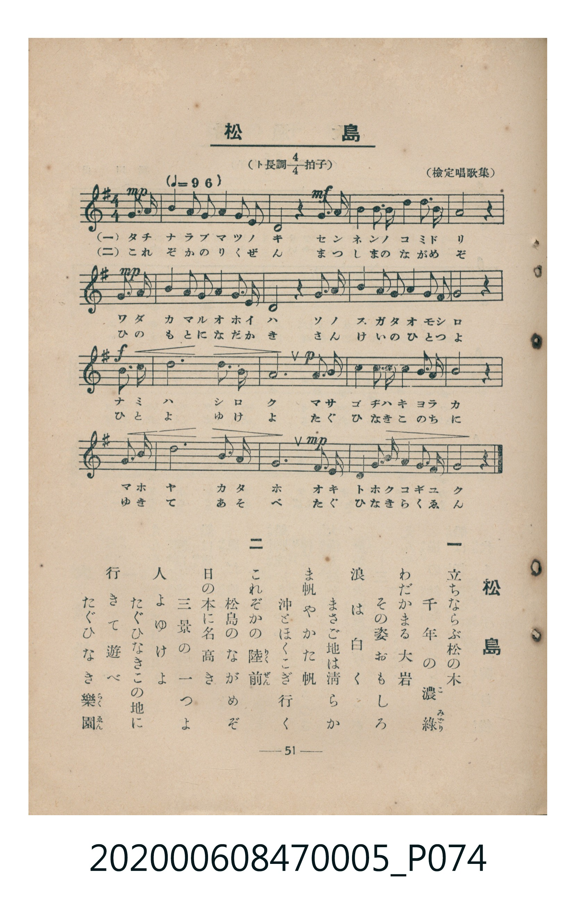

# 松島

> Re:Shōka 使用 AI 協助辨識與重建樂譜，可能會有錯誤。歡迎回報。

- **鋼琴伴奏版**：<br><audio controls src="matsushima.mp3"></audio>
- **NEUTRINO 歌聲合成版**：<br><audio controls src="matsushima_neutrino.mp3"></audio>

- 臺灣教育會公認《新定兒童唱歌》尋常科第五學年用（2020.006.0847.0005）

## 說明

原書資訊與歌詞全文（對應 P074.jpg，書頁 p. 51，參考教材第 15 首）：
調性與拍號：ト長調四分之四拍子（G 大調 4/4 拍），♩= 96
出處：（檢定唱歌集）


## 歌詞

```text
一　立ちならぶ松の木
千年の濃綠（こみどり）
わだかまる大岩
その姿おもしろ
浪は白く
まさご地は清らか
ま帆やかた帆
沖とほくこぎ行く

二　これぞかの陸前（りくぜん）
松島のながめぞ
日の本に名高き
三景の一つよ
人よゆけよ
たぐひなきこの地に
行きて遊べ
たぐひなき樂園（らくゑん）
```

## ABC

<div class="abc-score" data-abc-src="matsushima.abc" aria-label="五線譜載入中"></div>

[下載 ABC 原始檔](matsushima.abc)

## TMD 檔案連結

- [主旋律 TMD 檔案](matsushima.tmd) [[在 TMD Studio 編輯](https://tmdlang.github.io/Tmd-TS/#tmd=s7IKdvYPcrWy4qpTUCpJTLdSSM7PyUlNLsnMz7MqzsjMK0nNjM_KTMmPL87Iz05Ugisry88pzU21Si9KTEmNN403MjAyiDcwMIs3sDAxBzIMTBFKi_NLi5JTrYqTM_Lzc-JLUitKkvLzsxHyBUX5Zal5iXlANQVFIBtTwIoQClLLMlNSQdKpKZkl-UWZiTlI7kgtKga7FWxJfElRYl5xclFmAcgDCFUlGalAx-YllpQWpSJEgUalZ-ZZ5ebnJZUCvYcpkZqZlYnFwflFJRn5QJ8XZFRaZWQWg5yUnJgTn52YhxRAUAcVJKanWgUYmJsocWlpKTybu-_p5m0KWlpcirYKlmZc9rYK7lw2JvomdiB9L9p3PW9c_GzqzBdNm57NaX7auubFqt7HDV3Ppm14um7W09ZJz1cvfTpl47O1PY8bup9u6H66Y8fz5ROfr1nzZNeUp2t3PN255fmUFe_3dIAiQw8YGXqgyAAyDEzf7-lU4uLS11KwpRbgUlBQeNo3_9nsHS82t79Y0fWiox3orhcr5z1tXfFsWjvQFU839D5r71QA-V0vqyD9_Z4eoOKXCxoVCvQUTA2B3Kf9zS8amoHefTZ3AtATCoamCi-XTQM69f2eWSDjX6za_6xhOcjg7t4XM-cDRR83d7ycuh0o_nT27KcdbU92dgMZQNmnaycALXRXeLpkOVBSARieCkBRsEk9j2auBAc1yL3tu17MnAo0B6j42apFoDAFh-bL2W1AtVwgJU92NDxuaHi-uvtx48LHjaseN3U-btwGjLXHjeuezVkBNqS3GRjQIP7-5ufbFgCNetw4-XHj_seNKx83dYHMASp63NT_uHHB40agMfseN3UD3fV000qwRONcoNany4HKux43NT1unP64qRck8WzrqseN65_P3Pu4sR-iEGjn1MeNU57O2QCUeLajFeyWbqjc0x1tj5tawBbMB7LBJmya9rhxxePG3UATwE7qe7GwB2Qa2F-7gGmmASTcBBSbB9a47uXMHU87gcHUAXQ4WNOcx02ToT6ApFSgIlAoNPY8bmoEagNLTF8KDow1jxtXP53Q-3L1jMeNYB882dH5bOZ6oBwoDBuXPG7qgFi8C8h63NT2uHEiVAjo5MeNEx43bgIb3Qt26zqwN1eDox3kaqDospfAIGrciUXHsxVNT-dMArsbGCT9j5uAJsPcTXnKhgIFLX0uLt_EkmJg0ZCZm2gVkJmYl-9QY1BTDbJGwcbQTMsOzMKWqxRAmXJHA9ArChomCk839D9f36ADzwqaWDQAbYMapgHUqGkFTEL7QT5vbgTiLjBrJRBPA7PmAXELEPcp1ADVrQVpRAaPm3aDlW0GSTf3Qtkg5SA5EGs-WKwTLL8KXTsEIDtoVw_IQY2Twfp7gKx54EjpBuJ1YLEuIKsfiOeAHQRSh-qgxn1gcglIunE6VASquXEVEPeAjWkEy4MMx-2gGgVTBV0gNFYwAtOGUNoYyNJVMIsHEkAlIAoZGkBpkBpdoI4aoHoQy1TBDEybQU2F0CC5Gqi5mBBmVg3YPT6GIC_vB4vAYgvChsQXhA2JMRCrD2w2KNZQTYW5GBR5ED2w6IPxIHohajZDReeDoxHqHnBkYnczzHSom41A4TwZahYkQsFsaJRCxCGRChKdA3UzRAcWNwNjE0LDYhgmCjMNxIO4DRTXoJiGuxlqNz43489nu3ooymfN60Fpr7kB6KrVYBYorsCsJmDKbJ4NpMG-au7HSNZNe8EaINlwJ1hkDSzjgjUvArO2g7VjZFOUZI2czzaBdAEDDlhBgFkrgBjsIHBWWQCOJlDAgXI2qoMap4ItnAyWnggWAZYT0Hy2CWwUPB82deB1ECyHkJfPYGproDnOEKID2RgQbQ4xBqIGE2LJacDYAqciaHxB2JAYg6RaSJyBWEsg6QsYbzhSLTD6IPphEQgRhUQhTA001QKjEhSR8FQLjE5CqRbsZnBO2wQxAxqlEDYkUiFsSLRC8h8kT_TicjMwhiHugsUxRBQSyzA1MPtAdoBCAepmYIwTcjOBGq2TspwGqcdAZRZSXgIFK0h4LdiJoMyImqaBsQtStBUsvQUs0gQ1AVSKPm4Gp2lgaQuSB2UT3GkaM5MBQwg5HwDbKWDhidgzCLAdAiYngMMeYgIo7sBVLLA8heW0hWB5_G5Br4EQEMI3havAhBBxUC0Gq89QzTIF80EZDLcZ2PIWrOaCxBCqeljqR0QUdnNB8QVRD4sxiCgkzmBmrYWKAsMfGHNQl8BzNCbEl6sgcYju2jaoLCwqcbgWGKMQGhanEB4kVmFqoDUlKP8C4xbuWmj-xedavPkJ2HmhLD-BcwaohmpegpyGIZXXfnAxNRsjDQNLNEjOAUmDkjikjgPXgqDGYRM4DTcvw54dUdIwUn6CZpxeIF6GZFkjpAabCw4uUA2J6hZ8-ampE8iC5HJIHGI0K1HcQs38RL3aCpoXoHGElvZg9Rc8qrCbC6-D4HEGNxOeC-EtQmDsgeIO6hI8-RRLjoLnGUgsorkCGJUQGhaZOFxLTI4Cxi1EFNhpAMYuwrXoLUxM19ZycenaKSA6ZgpAnjIXAA)]
- [鋼琴伴奏 TMD 檔案](matsushima_piano.tmd) [[在 TMD Studio 編輯](https://tmdlang.github.io/Tmd-TS/#tmd=s7IKdvYPcrWy4qpTUCpJTLdSyC8qychPL0osyKi0ysgsLskvykxOzInPTsxLVIIrKs4vLUpOjS9ITE-1CjAwN1Hi0tJSeDZ339PN297v6XjZvef5hC1P9mx5urT_eWfH-z2dClpaXIq2CpZmXPa2Cu5cNib6JnYgw16073reuPjZ1JkvmjY9m9P8tHXNi1W9jxu6nk3b8HTdrKetk56vXvp0ysZna3seN3Q_3dD9dMeO58snPl-z5smuKU_X7ni6c8vzKSuANhoZGBnoGRiY6RlYmJgDGQamQEuVuLh8E0uKS4szMnMTrQIyE_PygzwcagxqqrkUgMDG0EzLDszS11KwRQcKIEt2NLxY2KOgYaLwdEP_8_UNOgogv-plFaRrYtGgpQ82rEbBVEEXCI0VjMC0IZQ2BrJ0FczigQRQCYhChgZQGqRGF6ijBqgexDJVMAPTZlBTITRIrgZqLiaEmVUDdo-PYY3C46b9YJHHzY1A3AVlrwTiaVD2PCBuAbP6wGY_blqLZirMxY-bdkP1bAapa-6F8yB6IWo2Q0XnA3EnzD1A9iocboaZDnWzEVBt42SoWT1A9jwIu7EbiNdBxbuA7H6w6ByomyE6sLi5cR-UXgJS1zgdLgozDcSDuO1xI9C-pkaEm6F243Mz_lS0q4ecVASJf_JSEUxtDTQ9GUJ0IBsDos0hxkDUYEIs6ah5PSSMmhuAYbQaygalHSi7aRWQPRvMWgIJvWZQDGGNk6a9UP194LjbCRVdA0-tEPMgahYB2dth7gHy1-JwM7Z0tAliBjCmHzc1QdkrgBjqZmC8P25cAGZ1Q0xv7MXl5sapUHdNBqubCBVtQUlHMPtAdoBCAermpg6CbiZQGnWSn45g5QgCQvimcBWYECIOKotgpRKqWaZgPigh4TYDWxqClT-gsgE9dcBiGRTDoDCDpDdMCEp1EPVbweq2QEWbkMyElWGPm4ExASztoC6Bp1xMiC_1AM3AiMHHTW1Q2Yl4Y_hx43woPQGcbmBmglJeL1wNtLwDpdPGhQjXQtMpPtfiTTdPZ88e2HRDvdIHGufAEuZxMyxnwcMYVh4BSw-QWlAphA3CyxRg6gCpg8QZ2Ex4aoPXX03AuGheBnMJnvSIJeXA00YvEMPMgLuiEVYSzQXHMaT0w-JaYlJOE6SGBdWGj5sgZRL2-hDTtbWYbSQf5DaSCaKJ9LRl1fN9fU_Xr3m6e_GTnd3AZPWsu_fp2glPty971tkNae2939PzrL__-c5Vz6YvfTYHVGQ9m7ke0i58OXcSkPF85t5nW1c9bmgEMp7uaHvZuODp3o0g07rnAlUiUp9hvEK0YSywhoPQoLoOyDKNRxYCqTGJhSlFU2IAjQqCRoEYEEVm8bkYYkANQArDMBOI1chqUDWBFFBoCn7nACNO104BEXfRPkA5NBEjsIgyFwA)]

## 分析

```text
================================================================================
📊 TMD Song Profile: [ 松島 ]
================================================================================
⏱  Duration:       0:40 (40.0s), 16 measures total
🎼 Key & Tempo:    首調基準 G, != 96.0 BPM, <4/4>
   - 分析範圍：      由實際發聲的音符與和弦推測調性；播放脈絡另行呈現
🎤 人聲音域:    D4 (MIDI 62) – E5 (MIDI 76) [跨度: 14 個半音 / 1.2 個八度, 難度: moderate]
   - 最低音:  D4 in [Matsushima #1 @ m.2, 0:02]
   - 最高音: E5 in [Matsushima #1 @ m.3, 0:05]
   - 適合: soprano, mezzo-soprano, contralto, tenor, baritone, bass
🏛  結構:      Matsushima (40.0s)
⚡ 編曲密度:        Peak 1 軌道同時演奏
🗝  調性診斷：       E 調性不明確（純淨自然大調，未偵測到可信轉調）
   - 風格氣質:    純淨自然大調（陽光明朗、易唱易記，無明顯調外色彩）
   - 轉調歷程:    全曲維持單一推測調性（未偵測到可信轉調）
   - 核心骨幹音:  B, G, A, E, D
   - 調性數值:    E 調性不明確 [相關度: 0.71, 穩定度: Ambiguous, 自然音純度: 100.0%]
   - 候選調性 (K-S): E 小調 (0.71), G 大調 (0.70), B 小調 (0.68)
   - 五度圈歷程:   +4
   - 各段落調性細節:
     • [Matsushima #1]: E 調性不明確 (r: 0.71, 自然音純度: 100.0%)

  [ 五度圈游移軌跡 ]
               C  
         F            G  
      Bb               D  
      Eb               A  
         Ab          [E ]*
            Db       B  
               F# 
     (* = active key center)

  [ 十二半音累積音高分佈 ]
     C  :                            0.0%
     C# :                            0.0%
     D  : ███████████               13.4%
     D# :                            0.0%
     E  : ██████████████            17.2%
     F  :                            0.0%
     F# : █                          1.7%
     G  : ████████████████          19.8%
     G# :                            0.0%
     A  : ███████████████           18.5%
     A# :                            0.0%
     B  : ████████████████████████  29.3%
--------------------------------------------------------------------------------
Assignment 軌道音域：
  - Piano         : D4 – E5 (14 個半音 / 1.2 個八度, 74 個音符)
================================================================================
```


## 原書掃描頁




