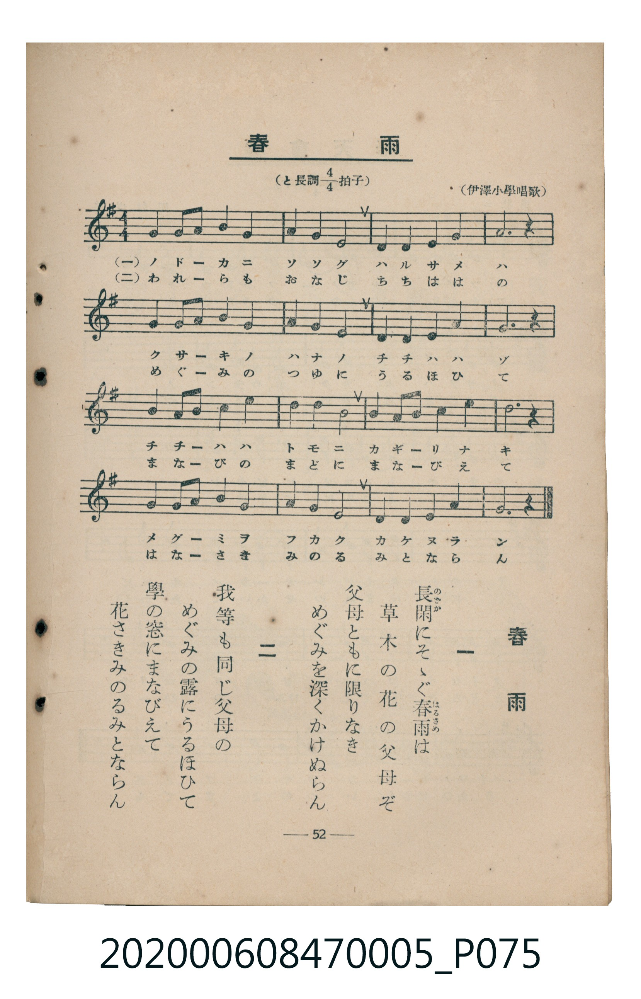

# 春雨

> Re:Shōka 使用 AI 協助辨識與重建樂譜，可能會有錯誤。歡迎回報。

- **鋼琴伴奏版**：<br><audio controls src="harusame.mp3"></audio>
- **NEUTRINO 歌聲合成版**：<br><audio controls src="harusame_neutrino.mp3"></audio>

- 臺灣教育會公認《新定兒童唱歌》尋常科第五學年用（2020.006.0847.0005）

## 說明

原書資訊與歌詞全文（對應 P075.jpg，書頁 p. 52，參考教材第 16 首）：
調性與拍號：と長調四分之四拍子（G 大調 4/4 拍）
出處：（伊澤小學唱歌）


## 歌詞

```text
一　長閑（のどか）にそゝぐ春雨（はるさめ）は
草木の花の父母ぞ
父母ともに限りなき
めぐみを深くかけぬらん

二　我等も同じ父母の
めぐみの露にうるほひて
學の窓にまなびえて
花さきみのるみとならん
```

## ABC

<div class="abc-score" data-abc-src="harusame.abc" aria-label="五線譜載入中"></div>

[下載 ABC 原始檔](harusame.abc)

## TMD 檔案連結

- [主旋律 TMD 檔案](harusame.tmd) [[在 TMD Studio 編輯](https://tmdlang.github.io/Tmd-TS/#tmd=s7IKdvYPcrWy4qpTUCpJTLdSSM7PyUlNLsnMz7MqzsjMK0nNjM_KTMmPL87Iz05Ugisry88pzU21Si9KTEmNN403MjAyiDcwMIs3sDAxBzIMTBFKi_NLi5JTrYqTM_Lzc-JLUitKkvLzsxHyBUX5Zal5iXlANQVFIBtTwIoQClLLMlNSQdKpKZkl-UWZiTlI7kgtKga7FWxJfElRYl5xclFmAcgDCFUlGalAx5anJgIZRQhhoFnpmXlWJYmZQN-BfFieGJ-bmJmXk5iXosSlpaXwbMbSl7NXKGhpcSnaKlhYcNnbKrhz2Zjom9iBzHjRvut54-JnU2e-aNr0bE7z09Y1L1b1Pm7oejZtw9N1s562Tnq-eunTKRufre153ND9dEP30x07ni-f-HzNmie7pjxdu-Ppzi3Pp6x4v6cDFHh6wMDTAwUekGFg-n5PpxIXl76Wgi21AJeCgsLTvvnPZu94sbn9xYquFx3tQHe9WDnvaeuKZ9Paga54uqH3WXunQoCBualeVkH6-z09QMUvFzQqFOgpmBoBuU_7m180NAO9-2zuBKAnFAzNFF4umwZ06vs9s0DGv1i1_1nDcpDB3b0vZs4Hij5uXPFy6nag-NPZs592tD3Z2Q1kAGWfrp0AtNBd4emS5UBJBWB4KgBFgSaBXdm-68XMqUDdQCVP9nQ927fk6YZ-UHCBQxKkCKTqyY6Gxw0NQNNfTpsIVPi4cd3jxpWPG7uB8o8bVz9unPu4ae7jxgmQCAQrWP-4qftx49THTY1gNevBTu7tfDZnBVDzi66NQPJ5x7Zn63sfN84DycE4Kx43NQGNfDlzwuOmrseNqx439oKkgeYAzX_cuP9x06Rn24G6-4G2P26c-LhxzeOmzsdNkyHO3AWM-4ZnHROfrwWKNT2d0PO4cQbM5HWo5jSuezlnE9jxbWCn7n7cCOQuA4fJ2h0g562aDJbeB3bF5seNQF-BpcGunwp0GMQYsG4gA-ixVVC3ABVRnoagQEFLn4vLI7GotDgRmKkCMhPz8h1qDGqqQZYo2Fho2YEZ2BKvAijt72h4sbBHQcNEARitz9c36MBTnCYWDUCroIZpADVqWik8bu4DCTxu7gTiPcDQWw3hdoOoGiB_L5gPozaAKAgASjb3QxRD9DRthfAWoshiAmQ37OoBuaEJYk5TD9QNnRBuE9Sgxi4wv3EVhJqB4oZGsHVwaj0SBZJdh9cNNQqGCrpAbKRgDKZ1gSJGQBLEA9EgWKNgGg-kzEAESAVIvAasAgYNQCJg83wMQf7uA_JBAQokgcEJYneD9YBCESQGITfAzQeFFEgVWC0wFEHshUgyMAhyAdQeI5BpYF3AQAORENuaILqAAQbkAcMLRM5A2AMMJJAIhFwPJyHhhG4P_lS3q4eiVNcEiSegZyExvhbMhaRFpIQFiXiIMDzGmxsholAKqhRMgUJlH94YR051EAMaJ0Dc0LgfwgWnGFCQLIE4sQ0iDE7jcDc0QkSbwNkEWLRAqE0w2WV43YAr1YFY4GSGLdmZg2MFzMSR7oBhCk8_wAAFpSJQSkSkL3CqAIvB0l0jWARCQtSASEgo4k53YPXAYAOR-8EkKPVAggxkdxtYDJSaYekOLAIMLJD4bjC5CSqzjMR0t6OTstIOnnbAcY6eeJo7IPxFEAocu_A4hxaNTeugeiHFESSNgqTBaRhnpCMlvEZwEgXlT0jC2wzhwhMeVHolhEJLeNj1gt1NTMoDpThjBVMFM1DagiQzKAtWokHSIihtwmQganCVdjjTEDAwQbxFYBIU99DUACkTgcEIEgeXUeCUCQlCnKkO6HFEmbYZJdVBZFZipDpMHSAXkZHqgK0sylIdpHICFvmQlDMfzG2GFRfNUyHS0PQFLhrhEQ4T3QjR0wOhwGkDpBUc_zjjGznRQWtGWMKB2NnYCzUIpfSDlmtwN8AkV8CMAKsB19IgF07G6wbU9ARKZbhLO5AYrO7FW9aB60dIHQoKThAJLVGAgQmvd8ElImqq2whWC64zgYEI0QFKG7hSHaSWhKQhsMnAEIOkIUTJBynZYKkOIr4CoQ9cN0PCCd2eWi4uXTsFWNtPAchW5gIA)]
- [鋼琴伴奏 TMD 檔案](harusame_piano.tmd) [[在 TMD Studio 編輯](https://tmdlang.github.io/Tmd-TS/#tmd=s7IKdvYPcrWy4tLSUng2Y-nL2Sve7-l42b3n-YQtT_Zsebq0_3lnx_s9nQpaWlyKtgoWFlz2tgruXDYm-iZ2XHUKSi_adz1vXPxs6swXTZuezWl-2rrmxarexw1dz6ZteLpu1tPWSc9XL306ZeOztT2PG7qfbuh-umPH8-UTn69Z82TXlKdrdzzdueX5FJCNRgZGBnoGBmZ6BhYm5kCGgSnQUiUuLo_EotLixNxUq4DMxLz8IA-HGoOaai4FILCx0LIDM_S1FGzRgQLIhh0NLxb2KGiYKDzd0P98fYOOQoCBualeVkG6JhYNWvpgw2oUDBV0gdhIwRhM6wJFjIAkiAeiQbBGwTQeSJmBCJAKkHgNWAUMGoBEwOb5GNYoPG7uA_IfN3eCyKbVYHY3WM_jpr1gMQi5AW7-4-Z-sCqw2qatYPZCJBkYBLkAao8RyDSwrqYeMAmxrQmiq7ELxGtcBSZnIOxpBJkKI9fDSZDMOgx78If2rh7qhTaIBQ5ebMFtDnYNmIkjvJvAPoGEW9NacOiBYgARruDQAIvBwrsRLAIhIWpAJMisfXjCG6y-cQKY3A8mQaEGCr0lYLvbwGKgWISFN1ikCRT7jxt3g8lNUJllJIb3jk5ywhsUzsYKpgpmoBCFBC6UBUu_kBgAxQhMBqIGV9rGGXLNHWDeIjAJ8jE0DCA5oAkUUo-bwSkSHB8gGVBc4QjrRlA8wFLwZpSwhsisxAhrTB0gF5ER1k9nzyYnrJHDERS6uNM2SAxWwuBN2eBSAFJSPG6eDyah6ad5KlgGErag9I8a2hvBasElQzMopEA6QGGCK7QhZQEk7MAmN_ZCww6RziHpGBbaEPEVCH3gEgjkgskY9tSiF-w-yAW7CaJgf7Zr9bO9S54vXfp0Us-Tnd3AiHjW3ft07YSn25c96-yGVFDv9wBLnhXP-_dBqi-g-mf7lrzo7Xw2Z8WLjvbnHduere99tn3js8aVQBOetcx_un8rUvkTrxBtGAujQNEBZJnGxyIYUDGz-FyIMogYQp8BNNxwmAVkmcH1k2yWCZAygakBMjDdCZXAbgqKKvxuAooheRnVMGB06dopwGIs2gcog8I3AvOVuQA)]

## 分析

```text
================================================================================
📊 TMD Song Profile: [ 春雨 ]
================================================================================
⏱  Duration:       0:43 (43.6s), 16 measures total
🎼 Key & Tempo:    首調基準 G, != 88.0 BPM, <4/4>
   - 分析範圍：      由實際發聲的音符與和弦推測調性；播放脈絡另行呈現
🎤 人聲音域:    D4 (MIDI 62) – E5 (MIDI 76) [跨度: 14 個半音 / 1.2 個八度, 難度: moderate]
   - 最低音:  D4 in [Harusame #1 @ m.3, 0:05]
   - 最高音: E5 in [Harusame #1 @ m.9, 0:23]
   - 適合: soprano, mezzo-soprano, contralto, tenor, baritone, bass
🏛  結構:      Harusame (43.6s)
⚡ 編曲密度:        Peak 1 軌道同時演奏
🗝  調性診斷：       G 大調（純淨自然大調，未偵測到可信轉調）
   - 風格氣質:    純淨自然大調（陽光明朗、易唱易記，無明顯調外色彩）
   - 轉調歷程:    全曲維持單一推測調性（未偵測到可信轉調）
   - 核心骨幹音:  G, B, A, E, D
   - 調性數值:    G 大調 [相關度: 0.83, 穩定度: Moderate, 自然音純度: 100.0%]
   - 候選調性 (K-S): G 大調 (0.83), E 小調 (0.73), D 大調 (0.65)
   - 五度圈歷程:   +1
   - 各段落調性細節:
     • [Harusame #1]: G 大調 (r: 0.83, 自然音純度: 100.0%)

  [ 五度圈游移軌跡 ]
               C  
         F           [G ]*
      Bb               D  
      Eb               A  
         Ab           E  
            Db       B  
               F# 
     (* = active key center)

  [ 十二半音累積音高分佈 ]
     C  :                            0.0%
     C# :                            0.0%
     D  : ██████████████            15.8%
     D# :                            0.0%
     E  : ███████████████           16.7%
     F  :                            0.0%
     F# : ██                         1.7%
     G  : ████████████████████████  26.7%
     G# :                            0.0%
     A  : █████████████████         18.3%
     A# :                            0.0%
     B  : ███████████████████       20.8%
--------------------------------------------------------------------------------
Assignment 軌道音域：
  - Piano         : D4 – E5 (14 個半音 / 1.2 個八度, 53 個音符)
================================================================================
```


## 原書掃描頁




