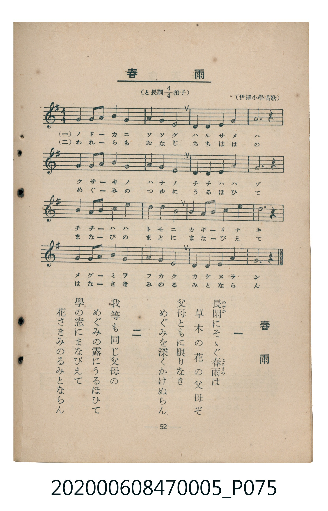

# 春雨

> Re:Shōka 使用 AI 協助辨識與重建樂譜，可能會有錯誤。歡迎[回報](https://github.com/TMDLang/reshoka/issues)。

- **鋼琴伴奏版**：<br><audio controls src="harusame.mp3"></audio>
- **NEUTRINO 歌聲合成版**：<br><audio controls src="harusame_neutrino.mp3"></audio>

- 臺灣教育會公認《新定兒童唱歌》尋常科第五學年用（2020.006.0847.0005）

## 說明

原書資訊與歌詞全文（對應 P075.jpg，書頁 p. 52，參考教材第 16 首）：
調性與拍號：と長調四分之四拍子（G 大調 4/4 拍）
出處：（伊澤小學唱歌）


## 歌詞

```text
一　長閑（のどか）にそゝぐ春雨（はるさめ）は
草木の花の父母ぞ
父母ともに限りなき
めぐみを深くかけぬらん

二　我等も同じ父母の
めぐみの露にうるほひて
學の窓にまなびえて
花さきみのるみとならん
```

## ABC

<div class="abc-score" data-abc-src="harusame.abc" aria-label="五線譜載入中"></div>

[下載 ABC 原始檔](harusame.abc)

## TMD 檔案連結

- [主旋律 TMD 檔案](harusame.tmd) [[在 TMD Studio 編輯](https://tmdlang.github.io/Tmd-TS/#tmd=s7IKdvYPcrWy4qpTUCpJTLdSSM7PyUlNLsnMz7MqzsjMK0nNjM_KTMmPL87Iz05Ugisry88pzU21Si9KTEmNN403MjAyiDcwMIs3sDAxBzIMTBFKi_NLi5JTrYqTM_Lzc-JLUitKkvLzsxHyBUX5Zal5iXlANQVFIBtTwIoQClLLMlNSQdKpKZkl-UWZiTlI7kgtKga7FWxJfElRYl5xclFmAcgDCFUlGalAx5anJgIZRQhhoFnpmXlWJYmZQN-BfFieGJ-bmJmXk5iXgqyqJCMf6NGCjEqrjMxikAuSE3PisxPzkMIDan9BYnqqVYCBOdD7WloKz2YsfTl7hYKWFpeirYKFBZe9rYI7l42JvokdSN-L9l3PGxc_mzrzRdOmZ3Oan7auebGq93FD17NpG56um_W0ddLz1UufTtn4bG3P44bupxu6n-7Y8Xz5xOdr1jzZNeXp2h1Pd255PmXF-z0doLDXA4a9HijsgQwD0_d7OpW4uPS1FGypBbgUFBSe9s1_NnvHi83tL1Z0vehoB7rrxcp5T1tXPJvWDnTF0w29z9o7FUB-18sqSH-_pweo-OWCRoUCPQVTIyD3aX_zi4ZmoHefzZ0A9ISCoZnCy2XTgE59v2cWyPgXq_Y_a1gOMri798XM-UDRx40rXk7dDhR_Onv20462Jzu7gQyg7NO1E4AWuis8XbIcKKkADE8FoCjQJLAr23e9mDkVqBuo5Mmermf7ljzd0A8KLnBIghSBVD3Z0fC4oQFo-stpE4EKHzeue9y48nFjN1D-cePqx41zHzfNfdw4ARKBYAXrHzd1P26c-ripEaxmPdjJvZ3P5qwAan7RtRFIPu_Y9mx97-PGeSA5GGfF46YmoJEvZ0543NT1uHHV48ZekDTQHKD5jxv3P26a9Gw7UHc_0PbHjRMfN6553NT5uGkyxJm7gHHf8Kxj4vO1QLGmpxN6HjfOgJm8DtWcxnUv52wCO74N7NTdjxuB3GXgMFm7A-S8VZPB0vvArtj8uBHoK7A02PVTgQ6DGAPWDWQAPbYK6hagIsrTEBQoaOlzcXkkFpUWJwLzZEBmYl6-Q41BTTXIEgUbCy07MANb4lUApf0dDS8W9ihomCgAo_X5-gYdeIrTxKIBaBXUMA2gRk0rhcfNfSCBx82dQLwHGHqrIdxuEFUD5O8F82HUBhAFAUDJ5n6IYoiepq0Q3kIUWUyA7IZdPSA3NEHMaeqBuqETwm2CGtTYBeY3roJQM1Dc0Ai2Dk6tR6JAsuvwuqFGwVBBF4iNFIzBtC5QxAhIgnggGgRrFEzjgZQZiACpAInXgFXAoAFIBGyejyHI331APihAgSQwOEHsbrAeUCiCxCDkBrj5oJACqQKrBYYiiL0QSQYGQS6A2mMEMg2sCxhoIBJiWxNEFzDAgDxgeIHIGQh7gIEEEoGQ6-EkJJzQ7cGf6nb1UJTqmiDxBPQsJMbXgrmQtIiUsCARDxGGx3hzI0QUSkGVgilQqOzDG-PIqQ5iQOMEiBsa90O44BQDCpIlECe2QYTBaRzuhkaIaBM4mwCLFgi1CSa7DK8bcKU6EAuczLAlO3NwrICZONIdMEzh6QcYoKBUBEqJiPQFThVgMVi6awSLQEiIGhAJCUXc6Q6sHhhsIHI_mASlHkiQgexuA4uBUjMs3YFFgIEFEt8NJjdBZZaRmO52dFJW2sHTDjjO0RNPcweEvwhCgWMXHufQorFpHVQvpDiCpFGQNDgN44x0pITXCE6ioPwJSXibIVx4woNKr4RQaAkPu16wu4lJeaAUZ6xgqmAGSluQZAZlwUo0SFoEpU2YDEQNrtIOZxoCBiaItwhMguIemhogZSIwGEHi4DIKnDIhQYgz1QE9jijTNqOkOojMSoxUh6kD5CIyUh2wlUVZqoNUTsAiH5Jy5oO5zbDionkqRBqavsBFIzzCYaIbIXp6IBQ4bYC0guMfZ3wjJzpozQhLOBA7G3uhBqGUftByDe4GmOQKmBFgNeBaGuTCyXjdgJqeQKkMd2kHEoPVvXjLOnD9CKlDQcEJIqElCjAw4fUuuERETXUbwWrBdSYwECE6QGkDV6qD1JKQNAQ2GRhikDSEKPkgJRss1UHEVyD0getmSDih21PLxaVrpwBr-ykA2cpcAA)]
- [鋼琴伴奏 TMD 檔案](harusame_piano.tmd) [[在 TMD Studio 編輯](https://tmdlang.github.io/Tmd-TS/#tmd=s7IKdvYPcrWy4qpTUCpJTLdSyC8qychPL0osyKi0ysgsLskvykxOzInPTsxLVIIrKs4vLUpOjS9ITE-1CjAwN1Xi0tJSeDZj6cvZK97v6XjZvef5hC1P9mx5urT_eWfH-z2dClpaXIq2ChYWXPa2Cu5cNib6JnYgw16073reuPjZ1JkvmjY9m9P8tHXNi1W9jxu6nk3b8HTdrKetk56vXvp0ysZna3seN3Q_3dD9dMeO58snPl-z5smuKU_X7ni6c8vzKSAbjQyMDPQMDMz0DCxMzIEMA1OgpUpcXB6JRaXFiblAR2Ym5uUHeTjUGNRUcykAgY2Flh2Yoa-lYIsOFEA27Gh4sbBHQcNE4emG_ufrG3QUQB7VyypI18SiQUsfbFiNgqGCLhAbKRiDaV2giBGQBPFANAjWKJjGAykzEAFSARKvAauAQQOQCNg8H8MahcfNfUD-4-ZOENm0GszuBut53LQXLAYhN8DNf9zcD1YFVtu0FcxeiCQDgyAXQO0xApkG1tXUAyYhtjVBdDV2gXiNq8DkDIQ9jSBTYeR6OAmSWYdhD_7Q3tVDvdAGscDBiy24zcGuATNxhHcT2CeQcGtaCw49UAwgwhUcGmAxWHg3gkUgJEQNiASZtQ9PeIPVN04Ak_vBJCjUQKG3BGx3G1gMFIuw8AaLNIFi_3HjbjC5CSqzjMTw3tFJTniDwtlYwVTBDBSikMCFsmDpFxIDoBiByUDU4ErbOEOuuQPMWwQmQT6GhgEkBzSBQupxMzhFguMDJAOKKxxh3QiKB1gK3owS1hCZlRhhjakD5CIywvrp7NnkhDVyOIJCF3faBonBShi8KRtcCkBKisfN88EkNP00TwXLQMIWlP5RQ3sjWC24ZGgGhRRIByhMcIU2pCyAhB3Y5MZeaNgh0jkkHcNCGyK-AqEPXAKBXDAZw55a9ILdB7lgN0EU7M92rX62d8nzpUufTup5srMbGBHPunufrp3wdPuyZ53dkArq_R5gybPief8-SPUFVP9s35IXvZ3P5qx40dH-vGPbs_W9z7ZvfNa4EmjCs5b5T_dvRSp_4hWiDWNhFCg6gCzT-FgEAypmFp8LUQYRQ-gzgIYbDrOALDO4fpLNMgFSJjA1QAamO6ES2E1BUYXfTUAxJC-jGgaMLl07BViMRfsAZVD4RmC-MhcA)]

## 分析

```text
================================================================================
📊 TMD Song Profile: [ 春雨 ]
================================================================================
⏱  Duration:       0:43 (43.6s), 16 measures total
🎼 Key & Tempo:    首調基準 G, != 88.0 BPM, <4/4>
   - 分析範圍：      由實際發聲的音符與和弦推測調性；播放脈絡另行呈現
🎤 人聲音域:    D4 (MIDI 62) – E5 (MIDI 76) [跨度: 14 個半音 / 1.2 個八度, 難度: moderate]
   - 最低音:  D4 in [Harusame #1 @ m.3, 0:05]
   - 最高音: E5 in [Harusame #1 @ m.9, 0:23]
   - 適合: soprano, mezzo-soprano, contralto, tenor, baritone, bass
🏛  結構:      Harusame (43.6s)
⚡ 編曲密度:        Peak 1 軌道同時演奏
🗝  調性診斷：       G 大調（純淨自然大調，未偵測到可信轉調）
   - 風格氣質:    純淨自然大調（陽光明朗、易唱易記，無明顯調外色彩）
   - 轉調歷程:    全曲維持單一推測調性（未偵測到可信轉調）
   - 核心骨幹音:  G, B, A, E, D
   - 調性數值:    G 大調 [相關度: 0.83, 穩定度: Moderate, 自然音純度: 100.0%]
   - 候選調性 (K-S): G 大調 (0.83), E 小調 (0.73), D 大調 (0.65)
   - 五度圈歷程:   +1
   - 各段落調性細節:
     • [Harusame #1]: G 大調 (r: 0.83, 自然音純度: 100.0%)

  [ 五度圈游移軌跡 ]
               C  
         F           [G ]*
      Bb               D  
      Eb               A  
         Ab           E  
            Db       B  
               F# 
     (* = active key center)

  [ 十二半音累積音高分佈 ]
     C  :                            0.0%
     C# :                            0.0%
     D  : ██████████████            15.8%
     D# :                            0.0%
     E  : ███████████████           16.7%
     F  :                            0.0%
     F# : ██                         1.7%
     G  : ████████████████████████  26.7%
     G# :                            0.0%
     A  : █████████████████         18.3%
     A# :                            0.0%
     B  : ███████████████████       20.8%
--------------------------------------------------------------------------------
Assignment 軌道音域：
  - Piano         : D4 – E5 (14 個半音 / 1.2 個八度, 53 個音符)
================================================================================
```


## 原書掃描頁




