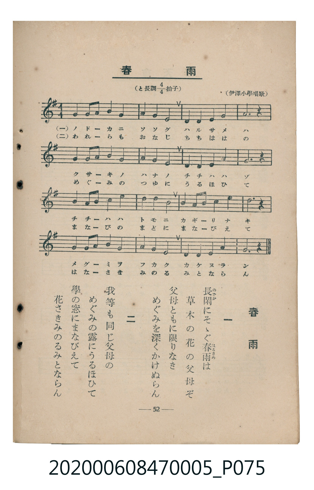

# 春雨

<audio controls src="harusame.mp3"></audio>

- 臺灣教育會公認《新定兒童唱歌》尋常科第五學年用（2020.006.0847.0005）

## 說明

原書資訊與歌詞全文（對應 P075.jpg，書頁 p. 52，參考教材第 16 首）：
調性與拍號：と長調四分之四拍子（G 大調 4/4 拍）
出處：（伊澤小學唱歌）

## 歌詞

```text
一　長閑（のどか）にそゝぐ春雨（はるさめ）は
草木の花の父母ぞ
父母ともに限りなき
めぐみを深くかけぬらん

二　我等も同じ父母の
めぐみの露にうるほひて
學の窓にまなびえて
花さきみのるみとならん
```

## 原書掃描頁



## 分析

```text
================================================================================
📊 TMD Song Profile: [ 春雨 ]
================================================================================
⏱  Duration:       0:43 (43.6s), 16 measures total
🎼 Key & Tempo:    首調基準 G, != 88.0 BPM, <4/4>
   - 分析範圍：      由實際發聲的音符與和弦推測調性；播放脈絡另行呈現
🎤 人聲音域:    D4 (MIDI 62) – E5 (MIDI 76) [跨度: 14 個半音 / 1.2 個八度, 難度: moderate]
   - 最低音:  D4 in [Harusame #1 @ m.3, 0:05]
   - 最高音: E5 in [Harusame #1 @ m.9, 0:23]
   - 適合: soprano, mezzo-soprano, contralto, tenor, baritone, bass
🏛  結構:      Harusame (43.6s)
⚡ 編曲密度:        Peak 1 軌道同時演奏
🗝  調性診斷：       G 大調（純淨自然大調，未偵測到可信轉調）
   - 風格氣質:    純淨自然大調（陽光明朗、易唱易記，無明顯調外色彩）
   - 轉調歷程:    全曲維持單一推測調性（未偵測到可信轉調）
   - 核心骨幹音:  G, B, A, E, D
   - 調性數值:    G 大調 [相關度: 0.83, 穩定度: Moderate, 自然音純度: 100.0%]
   - 候選調性 (K-S): G 大調 (0.83), E 小調 (0.73), D 大調 (0.65)
   - 五度圈歷程:   +1
   - 各段落調性細節:
     • [Harusame #1]: G 大調 (r: 0.83, 自然音純度: 100.0%)

  [ 五度圈游移軌跡 ]
               C  
         F           [G ]*
      Bb               D  
      Eb               A  
         Ab           E  
            Db       B  
               F# 
     (* = active key center)

  [ 十二半音累積音高分佈 ]
     C  :                            0.0%
     C# :                            0.0%
     D  : ██████████████            15.8%
     D# :                            0.0%
     E  : ███████████████           16.7%
     F  :                            0.0%
     F# : ██                         1.7%
     G  : ████████████████████████  26.7%
     G# :                            0.0%
     A  : █████████████████         18.3%
     A# :                            0.0%
     B  : ███████████████████       20.8%
--------------------------------------------------------------------------------
Assignment 軌道音域：
  - Piano         : D4 – E5 (14 個半音 / 1.2 個八度, 53 個音符)
================================================================================
```

## ABC

```abc
X:1
T:春雨
C:TMD (Chen, Chih-Han / aguai)
M:4/4
L:1/16
Q:1/4=88
K:G

V:V1 name="Piano" snm="Pia"

[V:V1]
g4 g2 a2 b4 g4 | a4 b4 a8 | d4 e4 g4 a4 | b12 z4 |
g4 g2 a2 b4 g4 | a4 g4 e8 | d4 e4 g4 f4 | g12 z4 |
b4 b2 d2 e4 e4 | d4 e4 b8 | a4 a2 b2 d4 e4 | d12 z4 |
a4 a2 b2 d4 b4 | a4 g4 e8 | d4 g4 b4 a4 | g12 z4 |
```

- [主旋律 TMD 檔案](harusame.tmd)
- [鋼琴伴奏 TMD 檔案](harusame_piano.tmd)
