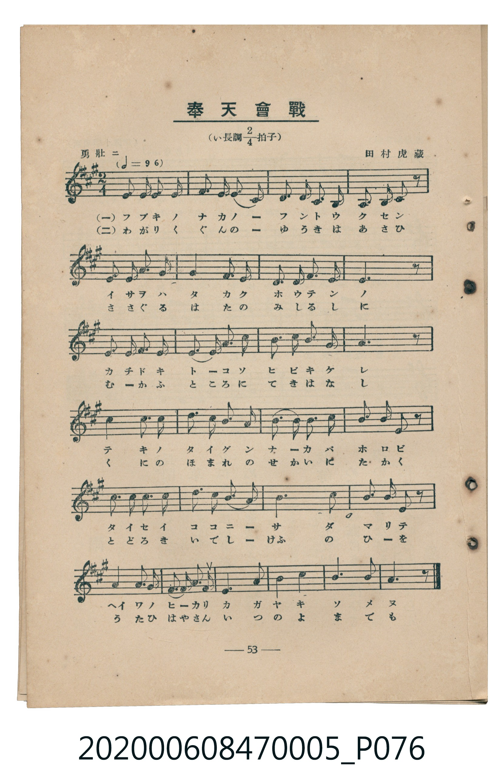
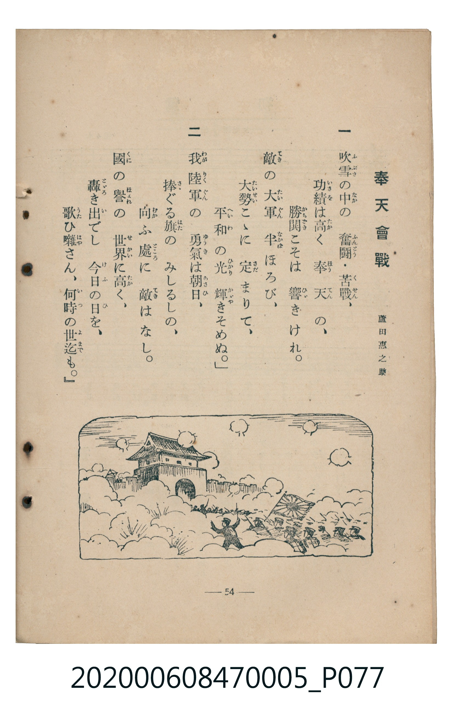

# 奉天會戰

<audio controls src="hoten_kaisen.mp3"></audio>

- 臺灣教育會公認《新定兒童唱歌》尋常科第五學年用（2020.006.0847.0005）

## 說明

原書資訊與歌詞全文（對應 P076.jpg – P077.jpg，書頁 pp. 53–54，參考教材第 17 首）：
調性與拍號：い長調四分之二拍子（A 大調 2/4 拍），勇壯ニ（♩= 96）
作曲與作歌：田村虎藏、蘆田惠之助

## 歌詞

```text
一　吹雪（ふぶき）の中（なか）の　奮闘（ふんとう）・苦戰（くせん）、
功績（いさを）は高（たか）く　奉天（ほうてん）の、
勝鬨（かちどき）こそは　響（ひゞ）きけれ。
敵（てき）の大軍（たいぐん）　半（なかば）ほろび、
大勢（たいせい）こゝに　定（さだ）まりて、
平和（へいわ）の光（ひかり）　輝（かゞや）きそめぬ。」

二　我（わが）陸軍（りくぐん）の　勇氣（ゆうき）は朝日（あさひ）、
捧（さゝ）ぐる旗（はた）の　みしるしの、
向（むか）ふ處（ところ）に　敵（てき）はなし。
國（くに）の譽（ほまれ）の　世界（せかい）に高（たか）く、
轟（とゞろ）き出（い）でし　今日（けふ）の日（ひ）を、
歌（うた）ひ囃（はや）さん、何時（いつ）の世迄（よまで）も。」
```

## ABC

```abc
X:1
T:奉天會戰
M:2/4
L:1/16
Q:1/4=96
K:A
V:V1 name="Piano" snm="Pia"
[V:V1]
E3 E E3 F | A3 B A4 | F3 F E3 C | E2 C2 E2 z2 |
A3 A B3 B | c4 c3 e | f3 f e3 c | B6 z2 |
c3 B A3 B | A2 F2 E3 E | F3 A B3 c | A6 z2 |
B4 B3 c | e3 e c2 B2 | A2 B2 c3 c | B3 A F2 z2 |
e3 e e3 e | f3 f e4 | c4 E4 | A3 B c2 z2 |
B2 B A F E F A | E2 F2 A2 B2 | c6 B2 | A6 z2 |
```

## TMD 檔案連結

- [主旋律 TMD 檔案](hoten_kaisen.tmd) [[在 TMD Studio 編輯](https://tmdlang.github.io/Tmd-TS/#tmd=s7IKdvYPcrWy4qpTUCpJTLdSSM7PyUlNLsnMz7MqzsjMK0nNjM_KTMmPL87Iz05Ugisry88pzU21Si9KTEmNN403MjAyiDcwMIs3sDAxBzIMTBFKi_NLi5JTrYqTM_Lzc-JLUitKkvLzsxHyBUX5Zal5iXlANQVFIBtTwIoQClLLMlNSQdKpKZkl-UWZiTlI7kgtKga7FWxJfElRYl5xclFmAcgDCFUlGalAx-Zm5mSWJBZVKnFpaSk8Xdr5dMnKZ3Oan3VsUNDS4lK0VbA047K3VXDksjHSN7ED6X3Rvut54-JnU2e-aNoEVPm0dc2LVb2PG7qeTdvwdN2sp62Tnq9e-nTKxmdrex43dD_d0P10x47nyyc-X7Pmya4pT9fueLpzy_MpK97v6QCFjh4wdPRAoQNkGJi-39OpxMWlr6VgSy3ApaCg8LRv_rPZO15sbn-xoutFRzvQXS9WznvauuLZtHagK55u6H3W3qkQYGBuppdVkK7wqGEyiGMO4rzf0wPU-XJBo0JBgZ6CqTFQztQEKPi0v_lFQzMwBJ7NnQD0l4KhucLLZdOArn-_ZxbIxher9j9rWA6yq7v3xcz5QNHHjS0vp24Hij-dPftpR9uTnd1PdvUAZZ-unQB0g6PC0yXLgZIKwCBWAIqCTep52t3-dPH6x83dQBWPZq4ExQRQAmT-k71zns3eBDQfxFjbAzT_-ZQNz-ZOfDGz78X0_scNjS9mtIFEmhcALXratZILrGlHw-OGhqcTdr6cvQpo4uPGrY8btz1uBFn2uHHdkx1rwYKrHjcC7QOJgBQvXfdy-gyo4qbJjxtXPG5sA8k2737RvQyYRMBS_Y8bZwNlQeINjeAA75r_fMc-sFzL48apj5smgU1c_3I1xKz5MDuATgXaAUpxYPHdQNMfNy6DmgVyAcS47rkv14ASDFDb48aFjxtXwlwNdNFcoLlAU17O3w9WsOlx0zywVO_jxomPm4ApsAlkxLOpW8HSy-D-BQX4biAb4hygMyfAvNDwtLcLHhSPG4F-BKrf_bgJaOJmmIuWLH_avQhJ82wgCXVRE9BFq0GmrJsFVjD1ceMCsNS-x01dIBdAjdi5-ekkYMwBVewAGdHUD3VXKzDqwR4BWt4EdAjIRS_2zIV6v2ne4yaITUDnzH3c1Pi4cQ3Qj48beiFxvAvo44ZnHRNBypuAEQO0ofPlzB1Qr4IcABSEeRUSx93tzzYsBssCAx-IIAG0_tmcuc-mLwVb2wT2xSZEBD_rXQ71WxPQYUDVQBO7n02fDhZcDwwUuOmPG_c_bpwOlAWRiBidAHEgUBqSELa-mDkVrBmYwIBBCHECKBQxIg5oOjBepkPj9ekcUOYAe2o1xM4Xa_fC0hIwwEHehzjkyY5pz6dCwhsYWUDnQEJxNbY0CXbji71AX4BdBApziOW9T9t3QZI1mLsc7JCGJ7u7YCE1EegViJUwEXCoNU2CBRwoswJFgcEMCaNNT2c3Q0MNGq_AMJ0MVP1k79RnM5tgeWgJLJNOe7EfqAwYdEDxfUAXgE0HRj84BQAtoLzEhAIFLX0uLo_8ktQ878TM4tQ8q4DMxLx8hxqDGoVqkEUKNoZmWnZgFrbyWgFU3O9oeLGwR0HDROHphv7n6xt04IWsJhYNQPughmkANWpaKTxungrkP26epvC4aS2Y1adQAyS7QOym1WA-SHQPWBSidjMQd4Dll4FEm9YD8W6wOBgg27GrB2RHUz9IdWMPkAU2t7EfpK9xAtiMyUDWOoQdTW1gFW1A3AtmrQerbQLiqUC8CcWOGgXTeAVdIARSUJZZPFDUEMw0gtK6QBGgMFQWqs4YpA7MBrLABugqGICUgrM47uDe1UNRcDctAXt6K9C7IK88bgYHRdN-iLdAIQ4iwX5ung0N48fN4DABhi9IFBQfSAAztIHhBAo3UGhBQrgbHILroVY0zgeT68CCIHuB-QusCMICiYIcgWkFLFgNgQELCd4aBWNoAENoU1BAQ8IZyIaI10BVQyAxIbyjk7IQBgdhcyMQd4K9vxYcbB3gBAbig5Lp46a9YNFJYLXAJAhJ_E0bwaJrCAVxUwNY3x5gWEHCbSs43FYA8WSwOZCkuxosugzM7oVGAbBkBYtOxxHGkJCEJV1QGINY4OSLSOvw9AyLC1A4wxI7keEMbCNRVnCAEiU0gOHlBjghgxL546YN0BIBUprAAh8SORMQ6bt5LTgCcAQ0sKSAWAJOk7BUuxvM3gc0DlikgAsPkOhseGy0IIU-JLV3I4yChzQsXSJCEJJmTcFxABKFhCmIBYkVRGo2hEQAUQXGFMqSMyJEwd4GskDhDEnEoJIY7GVo2bkVGlrNDRAGKJTngQVWISIMSyivAAfSSnjC7QUHHSQYl0MTK9SOxong5A6JDJgl4GIZnB-aQDkKOZRhYQqj0UsIUCjDShFoAocFPCjoQVLEJObWtZQl5hmQMG4G1mXAlAwqGCDeAdWA4AwLYjWtAfJAMQEuUoBFCDS0F4IDugfChQEswQyq1OaDQwtUFgDbIpBiGlgFQoMRJAA0HxiywLYHWGQf1A5gNICsbMJqByRVgsoMSP0GJA1htRs4ncKSMSKoYQkfW7FRy8Wla6eA1CxRAHKVubgA)]
- [鋼琴伴奏 TMD 檔案](hoten_kaisen_piano.tmd) [[在 TMD Studio 編輯](https://tmdlang.github.io/Tmd-TS/#tmd=s7IKdvYPcrWy4tLSUni6tPPpkpXP5jQ_69jwfk_Hy-49zydsebJny9Ol_c87O97v6VTQ0uJStFWwNOOyt1Vw5LIx0jex46pTUHrRvut54-JnU2e-aNoE1P60dc2LVb2PG7qeTdvwdN2sp62Tnq9e-nTKxmdrex43dD_d0P10x47nyyc-X7Pmya4pT9fueLpzy_MpK4A2GhkYGegZGJjpGViYmAMZBqZAS5W4uDzyS1LzvBMzi1PzrAIyE_PygzwcagxqFKq5FIDAxtBMyw7M0tdSsEUHCiBrdjS8WNijoGGi8HRD__P1DToKAQbmZnpZBemaWDRo6YMNq1EwjVfQBUIgBWWZxQNFDcFMIyitCxQBCkNloeqMQerAbCALbICuggFIKRd-Z-7qIceZEIcYAp0EcViNgjHUaRDaFOREiAuBbIh4DVQ1BBLjth2d5LgN4gJYYIHcBmKBAwwRuvAQhPkB5D5Y8BLpvqezZ5PjPlgoIOyFhJAp2OUgUYhLQCyIXxBhZwhxNlERO4Ws9Ad1CoxGj0aQ42BRDQ1NmHtBLgZJERNyrWvJDTlQvEJSPZA0hKV5cKjAAg3hQlgwY4vaWix53Aclj5sgsvjT7vani9e_7J_-sn_Gk53dwFzzrLv36doJLxs2AT3ybPYmSJGFlEHiFaINY5EZJjCGaXw80Ak1SApN44lViSpvhKwXoRCkDclMNNPNCBiKogXNUBNMM1GUAsNU104BKVgVMLnKXFwA)]

## 分析

```text
================================================================================
📊 TMD Song Profile: [ 奉天會戰 ]
================================================================================
⏱  Duration:       0:30 (30.0s), 24 measures total
🎼 Key & Tempo:    首調基準 A, != 96.0 BPM, <2/4>
   - 分析範圍：      由實際發聲的音符與和弦推測調性；播放脈絡另行呈現
🎤 人聲音域:    C#4 (MIDI 61) – F#5 (MIDI 78) [跨度: 17 個半音 / 1.4 個八度, 難度: challenging]
   - 最低音:  C#4 in [HotenKaisen #1 @ m.3, 0:03]
   - 最高音: F#5 in [HotenKaisen #1 @ m.7, 0:07]
   - 適合: soprano, mezzo-soprano, tenor, baritone
🏛  結構:      HotenKaisen (30.0s)
⚡ 編曲密度:        Peak 1 軌道同時演奏
🗝  調性診斷：       E 調性不明確（純淨自然大調，未偵測到可信轉調）
   - 風格氣質:    純淨自然大調（陽光明朗、易唱易記，無明顯調外色彩）
   - 轉調歷程:    全曲維持單一推測調性（未偵測到可信轉調）
   - 核心骨幹音:  E, A, B, C#, F#
   - 調性數值:    E 調性不明確 [相關度: 0.81, 穩定度: Ambiguous, 自然音純度: 100.0%]
   - 候選調性 (K-S): E 大調 (0.81), A 大調 (0.80), C# 小調 (0.62)
   - 五度圈歷程:   +4
   - 各段落調性細節:
     • [HotenKaisen #1]: E 調性不明確 (r: 0.81, 自然音純度: 100.0%)

  [ 五度圈游移軌跡 ]
               C  
         F            G  
      Bb               D  
      Eb               A  
         Ab          [E ]*
            Db       B  
               F# 
     (* = active key center)

  [ 十二半音累積音高分佈 ]
     C  :                            0.0%
     C# : ██████████████████        18.9%
     D  :                            0.0%
     D# :                            0.0%
     E  : ████████████████████████  25.0%
     F  :                            0.0%
     F# : █████████████             13.3%
     G  :                            0.0%
     G# :                            0.0%
     A  : █████████████████████     21.7%
     A# :                            0.0%
     B  : ████████████████████      21.1%
--------------------------------------------------------------------------------
Assignment 軌道音域：
  - Piano         : C#4 – F#5 (17 個半音 / 1.4 個八度, 79 個音符)
================================================================================
```


## 原書掃描頁






