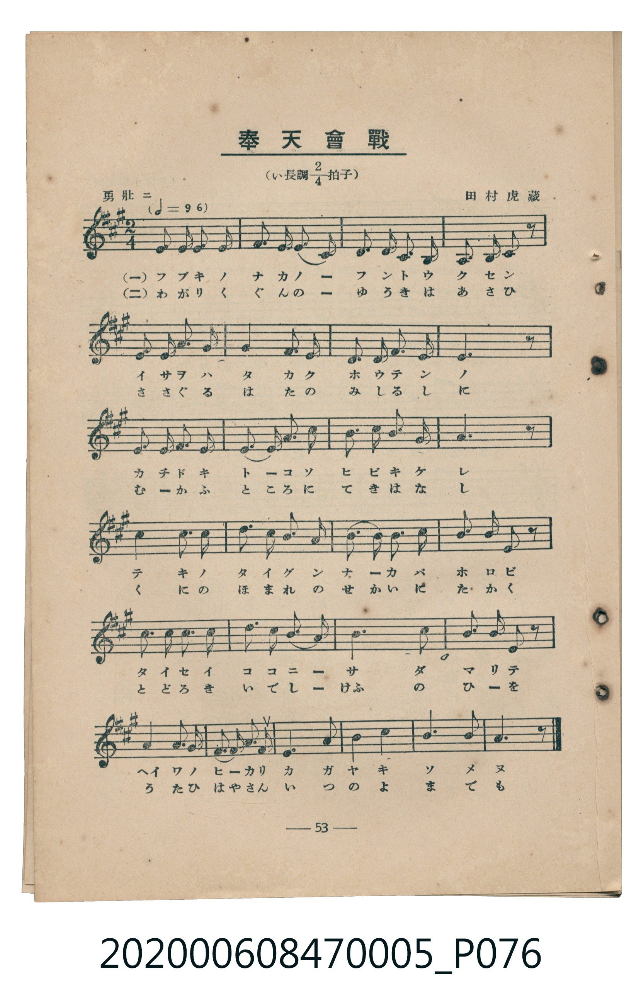
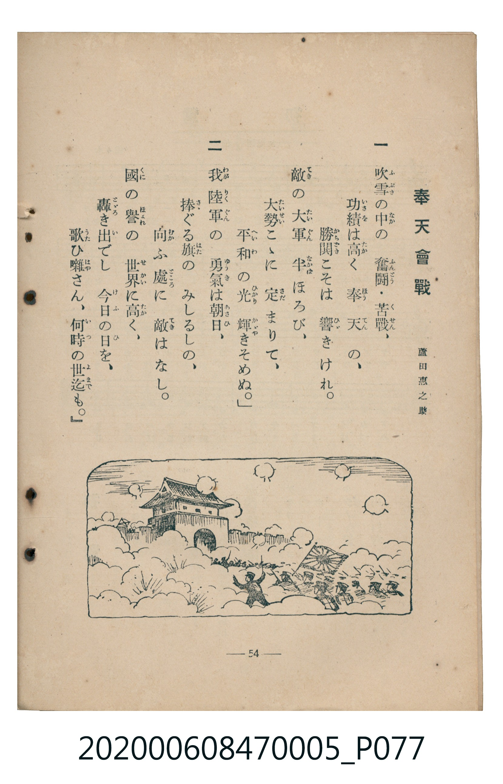

# 奉天會戰

> Re:Shōka 使用 AI 協助辨識與重建樂譜，可能會有錯誤。歡迎回報。

- **鋼琴伴奏版**：<br><audio controls src="hoten_kaisen.mp3"></audio>
- **NEUTRINO 歌聲合成版**：<br><audio controls src="hoten_kaisen_neutrino.mp3"></audio>

- 臺灣教育會公認《新定兒童唱歌》尋常科第五學年用（2020.006.0847.0005）

## 說明

原書資訊與歌詞全文（對應 P076.jpg – P077.jpg，書頁 pp. 53–54，參考教材第 17 首）：
調性與拍號：い長調四分之二拍子（A 大調 2/4 拍），勇壯ニ（♩= 96）
作曲與作歌：田村虎藏、蘆田惠之助


## 歌詞

```text
一　吹雪（ふぶき）の中（なか）の　奮闘（ふんとう）・苦戰（くせん）、
功績（いさを）は高（たか）く　奉天（ほうてん）の、
勝鬨（かちどき）こそは　響（ひゞ）きけれ。
敵（てき）の大軍（たいぐん）　半（なかば）ほろび、
大勢（たいせい）こゝに　定（さだ）まりて、
平和（へいわ）の光（ひかり）　輝（かゞや）きそめぬ。」

二　我（わが）陸軍（りくぐん）の　勇氣（ゆうき）は朝日（あさひ）、
捧（さゝ）ぐる旗（はた）の　みしるしの、
向（むか）ふ處（ところ）に　敵（てき）はなし。
國（くに）の譽（ほまれ）の　世界（せかい）に高（たか）く、
轟（とゞろ）き出（い）でし　今日（けふ）の日（ひ）を、
歌（うた）ひ囃（はや）さん、何時（いつ）の世迄（よまで）も。」
```

## ABC

<div class="abc-score" data-abc-src="hoten_kaisen.abc" aria-label="五線譜載入中"></div>

[下載 ABC 原始檔](hoten_kaisen.abc)

## TMD 檔案連結

- [主旋律 TMD 檔案](hoten_kaisen.tmd) [[在 TMD Studio 編輯](https://tmdlang.github.io/Tmd-TS/#tmd=s7IKdvYPcrWy4qpTUCpJTLdSSM7PyUlNLsnMz7MqzsjMK0nNjM_KTMmPL87Iz05Ugisry88pzU21Si9KTEmNN403MjAyiDcwMIs3sDAxBzIMTBFKi_NLi5JTrYqTM_Lzc-JLUitKkvLzsxHyBUX5Zal5iXlANQVFIBtTwIoQClLLMlNSQdKpKZkl-UWZiTlI7kgtKga7FWxJfElRYl5xclFmAcgDCFUlGalAx-Zm5mSWJBZVIsSBhqVn5lnl5ucllQI9iCmRmpmVicXJ-UUlGflAvxdkVFplZBaDHJWcmBOfnZiHFERQJxUkpqdaBRiYm-kCCXMlLi0thadLO58uWflsTvOzjg0KWlpcirYKlmZc9rYKjlw2RvomdiAjXrTvet64-NnUmS-aNgFVPm1d82JV7-OGrmfTNjxdN-tp66Tnq5c-nbLx2dqexw3dTzd0P92x4_nyic_XrHmya8rTtTue7tzyfMqK93s6QDGjB4wZPVDMABkGpu_3dCpxcelrKdhSC3ApKCg87Zv_bPaOF5vbX6zoetHRDnTXi5XznraueDatHeiKpxt6n7V3KoCCQS-rIF3hUcNkEMccxHm_pweo8-WCRoWCAj0FU2OgnKkJUPBpf_OLhmZgCDybOwHoLwVDc4WXy6YBXf9-zyyQjS9W7X_WsBxkV3fvi5nzgaKPG1teTt0OFH86e_bTjrYnO7uf7OoByj5dOwHoBkeFp0uWAyUVgEGsABQFm9TztLv96eL1j5u7gSoezVwJigmgBMj8J3vnPJu9CWg-iLG2B2j-8ykbns2d-GJm34vp_Y8bGl_MaAOJNC8AWvS0ayUXWNOOhscNDU8n7Hw5exXQxMeNWx83bnvcCLLsceO6JzvWggVXPW4E2gcSASleuu7l9BlQxU2THzeueNzYBpJt3v2iexkwiYCl-h83zgbKgsQbGsEB3jX_-Y59YLmWx41THzdNApu4_uVqiFnzYXYAnQq0A5TiwOK7gaY_blwGNQvkAohx3XNfrgElGKC2x40LHzeuhLka6KK5QHOBprycvx-sYNPjpnlgqd7HjRMfNwFTYBPIiGdTt4Kll8H9Cwrw3UA2xDlAZ06AeaHhaW8XPCgeNwL9CFS_-3ET0MTNMBctWf60exGS5tlAEuqiJqCLVoNMWTcLrGDq48YFYKl9j5u6QC6AGrFz89NJwJgDqtgBMqKpH-quVmDUgz0CtLwJ6BCQi17smQv1ftO8x00Qm4DOmfu4qfFx4xqgHx839ELieBfQxw3POiaClDcBIwZoQ-fLmTugXgU5ACgI8yokjrvbn21YDJYFBj4QQQJo_bM5c59NXwq2tgnsi02ICH7Wuxzqtyagw4CqgSZ2P5s-HSy4HhgocNMfN-5_3DgdKAsiETE6AeJAoDQkIWx9MXMqWDMwgQGDEOIEUChiRBzQdGC8TIfG69M5oMwB9tRqiJ0v1u6FpSVggIO8D3HIkx3Tnk-FhDcwsoDOgYTiamxpEuzGF3uBvgC7CBTmEMt7n7bvgiRrMHc52CENT3Z3wUJqItArECthIuBQa5oECzhQZgWKAoMZEkabns5uhoYaNF6BYToZqPrJ3qnPZjbB8tASWCad9mI_UBkw6IDi-4AuAJsOjH5wCgBaQHmJCQUKWvpcXB75Jal53omZxal5VgGZiXn5DjUGNdUgexRsDM207MAsbMW1Aqi039HwYmGPgoaJwtMN_c_XN-jAy1hNLBqA1kEN0wBq1LRSeNw8Fch_3DxN4XHTWjCrT6EGSHaB2E2rwXyQ6B6wKETtZiDuAMsvA4k2rQfi3WBxMEC2Y1cPyI6mfpDqxh4gC2xuYz9IX-MEsBmTgax1CDua2sAq2oC4F8xaD1bbBMRTgXgTih01CqbxCrpACKSgLLN4oKghmGkEpXWBIkBhqCxUnTFIHZgNZIEN0FUwACkFG-xjCPEuSCUscCBsWPCAedAAglmC0AEJIogaWCCB2LuhsroKIPugdhmB5PshqqGBBGHDggliDiSg4HYBAwqiChJUEDYssEBskFtAAQazC38y2tVDUTJqWgKOzK1A34Gi6HEz2O1N-yHRBQooEAl2XvNsaNp53AyOa2BwgERB6QwJYKYioIdA6QGUCiAppxvs2fVQKxrng8l1YEGQvcBiA6wIwgKJghyBaQUsuRgCEwwk2dQoGEPDGUKbghIQJP0A2RDxGqhqCERLOcDQgMQZJDwgaQIWIhAdoCCB0LBAgaUWULDAUhEkYBD2oKUacBxD4hqRTmDBArUHGC4QGhYyEB4kbGBsSOig20Og4OmkLMWAk0RzIxB3gqNzLdi3HeCCAMQHFSePm_aCRSeB1QJzAKSQatoIFl1DKMk0NYD17QH6DpIOtoJ9ugKIJ4PNgRQxq8Giy8DsXmiSAlaAYNHpONIMJGXAihhQmgGxwMUMokyClzuwtAVKN7BCCVu6gaYJaKhA4hMWLrB0Ayo9QDQsZCA6IGEDkYGFDs50AwwXWOqApQFYyIDYk8GmwMoUWOhAeJDwgbBhIURSugE2zSmrsECFBjTBwOsrcEEDynaPmzZAayJIMQ1LTJDENgFR_jSvBQcajoQDLHohloDLDFje2Q1m7wMaByylwZUWSHQ2PHW1IKUmSGnUjTAKnnJg5QYiRUDKFFNwmgKJQtIIiAVJZYjSxhCSoNArKkiBAUkskOQACxWIKCRckAsVSBWDVAzBwwbCg4QOZoEDqaYgyQK5WAFVbCAeJHCQZUAmQpIZKICQkxSsYIIEEpHV1BTKCh1EOgFHJpAFCidIUQOqtMERCW2JbIWmgeYGCAMUPvPAAqsQyRBL2lkBjvqV8OKlF-xbSOJYDi1SoHY0TgRnPUgSg1kCbuSAS60mULmHnHZgKQVGo9dLoLQDq7ugxRAsOYESFEgKvchBTiPQWISHCqzAAYULzCxQuEDTADBg4KLAkIGIQcIGM-WAihZQbEPCBVaYQEIGwoOEDdxEcDMfntyQWj7gNg3EaaDSj5gyp3UtZWXODEgANQObusCsBSp1IfEDav-BS0EQq2kNkAcKRnCJDSyfoclnITh8eiBcGMCSbtrAeQLkPVARC-ypAGlgxQ5s-EHTBUgAaD4wLIA9E7DIPqgdwLADWdmE1Q5I4QGqqiDNXyBpCEpLoIADFyew0gaRdmDlE97aqnkGpKGDHCyQEgURKCA-qCICBQysfIIEDsJYUAhB0hCk5IBA9PQDSlPI4QMyDRxCoACCJSNQ-MBSCyiMIOllH7JlwKCCOAHUSka1rJaLS9dOAak7pgDkKnMBAA)]
- [鋼琴伴奏 TMD 檔案](hoten_kaisen_piano.tmd) [[在 TMD Studio 編輯](https://tmdlang.github.io/Tmd-TS/#tmd=s7IKdvYPcrWy4qpTUCpJTLdSyC8qychPL0osyKi0ysgsLskvykxOzInPTsxLVIIrKs4vLUpOjS9ITE-1CjAwN9MFEuZKXFpaCk-Xdj5dsvLZnOZnHRve7-l42b3n-YQtT_Zsebq0_3lnx_s9nQpaWlyKtgqWZlz2tgqOXDZG-iZ2IHNftO963rj42dSZL5o2AbU_bV3zYlXv44auZ9M2PF0362nrpOerlz6dsvHZ2p7HDd1PN3Q_3bHj-fKJz9esebJrytO1O57u3PJ8ygqgjUYGRgZ6BgZmegYWJuZAhoEp0FIlLi6P_JLUPO_EzOLUPKuAzMS8_CAPhxqDmmouBSCwMTTTsgOz9LUUbNGBAsiWHQ0vFvYoaJgoPN3Q_3x9g44CyN96WQXpmlg0aOmDDatRMI1X0AVCIAVlmcUDRQ3BTCMorQsUAQpDZaHqjEHqwGwgC2yAroIBSCnYYB_DGoXHzVPBKh83T1N43LQWyu4Danvc3AXhNa0Gi8AsQejYDMQdUDXLQDJN68Hs3VBZXQWQfVC7jEDy_RDVjT1ANtT0xn6QzsYJUHMmA9nrEHY1tUFVtQFxL5S9HqyjCcwGueVx4ya4XfiDf1cPOcEPCWBDYFBDArxGwRjqQghtCgp6SMgD2RDxGqhqCEQL86YlUN9uBYYTyO2g8AKHQ9N-qA5QqENosG-bZ8PD-XEzNEyAIQySgcUMCKKFNzh0IKGECOFucOiBYgoiNx9KrwOLQ-x_3DgdrBLGBslA3INsD4Gk3klOWENCFJaoQWENYoETNiIXwFM6LE5A4Q3LBtjCGxqWzY1A3AkNh7Xg0IOkXxAflF5B9F6w-CSoDmB6hOWKpo1gmTW4w7upAR6qsLDbCg67FWD2ZLApsFS8GiyzDMrrhcfJ48ZVYJnppIX309mzyQlvWCpFhCMkBZuCYwIkCglZEAsSN4i0bQiJBvQCBZI8IUEMCURwcQJN2qDE_7hpA1QGkoQhRQFSom-egJzom9eCIwIzeUOKE0hgIidiUAEE4u0DmtiDIgMyERI5jxtbUCIClg26oeYSVZxMIas0hwYwjEYvPEBBDitgoGkeFgugeABJoadv5KCFeh7IBsnAUjWorIakSUi5uhUWdM2wNAsK8HlQsVXQaEQPcFA6BgXSSqR03AsOPlhgLkdKuSDxiaAsAIslpIIdXGRDnAbKasQk8Na15CZwUHECqRSBpCGsSgQnXljaRgQ5LDfgLVGaZ0AK8cfN68HpG1JgQKpKcPYFp-THTaDC4nEzWCU4N4Bk9iIZ-7h5ITToIekUAtGDHRQVoBQKCjVIMfG4qQVUrIPqS1joP24EWwMO5MdNoHINJLMP2TJg7ECcAKo7US2rxdK28UFu25ggmjZPu9ufLl7_sn_6y_4ZT3Z2A2vVZ929T9dOeNmwCRhDz2ZvgrTUkCrQeIVow1hkhgmMYRofDwxbiGch8qbxxKpElTdC1otQCNKGZCaa6WYEDEXRgmaoCaaZKEqBQaprp4AUqtE-QDPRhYzAQspcAA)]

## 分析

```text
================================================================================
📊 TMD Song Profile: [ 奉天會戰 ]
================================================================================
⏱  Duration:       0:30 (30.0s), 24 measures total
🎼 Key & Tempo:    首調基準 A, != 96.0 BPM, <2/4>
   - 分析範圍：      由實際發聲的音符與和弦推測調性；播放脈絡另行呈現
🎤 人聲音域:    C#4 (MIDI 61) – F#5 (MIDI 78) [跨度: 17 個半音 / 1.4 個八度, 難度: challenging]
   - 最低音:  C#4 in [HotenKaisen #1 @ m.3, 0:03]
   - 最高音: F#5 in [HotenKaisen #1 @ m.7, 0:07]
   - 適合: soprano, mezzo-soprano, tenor, baritone
🏛  結構:      HotenKaisen (30.0s)
⚡ 編曲密度:        Peak 1 軌道同時演奏
🗝  調性診斷：       E 調性不明確（純淨自然大調，未偵測到可信轉調）
   - 風格氣質:    純淨自然大調（陽光明朗、易唱易記，無明顯調外色彩）
   - 轉調歷程:    全曲維持單一推測調性（未偵測到可信轉調）
   - 核心骨幹音:  E, A, B, C#, F#
   - 調性數值:    E 調性不明確 [相關度: 0.81, 穩定度: Ambiguous, 自然音純度: 100.0%]
   - 候選調性 (K-S): E 大調 (0.81), A 大調 (0.80), C# 小調 (0.62)
   - 五度圈歷程:   +4
   - 各段落調性細節:
     • [HotenKaisen #1]: E 調性不明確 (r: 0.81, 自然音純度: 100.0%)

  [ 五度圈游移軌跡 ]
               C  
         F            G  
      Bb               D  
      Eb               A  
         Ab          [E ]*
            Db       B  
               F# 
     (* = active key center)

  [ 十二半音累積音高分佈 ]
     C  :                            0.0%
     C# : ██████████████████        18.9%
     D  :                            0.0%
     D# :                            0.0%
     E  : ████████████████████████  25.0%
     F  :                            0.0%
     F# : █████████████             13.3%
     G  :                            0.0%
     G# :                            0.0%
     A  : █████████████████████     21.7%
     A# :                            0.0%
     B  : ████████████████████      21.1%
--------------------------------------------------------------------------------
Assignment 軌道音域：
  - Piano         : C#4 – F#5 (17 個半音 / 1.4 個八度, 79 個音符)
================================================================================
```


## 原書掃描頁






