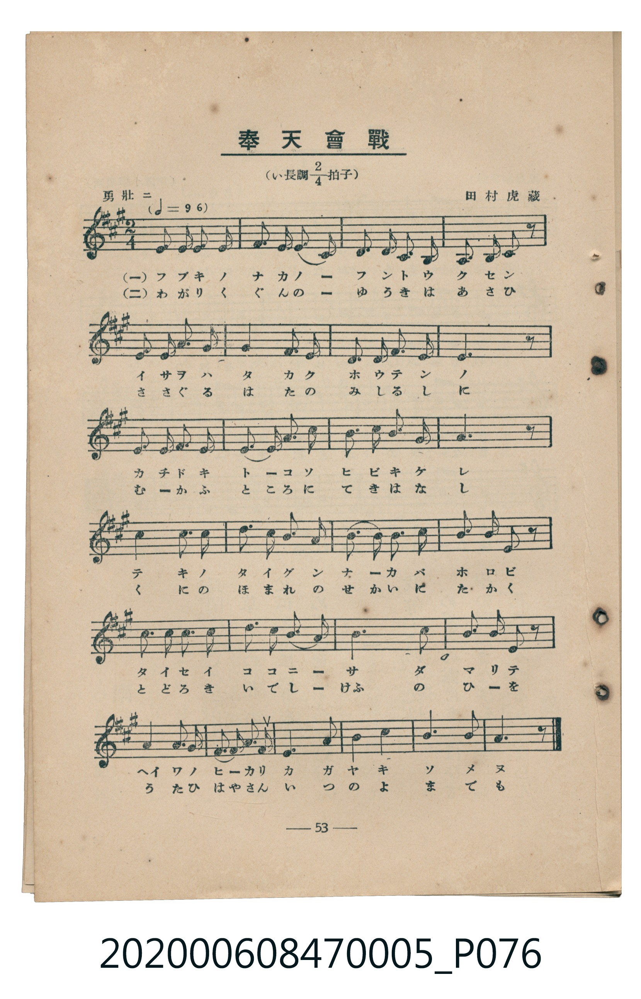
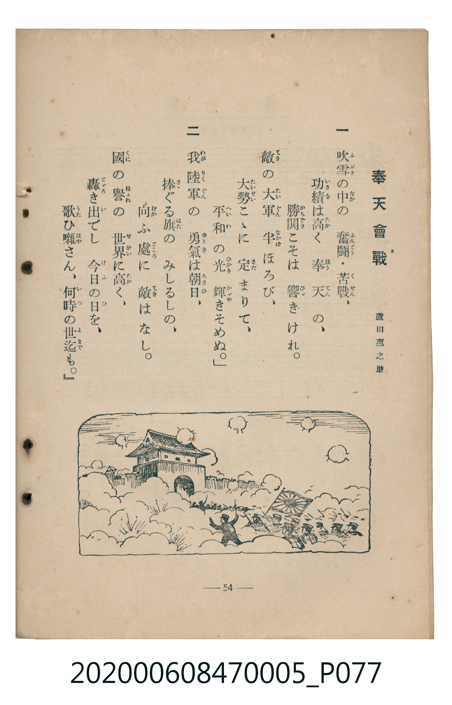

# 奉天會戰

> Re:Shōka 使用 AI 協助辨識與重建樂譜，可能會有錯誤。歡迎回報。

- **鋼琴伴奏版**：<br><audio controls src="hoten_kaisen.mp3"></audio>
- **NEUTRINO 歌聲合成版**：<br><audio controls src="hoten_kaisen_neutrino.mp3"></audio>

- 臺灣教育會公認《新定兒童唱歌》尋常科第五學年用（2020.006.0847.0005）

## 說明

原書資訊與歌詞全文（對應 P076.jpg – P077.jpg，書頁 pp. 53–54，參考教材第 17 首）：
調性與拍號：い長調四分之二拍子（A 大調 2/4 拍），勇壯ニ（♩= 96）
作曲與作歌：田村虎藏、蘆田惠之助


## 歌詞

```text
一　吹雪（ふぶき）の中（なか）の　奮闘（ふんとう）・苦戰（くせん）、
功績（いさを）は高（たか）く　奉天（ほうてん）の、
勝鬨（かちどき）こそは　響（ひゞ）きけれ。
敵（てき）の大軍（たいぐん）　半（なかば）ほろび、
大勢（たいせい）こゝに　定（さだ）まりて、
平和（へいわ）の光（ひかり）　輝（かゞや）きそめぬ。」

二　我（わが）陸軍（りくぐん）の　勇氣（ゆうき）は朝日（あさひ）、
捧（さゝ）ぐる旗（はた）の　みしるしの、
向（むか）ふ處（ところ）に　敵（てき）はなし。
國（くに）の譽（ほまれ）の　世界（せかい）に高（たか）く、
轟（とゞろ）き出（い）でし　今日（けふ）の日（ひ）を、
歌（うた）ひ囃（はや）さん、何時（いつ）の世迄（よまで）も。」
```

## ABC

<div class="abc-score" data-abc-src="hoten_kaisen.abc" aria-label="五線譜載入中"></div>

[下載 ABC 原始檔](hoten_kaisen.abc)

## TMD 檔案連結

- [主旋律 TMD 檔案](hoten_kaisen.tmd) [[在 TMD Studio 編輯](https://tmdlang.github.io/Tmd-TS/#tmd=s7IKdvYPcrWy4qpTUCpJTLdSSM7PyUlNLsnMz7MqzsjMK0nNjM_KTMmPL87Iz05Ugisry88pzU21Si9KTEmNN403MjAyiDcwMIs3sDAxBzIMTBFKi_NLi5JTrYqTM_Lzc-JLUitKkvLzsxHyBUX5Zal5iXlANQVFIBtTwIoQClLLMlNSQdKpKZkl-UWZiTlI7kgtKga7FWxJfElRYl5xclFmAcgDCFUlGalAx-Zm5mSWJBZVIsSBhqVn5lnl5ucllQI9iCmRmpmVieRkLS2Fp0s7ny5Z-WxO87OODQpaWlyKtgqWZlz2tgqOXDZG-iZ2ICNetO963rj42dSZL5o2AVU-bV3zYlXv44auZ9M2PF0362nrpOerlz6dsvHZ2p7HDd1PN3Q_3bHj-fKJz9esebJrytO1O57u3PJ8yor3ezpAoaoHDFU9UKgCGQam7_d0KnFx6Wsp2FILcCkoKDztm_9s9o4Xm9tfrOh60dEOdNeLlfOetq54Nq0d6IqnG3qftXcqBBiYm-llFaQrPGqYDOKYgzjv9_QAdb5c0KhQUKCnYGoMlDM1AQo-7W9-0dAMDIFncycA_aVgaK7wctk0oOvf75kFsvHFqv3PGpaD7OrufTFzPlD0cWPLy6nbgeJPZ89-2tH2ZGf3k109QNmnaycA3eCo8HTJcqCkAjCIFYCiYJN6nna3P128_nFzN1DFo5krQTEBlACZ_2TvnGezNwHNBzHW9gDNfz5lw7O5E1_M7Hsxvf9xQ-OLGW0gkeYFQIuedq3kAmva0fC4oeHphJ0vZ68Cmvi4cevjxm2PG0GWPW5c92THWrDgqseNQPtAIiDFS9e9nD4Dqrhp8uPGFY8b20CyzbtfdC8DJhGwVP_jxtlAWZB4QyM4wLvmP9-xDyzX8rhx6uOmSWAT179cDTFrPswOoFOBdoBSHFh8N9D0x43LoGaBXAAxrnvuyzWgBAPU9rhx4ePGlTBXA100F2gu0JSX8_eDFWx63DQPLNX7uHHi4yZgCmwCGfFs6law9DK4f0EBvhvIhjgH6MwJMC80PO3tggfF40agH4Hqdz9uApq4GeaiJcufdi9C0jwbSEJd1AR00WqQKetmgRVMfdy4ACy173FTF8gFUCN2bn46CRhzQBU7QEY09UPd1QqMerBHgJY3AR0CctGLPXOh3m-a97gJYhPQOXMfNzU-blwD9OPjhl5IHO8C-rjhWcdEkPImYMQAbeh8OXMH1KsgBwAFYV6FxHF3-7MNi8GywMAHIkgArX82Z-6z6UvB1jaBfbEJEcHPepdD_dYEdBhQNdDE7mfTp4MF1wMDBW7648b9jxunA2VBJCJGJ0AcCJSGJIStL2ZOBWsGJjBgEEKcAApFjIgDmg6Ml-nQeH06B5Q5wJ5aDbHzxdq9sLQEDHCQ9yEOebJj2vOpkPAGRhbQOZBQXI0tTYLd-GIv0BdgF4HCHGJ579P2XZBkDeYuBzuk4cnuLlhITQR6BWIlTAQcak2TYAEHyqxAUWAwQ8Jo09PZzdBQg8YrMEwnA1U_2Tv12cwmWB5aAsuk017sByoDBh1QfB_QBWDTgdEPTgFACygvMaFAQUufi8sjvyQ1zzsxszg1zyogMzEv36HGoKYaZI-CjaGZlh2Yha24VgCV9jsaXizsUdAwUXi6of_5-gYdeBmriUUD0DqoYRpAjZpWCo-bpwL5j5unKTxuWgtm9SnUAMkuELtpNZgPEt0DFoWo3QzEHWD5ZSDRpvVAvBssDgbIduzqAdnR1A9S3dgDZIHNbewH6WucADZjMpC1DmFHUxtYRRsQ94JZ68Fqm4B4KhBvQrGjRsE0XkEXCIEUlGUWDxQ1BDONoLQuUAQoDJWFqjMGqQOzgSywAboKBiClYIN9DCHeBamEBQ6EDQseMA8aQDBLEDogQQRRAwskEHs3VFZXAWQf1C4jkHw_RDU0kCBsWDBBzIEEFNwuYEBBVEGCCsKGBRaIDXILKMBgduFPRrt6KEpGTUvAkbkV6DtQFD1uBru9aT8kukABBSLBzmueDU07j5vBcQ0MDpAoKJ0hAcxUBPQQKD2AUgEk5XSDPbseakXjfDC5DiwIshdYbIAVQVggUZAjMK2AJRdDYIKBJJsaBWNoOENoU1ACgqQfIBsiXgNVDYFoKQcYGpA4g4QHJE3AQgSiAxQkEBoWKLDUAgoWWCqCBAzCHrRUA45jSFwj0gksWKD2AMMFQsNCBsKDhA2MDQkddHsIFDydlKUYcJJobgTiTnB0rgX7tgNcEID4oOLkcdNesOgksFpgDoAUUk0bwaJrCCWZpgawvj1A30HSwVawT1cA8WSwOZAiZjVYdBmY3QtNUsAKECw6HUeagaQMWBEDSjMgFriYQZRJ8HIHlrZA6QZWKGFLN9A0AQ0VSHzCwgWWbkClB4iGhQxEByRsIDKw0MGZboDhAksdsDQACxkQezLYFFiZAgsdCA8SPhA2LIRISjfApjllFRao0IAmGHh9BS5oQNnucdMGaE0EKaZhiQmS2CYgyp_mteBAw5FwgEUvxBJwmQHLO7vB7H1A44ClNLjSAonOhqeuFqTUBCmNuhFGwVMOrNxApAhImWIKTlMgUUgaAbEgqQxR2hhCEhR6RQUpMCCJBZIcYKECEYWEC3KhAqlikIoheNhAeJDQwSxwINUUJFkgFyugig3EgwQOsgzIREgyAwUQcpKCFUyQQCKymppCWaGDSCfgyASyQOEEKWpAlTY4IqEtka3QNNDcAGGAwmceWGAVIhliSTsrwFG_El689IJ9C0kcy6FFCtSOxongrAdJYjBLwI0ccKnVBCr3kNMOLKXAaPR6CZR2YHUXtBiCJSdQggJJoRc5yGkEGovwUIEVOKBwgZkFChdoGgAGDFwUGDIQMUjYYKYcUNECim1IuMAKE0jIQHiQsIGbCG7mw5MbUssH3KaBOA1U-hFT5rSupazMmQEJoGZgUxeYtUClLiR-QO0_cCkIYjWtAfJAwQgusYHlMzT5LASHTw-ECwNY0k0bOE-AvAcqYoE9FSANrNiBDT9ougAJAM0HhgWwZwIW2Qe1Axh2ICubsNoBKTxAVRWk-QskDUFpCRRw4OIEVtog0g6sfMJbWzXPgDR0kIMFUqIgAgXEB1VEoICBlU-QwEEYCwohSBqClBwQiJ5-QGkKOXxApoFDCBRAsGQECh9YagGFESS97EO2DBhUECeAWsmoltVycenaKSB1xxSAXGUuAA)]
- [鋼琴伴奏 TMD 檔案](hoten_kaisen_piano.tmd) [[在 TMD Studio 編輯](https://tmdlang.github.io/Tmd-TS/#tmd=s7IKdvYPcrWy4tLSUni6tPPpkpXP5jQ_69jwfk_Hy-49zydsebJny9Ol_c87O97v6VTQ0uJStFWwNOOyt1Vw5LIx0jex46pTUHrRvut54-JnU2e-aNoE1P60dc2LVb2PG7qeTdvwdN2sp62Tnq9e-nTKxmdrex43dD_d0P10x47nyyc-X7Pmya4pT9fueLpzy_MpK4A2GhkYGegZGJjpGViYmAMZBqZAS5W4uDzyS1LzvBMzi1PzrAIyE_PygzwcagxqqrkUgMDG0EzLDszS11KwRQcKIFt2NLxY2KOgYaLwdEP_8_UNOgoBBuZmelkF6ZpYNGjpgw2rUTCNV9AFQiAFZZnFA0UNwUwjKK0LFAEKQ2Wh6oxB6sBsIAtsgK6CAUgp2GAfwxqFx81TwSofN09TeNy0FsruA2p73NwF4TWtBovALEHo2AzEHVA1y0AyTevB7N1QWV0FkH1Qu4xA8v0Q1Y09QDbU9MZ-kM7GCVBzJgPZ6xB2NbVBVbUBcS-UvR6sownMBrnlceMmuF34g39XDznBDwlgQ2BQQwK8RsEY6kIIbQoKekjIA9kQ8RqoaghEC_OmJVDfbgWGE8jtoPACh0PTfqgOUKhDaLBvm2fDw_lxMzRMgCEMkoHFDAiihTc4dCChhAjhbnDogWIKIjcfSq8Di0Psf9w4HawSxgbJQNyDbA-BpN5JTlhDQhSWqEFhDWKBEzYiF8BTOixOQOENywbYwhsals2NQNwJDYe14NCDpF8QH5ReQfResPgkqA5geoTliqaNYJk1uMO7qQEeqrCw2woOuxVg9mSwKbBUvBosswzK64XHyePGVWCZ6aSF99PZs8kJb1gqRYQjJAWbgmMCJAoJWRALEjeItG0IiQb0AgWSPCFBDAlEcHECTdqgxP-4aQNUBpKEIUUBUqJvnoCc6JvXgiMCM3lDihNIYCInYlABBOLtA5rYgyIDMhESOY8bW1AiApYNuqHmElWcTCGrNIcGMIxGLzxAQQ4rYKBpHhYLoHgASaGnb-SghXoeyAbJwFI1qKyGpElIuboVFnTNsDQLCvB5ULFV0GhED3BQOgYF0kqkdNwLDj5YYC5HSrkg8YmgLACLJaSCHVxkQ5wGymrEJPDWteQmcFBxAqkUgaQhrEoEJ15Y2kYEOSw34C1RmmdACvHHzevB6RtSYECqSnD2Bafkx02gwuJxM1glODeAZPYiGfu4eSE06CHpFALRgx0UFaAUCgo1SDHxuKkFVKyD6ktY6D9uBFsDDuTHTaByDSSzD9kyYOxAnACqO1Etq8XStvFBbtuYIJo2T7vbny5e_7J_-sv-GU92dgNr1WfdvU_XTnjZsAkYQ89mb4K01JAq0HiFaMNYZIYJjGEaHw8MW4hnIfKm8cSqRJU3QtaLUAjShmQmmulmBAxF0YJmqAmmmShKgUGqa6eAFKrRPkAz0YWMwELKXAA)]

## 分析

```text
================================================================================
📊 TMD Song Profile: [ 奉天會戰 ]
================================================================================
⏱  Duration:       0:30 (30.0s), 24 measures total
🎼 Key & Tempo:    首調基準 A, != 96.0 BPM, <2/4>
   - 分析範圍：      由實際發聲的音符與和弦推測調性；播放脈絡另行呈現
🎤 人聲音域:    C#4 (MIDI 61) – F#5 (MIDI 78) [跨度: 17 個半音 / 1.4 個八度, 難度: challenging]
   - 最低音:  C#4 in [HotenKaisen #1 @ m.3, 0:03]
   - 最高音: F#5 in [HotenKaisen #1 @ m.7, 0:07]
   - 適合: soprano, mezzo-soprano, tenor, baritone
🏛  結構:      HotenKaisen (30.0s)
⚡ 編曲密度:        Peak 1 軌道同時演奏
🗝  調性診斷：       E 調性不明確（純淨自然大調，未偵測到可信轉調）
   - 風格氣質:    純淨自然大調（陽光明朗、易唱易記，無明顯調外色彩）
   - 轉調歷程:    全曲維持單一推測調性（未偵測到可信轉調）
   - 核心骨幹音:  E, A, B, C#, F#
   - 調性數值:    E 調性不明確 [相關度: 0.81, 穩定度: Ambiguous, 自然音純度: 100.0%]
   - 候選調性 (K-S): E 大調 (0.81), A 大調 (0.80), C# 小調 (0.62)
   - 五度圈歷程:   +4
   - 各段落調性細節:
     • [HotenKaisen #1]: E 調性不明確 (r: 0.81, 自然音純度: 100.0%)

  [ 五度圈游移軌跡 ]
               C  
         F            G  
      Bb               D  
      Eb               A  
         Ab          [E ]*
            Db       B  
               F# 
     (* = active key center)

  [ 十二半音累積音高分佈 ]
     C  :                            0.0%
     C# : ██████████████████        18.9%
     D  :                            0.0%
     D# :                            0.0%
     E  : ████████████████████████  25.0%
     F  :                            0.0%
     F# : █████████████             13.3%
     G  :                            0.0%
     G# :                            0.0%
     A  : █████████████████████     21.7%
     A# :                            0.0%
     B  : ████████████████████      21.1%
--------------------------------------------------------------------------------
Assignment 軌道音域：
  - Piano         : C#4 – F#5 (17 個半音 / 1.4 個八度, 79 個音符)
================================================================================
```


## 原書掃描頁






