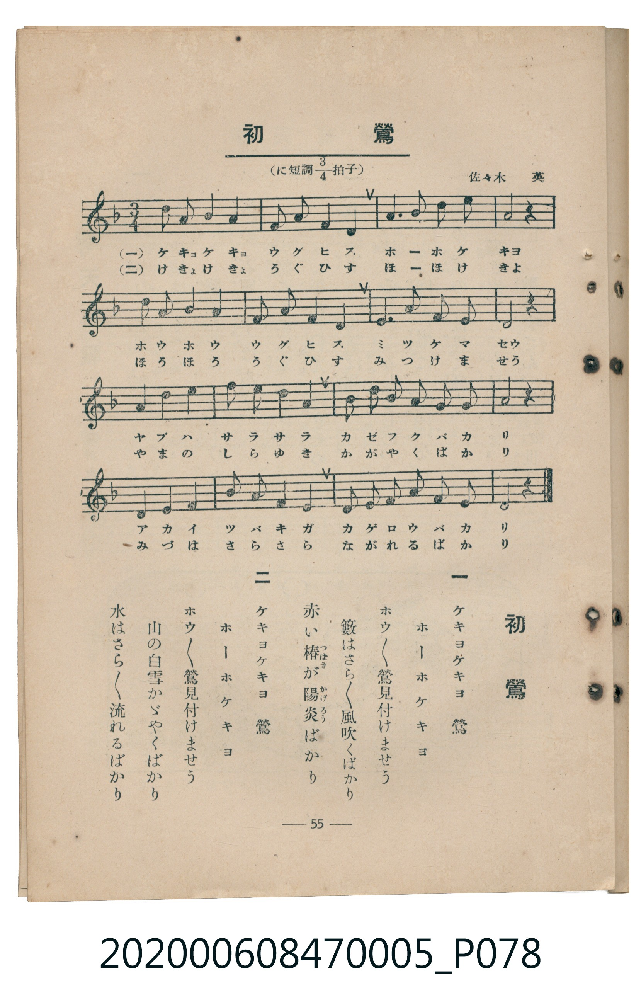

# 初鶯

<audio controls src="hatsu_uguisu.mp3"></audio>

- 臺灣教育會公認《新定兒童唱歌》尋常科第五學年用（2020.006.0847.0005）

## 說明

原書資訊與歌詞全文（對應 P078.jpg，書頁 p. 55，參考教材第 18 首）：
調性與拍號：に短調四分之三拍子（D 小調 3/4 拍）
作曲：佐々木英

## 歌詞

```text
一　ケキヨケキヨ　鶯
ホーホケキヨ
ホウ〳〵鶯見付けませう
籔はさら〳〵風吹くばかり
赤い椿（つばき）が陽炎（かげろう）ばかり

二　ケキヨケキヨ　鶯
ホーホケキヨ
ホウ〳〵鶯見付けませう
山の白雪かゞやくばかり
水はさら〳〵流れるばかり
```

## 原書掃描頁



## 分析

```text
================================================================================
📊 TMD Song Profile: [ 初鶯 ]
================================================================================
⏱  Duration:       0:30 (30.0s), 16 measures total
🎼 Key & Tempo:    首調基準 F, != 96.0 BPM, <3/4>
   - 分析範圍：      由實際發聲的音符與和弦推測調性；播放脈絡另行呈現
🎤 人聲音域:    A3 (MIDI 57) – D5 (MIDI 74) [跨度: 17 個半音 / 1.4 個八度, 難度: challenging]
   - 最低音:  A3 in [HatsuUguisu #1 @ m.7, 0:12]
   - 最高音: D5 in [HatsuUguisu #1 @ m.1, 0:00]
   - 適合: soprano, mezzo-soprano, contralto, tenor, baritone, bass
🏛  結構:      HatsuUguisu (30.0s)
⚡ 編曲密度:        Peak 1 軌道同時演奏
🗝  調性診斷：       D 大調（流行色彩大調，未偵測到可信轉調）
   - 風格氣質:    流行大調（略帶和弦色彩音與裝飾副屬和弦）
   - 轉調歷程:    全曲維持單一推測調性（未偵測到可信轉調）
   - 核心骨幹音:  A, D, G, C, F
   - 調性數值:    D 大調 [相關度: 0.71, 穩定度: Moderate, 自然音純度: 88.6%]
   - 候選調性 (K-S): D 大調 (0.71), A 小調 (0.63), D 小調 (0.60)
   - 五度圈歷程:   +2
   - 各段落調性細節:
     • [HatsuUguisu #1]: D 大調 (r: 0.71, 自然音純度: 88.6%, 調外音: C, F)

  [ 五度圈游移軌跡 ]
               C  
         F            G  
      Bb              [D ]*
      Eb               A  
         Ab           E  
            Db       B  
               F# 
     (* = active key center)

  [ 十二半音累積音高分佈 ]
     C  : ████                       6.8%
     C# :                            0.0%
     D  : ██████████████            23.9%
     D# :                            0.0%
     E  : █                          2.3%
     F  : ███                        4.5%
     F# :                            0.0%
     G  : ████████████              20.5%
     G# :                            0.0%
     A  : ████████████████████████  42.0%
     A# :                            0.0%
     B  :                            0.0%
--------------------------------------------------------------------------------
Assignment 軌道音域：
  - Piano         : A3 – D5 (17 個半音 / 1.4 個八度, 57 個音符)
================================================================================
```

## ABC

```abc
X:1
T:初鶯
C:TMD (Chen, Chih-Han / aguai)
M:3/4
L:1/16
Q:1/4=96
K:Dm

V:V1 name="Piano" snm="Pia"

[V:V1]
d2 a2 g4 g4 | d2 d2 a4 a4 | a6 a2 c2 d2 | a8 z4 |
d2 a2 g4 g4 | d2 d2 a4 a4 | a4 g2 f2 e2 A2 | d8 z4 |
a4 c2 a2 g4 | g4 a2 c2 d4 | c2 a2 g2 a2 c2 d2 | a8 z4 |
d4 d2 f2 g4 | a4 a2 c2 a4 | g2 g2 f2 f2 e2 A2 | d8 z4 |
```

- [主旋律 TMD 檔案](hatsu_uguisu.tmd)
- [鋼琴伴奏 TMD 檔案](hatsu_uguisu_piano.tmd)
