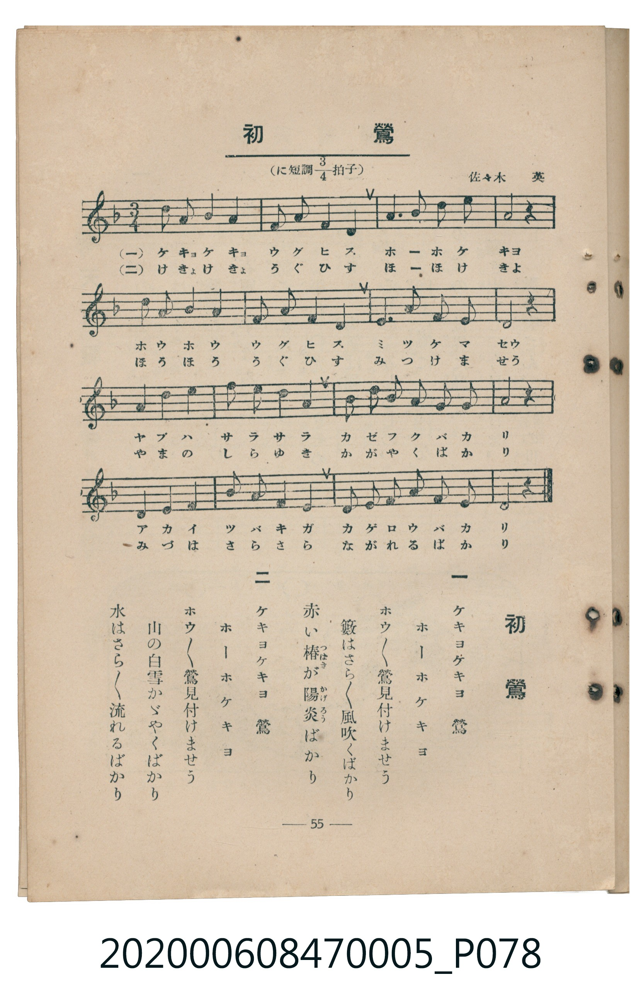

# 初鶯

> Re:Shōka 使用 AI 協助辨識與重建樂譜，可能會有錯誤。歡迎回報。

- **鋼琴伴奏版**：<br><audio controls src="hatsu_uguisu.mp3"></audio>
- **NEUTRINO 歌聲合成版**：<br><audio controls src="hatsu_uguisu_neutrino.mp3"></audio>

- 詞：富原義徳
- 曲：佐々木英
- 臺灣教育會公認《新定兒童唱歌》尋常科第五學年用（2020.006.0847.0005）

## 說明

> [!NOTE]
> **原書資訊與歌詞全文**（對應 `P078.jpg`，原書 p. 55，參考教材第 18 首）：
> - **調性與拍號**：に短調四分之三拍子（D 小調 3/4 拍，1 個降記號 `?= F`, `key= Dm`）
> - **作詞・作曲**：富原義徳 作詞（原書未署名，據《唱歌帖》第 7 冊 `P241.jpg` 所引《蓬萊唱歌集》第 49 頁補考）、佐々木英 作曲
> - **版面與字音校勘**：
>   1. 第 1 小節譜下拗音印小字「ケ キョ ケ キョ／け きょ け きょ」，第 4 小節二分音符下印大字雙假名「キヨ／きよ」（底欄全文亦排作「ケキヨケキヨ」「ホーホケキヨ」），悉依原譜字形分別錄入。
>   2. 第 3 小節第 2 個音符（`4` = B♭4 八分音符）下方印長音符「ー」，表示承接首拍附點四分音符「ホ／ほ」作一字多音圓滑唱奏，TMD 歌詞層以延音連音符 `-` 對位。
>   3. 第 15 小節第 1 節譜下印「カ ゲ ロ ウ バ カ」（底欄振假名亦作「陽炎（かげろう）」），與楊金土手抄《唱歌帖》`P241.jpg`（抄自《蓬萊唱歌集》）作「カ ゲ ラ フ バ カ」形成版本異文對照。
>   4. 第 2、6、10、14 小節小節線上方印有換氣記號 `∨`。
>
> **一**
> ケキヨケキヨ　鶯
> ホーホケキヨ
> ホウ〳〵鶯見付けませう
> 籔はさら〳〵風吹くばかり
> 赤い椿（つばき）が陽炎（かげろう）ばかり
>
> **二**
> ケキヨケキヨ　鶯
> ホーホケキヨ
> ホウ〳〵鶯見付けませう
> 山の白雪かゞやくばかり
> 水はさら〳〵流れるばかり


## 歌詞

```text
（TMD 檔案未包含歌詞註解）
```

## ABC

<div class="abc-score" data-abc-src="hatsu_uguisu.abc" aria-label="五線譜載入中"></div>

[下載 ABC 原始檔](hatsu_uguisu.abc)

## TMD 檔案連結

- [主旋律 TMD 檔案](hatsu_uguisu.tmd) [[在 TMD Studio 編輯](https://tmdlang.github.io/Tmd-TS/#tmd=s7IKdvYPcrWy4qpTUCpJTLdSSM7PyUlNLsnMz7MqzsjMK0nNjM_KTMmPL87Iz05Ugisry88pzU21Si9KTEmNN403MjAyiDcwMIs3sDAxBzIMTBFKi_NLi5JTrYqTM_Lzc-JLUitKkvLzs9Hl4wsS01OtAgzMLRAyBUX5Zal5iXlA3QVFILekgLUjFKSWZaakgqSLkxPz4stSizLTMlNTkFyZWlQM9gnEipKixLzi5KLMApD3EKryi0oy8oE-KciotMrILC7JL8pMTsyJz07MQ_JwSUYq0L-JeZm5iTnoosWpicX5ecXIJmamZ-ZZlSRmAoMNFHTlifG5iZl5OYl5QNdpaSk87Zj7ctt6BS0tLkVbBUszLntbBTeu7NRKWwWXXC4bY30TO5BZL1bOe79n1tP1PU_75j_ft_Lpvs1gK57N3gQUfrJ3wuOG1mdzVrzo3ggWftG-63nj4mdTZ75o2vRsTvPT1jUvVvU-buh6Nm3D03WznrZOer566dMpG5-t7Xnc0P10Q_fTHTueL5_4fM2aJ7umPF274-nOLc-nrHi_pwMUl3rAuNQDxSWQYWD6fk-nEheXvpaCLbUAl4KCgp1CtKKff4hrLISjpQX05bPZO15sbn-xoutFRzvQocAAeNq64tm0di0toMOebuh91t6pkABKJHpZBekJ7_eAQgaoR6FAT8EU6Myep_3NLxqagWHwbO4EoM8UDC0UXi6bBnQ_MMAg1ugCLXqxav-zhuUgK7p7X8ycDzJ81uPG1c_nrwXKPJ09-2lH25Od3U92dALln66dALTaReHphn6gpAIwahSAokCrDBWeNnS_nNn7YsUMoBkKCaAoTNBRSIDGItBxnQgbn-ydA_TL4-bdQAYw-sA2IserAkQByJNgDz2bs-r53k1PJ4AsejZ5FjAWITH3dMc0YOSBfGau8LStCxgWRiaG4LBQeNbZ8HTPVKDKF5PXvJgAVf9ydhtUvYmlwssFjS8WzwGGD9BpjxsakRMQyH6guxAOft7Z8XLuImAQPV07_eX8zc8WLHzaPQPsbIgaBQVDPQVwCINC5vn6hhdr5zzZ0f2sG6T6ae8GoCBQ5-OGnsdNGxUeN6193LwcSMGY7_f0P26cqPC4sfdxUzuQgjEfN4A8DHYu1Ngnu3qAsQE08_maZUDzQSYvWQ5y0-yZTxvbgQEEtgJoJjDlAs0EGtIBNqTj6a6pz9a0QFLPk13LnvVNAnoR4h6IegSjAWxI8-zHzXtAJJI4OOH0PGvqfLJvLjBigH4EWv107yKgk552LH3ZAzR_6eOGJliQGEGCxBjqdhDbCJxKwM4HOirBJEHBVsHp0cy1QP-1rob7DGgPKPCm7QT67-XU7RBBsKP2QILkxcIVz5fseta5_1nfUmCCBqbAlzNbXu6eB0msSOpng4NhN1AX0LtPdjSA3LtkFihO5kx-tnsiMFU8XdoPNDDE10UBmsE2Lnmye-nT3duAil42LIaYpZCgmwD0BdAQYNjA_WcMjXJTJA8aKsAjH-h4cACvBsbyJoXHzWuB9DIgPQFIr0aOlWc96yGRB4wYSKy8nLn3eVMfUMHjxu7HjZMeN_U-bmwDJ1NoHIAy69Kul-0Tn86Z_6yz-1lXC1qeQOQEoClA6Rftq7DmBVBQQxMCzJ0rgXgqkjuBEfysYwIwBzybs-b51A3ABAQMieety5FCwgQSEkbAbGQGxIYGIAKWZqGBs33Wkx3AwhcUp8_mdD7rn_1sw2JYYfGoY0UCzDhY8QeMLWB9AOZgS6QNwAoDKouRVBHiTcBksPlxw1ag4hfLup_sngHMXI8b9z1unA0MUIiy5xunPG5c_7hx6uMmYPiCFS9a8XTCzseNwJSzARQBTV0QlS-2Lnnc2PJsyX5wxADZQFlQfDxuxB1hKCbAvbarhy5ee7px4-PGdc9n7n05exXYGfMeN7Vg-uvZhi1oIfBsa-PjJmCSAPoFSSXl9RwUKGjpc3F5JJYUl4aml2YWl1qF5QNbGA41BjXVIHsUbCy0wGGlgK2OBaU0YNp4sbBHQQOWxHQUYJWgJhYNQNtAhtUomAHLIhNgeW4MxDXArGoMxLoKZvFgLkhQFyhtBqxLYDxdBQOQHFi7j2ENUpENZurCOCD94MzdtAEYN5PAEjshos2zoSaBWCBNIJWgmMS0wAgohVoNAHVBOGCjGtuAGJgrGzeBJWZCRXfDLACyQJpAYqCCH8UC_MG5C1iiUjk4zUEUSM4QxAQqhvAxQhQcKqBiERROIBa-sJwPDckWSEw0zwOr3Q3Rhi00QSECCjVQGIFY-MJxPzQUl0BjYR9YFJSbSAjJHZ3khCQoBM2A2BwSknFABogLCVhQkjQBso2AEGfCbF4CDphpYLIfGohbIaU5kAaJroSKgsr5PZAyvmk9rJwHB-8q7KHY1AIOl31gch00tKYDxTuBGBQ4wPQGFe0G4h6wDmAxA8TAKASKgczoIj4QgbU4WckRlMLAyQ6UDEHhBkmQYCGwNJAFSaV4U2TTInCaWw0mQcEKChqgh8ABtRYsugYpKDGqdnxBCU5kjxuXgsn10EADRQQwKIE0yOxOqOgqaFCCMChYcQVlLReXrp0CUmka7WMYq4AuZAQWUuYCAA)]
- [鋼琴伴奏 TMD 檔案](hatsu_uguisu_piano.tmd) [[在 TMD Studio 編輯](https://tmdlang.github.io/Tmd-TS/#tmd=s7IKdvYPcrWy4tLSUnjaMffltvXv93S87N7zfMKWJ3u2PF3a_7yz4_2eTgUtLS5FWwVLMy57WwU3ruzUSlsFl1wuG2N9EzuuOgWlFyvnvd8z6-n6nqd985_vW_l032YlkPCz2ZuAwk_2Tnjc0PpszooX3RvBwi_adz1vXPxs6swXTZuezWl-2rrmxarexw1dz6ZteLpu1tPWSc9XL306ZeOztT2PG7qfbuh-umPH8-UTn69Z82TXlKdrdzzdueX5lBVAdxoZGBnoGRiY6RlYmJgDGQamQKcqcXF5JJYUl4aml2YWl1oFZCbm5Qd5ONQY1FRzKQCBjYWWHZihr6Vgiw4UQJbsaHixsEdBw0Th6Yb-5-sbdBQCDMwt9LIK0jWxaNDSBxtWo2CmYKxgoqALJHWBPEMgbQhkmcWDuSBBXaC0mYI5nKerYACSA2v3MaxReNy0EYjXPm5eDmbqwjgg_Y-blgHxBoXHzZPAEjshos2zoSaBWCBNIJVATSswLTACSjVOBOLex03tYCZQF4QDNqqxDYgnAPEmsMRMqOhumAVAFkgTSAyoqQPFAvzBuauH6sFpDqJAcoYgJlAxhI8RouBQAYYcOJxALHxhOR8aki2QmGieB1a7G6INW2iCQgQUaqAwArHwheN-aCgugcbCPrDobIg2YkNyRyc5IQkKQTMgNoeEZByQAeJCAhaUJE2AbCMgxJkwm5eAA2YamOyHBuJWIHslmAaJroSKrgbiPUD-VCC9HkgDQwIoBjJjFfZQbGoBh8s-MLkOGlrTgeKdQAwKHGB6g4p2A3EPWMfjxn4gBkYhUAxkRhfxgfh09myykiMohYGTHSgZgsINkiDBQmBpIAuSSvGmyKZF4DS3GkyCghUUNEAPgQNqLVh0DVJQbgLKrIWmYYJBCU5kjxuXgsn10EADRQQwKIE0yOxOqOgqaFCCMChYcQVlLZbC1AdHYfpsRyuwAH85t-Np99QnO7sVXEAh_GLVfmCyfdbd-3TthKfblz3r7IZUK-_39DxdOvHphI5n05c-m7PmRfuq5y3bIOrf7-l_2bwXGDWPm3c_3df9bHr3s81TX3Ruerp3JXJ8gAI42ig-NxZEm0FouDiUD-RpG8JiCESDSKN4MGUMiiZjsKhxvDY4HhHhSYYF5vFgGTAFNBsoCmai68BiB1Qm2hjZDqARcAm45UCn68LcD2YT4QOoqdGG8XAzQGZDuKh2gh0MdDhB5wOTha6dAlLKiPYxBMqiCRmBhZS5AA)]

## 分析

```text
================================================================================
📊 TMD Song Profile: [ 初鶯 ]
================================================================================
⏱  Duration:       1:00 (60.0s), 32 measures total
🎼 Key & Tempo:    首調基準 F, != 96.0 BPM, <3/4>
   - 分析範圍：      由實際發聲的音符與和弦推測調性；播放脈絡另行呈現
🎤 人聲音域:    D4 (MIDI 62) – F5 (MIDI 77) [跨度: 15 個半音 / 1.2 個八度, 難度: moderate]
   - 最低音:  D4 in [HatsuUguisu[L1] #1 @ m.2, 0:03]
   - 最高音: F5 in [HatsuUguisu[L1] #1 @ m.10, 0:16]
   - 適合: soprano, mezzo-soprano, contralto, tenor, baritone, bass
🏛  結構:      HatsuUguisu[L1] (30.0s) -> HatsuUguisu[L2] (30.0s)
⚡ 編曲密度:        Peak 1 軌道同時演奏
🗝  調性診斷：       D 小調（純淨自然小調，未偵測到可信轉調）
   - 風格氣質:    純淨自然小調（陰鬱抒情、旋律集中，無明顯調外色彩）
   - 轉調歷程:    全曲維持單一推測調性（未偵測到可信轉調）
   - 核心骨幹音:  A, D, E, F, A#
   - 調性數值:    D 小調 [相關度: 0.85, 穩定度: High, 自然音純度: 100.0%]
   - 候選調性 (K-S): D 小調 (0.85), D 大調 (0.62), A 大調 (0.61)
   - 五度圈歷程:   +2 -> +2
   - 各段落調性細節:
     • [HatsuUguisu[L1] #1]: D 小調 (r: 0.85, 自然音純度: 100.0%)
     • [HatsuUguisu[L2] #1]: D 小調 (r: 0.85, 自然音純度: 100.0%)

  [ 五度圈游移軌跡 ]
               C  
         F            G  
      Bb              [D ]*
      Eb               A  
         Ab           E  
            Db       B  
               F# 
     (* = active key center)

  [ 十二半音累積音高分佈 ]
     C  :                            0.0%
     C# :                            0.0%
     D  : ████████████████████      26.1%
     D# :                            0.0%
     E  : ████████████              15.9%
     F  : ████████████              15.9%
     F# :                            0.0%
     G  : ██                         2.3%
     G# :                            0.0%
     A  : ████████████████████████  30.7%
     A# : ███████                    9.1%
     B  :                            0.0%
--------------------------------------------------------------------------------
Assignment 軌道音域：
  - Vocal         : D4 – F5 (15 個半音 / 1.2 個八度, 108 個音符)
================================================================================
```


## 原書掃描頁




