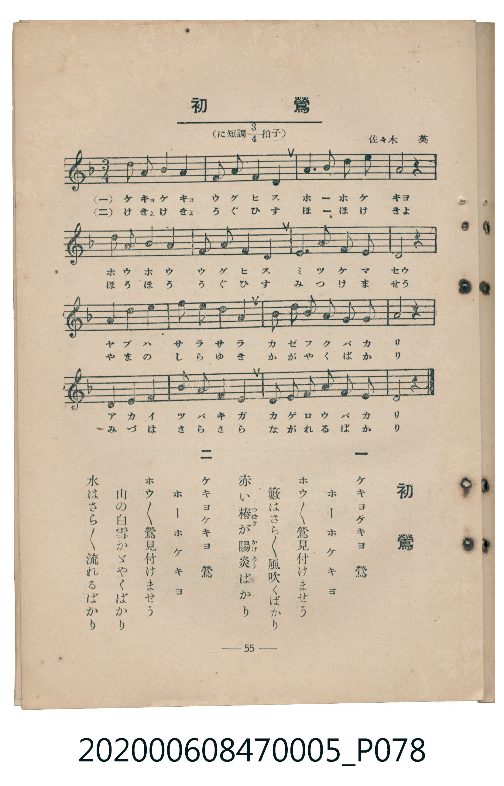

# 初鶯

> Re:Shōka 使用 AI 協助辨識與重建樂譜，可能會有錯誤。歡迎回報。

- **鋼琴伴奏版**：<br><audio controls src="hatsu_uguisu.mp3"></audio>
- **NEUTRINO 歌聲合成版**：<br><audio controls src="hatsu_uguisu_neutrino.mp3"></audio>

- 臺灣教育會公認《新定兒童唱歌》尋常科第五學年用（2020.006.0847.0005）

## 說明

原書資訊與歌詞全文（對應 P078.jpg，書頁 p. 55，參考教材第 18 首）：
調性與拍號：に短調四分之三拍子（D 小調 3/4 拍）
作曲：佐々木英


## 歌詞

```text
一　ケキヨケキヨ　鶯
ホーホケキヨ
ホウ〳〵鶯見付けませう
籔はさら〳〵風吹くばかり
赤い椿（つばき）が陽炎（かげろう）ばかり

二　ケキヨケキヨ　鶯
ホーホケキヨ
ホウ〳〵鶯見付けませう
山の白雪かゞやくばかり
水はさら〳〵流れるばかり
```

## ABC

<div class="abc-score" data-abc-src="hatsu_uguisu.abc" aria-label="五線譜載入中"></div>

[下載 ABC 原始檔](hatsu_uguisu.abc)

## TMD 檔案連結

- [主旋律 TMD 檔案](hatsu_uguisu.tmd) [[在 TMD Studio 編輯](https://tmdlang.github.io/Tmd-TS/#tmd=s7IKdvYPcrWy4qpTUCpJTLdSSM7PyUlNLsnMz7MqzsjMK0nNjM_KTMmPL87Iz05Ugisry88pzU21Si9KTEmNN403MjAyiDcwMIs3sDAxBzIMTBFKi_NLi5JTrYqTM_Lzc-JLUitKkvLzsxHyBUX5Zal5iXlANQVFIBtTwIoQClLLMlNSQdKpKZkl-UWZiTlI7kgtKga7FWxJfElRYl5xclFmAcgDCFUlGalAxybmZeYi6wUalZ6ZZ1WSmAn0HMiD5YnxuYmZeTmJeSlKXFpaCk875r7ctl5BS4tL0VbB0ozL3lbBjSs7tdJWwSWXy8ZY38QOZNaL9l3PGxc_mzrzRdOmZ3Oan7auebGq93FD17NpG56um_W0ddLz1UufTtn4bG3P44bupxu6n-7Y8Xz5xOdr1jzZNeXp2h1Pd255PmXF-z0doDDUA4ahHigMgQwD0_d7OpW4uPS1FGypBbgUFBSe9s1_NnvHi83tL1Z0vehoB7rrxcp5T1tXPJvWDnTF0w29z9o7FQIMzC30sgrS3-_pASp-uaBRoUBPwRToop6n_c0vGpqB3n02dwLQEwqGFgovl00DOvX9nlkg41-s2v-sYTnI4O7eFzPnA0UfN65-Pn8tUPzp7NlPO9qe7Ox-sqMTKPt07QSghS4KTzf0AyUVgOGpABQFmgQy5sneOc9mbwLqfrJ3wuOG1mdzVrzo3sgFltnR8Lih4XHTxsdNax83r0AwGhqAsQVS8bh59uPmPSASJgcTbVr2uGHz44atQIUvlnU_2T3jcePEx437HjfOftzYBlL0fOOUx43rHzdOfdzUCVW6aMXTCTsfN_Y_btzwuLH7cVMX2JdblzxubHm2ZD_QB48bgWygHMjpjxt7Xs7c-7ypDyze_bhx0uOmXqDZYCmYfrAvdgGTA6188XTjxseN657P3Pty9iqwnfMeN7Wge-HZhi1oXn22tfFxU8_jJqCzkdRRnuqgQEFLn4vLI7GkuDQ0vTSzuNQqIDMxL9-hxqCmGmSPgo2Flh2YgS3FK4AyzI6GFwt7FDRMQEnm-foGHXgy1cSiAWgb1DANoEZNKwVgOAIxMCCXg5mgwITwFBRqgMxlQLwBGL6TIDI7QRRQvHk2iAEO-T1gHkgvSD1UKxJAtnFXD8jGxolA3Pu4qR3MBBkC4YFNbmwD4glAvAkiMxNqY-NuZBuBPJBekDhUK6aNNQpmCsYKRgq6YAzkxYOQMZANwjVgEsQ2BaqD8XQVDEByYP0-hiAPoYSOLowD0o8cOCCJnRBRYGBATMIIFohwPMICI5D7UQIDqAvCARuFFBYgiZlQ0d0wC9BDAdkC_GlmVw9FaQbsM6DvIckAxCSQXOZDYq4FEqDN82Dqd0P14k0uIF-CQgKcAkBMAillP4S_BBq4-2DioIKA7JRipGCoYA4UjIfIY00sSMECShDL8CaT-eAkgggRiFpwgGBPKIhgAEV9G94ksh_MQ4QARBQcAMQnkh2dlCWSJZBInwbE_bAI3woRW4nMhEqtBmJQYTIVSK8H0kBfAcVAQbUKNdawJZKmFkik7wPidbAInw4Wa-oEYnDEA7MJTKobiHvA2oA1ABAD4wcoBnJGFw7LIMnAFJpQasAkpPAA8SDiBAoTYIiA4nwamOyHxvhWMA8SICAaIoovMLAmD6BPQFEOimpQCEAifDo4xUH8D_I8RBSf34lOHcBmC2XVziJI5IA8Ck4oIL9BIhHs2bUQ6TXIqWMTUG4tNIuRlDpgRcJSIF4PSwJT4akDwYRKrYKGEAiDQouY1AEuFICEITR9QIoPULqApBZQAUK4CAEGCyjKVoNJUHKBBAsoiUBCBRQkiCSCK0SwlyCQUmEpmFwPTQxTYUkEyALREFF8AYBsdi0Xl66dAlLzRQHIVeYCAA)]
- [鋼琴伴奏 TMD 檔案](hatsu_uguisu_piano.tmd) [[在 TMD Studio 編輯](https://tmdlang.github.io/Tmd-TS/#tmd=s7IKdvYPcrWy4tLSUnjaMffltvXv93S87N7zfMKWJ3u2PF3a_7yz4_2eTgUtLS5FWwVLMy57WwU3ruzUSlsFl1wuG2N9EzuuOgWlF-27njcufjZ15oumTc_mND9tXfNiVe_jhq5n0zY8XTfraeuk56uXPp2y8dnanscN3U83dD_dseP58onP16x5smvK07U7nu7c8nzKCqDNRgZGBnoGBmZ6BhYm5kCGgSnQciUuLo_EkuLS0PTSzOJSq4DMxLz8IA-HGoOaai4FILCx0LIDM_S1FGzRgQLIkh0NLxb2KGiYKDzd0P98fYOOQoCBuYVeVkG6JhYNWvpgw2oUzBSMFYwUdMEYyIsHIWMgG4RrwCSIbQpUB-PpKhiA5MD6fQxrFB43bQTitY-bl4OZujAOSP_jpmVAvEHhcfMksMROiGjzbKhJIBZIE0glVBMIxiMsMAJKNU4E4t7HTe1gJlAXhAM2qrENiCcA8SawxEyo6G6YBUAWSBNIDKoJYQH-8NzVQ5vwNFIwVDAHCsZD5LEGKThYgEEHDigQC19gzgcHZAskIprnQdXuhmjDFpygIAEFGyiQQCx8AbkfzFsCjYR9UNHZEG3EBuWOTnKCEhRYptDgrAGTkIQI4kHECSTM5iXgkJkGJvuh4bIVzFsJZoFoiOhqIN4D5E8F0uuBNDAggGIgM1ZhD8SmFnDAgALkceM6aLBMB8dLJxCDArMXKtoNxD1gHY8b-4EYGINAMZAZXcSH4dPZs8lKjiCjgYQhNBQhSREUepAwBSVGwsmxaRHYY6vBJChQQQEDDgBwQK0F4jVIAbkJKA4SAyVgggEJTWFLweR6aJBNhQUkkAWiIaKroAEJwqBAxRWQtVjKUh_kstQEUZY-29EKLL9fzu142j31yc5uYFJ91t37dO2Ep9uXPevshlQP7_f0POvvf75z1bPpK5_NWPp89c5n86Y_39L6bMn-xw2Nz9bNeDl71bNdq55tbXw5bTKwgnnROA9Yxzydugdo4LPm1hfbFiNHSLxCtFl8bqxCtBGQQBEwBpHAOAKJgNkQcWQRA2jQkWqQcTyqEoQ5SIog5hgB-SAWzHJDIN8QLkuUU1AshhsKMgSbO4DRpWungBRj0T5ApehCRmAhZS4A)]

## 分析

```text
================================================================================
📊 TMD Song Profile: [ 初鶯 ]
================================================================================
⏱  Duration:       0:30 (30.0s), 16 measures total
🎼 Key & Tempo:    首調基準 F, != 96.0 BPM, <3/4>
   - 分析範圍：      由實際發聲的音符與和弦推測調性；播放脈絡另行呈現
🎤 人聲音域:    A3 (MIDI 57) – D5 (MIDI 74) [跨度: 17 個半音 / 1.4 個八度, 難度: challenging]
   - 最低音:  A3 in [HatsuUguisu #1 @ m.7, 0:12]
   - 最高音: D5 in [HatsuUguisu #1 @ m.1, 0:00]
   - 適合: soprano, mezzo-soprano, contralto, tenor, baritone, bass
🏛  結構:      HatsuUguisu (30.0s)
⚡ 編曲密度:        Peak 1 軌道同時演奏
🗝  調性診斷：       D 大調（流行色彩大調，未偵測到可信轉調）
   - 風格氣質:    流行大調（略帶和弦色彩音與裝飾副屬和弦）
   - 轉調歷程:    全曲維持單一推測調性（未偵測到可信轉調）
   - 核心骨幹音:  A, D, G, C, F
   - 調性數值:    D 大調 [相關度: 0.71, 穩定度: Moderate, 自然音純度: 88.6%]
   - 候選調性 (K-S): D 大調 (0.71), A 小調 (0.63), D 小調 (0.60)
   - 五度圈歷程:   +2
   - 各段落調性細節:
     • [HatsuUguisu #1]: D 大調 (r: 0.71, 自然音純度: 88.6%, 調外音: C, F)

  [ 五度圈游移軌跡 ]
               C  
         F            G  
      Bb              [D ]*
      Eb               A  
         Ab           E  
            Db       B  
               F# 
     (* = active key center)

  [ 十二半音累積音高分佈 ]
     C  : ████                       6.8%
     C# :                            0.0%
     D  : ██████████████            23.9%
     D# :                            0.0%
     E  : █                          2.3%
     F  : ███                        4.5%
     F# :                            0.0%
     G  : ████████████              20.5%
     G# :                            0.0%
     A  : ████████████████████████  42.0%
     A# :                            0.0%
     B  :                            0.0%
--------------------------------------------------------------------------------
Assignment 軌道音域：
  - Piano         : A3 – D5 (17 個半音 / 1.4 個八度, 57 個音符)
================================================================================
```


## 原書掃描頁




