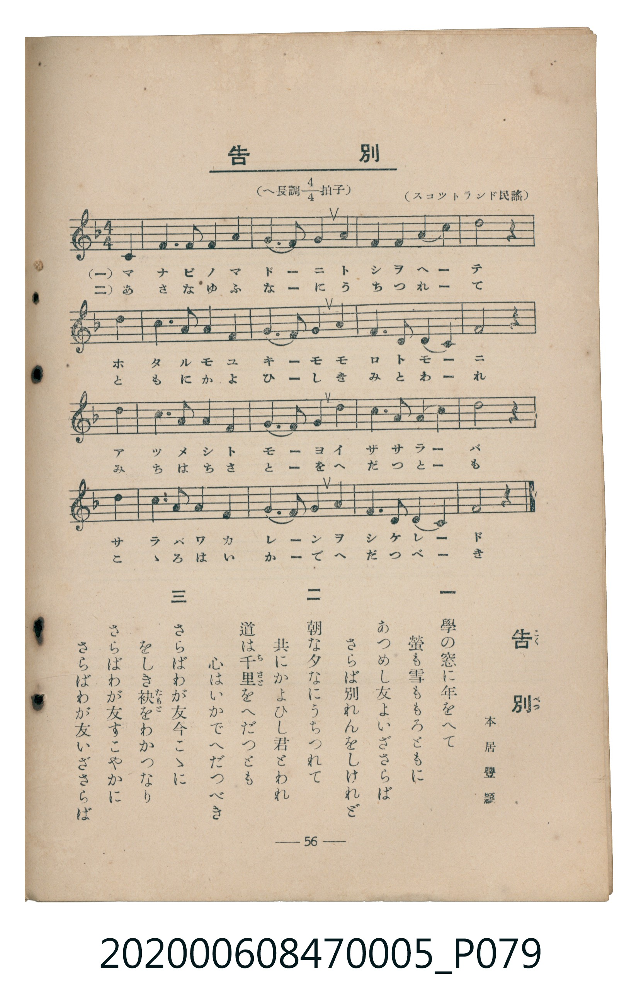

# 告別

<audio controls src="kokubetsu.mp3"></audio>

- 臺灣教育會公認《新定兒童唱歌》尋常科第五學年用（2020.006.0847.0005）

- note

原書資訊與歌詞全文（對應 P079.jpg，書頁 p. 56，參考教材第 19 首）：
調性與拍號：へ長調四分之四拍子（F 大調 4/4 拍）
出處與作歌：（スコットランド民謠）、本居豐穎

## 歌詞

```text
一　學の窓に年をへて
螢も雪ももろともに
あつめし友よいざさらば
さらば別れんをしけれど

二　朝な夕なにうちつれて
共にかよひし君とわれ
道は千里（ちさと）をへだつとも
心はいかでへだつべき

三　さらばわが友今こゝに
をしき袂（たもと）をわかつなり
さらばわが友すこやかに
さらばわが友いざさらば
```

## 原書掃描頁



## 調性分析

```text
================================================================================
📊 TMD Song Profile: [ 告別 ]
================================================================================
⏱  Duration:       0:48 (48.6s), 17 measures total
🎼 Key & Tempo:    首調基準 F, != 84.0 BPM, <4/4>
   - 分析範圍：      由實際發聲的音符與和弦推測調性；播放脈絡另行呈現
🎤 人聲音域:    C4 (MIDI 60) – D5 (MIDI 74) [跨度: 14 個半音 / 1.2 個八度, 難度: moderate]
   - 最低音:  C4 in [Kokubetsu #1 @ m.1, 0:02]
   - 最高音: D5 in [Kokubetsu #1 @ m.5, 0:11]
   - 適合: soprano, mezzo-soprano, contralto, tenor, baritone, bass
🏛  結構:      Kokubetsu (48.6s)
⚡ 編曲密度:        Peak 1 軌道同時演奏
🗝  調性診斷：       F 大調（純淨自然大調，未偵測到可信轉調）
   - 風格氣質:    純淨自然大調（陽光明朗、易唱易記，無明顯調外色彩）
   - 轉調歷程:    全曲維持單一推測調性（未偵測到可信轉調）
   - 核心骨幹音:  F, G, C, D, A
   - 調性數值:    F 大調 [相關度: 0.84, 穩定度: Moderate, 自然音純度: 100.0%]
   - 候選調性 (K-S): F 大調 (0.84), D 小調 (0.72), C 大調 (0.68)
   - 五度圈歷程:   -1
   - 各段落調性細節:
     • [Kokubetsu #1]: F 大調 (r: 0.84, 自然音純度: 100.0%)

  [ 五度圈游移軌跡 ]
               C  
        [F ]*          G  
      Bb               D  
      Eb               A  
         Ab           E  
            Db       B  
               F# 
     (* = active key center)

  [ 十二半音累積音高分佈 ]
     C  : ████████████████          18.3%
     C# :                            0.0%
     D  : ████████████████          18.3%
     D# :                            0.0%
     E  :                            0.0%
     F  : ████████████████████████  28.3%
     F# :                            0.0%
     G  : ████████████████          19.2%
     G# :                            0.0%
     A  : █████████████             15.8%
     A# :                            0.0%
     B  :                            0.0%
--------------------------------------------------------------------------------
Assignment 軌道音域：
  - Piano         : C4 – D5 (14 個半音 / 1.2 個八度, 59 個音符)
================================================================================
```

## ABC

```abc
X:1
T:告別
C:TMD (Chen, Chih-Han / aguai)
M:4/4
L:1/16
Q:1/4=84
K:F

V:V1 name="Piano" snm="Pia"

[V:V1]
z4 z4 z4 c4 | f6 f2 f4 a4 | g6 f2 g4 a2 g2 | f6 f2 a4 c4 |
d8 z4 d4 | c6 a2 a4 f4 | g6 f2 g4 a2 g2 | f6 d2 d4 c4 |
f8 z4 d4 | c6 a2 a4 f4 | g6 f2 g4 d4 | c6 a2 a4 c4 |
d8 z4 d4 | c6 a2 a4 f4 | g6 f2 g4 a2 g2 | f6 d2 d4 c4 |
f8 z4 z4 |
```

- [主旋律 TMD 檔案](kokubetsu.tmd)
- [鋼琴伴奏 TMD 檔案](kokubetsu_piano.tmd)
