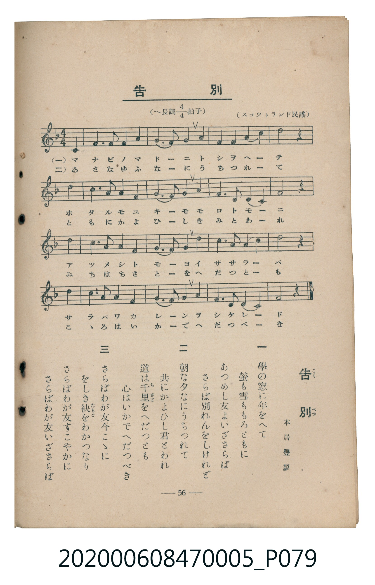

# 告別

> Re:Shōka 使用 AI 協助辨識與重建樂譜，可能會有錯誤。歡迎回報。

<audio controls src="kokubetsu.mp3"></audio>

- 臺灣教育會公認《新定兒童唱歌》尋常科第五學年用（2020.006.0847.0005）

## 說明

原書資訊與歌詞全文（對應 P079.jpg，書頁 p. 56，參考教材第 19 首）：
調性與拍號：へ長調四分之四拍子（F 大調 4/4 拍）
出處與作歌：（スコットランド民謠）、本居豐穎

## 跨冊／重複收錄參照

> 同曲異詞＋同名異曲（《新定兒童唱歌》五年級〈告別〉、《唱歌帖》P042〈螢の光〉與 P197〈送別の歌〉同採蘇格蘭民謠 *Auld Lang Syne* 旋律；高等科女子用〈告別〉為同名異曲）

- **[同名異曲]** 《新定兒童唱歌》高等科女子用（2020.006.0849）：[**〈告別〉**](../../koto_girls_2020.006.0849/1_4_02_kokubetsu/index.md)（`D` / `3/4` — [原始 TMD](../../koto_girls_2020.006.0849/1_4_02_kokubetsu/kokubetsu.tmd)）
- **[同曲異詞]** 楊金土手抄《唱歌帖》第 3 冊・I（2020.006.0843）：[**〈螢の光〉**](../../../shokacho/vol_03/p042_hotaru_no_hikari/index.md)（`F` / `4/4` — [原始 TMD](../../../shokacho/vol_03/p042_hotaru_no_hikari/hotaru_no_hikari.tmd)）
- **[同曲異詞]** 楊金土手抄《唱歌帖》第 10 冊・X（2020.006.0843）：[**〈送別の歌 (送別之歌)〉**](../../../shokacho/vol_10/p197_sobetsu_no_uta/index.md)（`F` / `2/4` — [原始 TMD](../../../shokacho/vol_10/p197_sobetsu_no_uta/sobetsu_no_uta.tmd)）
- 總表：[跨冊重複與同名歌曲總索引](../../../duplicate_songs.md)

## 歌詞

```text
一　學の窓に年をへて
螢も雪ももろともに
あつめし友よいざさらば
さらば別れんをしけれど

二　朝な夕なにうちつれて
共にかよひし君とわれ
道は千里（ちさと）をへだつとも
心はいかでへだつべき

三　さらばわが友今こゝに
をしき袂（たもと）をわかつなり
さらばわが友すこやかに
さらばわが友いざさらば
```

## ABC

```abc
X:1
T:告別
M:4/4
L:1/16
Q:1/4=84
K:F
V:V1 name="Piano" snm="Pia"
[V:V1]
z4 z4 z4 C4 | F6 F2 F4 A4 | G6 F2 G4 A2 G2 | F6 F2 A4 c4 |
w: 1.~マ | ナ ビ ノ マ | ド _ ニ ト _ | シ ヲ ヘ _
w: 2.~あ | さ な ゆ ふ | な _ に う _ | ち つ れ _
w: 3.~サ | ラ バ ワ ガ | ト _ モ イ _ | マ コ コ _
d8 z4 d4 | c6 A2 A4 F4 | G6 F2 G4 A2 G2 | F6 D2 D4 C4 |
w: 1.~テ ホ | タ ル モ ユ | キ _ モ モ _ | ロ ト モ _
w: 2.~て と | も に か よ | ひ _ し き _ | み と わ _
w: 3.~ニ ヲ | シ キ タ モ | ト _ ヲ ワ _ | カ ツ ナ _
F8 z4 d4 | c6 A2 A4 F4 | G6 F2 G4 d4 | c6 A2 A4 c4 |
w: 1.~ニ ア | ツ メ シ ト | モ _ ヨ イ | ザ サ ラ _
w: 2.~れ み | ち は ち さ | と _ を へ | だ つ と _
w: 3.~リ サ | ラ バ ワ ガ | ト _ モ ス | コ ヤ カ _
d8 z4 d4 | c6 A2 A4 F4 | G6 F2 G4 A2 G2 | F6 D2 D4 C4 |
w: 1.~バ サ | ラ バ ワ カ | レ _ ン ヲ _ | シ ケ レ _
w: 2.~も こ | こ ろ は い | か _ で へ _ | だ つ べ _
w: 3.~ニ サ | ラ バ ワ ガ | ト _ モ イ _ | ザ サ ラ _
F8 z4 z4 |
w: 1.~ド
w: 2.~き
w: 3.~バ
```

## TMD 檔案連結

- [主旋律 TMD 檔案](kokubetsu.tmd) [[在 TMD Studio 編輯](https://tmdlang.github.io/Tmd-TS/#tmd=s7IKdvYPcrWy4qpTUCpJTLdSSM7PyUlNLsnMz7MqzsjMK0nNjM_KTMmPL87Iz05Ugisry88pzU21Si9KTEmNN403MjAyiDcwMIs3sDAxBzIMTBFKi_NLi5JTrYqTM_Lzc-JLUitKkvLzsxHyBUX5Zal5iXlANQVFIBtTwIoQClLLMlNSQdKpKZkl-UWZiTlI7kgtKga7FWxJfElRYl5xclFmAcgDCFUlGalAx6bm5kOEtbQUnk7setqxVEFLi0vRVsHChMveVsGNy8ZE38QOpOlF-67njYufTZ35omnTsznNT1vXvFjV-7ih69m0DU_XzXraOun56qVPp2x8trbncUP30w3dT3fseL584vM1a57smvJ07Y6nO7c8n7Li_Z4OULDoAYNFDxQsQIaB6fs9nUpcXPpaCrbUAlwKCgpP--Y_m73jxeb2Fyu6XnS0A931YuW8p60rnk1rB7ri6YbeZ-2dCgEG5pZ6WQXp7_f0ABW_XNCoUKCnYGoG5D7tb37R0Az07rO5E4CeUDC0VHi5bBrQqe_3zAIZ_2LV_mcNy0EGd_e-mDkfKPq4ccfLqduB4k9nz37a0fZkZzeQAZR9unYC0EI3hadLlgMlFYDhqQAUBZoEdmX7rhczpwKNebJ3DtCJQGOAah837XzctPlxc_Pj5o7HzSsfNwPZnc82THyxZgFQ2-OGxmdz1jzd2Ppi44TnK_u4QMY82dHwuKEBGMyPG9c9XzX5ceNqYHg_bpoEdNPjxmVg985b9Lip6eXsVUASjHofN64AMRpXg6QfNwJZSx43NT5unP60v_txU8fjxpbHjdMeN0593NT5uHEDRBGUA0wmj5t6HjdNBlsx_XHjRBC3cSXELbuAKaDh2Zy5jxtXPV0yFUgC7Xjc2Pa4cSHYCqBCsIuetm4ES0As2wSyeMJssKP6gYpAKl42An2y_mlv88t2YMgAFQENAJoHTEWdML8tABkJ9gjYyP3NQA1gl3c_blyOpGLn48ZeaEgBA7AB7hOQZY3AyO5-srvrMdC6JqCrIQEC9Vnvi0VNYLvngwMLZjdIG9AKoMnAAO1CCRy4kY8bZ4KNhLgGGsyYijCCmfL0DwUKWvpcXN752aVJqSXFpVYBmYl5-Q41BjXVIFsUbAzNtOzALGxZTwGUc3c0vFjY86J9MzgX9wDZT_dsfLF1u4KGqcLTDf3P1zfowHOQJhYjgNZDjdcAGqVpBeJggsfN80BUDZDRBReaDMR9aLKdcNk9QNwNYXZAZZu2w2U3AfEMmEKo3jY0K2eDKGT37erB6b7GJqgpjVPhQquANoLNfNy4FSa7Ctl9jashsmBFINmFcL1LgHp7UN3XuAzNyhVI7qtRMFDQBUN02jQeyqhRMISyQBDEhvGN4SqM0FTA-CAVIDamGTC9pnAzzJBUIDsEJl4DdrCPYY0CzGXoNCg-YaaBIhxhFijSQWQfVpWdaDaDEgCM1YFQB0wGyGo2gckZaHohCQJVDOG-2ah-McLjF2DKgJsITBxINgMTA5AEJhEYfyuSSpAcil-AiQXGgumAJBlkNUvAJvZg-gWYeHD4BZiMUPxijMcvTUgubF6JbHPzBDC5Hq5yDZJKWNgjVC-CqwO5GKYOFpcQmc1wEs0v8FjF8As4LiF-wV9ogQsqaKG1oxOp0DIhr9B63LQfnrFXg_0HZoJzLCjFrUXO9jBZMAXyD0K2AyELL5bAhRgi2zeB5TGKJWDNAy8YgC5ohBR9TbCir3ETsgsap0MU9sJk4a4HpgZgtYPqAkhBhHABRDW84IHlfBAElQawEgFWUpBaqpiBohNMgCCO4gsEcRcsoOhATm6grIOU6IDxAk9MwKhBNRVZHYwFiSRkNaAkjZCHQbyJExhxKO4EFhqgSEMyFZzFQVEH04FUaAEjEM2dwEiEsXqR1KH4HJy5QRGK4U6MQgJRIMBMQBQIaEUmOMwQYYwaTpiZHeZyRPEAMhFWnEFkWsAkclEPMw-9IMRSGBHI7OAMDsnswNY2FTI70LWwzLQQ1qpAtDIgGRiW1ZrBtTSonINmpm0wWaD7QYUoSlYDFqMoWQ2oBpHVkDI7UkthPYwHbXqA0gDYTpgLmiZBZHfAZBfA9QJbGRC1SJkdVozA1ExGcgElmR2eS3GaQU4TApJyEOkIVB0iUitKtY-RW0FxA0tLSNUQMIaQ1IBTGWplBzMPVOUhQ2wpE-xOUE5Hq6hBOQEhhmgYQGIPzZ3AGISp24GkbgGKieCqH0MvehmD4k5g3KK4E5TTqVSt70SyH7kKf9wMaaIg536YebhLTiJzOiR3U5CvwbkRnB0mgH0NzoLgRjrIfWuQc1XzZggTXK-i9C2aNsLUIuVrWL8EDWCpxufCzekFpxMQsxFc4IDiHNYYgFTjyyGyOHL2TlQ3QGp7nG4YBBU5jEbO3viTIywZQaIH1VRQFMFY8HYhRlW2ESyPrhdbbwK9NYycuWEZCWJmL4gEZ3EwHxh7cFPhlTtcNTASYSxCmRuWqZBcCa_6CbiSilmbmkUlwpW1XFy6dgrwgQgFIEeZCwA)]
- [鋼琴伴奏 TMD 檔案](kokubetsu_piano.tmd) [[在 TMD Studio 編輯](https://tmdlang.github.io/Tmd-TS/#tmd=s7IKdvYPcrWy4tLSUng6setpx9L3ezpedu95PmHLkz1bni7tf97Z8X5Pp4KWFpeirYKFCZe9rYIbl42JvokdV52C0ov2Xc8bFz-bOvNF06Znc5qftq55sar3cUPXs2kbnq6b9bR10vPVS59O2fhsbc_jhu6nG7qf7tjxfPnE52vWPNk15enaHU93bnk-ZQXQRiMDIwM9AwMzPQMLE3Mgw8AUaKkSF5d3fnZpUmpJcalVQGZiXn6Qh0ONQU01lwIQ2BiaadmBWfpaCrboQAFkx46GFwt7XrRvBtvXA2Q_3bPxxdbtChqmCk839D9f36CjEGBgbqmXVZCuicUILX2w8TUKBgq6YIhOm8ZDGTUKhlAWCILYML4xXIURmgoYH6QCxMY0A6bXFG6GGZIKZIfAxGvADvYxrFGAuQydftw8D27a4-YuJLMeN08Gk31YVXai2fy4uRvO6kCoa9qOomYTmJyBphdkXhuaGMJ9s1H9YoTHL41NCBMbpyLb3LgKRDbBbHncuBVJJUgOxS-Nq-EsmA6QuoUoapaATezB9EvjMlx-aVyB6hdjPH5pQnJh80pkm5sngMn1cJVrkFTCwh6hehFcHcjFMHWwuITIbIaTaH6BxyqGX8BxCfEL_kwHzmjQTLejEynTmZCW6WCpHgRBOQGWG2C5hNQcZQbyCpgAQRxZFwRxZ6rHTfuR1D1uBiUbpABvhiUEkMq1aKYiq4OxQAGOrA4SnQh5GMQbMU1w0-AZ5nETLGOAVYCT9-NGeIZtQsqwjbBoRaieDmf1IqlD8Tk4YT9u6sd0J0YGQWQGmAmIzIBWXIDDDBHGqOGEmdBhLkdkDZCJsKwMkWkBk8jFHMw89EIAS0YkkNDBiRuS0J_Onj0QCR2eQnGaQU7VAQk1RBiCikFETKEU9xgp9XEzrMhDKX6atiGrAYcwaiEHMw9U1CFDbLECT-VoBTQoFSDEEBUCSCXMVQg3TIKr24GkbgGKieAiH0Mvev5CcWcjqBJFcicolVOpON-JZD9y0f24GVI1Iad8mHm4Sw0iUzkkZQ-9whtGIydr_NEACz6QSliUIFTDAhypHsQovjaC5dH1Yms9odf-yIkaloAgZvaCSHDSBvMbYVkTpBI9ch83LoezCCVqWGJCciW8uCfgSiomaWoWEQhX1mL0G3yQ-w0miG7Di76ul-29z7ZvfNbc-mRn94sZ7c8W7HkxY-2zDRNfrFkA7Me8mLcIKP60tRPUfZk9-1l379O1E55uX_assxvSPXq_p-dZ16TnM_c8ndDzfNX0Z81zgF2oFx3tT3ZNetrdCdQLNBm5IwGBwHQbrxBtGAujgBkmHsgyjY9FMDDVmAAZJrEgCmgC1ERizDEDMc3ic8FaMcwmzSw6uAkcQKBI1LVTgMdjtA9QBlXACF3AGCygzAUA)]

## 分析

```text
================================================================================
📊 TMD Song Profile: [ 告別 ]
================================================================================
⏱  Duration:       0:48 (48.6s), 17 measures total
🎼 Key & Tempo:    首調基準 F, != 84.0 BPM, <4/4>
   - 分析範圍：      由實際發聲的音符與和弦推測調性；播放脈絡另行呈現
🎤 人聲音域:    C4 (MIDI 60) – D5 (MIDI 74) [跨度: 14 個半音 / 1.2 個八度, 難度: moderate]
   - 最低音:  C4 in [Kokubetsu #1 @ m.1, 0:02]
   - 最高音: D5 in [Kokubetsu #1 @ m.5, 0:11]
   - 適合: soprano, mezzo-soprano, contralto, tenor, baritone, bass
🏛  結構:      Kokubetsu (48.6s)
⚡ 編曲密度:        Peak 1 軌道同時演奏
🗝  調性診斷：       F 大調（純淨自然大調，未偵測到可信轉調）
   - 風格氣質:    純淨自然大調（陽光明朗、易唱易記，無明顯調外色彩）
   - 轉調歷程:    全曲維持單一推測調性（未偵測到可信轉調）
   - 核心骨幹音:  F, G, C, D, A
   - 調性數值:    F 大調 [相關度: 0.84, 穩定度: Moderate, 自然音純度: 100.0%]
   - 候選調性 (K-S): F 大調 (0.84), D 小調 (0.72), C 大調 (0.68)
   - 五度圈歷程:   -1
   - 各段落調性細節:
     • [Kokubetsu #1]: F 大調 (r: 0.84, 自然音純度: 100.0%)

  [ 五度圈游移軌跡 ]
               C  
        [F ]*          G  
      Bb               D  
      Eb               A  
         Ab           E  
            Db       B  
               F# 
     (* = active key center)

  [ 十二半音累積音高分佈 ]
     C  : ████████████████          18.3%
     C# :                            0.0%
     D  : ████████████████          18.3%
     D# :                            0.0%
     E  :                            0.0%
     F  : ████████████████████████  28.3%
     F# :                            0.0%
     G  : ████████████████          19.2%
     G# :                            0.0%
     A  : █████████████             15.8%
     A# :                            0.0%
     B  :                            0.0%
--------------------------------------------------------------------------------
Assignment 軌道音域：
  - Piano         : C4 – D5 (14 個半音 / 1.2 個八度, 59 個音符)
================================================================================
```


## 原書掃描頁




