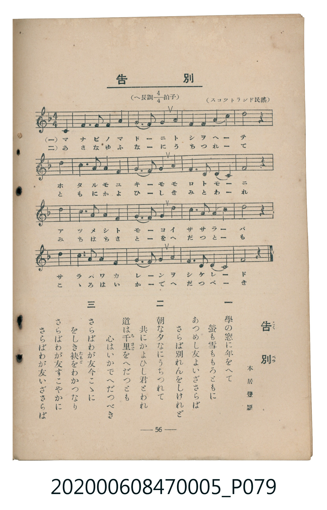

# 告別

> Re:Shōka 使用 AI 協助辨識與重建樂譜，可能會有錯誤。歡迎回報。

- **鋼琴伴奏版**：<br><audio controls src="kokubetsu.mp3"></audio>
- **NEUTRINO 歌聲合成版**：<br><audio controls src="kokubetsu_neutrino.mp3"></audio>

- 臺灣教育會公認《新定兒童唱歌》尋常科第五學年用（2020.006.0847.0005）

## 說明

原書資訊與歌詞全文（對應 P079.jpg，書頁 p. 56，參考教材第 19 首）：
調性與拍號：へ長調四分之四拍子（F 大調 4/4 拍）
出處與作歌：（スコットランド民謠）、本居豐穎


## 歌詞

```text
一　學の窓に年をへて
螢も雪ももろともに
あつめし友よいざさらば
さらば別れんをしけれど

二　朝な夕なにうちつれて
共にかよひし君とわれ
道は千里（ちさと）をへだつとも
心はいかでへだつべき

三　さらばわが友今こゝに
をしき袂（たもと）をわかつなり
さらばわが友すこやかに
さらばわが友いざさらば
```

## ABC

<div class="abc-score" data-abc-src="kokubetsu.abc" aria-label="五線譜載入中"></div>

[下載 ABC 原始檔](kokubetsu.abc)

## TMD 檔案連結

- [主旋律 TMD 檔案](kokubetsu.tmd) [[在 TMD Studio 編輯](https://tmdlang.github.io/Tmd-TS/#tmd=s7IKdvYPcrWy4qpTUCpJTLdSSM7PyUlNLsnMz7MqzsjMK0nNjM_KTMmPL87Iz05Ugisry88pzU21Si9KTEmNN403MjAyiDcwMIs3sDAxBzIMTBFKi_NLi5JTrYqTM_Lzc-JLUitKkvLzsxHyBUX5Zal5iXlANQVFIBtTwIoQClLLMlNSQdKpKZkl-UWZiTlI7kgtKga7FWxJfElRYl5xclFmAcgDCFUlGalAx6bm5qMKA81Kz8yzKk8tLkktyovPTc3JT6lEli7JyAf6sCCj0iojsxhkdXJiTnx2Yh5SQEAtLkhMT7UKMDC3VOLS0lJ4OrHracdSBS0tLkVbBQsTLntbBTcuGxN9EzuQvhftu543Ln42deaLpk3P5jQ_bV3zYlXv44auZ9M2PF0362nrpOerlz6dsvHZ2p7HDd1PN3Q_3bHj-fKJz9esebJrytO1O57u3PJ8yor3ezpAga4HDHQ9UKADGQam7_d0KnFx6Wsp2FILcCkoKDztm_9s9o4Xm9tfrOh60dEOdNeLlfOetq54Nq0d6IqnG3qftXcqgPyul1WQ_n5PD1DxywWNCgV6CqZmQO7T_uYXDc1A7z6bOwHoCQVDS4WXy6YBnfp-zyyQ8S9W7X_WsBxkcHfvi5nzgaKPG3e8nLodKP509uynHW1PdnYDGUDZp2snAC10U3i6ZDlQUgEYngpAUaBJYFe273oxcyrQmCd75wCdCDQGqPZx087HTZsfNzc_bu543LzycTOQ3flsw8QXaxYAtT1uaHw2Z83Tja0vNk54vrKPC2TMkx0NjxsagMH8uHHd81WTHzeuBob346ZJQDc9blwGdu-8RY-bml7OXgUkwaj3ceMKEKNxNUj6cSOQteRxU-PjxulP-7sfN3U8bmx53DjtcePUx02djxs3QBRBOcBk8rip53HTZLAV0x83TgRxG1dC3LILmAIans2Z-7hx1dMlU4Ek0I7HjW2PGxeCrQAqBLvoaetGsATEsk0giyfMBjuqH6gIpOJlI9An65_2Nr9sB4YMUBHQAKB5wFTUCfPbApCRYI-AjdzfDNQAdnn348blSCp2Pm7shYYUMAAb4D4BWdYIjOzuJ7u7HgOtawK6GhIgUJ_1vljUBLZ7PjiwYHaDtAGtAJoMDNAulMCBG_m4cSbYSIhroMGMqQgjmClP_1CgoKXPxeWdn12alFpSXGoVkJmYl-9QY1BTDbJFwcZCyw7MwJbzFEAZd0fDi4U9L9o3gzNxD5D9dM_GF1u3K2iYKjzd0P98fYMOPANpYjECaDvUeA2gUZpWIA4meNw8D0TVABldcKHJQNyHJtsJl90DxN0QZgdUtmk7XHYTEM-AKYTqbUOzcjaIQnbfrh6c7mtsgprSOBUutApoI9jMx41bYbKrkN3XuBoiC1YEkl0I17sEqLcH1X2Ny9CsXIHkvhoFAwVdODaNBxI1CoZAUhdIgmhjsIgRVAREGwNJhBqQvClYjRlYBGIQiF0DtsDHsEYBZCoMg8IcpBoUISDVsOhAlumEmgSKCBDZAREHRgNEFBIJEDWQCICwIebPRththGY3MLTBOoCBDTYJGtQg1laozCqY3cBABpEgWUgQQ0QhAQy3Gxi4SHYDgxZutzGa3U1QG5pXQn0xAYjXg2XWQGVA_oTILQKLL4GKg8IFxN8Mxgh_g0IH4e9NYLvxZzpwRoNmuh2dSJnOhLxM97hpPzxhrga7G8wEpzhQjK1FTrYwWTAFcj9CtgMhC89W4EyISLZNYHmMbAUsOOEJG-iCRkjWbYJl3cZNyC5onA5R2AuThbseGHPAUhPVBZCMhHABRDU844BSPSg3gHIAKDfgziVm8SCElr2wZRRQcEISACQwQSxQAoMEJUriAJOQQISIQoIQR-IABh5ypgAFGiyRg4IMpAKayYABBssA08FkL1Qc6jJoQMHtgWcGSAYAqUJkAHiWBboe4jeEuxGJHWQjJCuAdICyHYjfAi8iIOphGRMpMxFI7OAEDknswMYSFRI70E2wxLQQVisgaglIAoYltWZwKQvKw9DEtA0mC3Q7qBBASWrAwgAlqQHVIJIaUmJHKunXw3jQqgMUR2A7YS5omgSR3QGTXQDXCyzEIGqREjssG8HUTEZyAaHEDk7FKGoIVQmgsITEMyQkkYp5eCoGhSFSMQgMQUhagoQfImVMwJIywPaAUjq84IaEF4gFKvwhoQW1BxhSIPEdUPEFUB2QUEKkdEiegaX0yQh7QCmdhGJ9J9Q8SFH-uBlUpUBSPbacS0RKh6RuCtI1ODWCkwPE9eAkCG5kgNyzBjlVNW-GMMHlKkrbqGkjTC1Suoa1q9AAlmJ8LtycXnBsgZiN4AwHihNYZQApxpdDZHGk7J2oboCU9jjdQKWCHISRkzdmcgBFMSQ4YckBlACg9TZSUQkJRkRygLWGYC0J5MQNSoQgPZAgAyVLULaCBBisGF8OJrElblBChNoCLuax2EJi0iYlq0JsqeXi0rVTgPcjFIAcZS4A)]
- [鋼琴伴奏 TMD 檔案](kokubetsu_piano.tmd) [[在 TMD Studio 編輯](https://tmdlang.github.io/Tmd-TS/#tmd=s7IKdvYPcrWy4qpTUCpJTLdSyC8qychPL0osyKi0ysgsLskvykxOzInPTsxLVIIrKs4vLUpOjS9ITE-1CjAwt1Ti0tJSeDqx62nH0vd7Ol5273k-YcuTPVueLu1_3tnxfk-ngpYWl6KtgoUJl72tghuXjYm-iR3IsBftu543Ln42deaLpk3P5jQ_bV3zYlXv44auZ9M2PF0362nrpOerlz6dsvHZ2p7HDd1PN3Q_3bHj-fKJz9esebJrytO1O57u3PJ8ygqgjUYGRgZ6BgZmegYWJuZAhoEp0FIlLi7v_OzSpNSS4lKrgMzEvPwgD4cag5pqLgUgsLHQsgMz9LUUbNGBAsiKHQ0vFva8aN8Mtq4HyH66Z-OLrdsVNEwVnm7of76-QUcB5He9rIJ0TSxGaOmDja9RMFDQhWPTeCBRo2AIJHWBJIg2BosYQUVAtDGQRKgByZuC1ZiBRSAGgdg1YAt8DGsUQKbC8OPmeWDVj5u7wKofN08G4j4UmU6oSY-bu8FkB0S8aTtUdBMQz4CqAalvg7Ih5s9G2G2EZndjE0RH41SISY2rgKaCdD9u3AqVWQWzu3E1mATJgsQXQkWXAHX0IOxuXIZsd-MKhN3GaHY3QW1oXgn1xQQgXg-WWQOVAfkTIrcILL4EKg4KFxB_Mxgj_A0KHYS_N4Htxp9owAkFmmh2dCIlGhPSEg0oxkEpART7oJSAO4WYxYMQWtLClkgeN-2Hen41LACaQYELklmLGjBgEhQAEHFQwEHEsAZME1g1PEE8bgIlAkgEP24EJ7AmaAJrBAUhRG46mOyFikNdBozex039CHvgCQES-SBViMiHJ1eg6yF-Q7gbEdEgGyHJAKQDlORA_BZ49oCohyVKpIREIKLBkQuJ6KezZ9MqosExiKKGUFEA8hvEjwuhIQTP3vAYfNwMykbw5N-0DRqOW-GZB6J-ApZQgccyPMOuh7IhmR4kAzIdYuIksPgOqPgCqA5gFoerQaQXWCxPRtgDimUSsvNOqHmQLPy4GVSUQGIcW6olIpYhMTswmReEkaMVMxhAXgPJgIIDIgfyOLScQsoeG5HUIJf-sJITOVJBgQ_S0wuOWFB0gJITSAYWeI8bl4NJbJEKigCoLeCsjcUWEqOUlCQKsaUWo9r3Qa72TRDV_ou-rpftvc-2b3zW3PpkZ_eLGe3PFux5MWPtsw0TX6xZAGyGvJi3CCj-tLUT1PqYPftZd-_TtROebl_2rLMb0rp5v6fnWdek5zP3PJ3Q83zV9GfNc4AtoBcd7U92TXra3QnUCzQZuSEAgcB4jleINoyFUcAEEw9kmcbHIhiYakyADJNYEAU0AWoiMeaYgZhm8blgrRhmk2YWHdwEDiBQJOraKcDjMdoHKIMqYIQuYAwWUOYCAA)]

## 分析

```text
================================================================================
📊 TMD Song Profile: [ 告別 ]
================================================================================
⏱  Duration:       0:48 (48.6s), 17 measures total
🎼 Key & Tempo:    首調基準 F, != 84.0 BPM, <4/4>
   - 分析範圍：      由實際發聲的音符與和弦推測調性；播放脈絡另行呈現
🎤 人聲音域:    C4 (MIDI 60) – D5 (MIDI 74) [跨度: 14 個半音 / 1.2 個八度, 難度: moderate]
   - 最低音:  C4 in [Kokubetsu #1 @ m.1, 0:02]
   - 最高音: D5 in [Kokubetsu #1 @ m.5, 0:11]
   - 適合: soprano, mezzo-soprano, contralto, tenor, baritone, bass
🏛  結構:      Kokubetsu (48.6s)
⚡ 編曲密度:        Peak 1 軌道同時演奏
🗝  調性診斷：       F 大調（純淨自然大調，未偵測到可信轉調）
   - 風格氣質:    純淨自然大調（陽光明朗、易唱易記，無明顯調外色彩）
   - 轉調歷程:    全曲維持單一推測調性（未偵測到可信轉調）
   - 核心骨幹音:  F, G, C, D, A
   - 調性數值:    F 大調 [相關度: 0.84, 穩定度: Moderate, 自然音純度: 100.0%]
   - 候選調性 (K-S): F 大調 (0.84), D 小調 (0.72), C 大調 (0.68)
   - 五度圈歷程:   -1
   - 各段落調性細節:
     • [Kokubetsu #1]: F 大調 (r: 0.84, 自然音純度: 100.0%)

  [ 五度圈游移軌跡 ]
               C  
        [F ]*          G  
      Bb               D  
      Eb               A  
         Ab           E  
            Db       B  
               F# 
     (* = active key center)

  [ 十二半音累積音高分佈 ]
     C  : ████████████████          18.3%
     C# :                            0.0%
     D  : ████████████████          18.3%
     D# :                            0.0%
     E  :                            0.0%
     F  : ████████████████████████  28.3%
     F# :                            0.0%
     G  : ████████████████          19.2%
     G# :                            0.0%
     A  : █████████████             15.8%
     A# :                            0.0%
     B  :                            0.0%
--------------------------------------------------------------------------------
Assignment 軌道音域：
  - Piano         : C4 – D5 (14 個半音 / 1.2 個八度, 59 個音符)
================================================================================
```


## 原書掃描頁




