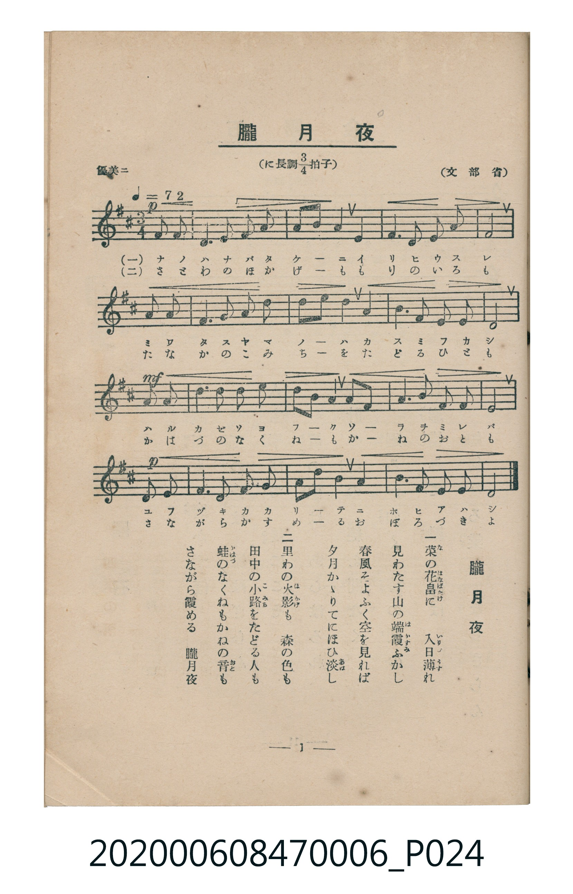

# 朧月夜

<audio controls src="oborozukiyo.mp3"></audio>

- 文部省
- 臺灣教育會公認《新定兒童唱歌》尋常科第六學年用（2020.006.0847.0006）

## 說明

原書資訊與歌詞全文（對應 P024.jpg，書頁 p. 1，第一學期第 1 首）：
調性與拍號：に長調四分之三拍子（D 大調 3/4 拍，弱起 1 拍），「優美ニ」（♩=72）

## 歌詞

```text
一　菜（な）の花畠（はなばたけ）に　入日薄（いりひうす）れ
見わたす山の端（は）霞（かすみ）ふかし
春風そよふく空を見れば
夕月かゝりてにほひ淡（あは）し

二　里わの火影（ほかげ）も　森の色も
田中の小路（こみち）をたどる人も
蛙（かはづ）のなくねもかねの音（おと）も
さながら霞める　朧月夜
```

## ABC

```abc
X:1
T:朧月夜
C:TMD (Chen, Chih-Han / aguai)
M:3/4
L:1/16
Q:1/4=72
K:D
V:V1 name="Piano" snm="Pia"
[V:V1]
!p! z4 z4 D2 E2 | F6 G2 A2 F2 | G2 B2 A4 D4 | F6 E2 F2 A2 |
E8 D2 E2 | F6 G2 A2 F2 | G2 B2 A4 A4 | B6 A2 F2 E2 |
!mf! D8 E2 E2 | B4 B2 c2 d4 | d2 B2 A4 B2 A2 | F6 A2 F2 E2 |
!p! D8 D2 E2 | F6 G2 A2 F2 | G2 B2 A4 A4 | B6 A2 F2 E2 |
D8 z4 |
```

## TMD 檔案連結

- [主旋律 TMD 檔案](oborozukiyo.tmd) [[在 TMD Studio 編輯](https://tmdlang.github.io/Tmd-TS/#tmd=s7IKdvYPcrWy4tLSUng2Z_mzOR1Pl8xR0NLiUrRVMDfisrdVcOGyMdY3seOqU1B6Nq39ZfOK53MalUC8F-27njcufjZ15oumTc_mND9tXfNiVe_jhq5n0zY8XTfraeuk56uXPp2y8dnanscN3U83dD_dseP58onP16x52rr26dodT3dueT5lxfs9HUYGRgZ6BgZmegYWJuZAhoHZ-z2dSlxc-loKttQCXAoKCk_75j-bvePF5vYXK7pedLQD3fVi5bynrSuAvgK64umG3mftnQoBBkYmelkF6e_39AAVv1zQqFCgp2AI5AHd_WRHA9Ddz-bMB7IVDBVeLpsGdOj7PbNAhr9Ytf9Zw3KQsd29L2bOB4o-blz9cup2oPjT2bOfdrQ92dn9ZEcnUPbp2glA61wUni5ZDpRUAIatAlAUaMPTPRtfbN0ONBjMBRoMDLeepy2rnu_re9zc_bgBKNjxaOZKW3MjoCwXyFKggx43NLzonwOUedy4Cij8uHHdi66Nz6cuAIusBwo-btzwuHH-48aJYNnVQPVPW5c-m770xbQWsJqWx01djxs3PW5se9w4E6SmqQfsn2Xdj5v6wTpnPt24EWju89XrIYYCFb2cMw_M7gbKPm7cDzZ6K5g7HaT52YylLxeteNw493ETUBFQov_5yl2PmyaBDe0BuggcHUumAlMbSFMTUB3QDctAzmvcDXTMs-0LwcY3QWwDmQr27i5giDS8bO8Bu2zd88bVT_duBCsEagLaPQns_CagmmeL14FConMTkAvS-XzKhic71gKFnm7of7Ed4o_JQIc_bgRaBNQzCezRlY-bup_sAjoUrOfFbGBwQPwIDMelkMAFByjQ8rUge0BSIENfzt8MVgn0AzA9g5wA0v-4cSpYNdC1oPB63NQINB7kNlguAymiPGVDgYKWPheXf1J-UX5VaXZmZb5VQGZiXr5DjUGNQjXIIgUbCy07MANbtlKApO4XC3sUNKDJUFvBRAEYWs_XN-jAM4UmFp1Ae0Gm1igYKOiCcXVBLTANGwFFjIE8XaAxpkBWDZA2A7J0gXK6cDkjIG0K5BmBeSA5oD5wXON25q4esDNJdB12t4BwDZANkgPJgFwNch8IVuem1QIFCDtoRyc5DgJZaqZgrmAYB3YDkII4CUTCnIvhJFjQ4ncRsMChTxCBoruGq5aLS9dOASntKQC5ylxcAA)]
- [鋼琴伴奏 TMD 檔案](oborozukiyo_piano.tmd) [[在 TMD Studio 編輯](https://tmdlang.github.io/Tmd-TS/#tmd=s7IKdvYPcrWy4tLSUng2Z_mzOR1Pl8x5v6fjZfee5xO2PNmz5enS_uedHe_3dCpoaXEp2iqYG3HZ2yq4cNkY65vYcdUpKD2b1v6yecXzOY1KIN6L9l3PGxc_mzrzRdOmZ3Oan7auebGq93FD17NpG56um_W0ddLz1UufTtn4bG3P44bupxu6n-7Y8Xz5xOdr1jxtXft07Y6nO7c8n7ICaL-RgZGBnoGBmZ6BhYk5kGFgBnSCEheXf1J-UX5VaXZmZb5VQGZiXn6Qh0ONQY1CNZcCENhYaNmBGfpaCrboQAFoy5MdDS8W9ihoBBgYmehlFaRrYlGmpQ82okbBQEEXjKsLahUMFYyAIsZAnq6CiYIpkFUDpM2ALF2gnC5czghImwJ5RmAeSA6ojwu_m3b1EO8m7C4A4RogGyQHkgG5FeQqEKzOTasFChB2xo5O4p0BsspMwVzBMA5sM5CCOAREwhyJ4RBYMOJ3x9PZs2kZHKAIreGqxZKSfFBSkgk0JYGSgQHY7QYgU-IVog1jwRhoHZBjAuOgyJjGA3mm8bEgPVBTcOuEcUDq4erAsYbQDVMDxGhGwTiouiHOJc9qkEZg-OjaKSAFkQImV5mLCwA)]

## 分析

```text
================================================================================
📊 TMD Song Profile: [ 朧月夜 ]
================================================================================
⏱  Duration:       0:42 (42.5s), 17 measures total
🎼 Key & Tempo:    首調基準 D, != 72.0 BPM, <3/4>
   - 分析範圍：      由實際發聲的音符與和弦推測調性；播放脈絡另行呈現
🎤 人聲音域:    D4 (MIDI 62) – D5 (MIDI 74) [跨度: 12 個半音 / 1.0 個八度, 難度: easy]
   - 最低音:  D4 in [Oborozukiyo #1 @ m.1, 0:01]
   - 最高音: D5 in [Oborozukiyo #1 @ m.10, 0:24]
   - 適合: soprano, mezzo-soprano, contralto, tenor, baritone, bass
🏛  結構:      Oborozukiyo (42.5s)
⚡ 編曲密度:        Peak 1 軌道同時演奏
🗝  調性診斷：       D 大調（純淨自然大調，未偵測到可信轉調）
   - 風格氣質:    純淨自然大調（陽光明朗、易唱易記，無明顯調外色彩）
   - 轉調歷程:    全曲維持單一推測調性（未偵測到可信轉調）
   - 核心骨幹音:  F#, D, A, B, E
   - 調性數值:    D 大調 [相關度: 0.88, 穩定度: High, 自然音純度: 100.0%]
   - 候選調性 (K-S): D 大調 (0.88), B 小調 (0.70), F# 小調 (0.69)
   - 五度圈歷程:   +2
   - 各段落調性細節:
     • [Oborozukiyo #1]: D 大調 (r: 0.88, 自然音純度: 100.0%)

  [ 五度圈游移軌跡 ]
               C  
         F            G  
      Bb              [D ]*
      Eb               A  
         Ab           E  
            Db       B  
               F# 
     (* = active key center)

  [ 十二半音累積音高分佈 ]
     C  :                            0.0%
     C# : █                          1.0%
     D  : ██████████████████████    20.8%
     D# :                            0.0%
     E  : ██████████████            13.5%
     F  :                            0.0%
     F# : ████████████████████████  22.9%
     G  : ███████                    6.2%
     G# :                            0.0%
     A  : ██████████████████████    20.8%
     A# :                            0.0%
     B  : ███████████████           14.6%
--------------------------------------------------------------------------------
Assignment 軌道音域：
  - Piano         : D4 – D5 (12 個半音 / 1.0 個八度, 61 個音符)
================================================================================
```


## 原書掃描頁




