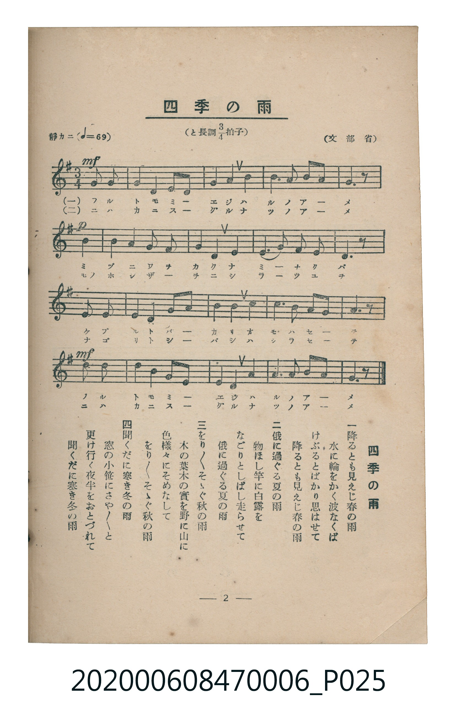

# 四季の雨

> Re:Shōka 使用 AI 協助辨識與重建樂譜，可能會有錯誤。歡迎回報。

- **鋼琴伴奏版**：<br><audio controls src="shiki_no_ame.mp3"></audio>
- **NEUTRINO 歌聲合成版**：<br><audio controls src="shiki_no_ame_neutrino.mp3"></audio>

- 文部省
- 臺灣教育會公認《新定兒童唱歌》尋常科第六學年用（2020.006.0847.0006）

## 說明

原書資訊與歌詞全文（對應 P025.jpg，書頁 p. 2，第一學期第 2 首）：
調性與拍號：と長調四分之三拍子（G 大調 3/4 拍，弱起 1 拍），「靜カニ」（♩=69）


## 歌詞

```text
一　降るとも見えじ春の雨
水に輪をかく波なくば
けぶるとばかり思はせて
降るとも見えじ春の雨

二　俄に過ぐる夏の雨
物ほし竿に白露を
なごりとしばし走らせて
俄に過ぐる夏の雨

三　をり／＼そゝぐ秋の雨
木の葉木の實を野に山に
色樣々にそめなして
をり／＼そゝぐ秋の雨

四　聞くだに寒き冬の雨
窓の小笹にさや／＼と
更け行く夜半をおとづれて
聞くだに寒き冬の雨
```

## ABC

<div class="abc-score" data-abc-src="shiki_no_ame.abc" aria-label="五線譜載入中"></div>

[下載 ABC 原始檔](shiki_no_ame.abc)

## TMD 檔案連結

- [主旋律 TMD 檔案](shiki_no_ame.tmd) [[在 TMD Studio 編輯](https://tmdlang.github.io/Tmd-TS/#tmd=s7IKdvYPcrWy4qpTUCpJTLdSSM7PyUlNLsnMz7MqzsjMK0nNjM_KTMmPL87Iz05Ugisry88pzU21Si9KTEmNN4s3MjAyiDcwMIs3sDAxBzIMzBBKi_NLi5JTrYqTM_Lzc-JLUitKkvLzsxHyBUX5Zal5iXlANQVFIBtTwIoQClLLMlNSQdLFyYl58WWpRZlpmakpSG5JLSoGuxdsUXxJUWJecXJRZgHIEwhVJRmpQAeXpyYCGUXowsWpicX5ecUI4fyizPTMPKvc_LykUqDXkSVKMvKB3i7IqLTKyCwuASpMTsyJz07MQwodqEsKEtNTrQIMjEyVuLS0FJ7Onv107eLHjetezl6hoKXFpWirYGbJZW-r4M5lY6xvYgfS_Wxa-8vmFc_nNILNetG-63nj4mdTZ75o2vRsTvPT1jUvVvU-buh6Nm3D03WznrZOer566dMpG5-t7Xnc0P10Q_fTHTueL5_4fM2ap61rn67d8XTnludTVrzf0wGKHT1gnOiBYgfIMDB7v6dTiYtLX0vBllqAS0FB4Wnf_Gezd7zY3P5iRdeLjnagu16snPe0dQXQV0BXPN3Q-6y9UwEUHnpZBenv9_QAFb9c0KhQoKdgBOQB3f1kRwPQ3c_mzAeyFYwUXi6bBnTo-z2zQIa_WLX_WcNykLHdvS9mzgeKPm5c8XLqdqA4KGQ72p7s7H6yoxMo-3TtBKB17gpPlywHSioAw1YBKAq04emejS-2blcwhHCBBgPDrefl3DmPm1Y_bu5-3AAU7Hg0c6WtmSVQlgtkKdBBjxsaXs7sfdzUDbTucVPTi2VARsfjxhnPZiyFxCVI3bMNWx43rn6xZ9XjpkmPG4Eq-p9tXvS4cRWQ8bhxA0jF48aJjxu3QY1p3ABS1NT1rGHu48b1jxtnP25cBlJEwCKwi3YBHd3wZH8L0L6XjX2PGycAdTxdArQG5pbnnSsfN-5-3Dj9-er9QEXPZ-59OWcT0F0QVwCdNAVoM9gV08EOmf5i64bHTZ0IV-A0HBIinUD7Qd5s6nq_p__9nj2PG-c-bgL6Y8Lz5UAXw0NkDtCCdS8mdkIYT9cvA-p52Q40c_XTjRuBJDhOOzc9W7H4cUMrkA82phHsQKC7wA4hYAs4yc2eDXTOi8Z54JBeADJ9PTAGep-2rUEKkVWTQU7Y0P98zU6wTVMfN7XAjIW4djYw_ia-WNgDNObpkjlPe7vAEQkJpqWPm4DiYBcRsIjybAQFClr6XFzBGZnZmX75jsDyKSAzMS_focagphpkjYKNhZYdmIEtBytAMhLQMwoa0BSvrWCiAPL--gYdeP7TxKITaCvI1BoFAwVdMK7OTasF5hdDoJAhkGsaDyTM4kE0RMAIiI2BuAZMgvjGQAyRA5lQXVALFDFWqAGb62NYowAyAYQfN24Fxm83UC0wjEH8piaw6H6wacCUD-bNAJPrIWJA1SBTgcENxCDVILFGsFg8WCcwqmA2GSHbtBpsBshUkAkgPoicCbVpAth2iMwqqNgSfDYBXQqSgdpkjGRT0yQg7gKrngTmd4FNmQs1FURD7YOZ2tiL10-TkW0yQfZTLxD3g01YgOSnqVATGqBqIOEMEWvDa9M-IF4JtAl_strVA05WJKYmUNoApRRDBXNYwoGlJJAzwBRUFsiugUiCkg-QBxKAJx6oN5v6oYENCUJI1IHF4BEISkYQPkQGJLYB7tmJQLwNKakAy0uw6ulgchpUPUQMErAgGVCAdULNXQINUFhUQ8wF2TYFKWFAki4oGiEBj3AbNIHAxUC2gERbwFGBLAYyFyja1IuUDCD6YObC3AuKfPSE0AJ171QoG5bdIOYCsyAwLAhF-o5OciIdHKvgmDQEFwmgRADCJmBXgEgQ3whctoASB7i4ABU3pkCIFOXQnAkuI8BRCI9yaO4CkSB1oDQNKS2AVRlU3TJkr4JKG0SUQ3VDzIVGL9h8WDKAljpgHsi2TqzmQssWpCiHRAMoEhFRA-FBogZaGkDzHiTRwOyHmwsrSRBRDk5u0GTeBCod4ckLmpSg4QCNXlBZCKy3MNwLLTfwRzmwViUnyk2hUWwIycaIFACKX1gso1cRoGoGOYdTozIAlytIuZsaxT6SmaBopkoBj2QmOFdToyiHmFnLxaVrp4BoQSgAecpcAA)]
- [鋼琴伴奏 TMD 檔案](shiki_no_ame_piano.tmd) [[在 TMD Studio 編輯](https://tmdlang.github.io/Tmd-TS/#tmd=s7IKdvYPcrWy4qpTUCpJTLdSyC8qychPL0osyKi0ysgsLskvykxOzInPTsxLVIIrKs4vLUpOjS9ITE-1CjAwMlXi0tJSeDp79tO1ix83rns5e8X7PR0vu_c8n7DlyZ4tT5f2P-_seL-nU0FLi0vRVsHMksveVsGdy8ZY38QOZOSzae0vm1c8n9MItuBF-67njYufTZ35omnTsznNT1vXvFjV-7ih69m0DU_XzXraOun56qVPp2x8trbncUP30w3dT3fseL584vM1a562rn26dsfTnVueTwHZb2RgZKBnYGCmZ2BhYg5kGJgBnaDExRWckZmd6ZfvmAt0emZiXn6Qh0ONrmFNNZcCENhYaNmBGfpaCrboQAFoyZMdDS8W9ihogHytl1WQrolFmZY-2IgaBQMFXTCuzk2rVTAEwhog1lUwjQcSZvEgGiJgBMTGQFwDJkF8YyCGyIFMqC6oBYoYK9SAzfUxrFEAmQDCjxu3Kjxu6gaqfdy4AsRvagKL7geb9rixA8ybASbXQ8SAqkGmAuMJiEGqQWKNYLF4sM7HjUthNhkh27QabAbIVJAJID6InAm1aQLYdojMKqjYEnw2AV0KkoHaZIxkU9MkIO4Cq54E5neBTZkLNRVEQ-2DmdrYi9dPk5FtMkH2Uy8Q94NNWIDkp6lQExqgaiDhDBFrw2vTPiBeCbQJfxra1UN8GgKlCFD6MFQwhyUXWPoBWQ6moLJAdg1EEpRogDyQADzJQD3X1A8NYkjAQSIMLAaPNlDigfAhMiCxDXAvTgTibUgJ5HHjbrDq6WByGlQ9RAwSnCAZUDB1Qs1dAg1GWARDzAXZNgUpOUASLCjyIMGNcBs0WcDFQLaARFvAEYAsBjIXKNrUixT5EH0wc2HuBUU5evS3QN07FcqGZTKIucCMBwwLQlG9o5P4qAbHJTj-DMHZHxT1IGwCthtEgvhG4HIElCTARQOoaDEFQqSIhuZCcHkAjjh4RENzEogEqQOlX0jJ8LhxNlTdMmQPgkoWRERDdUPMhUYq2HxY5ENLGDAPZFsnVnOh5QhSREMCHxR1iAiB8CARAs350HwGSSow--HmwkoNRESDExk0cTeBSkJ4ooImIGg4QCMVVO49burBcC-0jMAf0cDKj_iINoVGrCEkyyLiHRSrsLhFrwRAFQlybqZGcQ8uQ5ByMjUKdiQzQZFLlSIcyUxwDqZGYQ0xsxazQeCD0iAwgTYIQLU5NLsZgGIlXiHaMBaMIRzTeGQeSAokAueBqnCgPqhR2DWYgDWYxAO5IGa0EZhvCuKDFCO0g5Wg2A7WDtGNxIFrhTkbyXqEhWBVCAfDNaF6AKQbGFi6dgqI8Ir2AUqgiRhhiBhjiAAdBxRR5gIA)]

## 分析

```text
================================================================================
📊 TMD Song Profile: [ 四季の雨 ]
================================================================================
⏱  Duration:       0:44 (44.3s), 17 measures total
🎼 Key & Tempo:    首調基準 G, != 69.0 BPM, <3/4>
   - 分析範圍：      由實際發聲的音符與和弦推測調性；播放脈絡另行呈現
🎤 人聲音域:    D4 (MIDI 62) – D5 (MIDI 74) [跨度: 12 個半音 / 1.0 個八度, 難度: easy]
   - 最低音:  D4 in [ShikiNoAme #1 @ m.2, 0:03]
   - 最高音: D5 in [ShikiNoAme #1 @ m.13, 0:33]
   - 適合: soprano, mezzo-soprano, contralto, tenor, baritone, bass
🏛  結構:      ShikiNoAme (44.3s)
⚡ 編曲密度:        Peak 1 軌道同時演奏
🗝  調性診斷：       G 大調（純淨自然大調，未偵測到可信轉調）
   - 風格氣質:    純淨自然大調（陽光明朗、易唱易記，無明顯調外色彩）
   - 轉調歷程:    全曲維持單一推測調性（未偵測到可信轉調）
   - 核心骨幹音:  G, A, B, D, E
   - 調性數值:    G 大調 [相關度: 0.83, 穩定度: Moderate, 自然音純度: 100.0%]
   - 候選調性 (K-S): G 大調 (0.83), D 大調 (0.71), E 小調 (0.71)
   - 五度圈歷程:   +1
   - 各段落調性細節:
     • [ShikiNoAme #1]: G 大調 (r: 0.83, 自然音純度: 100.0%)

  [ 五度圈游移軌跡 ]
               C  
         F           [G ]*
      Bb               D  
      Eb               A  
         Ab           E  
            Db       B  
               F# 
     (* = active key center)

  [ 十二半音累積音高分佈 ]
     C  : ██████                     5.4%
     C# :                            0.0%
     D  : ████████████████████      17.4%
     D# :                            0.0%
     E  : ██████████████████        15.2%
     F  :                            0.0%
     F# : ███                        2.2%
     G  : ████████████████████████  20.7%
     G# :                            0.0%
     A  : ███████████████████████   19.6%
     A# :                            0.0%
     B  : ███████████████████████   19.6%
--------------------------------------------------------------------------------
Assignment 軌道音域：
  - Piano         : D4 – D5 (12 個半音 / 1.0 個八度, 56 個音符)
================================================================================
```


## 原書掃描頁




