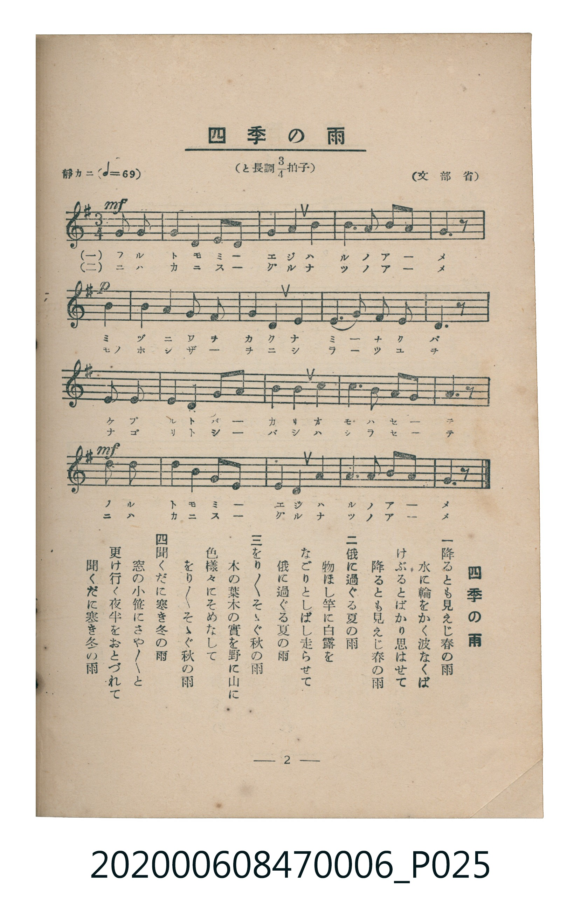

# 四季の雨

> Re:Shōka 使用 AI 協助辨識與重建樂譜，可能會有錯誤。歡迎回報。

- **鋼琴伴奏版**：<br><audio controls src="shiki_no_ame.mp3"></audio>
- **NEUTRINO 歌聲合成版**：<br><audio controls src="shiki_no_ame_neutrino.mp3"></audio>

- 文部省
- 臺灣教育會公認《新定兒童唱歌》尋常科第六學年用（2020.006.0847.0006）

## 說明

原書資訊與歌詞全文（對應 P025.jpg，書頁 p. 2，第一學期第 2 首）：
調性與拍號：と長調四分之三拍子（G 大調 3/4 拍，弱起 1 拍），「靜カニ」（♩=69）


## 歌詞

```text
一　降るとも見えじ春の雨
水に輪をかく波なくば
けぶるとばかり思はせて
降るとも見えじ春の雨

二　俄に過ぐる夏の雨
物ほし竿に白露を
なごりとしばし走らせて
俄に過ぐる夏の雨

三　をり／＼そゝぐ秋の雨
木の葉木の實を野に山に
色樣々にそめなして
をり／＼そゝぐ秋の雨

四　聞くだに寒き冬の雨
窓の小笹にさや／＼と
更け行く夜半をおとづれて
聞くだに寒き冬の雨
```

## ABC

<div class="abc-score" data-abc-src="shiki_no_ame.abc" aria-label="五線譜載入中"></div>

[下載 ABC 原始檔](shiki_no_ame.abc)

## TMD 檔案連結

- [主旋律 TMD 檔案](shiki_no_ame.tmd) [[在 TMD Studio 編輯](https://tmdlang.github.io/Tmd-TS/#tmd=s7IKdvYPcrWy4qpTUCpJTLdSSM7PyUlNLsnMz7MqzsjMK0nNjM_KTMmPL87Iz05Ugisry88pzU21Si9KTEmNN4s3MjAyiDcwMIs3sDAxBzIMzBBKi_NLi5JTrYqTM_Lzc-JLUitKkvLzsxHyBUX5Zal5iXlANQVFIBtTwIoQClLLMlNSQdLFyYl58WWpRZlpmakpSG5JLSoGuxdsUXxJUWJecXJRZgHIEwhVJRmpQAeXpyYCGUXowsWpicX5ecUI4fyizPTMPKvc_LykUqDXlbi0tBSezp79dO3ix43rXs5eoaClxaVoq2BmyWVvq-DOZWOsb2IH0vxsWvvL5hXP5zSCjXrRvut54-JnU2e-aNr0bE7z09Y1L1b1Pm7oejZtw9N1s562Tnq-eunTKRufre153ND9dEP30x07ni-f-HzNmqeta5-u3fF055bnU1a839MBCl49YKDqgYIXyDAwe7-nU4mLS19LwZZagEtBQeFp3_xns3e82Nz-YkXXi452oLterJz3tHUF0FdAVzzd0PusvVMhwMDIVC-rIP39nh6g4pcLGhUK9BSMgDygu5_saAC6-9mc-UC2gpHCy2XTgA59v2cWyPAXq_Y_a1gOMra798XM-UDRx40rXk7dDhQHhWxH25Od3U92dAJln66dALTOXeHpkuVASQVg2CoARYE2PN2z8cXW7QqGEC7QYGC49bycO-dx0-rHzd2PG4CCHY9mrrQ1swTKcoEsBTrocUPDy5m9j5u6gdY9bmp6sQzI6HjcOOPZjKWQuASpe7Zhy-PG1S_2rHrcNOlxI1BF_7PNix43rgIyHjduAKl43DjxceM2qDGNG0CKmrqeNcx93Lj-cePsx43LQIoIWAR20S6goxue7G8B2veyse9x4wSgjqdLgNbA3PK8c-Xjxt2PG6c_X70fqOj5zL0v52wCugviCqCTpgBtBrtiOtgh019s3fC4qRPhCpyGQ0KkE2g_yJtNXe_39L_fs-dx49zHTUB_THi-HOhieIjMAVqw7sXETgjj6fplQD0v24Fmrn66cSOQBMdp56ZnKxY_bmgF8sHGNIIdCHQX2CEEbAEnudmzgc550TgPHNILQKavB8ZA79O2NUghsmoyyAkb-p-v2Qm2aerjphaYsRDXzgbG38QXC3uAxjxdMudpbxc4IiHBtPRxE1Ac7CICFlGejaBAQUufiys4IzM70y_fEVjABGQm5uU71BjUVIOsUbCx0LIDM7DlYAVIRgJ6RkEDmuK1FUwUQN5f36ADz3-aWHQCbQWZWqNgoKALxtW5abXA_GIIFDIEck3jgYRZPIiGCBgBsTEQ14BJEN8YiCFyIBOqC2qBIsYKNWBzfQxrFEAmgPDjxq3A-O0GqgWGMYjf1AQW3Q82DZjywbwZYHI9RAyoGmQqMLiBGKQaJNYIFosH6wRGFcwmI2SbVoPNAJkKMgHEB5EzoTZNANsOkVkFFVuCzyagS0EyUJuMkWxqmgTEXWDVk8D8LrApc6GmgmiofTBTG3vx-mkysk0myH7qBeJ-sAkLkPw0FWpCA1QNJJwhYm14bdoHxCuBNuFPVrt6wMmKxNQEShuglGKoYA5LOLCUBHIGmILKAtk1EElQ8gHyQALwxAP1ZlM_NLAhQQiJOrAYPAJByQjCh8iAxDbAPTsRiLchJRVgeQlWPR1MToOqh4hBAhYkAwqwTqi5S6ABCotqiLkg26YgJQxI0gVFIyTgEW6DJhC4GMgWkGgLOCqQxUDmAkWbepGSAUQfzFyYe0GRj54QWqDunQplw7IbxFxgFgSGBaFI39FJTqSDYxUck4bgIgGUCEDYBOwKEAniG4HLFlDiABcXoOLGFAiRohyaM8FlBDgK4VEOzV0gEqQOlKYhpQWwKoOqW4bsVVBpg4hyqG6IudDoBZsPSwbQUgfMA9nWidVcaNmCFOWQaABFIiJqIDxI1EBLA2jegyQamP1wc2ElCSLKwckNmsybQKUjPHlBkxI0HKDRCyoLgfUWhnuh5Qb-KAfWquREuSk0ig0h2RiRAkDxC4tl9CoCVM0g53BqVAbgcgUpd1Oj2EcyExTNVCngkcwE52pqFOUQM2u5uHTtFBAtCAUgT5kLAA)]
- [鋼琴伴奏 TMD 檔案](shiki_no_ame_piano.tmd) [[在 TMD Studio 編輯](https://tmdlang.github.io/Tmd-TS/#tmd=s7IKdvYPcrWy4tLSUng6e_bTtYsfN657OXvF-z0dL7v3PJ-w5cmeLU-X9j_v7Hi_p1NBS4tL0VbBzJLL3lbBncvGWN_EjqtOQenZtPaXzSuez2lUAvFetO963rj42dSZL5o2PZvT_LR1zYtVvY8bup5N2_B03aynrZOer176dMrGZ2t7Hjd0P93Q_XTHjufLJz5fs-Zp69qna3c83bnl-RSQ_UYGRgZ6BgZmegYWJuZAhoEZ0AlKXFzBGZnZmX75jrmpVgGZiXn5QR4ONbqGNdVcCkBgY6FlB2boaynYogMFoCVPdjS8WNijoBFgYGSql1WQrolFmZY-2IgaBQMFXTCuzk2rVTAEwhog1lUwjQcSZvEgGiJgBMTGQFwDJkF8YyCGyIFMqC6oBYoYK9SAzfUxrFEAmQDCjxu3Kjxu6gaqfdy4AsRvagKL7geb9rixA8ybASbXQ8SAqkGmAuMJiEGqQWKNYLF4sM7HjUthNhkh27QabAbIVJAJID6InAm1aQLYdojMKqjYEnw2AV0KkoHaZIxkU9MkIO4Cq54E5neBTZkLNRVEQ-2DmdrYi9dPk5FtMkH2Uy8Q94NNWIDkp6lQExqgaiDhDBFrw2vTPiBeCbQJfxra1UN8GgKlCFD6MFQwhyUXWPoBWQ6moLJAdg1EEpRogDyQADzJQD3X1A8NYkjAQSIMLAaPNlDigfAhMiCxDXAvTgTibUgJ5HHjbrDq6WByGlQ9RAwSnCAZUDB1Qs1dAg1GWARDzAXZNgUpOUASLCjyIMGNcBs0WcDFQLaARFvAEYAsBjIXKNrUixT5EH0wc2HuBUU5evS3QN07FcqGZTKIucCMBwwLQlG9o5P4qAbHJTj-DMHZHxT1IGwCthtEgvhG4HIElCTARQOoaDEFQqSIhuZCcHkAjjh4RENzEogEqQOlX0jJ8LhxNlTdMmQPgkoWRERDdUPMhUYq2HxY5ENLGDAPZFsnVnOh5QhSREMCHxR1iAiB8CARAs350HwGSSow--HmwkoNRESDExk0cTeBSkJ4ooImIGg4QCMVVO49burBcC-0jMAf0cDKj_iINoVGrCEkyyLiHRSrsLhFrwRAFQlybqZGcQ8uQ5ByMjUKdiQzQZFLlSIcyUxwDqZGYQ0xsxazQeCD0iAwgTYIQLU5NLsZgGIlXiHaMBaMIRzTeGQeSAokAueBqnCgPqhR2DWYgDWYxAO5IGa0EZhvCuKDFCO0g5Wg2A7WDtGNxIFrhTkbyXqEhWBVCAfDNaF6AKQbGFi6dgqI8Ir2AUqgiRhhiBhjiAAdBxRR5gIA)]

## 分析

```text
================================================================================
📊 TMD Song Profile: [ 四季の雨 ]
================================================================================
⏱  Duration:       0:44 (44.3s), 17 measures total
🎼 Key & Tempo:    首調基準 G, != 69.0 BPM, <3/4>
   - 分析範圍：      由實際發聲的音符與和弦推測調性；播放脈絡另行呈現
🎤 人聲音域:    D4 (MIDI 62) – D5 (MIDI 74) [跨度: 12 個半音 / 1.0 個八度, 難度: easy]
   - 最低音:  D4 in [ShikiNoAme #1 @ m.2, 0:03]
   - 最高音: D5 in [ShikiNoAme #1 @ m.13, 0:33]
   - 適合: soprano, mezzo-soprano, contralto, tenor, baritone, bass
🏛  結構:      ShikiNoAme (44.3s)
⚡ 編曲密度:        Peak 1 軌道同時演奏
🗝  調性診斷：       G 大調（純淨自然大調，未偵測到可信轉調）
   - 風格氣質:    純淨自然大調（陽光明朗、易唱易記，無明顯調外色彩）
   - 轉調歷程:    全曲維持單一推測調性（未偵測到可信轉調）
   - 核心骨幹音:  G, A, B, D, E
   - 調性數值:    G 大調 [相關度: 0.83, 穩定度: Moderate, 自然音純度: 100.0%]
   - 候選調性 (K-S): G 大調 (0.83), D 大調 (0.71), E 小調 (0.71)
   - 五度圈歷程:   +1
   - 各段落調性細節:
     • [ShikiNoAme #1]: G 大調 (r: 0.83, 自然音純度: 100.0%)

  [ 五度圈游移軌跡 ]
               C  
         F           [G ]*
      Bb               D  
      Eb               A  
         Ab           E  
            Db       B  
               F# 
     (* = active key center)

  [ 十二半音累積音高分佈 ]
     C  : ██████                     5.4%
     C# :                            0.0%
     D  : ████████████████████      17.4%
     D# :                            0.0%
     E  : ██████████████████        15.2%
     F  :                            0.0%
     F# : ███                        2.2%
     G  : ████████████████████████  20.7%
     G# :                            0.0%
     A  : ███████████████████████   19.6%
     A# :                            0.0%
     B  : ███████████████████████   19.6%
--------------------------------------------------------------------------------
Assignment 軌道音域：
  - Piano         : D4 – D5 (12 個半音 / 1.0 個八度, 56 個音符)
================================================================================
```


## 原書掃描頁




