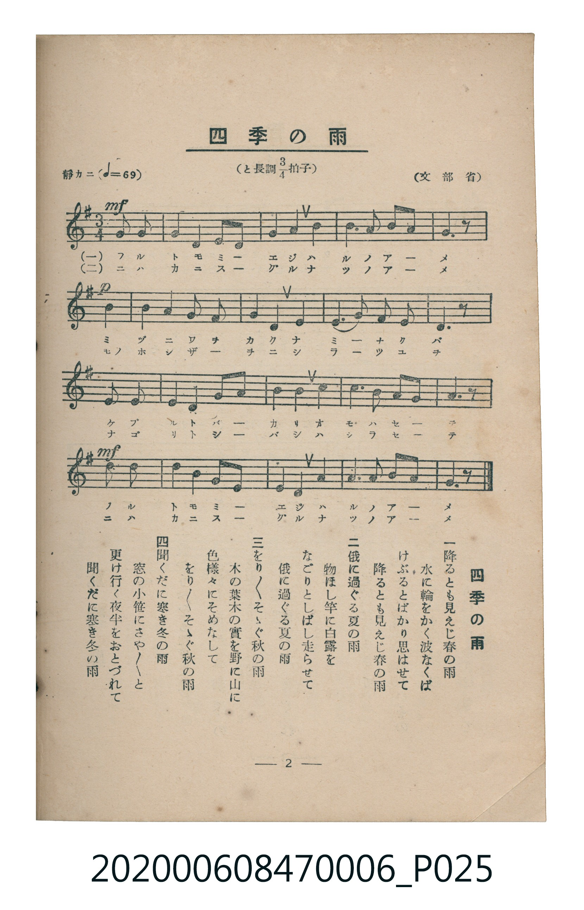

# 四季の雨

<audio controls src="shiki_no_ame.mp3"></audio>

- 文部省
- 臺灣教育會公認《新定兒童唱歌》尋常科第六學年用（2020.006.0847.0006）

## 說明

原書資訊與歌詞全文（對應 P025.jpg，書頁 p. 2，第一學期第 2 首）：
調性與拍號：と長調四分之三拍子（G 大調 3/4 拍，弱起 1 拍），「靜カニ」（♩=69）

## 歌詞

```text
一　降るとも見えじ春の雨
水に輪をかく波なくば
けぶるとばかり思はせて
降るとも見えじ春の雨

二　俄に過ぐる夏の雨
物ほし竿に白露を
なごりとしばし走らせて
俄に過ぐる夏の雨

三　をり／＼そゝぐ秋の雨
木の葉木の實を野に山に
色樣々にそめなして
をり／＼そゝぐ秋の雨

四　聞くだに寒き冬の雨
窓の小笹にさや／＼と
更け行く夜半をおとづれて
聞くだに寒き冬の雨
```

## ABC

```abc
X:1
T:四季の雨
M:3/4
L:1/16
Q:1/4=69
K:G
V:V1 name="Piano" snm="Pia"
[V:V1]
!mf! z4 z4 B2 B2 | A4 G4 E2 G2 | D4 B,4 D4 | G6 A2 B2 A2 |
!p! A6 z2 B2 B2 | A4 G4 E4 | A4 A4 A4 | F2 D2 G4 F4 |
D6 z2 D2 D2 | E6 E2 F2 G2 | A4 A4 G4 | E6 B2 A2 G2 |
!mf! A6 z2 B2 B2 | A4 G4 E2 G2 | D4 B,4 D4 | G6 A2 B2 A2 |
G6 z2 z4 |
```

## TMD 檔案連結

- [主旋律 TMD 檔案](shiki_no_ame.tmd) [[在 TMD Studio 編輯](https://tmdlang.github.io/Tmd-TS/#tmd=s7IKdvYPcrWy4qpTUCpJTLdSSM7PyUlNLsnMz7MqzsjMK0nNjM_KTMmPL87Iz05Ugisry88pzU21Si9KTEmNN4s3MjAyiDcwMIs3sDAxBzIMzBBKi_NLi5JTrYqTM_Lzc-JLUitKkvLzsxHyBUX5Zal5iXlANQVFIBtTwIoQClLLMlNSQdKpKZkl-UWZiTlI7kgtKga7FWxJfElRYl5xclFmAcgDCFUlGalAx5anJgIZRejCxamJxfl5xUpcWloKT2fPfrp28ePGdS9nr1DQ0uJStFUws-Syt1Vw57Ix1jexA2l9Nq39ZfOK53MawQa9aN_1vHHxs6kzXzRtejan-Wnrmhereh83dD2btuHpullPWyc9X7306ZSNz9b2PG7ofrqh--mOHc-XT3y-Zs3T1rVP1-54unPL8ykr3u_pAIWgHjDc9EAhCGQYmL3f06nExaWvpWBLLcCloKDwtG_-s9k7Xmxuf7Gi60VHO9BdL1bOe9q6AugroCuebuh91t6pEGBgZKqXVZD-fk8PUPHLBY0KBXoKRkAe0N1PdjQA3f1sznwgW8FI4eWyaUCHvt8zC2T4i1X7nzUsBxnb3fti5nyg6OPGFS-nbgeKg0K2o-3Jzu4nOzqBsk_XTgBa567wdMlyoKQCMGwVgKJAG57u2fhi63YFQwgXaDAw3Hpezp3zuGn14-buxw1AwY5HM1famlkCZblAlgId9Lih4eXM3sdN3UDrHjc1vVgGZHQ8bpzxbMZSSFyC1D3bsOVx4-oXe1Y9bpr0uBGoov_Z5kWPG1cBGY8bN4BUPG6c-LhxG9SYxg0gRU1dzxrmPm5c_7hx9uPGZSBFBCwCu2gX0NENT_a3AO172dj3uHECUMfTJUBrYG553rnycePux43Tn6_eD1T0fObel3M2Ad0FcQXQSVOANoNdMR3skOkvtm543NSJcAVOwyEh0gm0H-TNpq73e_rf79nzuHHu4yagPyY8Xw50MTxE5gAtWPdiYieE8XT9MqCel-1AM1c_3bgRSILjtHPTsxWLHze0AvlgYxrBDgS6C-wQAraAk9zs2UDnvGicBw7pBSDT1wNjoPdp2xqkEFk1GeSEDf3P1-wE2zT1cVMLzFiIa2cD42_ii4U9QGOeLpnztLcLHJGQYFr6uAkoDnYRAYsoz0ZQoKClz8UVnJGZnemX7wgsRwIyE_PyHWoMahSqQfYo2Fho2YEZ2LKwAiQnAX2joAFN8toKJgog_69v0IFnQE0sOoHWgkytUTBQ0AXj6ty0WgVjIKwB5kddYNbRVTCLB1I1CqbxQLYxiACzasByukBVxkAMUQ0yoroAqh8cXbjdu6sH7F4SnYnkJpATQFwYrlEwjwc5DSQNZIEEwA4FOQrIACJCTtrRSY6TwE4BuwhoKyigYA4COQQuDQokmCQ4mODhjN9RwPROYTgREXcQngE4AdRw1XJx6dopIBKjApCnzMUFAA)]
- [鋼琴伴奏 TMD 檔案](shiki_no_ame_piano.tmd) [[在 TMD Studio 編輯](https://tmdlang.github.io/Tmd-TS/#tmd=s7IKdvYPcrWy4tLSUng6e_bTtYsfN657OXvF-z0dL7v3PJ-w5cmeLU-X9j_v7Hi_p1NBS4tL0VbBzJLL3lbBncvGWN_EjqtOQenZtPaXzSuez2lUAvFetO963rj42dSZL5o2PZvT_LR1zYtVvY8bup5N2_B03aynrZOer176dMrGZ2t7Hjd0P93Q_XTHjufLJz5fs-Zp69qna3c83bnl-RSQ_UYGRgZ6BgZmegYWJuZAhoEZ0AlKXFzBGZnZmX75jrmpVgGZiXn5QR4ONQY1CtVcCkBgY6FlB2boaynYogMFoCVPdjS8WNijoBFgYGSql1WQrolFmZY-2IgaBQMFXTCuzk2rVTAGwhoFIyDXEIjN4oFUjYJpPJBtDCLArBqwnC5QlTEQQ1SDjKgugOrnwu-4XT3EOw7JJSCLQVwYrlEwjwc5CCQNZIEEwM4DOQXIACJCDtnRSbxDwA4AuwNoFyhQYM4AWQ-XBgUITBIcJPAwxe8UYKokK0yIiB0IzwAcxTVctZhJywclaZlAkxYoXUDdbwAyJV4h2jBWIdosPjcWbCeUbxoP4sJkgRgqBxIHpQegXqhxaCYYAblGQC4QI2lB4yJ0m4GEwFpRnADWA7YVSQGaK6BewO4MHB5B4YE0A8NN104BEXQKGDxlLi4A)]

## 分析

```text
================================================================================
📊 TMD Song Profile: [ 四季の雨 ]
================================================================================
⏱  Duration:       0:44 (44.3s), 17 measures total
🎼 Key & Tempo:    首調基準 G, != 69.0 BPM, <3/4>
   - 分析範圍：      由實際發聲的音符與和弦推測調性；播放脈絡另行呈現
🎤 人聲音域:    B3 (MIDI 59) – B4 (MIDI 71) [跨度: 12 個半音 / 1.0 個八度, 難度: easy]
   - 最低音:  B3 in [ShikiNoAme #1 @ m.3, 0:06]
   - 最高音: B4 in [ShikiNoAme #1 @ m.1, 0:01]
   - 適合: soprano, mezzo-soprano, contralto, tenor, baritone, bass
🏛  結構:      ShikiNoAme (44.3s)
⚡ 編曲密度:        Peak 1 軌道同時演奏
🗝  調性診斷：       D 大調（純淨自然大調，未偵測到可信轉調）
   - 風格氣質:    純淨自然大調（陽光明朗、易唱易記，無明顯調外色彩）
   - 轉調歷程:    全曲維持單一推測調性（未偵測到可信轉調）
   - 核心骨幹音:  A, G, D, B, E
   - 調性數值:    D 大調 [相關度: 0.75, 穩定度: Moderate, 自然音純度: 100.0%]
   - 候選調性 (K-S): D 大調 (0.75), G 大調 (0.71), A 大調 (0.55)
   - 五度圈歷程:   +2
   - 各段落調性細節:
     • [ShikiNoAme #1]: D 大調 (r: 0.75, 自然音純度: 100.0%)

  [ 五度圈游移軌跡 ]
               C  
         F            G  
      Bb              [D ]*
      Eb               A  
         Ab           E  
            Db       B  
               F# 
     (* = active key center)

  [ 十二半音累積音高分佈 ]
     C  :                            0.0%
     C# :                            0.0%
     D  : ████████████              15.2%
     D# :                            0.0%
     E  : ██████████                12.0%
     F  :                            0.0%
     F# : ████                       4.3%
     G  : ████████████████████      25.0%
     G# :                            0.0%
     A  : ████████████████████████  29.3%
     A# :                            0.0%
     B  : ████████████              14.1%
--------------------------------------------------------------------------------
Assignment 軌道音域：
  - Piano         : B3 – B4 (12 個半音 / 1.0 個八度, 55 個音符)
================================================================================
```


## 原書掃描頁




