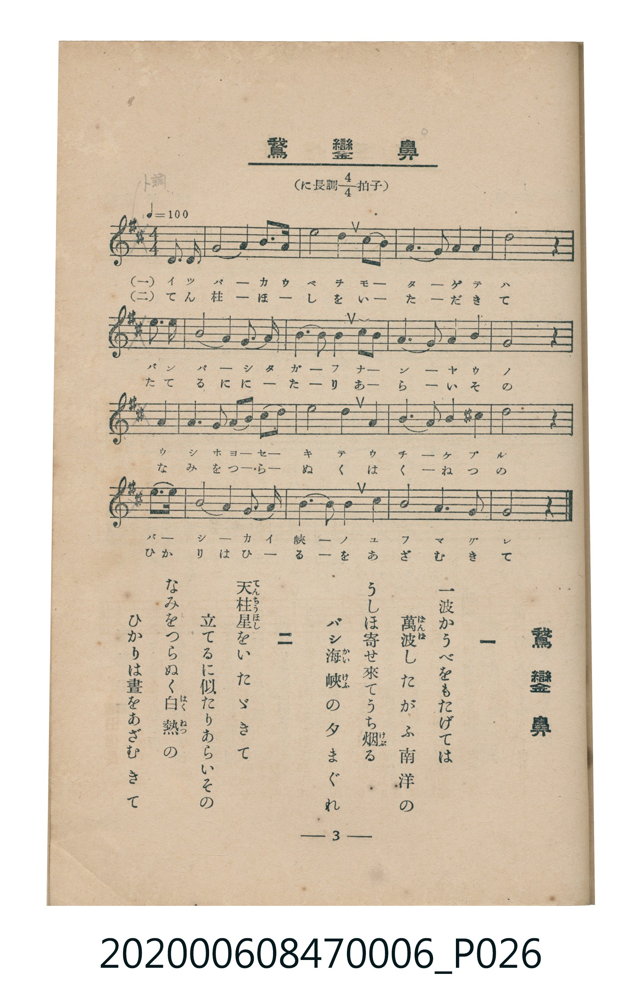

# 鵞鑾鼻

> Re:Shōka 使用 AI 協助辨識與重建樂譜，可能會有錯誤。歡迎[回報](https://github.com/TMDLang/reshoka/issues)。

- **鋼琴伴奏版**：<br><audio controls src="garanbi.mp3"></audio>
- **NEUTRINO 歌聲合成版**：<br><audio controls src="garanbi_neutrino.mp3"></audio>

- 臺灣教育會公認《新定兒童唱歌》尋常科第六學年用（2020.006.0847.0006）

## 說明

原書資訊與歌詞全文（對應 P026.jpg，書頁 p. 3，第一學期第 3 首）：
調性與拍號：原書標題誤植「に長調」與兩升記號，但旋律終止於第二線 G4，原書藏書者亦以鉛筆塗銷 C♯ 並批註「ト長調」；實為 G 大調 4/4 拍（弱起 1 拍），♩=100


## 歌詞

```text
一　一波かうべをもたげては
萬波（ばんぱ）したがふ南洋の
うしほ寄せ來てうち烟（けぶ）る
バシ海峽（かいけふ）の夕まぐれ

二　天柱星（てんちゅうぼし）をいたゞきて
立てるに似たりあらいその
なみをつらぬく白熱（はくねつ）の
ひかりは晝をあざむきて
```

## ABC

<div class="abc-score" data-abc-src="garanbi.abc" aria-label="五線譜載入中"></div>

[下載 ABC 原始檔](garanbi.abc)

## TMD 檔案連結

- [主旋律 TMD 檔案](garanbi.tmd) [[在 TMD Studio 編輯](https://tmdlang.github.io/Tmd-TS/#tmd=s7IKdvYPcrWy4qpTUCpJTLdSSM7PyUlNLsnMz7MqzsjMK0nNjM_KTMmPL87Iz05Ugisry88pzU21Si9KTEmNN4s3MjAyiDcwMIs3sDAxBzIMzBBKi_NLi5JTrYqTM_Lzc-JLUitKkvLzsxHyBUX5Zal5iXlANQVFIBtTwIoQClLLMlNSQdLFyYl58WWpRZlpmakpSG5JLSoGuxdsUXxJUWJecXJRZgHIEwhV-UUlGflA9xZkVFplZBaX5BdlJifmxGcn5iF5qyQjFeirvMSS0qJUdNGCnMRkJEGg_vTMPKuSxMxyoKvy09IykzMTc9C9HV-QmJ5qFWBgBAwQLS2Fl1vnvZy47-We3QpaWlyKtgqGBgZc9rYK7lw2JvomdiC9L9p3PW9c_GzqzBdNm57NaX7auubFqt7HDV3Ppm14um7W09ZJz1cvfTpl47O1PY8bup9u6H66Y8fz5ROfr1nztHXt07U7nu7c8nzKivd7OkAxogeMBz1QjAAZBmbv93QqcXHpaynYUgtwKSgoPO2b_2z2jheb21-s6HrR0Q5014uV8562rng2rR3oiqcbep-1dyqA_K-XVZD-fk8PUPHLBY0KBXoKxkAe0N1PdjQA3f1sznwgW8FY4eWyaUCHvt8zC2T4i1X7nzUsBxnb3fti5nygKMS6ZytmvlzY82LVkmdLgGHT87hx9cup24GKHzf0AhU_bV35tBfonhlgLT1P9rY9m979dF_3861Nz9YuejZtD8jWXT3Pt89ScDcBKoB6YXo_iGxofbJr2ZPdS192zn6-tu3pwukvu7YrOD-auV7hyY5lzzp3vlixG2Rjcwfcxvd7Zj9dv-x50y4Fd4WnS5YDBRWAkakAdDIoAPZsfLF1u4IhhAv0V8-jmSttQdEO8h_Q748bGoDks82LHjd2P25se9y483HTpMdNTY8b5z9unPS4cdnjxvXgoJiwBqgIaOLjxg2PmyY_btwINO5x43SwOmAIbH3aO_3ZFqAR60CqwSYB5XY_Xd_yuHH2k31ALtAkILnweTMwUICmTHzcuA1kRFM3WEPzhMdN259t3f50816wNNAkoE6goq1ge9Y9XTL1ceO-x41AZT0Qt-8CpsCGp0tWPpu_8dkMiJnLwC5b-LipFWzXHqAbwFYA_QE0bP7jpnmPG3uBykD6n68GWgHUACRXP9kDVAqU7nrc2PS4CWgdUPVcuFdWPW7cDzZjCVhuzePG_ucz9z5vA4YA0M71QO7jxrVAWYhDIXo2gXwAMm_9s5lzwZqBITrtcVMDwgGUp38oUNDS5-JyTwQWO0mZVgGZiXn5DjW6hjXVIEsUbAzNtOzALGw5TwGSAV4s7FHQgCYVbQUThacb-p-vb9CB5xtNLDqBloJMrVEwUNAFQ3TaNB5G1QDTH0QMBmF8YzBpBFRhiqbCBEmFERCjmmEGMhsmAKNroMYhINwpULIG7GQfwxoFiNt0MWhg1EPpJUDzgKkczURgtMJZbVB6J0hl0yR0lU1NcJXzwSRIBcjMZRhmrkcTqUHjI7tvA9T0yTDfGOHzDcQusGogD5ozMOzfDWdNh6qfBFYPCQtklSCfQFgLwGQvDj-hQ3w-gpgJMqMGnLNxp9RdPeCUSmIChaUKWDoBJx6EgCFQCSiFwSCIDeMTkfpgpmMmcljqg9uHSH7YEhYk6JEDpAcctFsxVK6CsYDRCiJB0QRSiRmx69BE8EUDTDciWQELR7jsaiwsqDubusC2w5I73PamTrhKkAuBRSrUneiuQof4XAnzO6GksqOTnKQCjyoQBBdg8LgGJQNQXOMuqhDxjKesUoerQU5zIIi7sEKkDUgYgLLr46YOOH82mOwFm4qteIHFLLAAgNsOrFsx1G2DseDxTrggQkkvjfuRzQMXiaCCFMYHpQdg_Qm1vx_DflgxiJADqVuLoQ5uIjwl4XPnJijdTSjNPJ09ewCKF4jz0RMDRgLCXbzAaFzpBeZ7GAtWwYHaVliz4-MmRIKBFT4gdfswDJ2AJgIqMnrQxNDrJOTipQtuEiLqIdGFSISwugijeGmcBlfZgOTKXgx16BkCd2JBuLGWi0vXTgHaqFIAMpW5AA)]
- [鋼琴伴奏 TMD 檔案](garanbi_piano.tmd) [[在 TMD Studio 編輯](https://tmdlang.github.io/Tmd-TS/#tmd=s7IKdvYPcrWy4qpTUCpJTLdSyC8qychPL0osyKi0ysgsLskvykxOzInPTsxLVIIrKs4vLUpOjS9ITE-1CjAwMlPi0tJSeLl13suJ-17u2f1-T8fL7j3PJ2x5smfL06X9zzs73u_pVNDS4lK0VTA0MOCyt1Vw57Ix0TexAxn4on3X88bFz6bOfNG06dmc5qeta16s6n3c0PVs2oan62Y9bZ30fPXSp1M2Plvb87ih--mG7qc7djxfPvH5mjVPW9c-Xbvj6c4tz6esAFppZGBkoGdgYKZnYGFiDmQYmAFtVeLick8sSsxLyrQKyEzMyw_ycKjRNayp5lIAAhtDMy07MEtfS8EWHSgArXiyo-HFwh4Fjad7Nr7Yul1BW8FE4emG_ufrG3QUQN7WyypI18SiU0sfbGqNgoGCLhii06bxMKpGwRAqBoMwvjGYNAKqMEVTYYKkwgiIUc0wA5kNE4DRNVDjEBDuFChZA3ayj2GNAsRtuhj048YWKL0EaN7jxo1oJj5u7Iaz2qD0TpDKpknoKpua4Crng0mQCpCZyzDMXI8mUoPGR3bfBqjpk2G-McLnG4hdYNVA3sLHTa0wdyPbvxvOmg5VPwmsHhIWyCpBPoGwFoDJXhx-Qof4fAQxE2RGDRf-lLqrB5xSSUygsFQBSyfgxIMQMAQqAaUwGASxYXwiUh_MdMxEDkt9cPsQyQ9bwoIEPXKA9ICDdiuGylUwFjBaQSQomkAqMSN2HZoIvmiA6UYkq8dNiMS-GgsL6s6mLrDtsOQOt72pE64S5MLHjXOh7kR3FTrE50qY3wkllR2d5CQVeFSBILgAg8c1KBmA4hp3UYWIZzxllTpcDXKaA0HchRUibUDCAJRdHzd1wPmzwWQv2FRsxQssZoEFANz2x40TMdRtg7Hg8U64IEJJL437kc0DF4mgghTGB6WHx41roPb3Y9gPKwYRciB1azHUwU2EpyR87twEpbsJpZmns2cPQPECcT56YsBIQLiLFxiNK73AfA9jwSq43sdN7aC0gS1HPm5CpBlY-QNStw_D3AloIqBSowdNDL1aQi5huuAmIWIfEmOIdAirjjBKmMZpcJUNSK7sxVCHnidwpxeEG2vRmlU-KM0qE2irCtT-gUBgDMUrRBvGwig43wRImcbDBMziczGVgPVDzYPrAtImYG2mICbIBDiDSKPgZoAZCI2oxqMYZYZqIykOA7sCLgRSjTAf7jBgqOraKUADNtoHKI7MNQJzlbkA)]

## 分析

```text
================================================================================
📊 TMD Song Profile: [ 鵞鑾鼻 ]
================================================================================
⏱  Duration:       0:38 (38.4s), 16 measures total
🎼 Key & Tempo:    首調基準 G, != 100.0 BPM, <4/4>
   - 分析範圍：      由實際發聲的音符與和弦推測調性；播放脈絡另行呈現
🎤 人聲音域:    D4 (MIDI 62) – D5 (MIDI 74) [跨度: 12 個半音 / 1.0 個八度, 難度: easy]
   - 最低音:  D4 in [Garanbi #1 @ m.1, 0:01]
   - 最高音: D5 in [Garanbi #1 @ m.3, 0:04]
   - 適合: soprano, mezzo-soprano, contralto, tenor, baritone, bass
🏛  結構:      Garanbi (38.4s)
⚡ 編曲密度:        Peak 1 軌道同時演奏
🗝  調性診斷：       G 大調（純淨自然大調，未偵測到可信轉調）
   - 風格氣質:    純淨自然大調（陽光明朗、易唱易記，無明顯調外色彩）
   - 轉調歷程:    全曲維持單一推測調性（未偵測到可信轉調）
   - 核心骨幹音:  G, A, B, E, D
   - 調性數值:    G 大調 [相關度: 0.86, 穩定度: High, 自然音純度: 98.3%]
   - 候選調性 (K-S): G 大調 (0.86), E 小調 (0.68), D 大調 (0.54)
   - 五度圈歷程:   +1
   - 各段落調性細節:
     • [Garanbi #1]: G 大調 (r: 0.85, 自然音純度: 98.3%, 調外音: G#)

  [ 五度圈游移軌跡 ]
               C  
         F           [G ]*
      Bb               D  
      Eb               A  
         Ab           E  
            Db       B  
               F# 
     (* = active key center)

  [ 十二半音累積音高分佈 ]
     C  : ██                         3.3%
     C# :                            0.0%
     D  : ████████                  12.5%
     D# :                            0.0%
     E  : █████████                 13.3%
     F  :                            0.0%
     F# :                            0.0%
     G  : ████████████████████████  35.8%
     G# : █                          1.7%
     A  : █████████████             19.6%
     A# :                            0.0%
     B  : █████████                 13.7%
--------------------------------------------------------------------------------
Assignment 軌道音域：
  - Piano         : D4 – D5 (12 個半音 / 1.0 個八度, 62 個音符)
================================================================================
```


## 原書掃描頁




