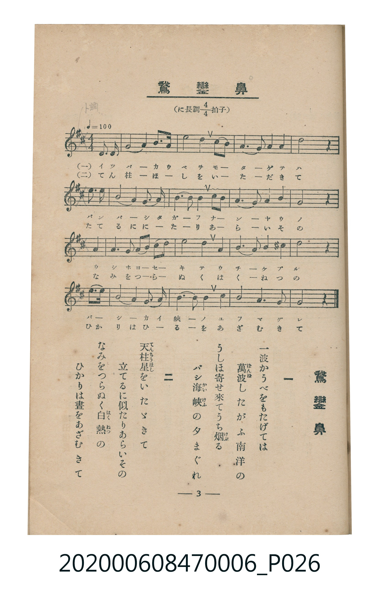

# 鵞鑾鼻

> Re:Shōka 使用 AI 協助辨識與重建樂譜，可能會有錯誤。歡迎回報。

<audio controls src="garanbi.mp3"></audio>

- 臺灣教育會公認《新定兒童唱歌》尋常科第六學年用（2020.006.0847.0006）

## 說明

原書資訊與歌詞全文（對應 P026.jpg，書頁 p. 3，第一學期第 3 首）：
調性與拍號：に長調四分之四拍子（D 大調 4/4 拍），♩=100


## 歌詞

```text
一　一波かうべをもたげては
萬波（ばんぱ）したがふ南洋の
うしほ寄せ來てうち烟（けぶ）る
バシ海峽（かいけふ）の夕まぐれ

二　天柱星（てんちゅうぼし）をいたゞきて
立てるに似たりあらいその
なみをつらぬく白熱（はくねつ）の
ひかりは晝をあざむきて
```

## ABC

```abc
X:1
T:鵞鑾鼻
M:4/4
L:1/16
Q:1/4=100
K:D
V:V1 name="Piano" snm="Pia"
[V:V1]
A3 A A8 B3 A | d8 B4 B3 A | F6 E2 F4 A4 | B12 z4 |
w: 1.~い つ ぱ か う | べ を も _ | た _ げ て | は
w: 2.~て ん ちゆう ほ _ | し を い _ | た _ だ き | て
d3 d B8 A2 F2 | E6 F2 E4 A3 A | F6 E2 F4 A4 | A12 z4 |
w: 1.~ば ん ぱ し た | が _ ふ な _ | ん _ や う | の
w: 2.~た て るに に _ | た _ り あ _ | ら _ い そ | の
F6 F2 F4 A3 F | A8 B4 d4 | e4 B6 d2 A3 ^G | A12 z4 |
w: 1.~う し ほ よ _ | せ き て | う ち _ け ぶ | る
w: 2.~な み を つ _ | ら ぬ く | は く _ ね つ | の
d3 e f8 A3 A | B6 d2 A4 F4 | A8 E6 F2 | D12 z4 |
w: 1.~ば _ し か い | けふ _ の ゆ | ふ ま ぐ | れ
w: 2.~ひ か りは ひ _ | る _ を あ | ざ む き | て
```

## TMD 檔案連結

- [主旋律 TMD 檔案](garanbi.tmd) [[在 TMD Studio 編輯](https://tmdlang.github.io/Tmd-TS/#tmd=s7IKdvYPcrWy4qpTUCpJTLdSSM7PyUlNLsnMz7MqzsjMK0nNjM_KTMmPL87Iz05Ugisry88pzU21Si9KTEmNN4s3MjAyiDcwMIs3sDAxBzIMzBBKi_NLi5JTrYqTM_Lzc-JLUitKkvLzsxHyBUX5Zal5iXlANQVFIBtTwIoQClLLMlNSQdKpKZkl-UWZiTlI7kgtKga7FWxJfElRYl5xclFmAcgDCFUlGalAx-YllpQWpaKLFuQkJiMJAs1Pz8yzKknMLE_Mi89PS8tMBluopaXwcuu8lxP3vdyzW0FLi0vRVsHQwIDL3lbBhcvGRN_EDmTCi_ZdzxsXP5s680XTpmdzmp-2rnmxqvdxQ9ezaRuerpv1tHXS89VLn07Z-Gxtz-OG7qcbup_u2PF8-cTna9Y8bV37dO2Opzu3PJ-y4v2eDlBw6gEDUQ8UnECGgdn7PZ1KXFz6Wgq21AJcCgoKT_vmP5u948Xm9hcrul50tAPd9WLlvKetK55Nawe64umG3mftnQoBBkZmelkF6e_39AAVv1zQqFCgp2AM5AHd_WRHA9Ddz-bMB7IVjBVeLpsGdOj7PbNAhr9Ytf9Zw3KQsd29L2bOB4o-blz9cup2oPjT2bOfdrQ92dkNZABln66dALTOReHpkuVASQVgaCoARcEm9TyaudIWFNAgE4G2PW5oAJLPNi963Nj9uLHtcePOx02THjc1PW6c_7hx0uPGZY8b14Mtn7AGqAho6uPGDY-bJj9u3Ag07nHjdLC6nseNW5_2Tn-2BWjEOpBqsElAud1P17c8bpz9ZB-QCzQJSC583gx0OdCUiY8bt4GMaOoGa2ie8Lhp-7Ot259u3guWBpoE1AlUtBVsz7qnS6Y-btz3uBGorAfi9l3AOG94umTls_kbn82AmLkM7LKFj5tawXbtAboBbAXQH0DD5j9umve4sReoDKT_-WqgFUANQHL1kz1ApUDprseNTY-bgNYBVc-Fe2XV48b9YDOWgOXWPG7sfz5z7_M2YAgA7VwP5D5uXAuUhTgUomcTyAcg89Y_mzkXrBkYotMeNzUgHEB5ioMCBS19Li73RGBOTcq0CshMzMt3qDGoqQbZoWBjaKZlB2ZhS-oKkBT3YmGPgoaJwtMN_c_XN-jA06cmFg1Aq6CGaQA1alopPG5a8ri5GRh_Ex837wHyVj9uWqZQA-TPBOJNQLwIJA4UaNoPUQASawOr6EcxbVcPyDRwFCoAoxSsuHE3VHPjdKDOSUC6BSYwH6JgARD3ggWWwUyrUTBV0AVCUyiNgGZQ8RoFwzisUshKjJFkjYAYxocZWgPXgw4NYCrAzvExBLmuBSwCTCRAvBFNPTCpQGlwuDTuRJcH-hzGaoLbDgwCDHPg6oChgVC3Hoc741HdaQQJRYg9k4FsYD4CZqI2DFt2I5k9HbdboX7G5dYFcFYvkjqYu3G7FX9i3tVDUWIGlkLNmxGJeTsw1YLT7howv3kqEHdBU2DzZogYMEahKb4PW3oGlo7LgCpApQyQtxo1-TZ1AZlNsAzSCUnSLUA8F6xoHSJJQxMskEJPdaD0CEqbNeBUCoMgERgflh2ISdPoWQYGsaXpDWARSFrBTNOglAGJd5DaHgz5rXDWKrjtILPQ1DXBUhEiJUKCBrs7saVpSNpDigd0p8BEsCZUYBzB1CFlvqZODFMQDp1LkkMJlM6dlJXOwPJ0OzBtzgbiFbCEBi5VHzethZXEwPT7uLkRIggseKeBU_NqbKkZVBVCS2JgsY-SbNcAcT-0vAFViWBBULWInpSREyGIjZoIjbEkQliSh5fawLQOYyJnB7A8RLOJOomJGbmYgyVeWEH3uKkDbjGwNYNmGqIAQy12YSYCC1IMHROh9DZwCEKKf0yILTHDMgtE_36w6xBF7hKE_VhS6Bo4qx_JnbDqASGK0LEWbi4V0jKwbUpx4QwplWEtDZCzgA1GSEHcB8SQghhUTM8DqtgA5q3BlpBB7TNQ3oak1k2wtNwNMRqUvpvAXp4G5DWAoxitjQFNi8B0aIzelkCUtzgSJyLNY6ZR9EIcaBOOUMddJMNSMGpcwhoZLWCvgFrWGEpgEQys-OEOxKZuHwpvAkRdE3oZD4PYkvEmuKOgkYBuBUQBxGD0_IGc4pEbRNMw1DWgmNkLVUe4kVHLxaVrpwBtUysAmcpcAA)]
- [鋼琴伴奏 TMD 檔案](garanbi_piano.tmd) [[在 TMD Studio 編輯](https://tmdlang.github.io/Tmd-TS/#tmd=s7IKdvYPcrWy4tLSUni5dd7Lifte7tn9fk_Hy-49zydsebJny9Ol_c87O97v6VTQ0uJStFUwNDDgsrdVcOGyMdE3seOqU1B60b7reePiZ1Nnvmja9GxO89PWNS9W9T5u6Ho2bcPTdbOetk56vnrp0ykbn63tedzQ_XRD99MdO54vn_h8zZqnrWufrt3xdOeW51NWAK00MjAy0DMwMNMzsDAxBzIMzIC2KnFxuScWJeYlZVoFZCbm5Qd5ONQY1FRzKQCBjaGZlh2Ypa-lYIsOFIA2PNnR8GJhj4KGicLTDf3P1zfoKAQYGJnpZRWka2LRoKUPNqxGwVRBFwhNoTQCmkHFaxQM47BKISsxRpI1AmIYH2ZoDVwPOjSAqQA7x8ewRuFxYwtY5HHjEiDeiKb-cWM3lG4Dmvq4cSe6fNMkOKsJbvvjxvkY5sDVNS5DUrcehzvjUd1pBFIL0fe4aTKQvfBxUxvITei27EYyezput0L9jMutC-CsXiR1MHfjdiv-BLOrh5wEA00OQAo9TkGxDYr5GnAagEGQCIwPS2zEpBj0BAmD2FLMBrAIJCYwUwwo3CGhClLbgyG_Fc5aBbcdZBaauiZYHCHiGWTeOhzuxJZiIDELirnHTd2PG1djOAUmgjUZNHXB1SEl7aZODFMQDp1LkkMJlC-d5CQX5IgGsVEj2hhLRMOSFbzcAaYnGBM5yYHlIZpN1ElMMMgZFZZAYFn1cVMH3OLHjbPRTENkQdSCA2YisCjA0DERSm8DxxekAMOE2BIMLEFC9O8Huw5RaCxB2I8lFayBs_qR3Akr4BCiCB1r4eZSIb08nT2bguIFGOPG6PUOovTAkQwQqQszNaAXSUCbcPgPdwEDSyuooQarkFrAoTYRUZ4glMCCElhJwB2ITd0-FN4EiLom9BILBrElmE1wRwGLC8zqDKYAYjB6SkROW8iV5zQMdQ0oZvZC1RGukGrRmjg-yE0cE2gLBxg18QrRhrEwqkbBBMgwiYVRmPJm8UCWWXxuLJhlAA0RTH2mIHWm8bEIBtwshBFoyhCmodsKZcBNNwIyjIAGGANpY1Rn4TcIagKcj8eZQApkDjAcde0UoEEZ7QOUQOYagbnKXAA)]

## 分析

```text
================================================================================
📊 TMD Song Profile: [ 鵞鑾鼻 ]
================================================================================
⏱  Duration:       0:38 (38.4s), 16 measures total
🎼 Key & Tempo:    首調基準 D, != 100.0 BPM, <4/4>
   - 分析範圍：      由實際發聲的音符與和弦推測調性；播放脈絡另行呈現
🎤 人聲音域:    D4 (MIDI 62) – F#5 (MIDI 78) [跨度: 16 個半音 / 1.3 個八度, 難度: moderate]
   - 最低音:  D4 in [Garanbi #1 @ m.16, 0:36]
   - 最高音: F#5 in [Garanbi #1 @ m.13, 0:29]
   - 適合: soprano, mezzo-soprano, tenor, baritone
🏛  結構:      Garanbi (38.4s)
⚡ 編曲密度:        Peak 1 軌道同時演奏
🗝  調性診斷：       A 大調（純淨自然大調，未偵測到可信轉調）
   - 風格氣質:    純淨自然大調（陽光明朗、易唱易記，無明顯調外色彩）
   - 轉調歷程:    全曲維持單一推測調性（未偵測到可信轉調）
   - 核心骨幹音:  A, F#, B, D, E
   - 調性數值:    A 大調 [相關度: 0.76, 穩定度: Moderate, 自然音純度: 100.0%]
   - 候選調性 (K-S): A 大調 (0.76), D 大調 (0.73), F# 小調 (0.71)
   - 五度圈歷程:   +3
   - 各段落調性細節:
     • [Garanbi #1]: A 大調 (r: 0.76, 自然音純度: 100.0%)

  [ 五度圈游移軌跡 ]
               C  
         F            G  
      Bb               D  
      Eb              [A ]*
         Ab           E  
            Db       B  
               F# 
     (* = active key center)

  [ 十二半音累積音高分佈 ]
     C  :                            0.0%
     C# :                            0.0%
     D  : ██████████                14.6%
     D# :                            0.0%
     E  : ███████                   10.4%
     F  :                            0.0%
     F# : ███████████████           21.2%
     G  :                            0.0%
     G# :                            0.4%
     A  : ████████████████████████  34.2%
     A# :                            0.0%
     B  : █████████████             19.2%
--------------------------------------------------------------------------------
Assignment 軌道音域：
  - Piano         : D4 – F#5 (16 個半音 / 1.3 個八度, 56 個音符)
================================================================================
```


## 原書掃描頁




