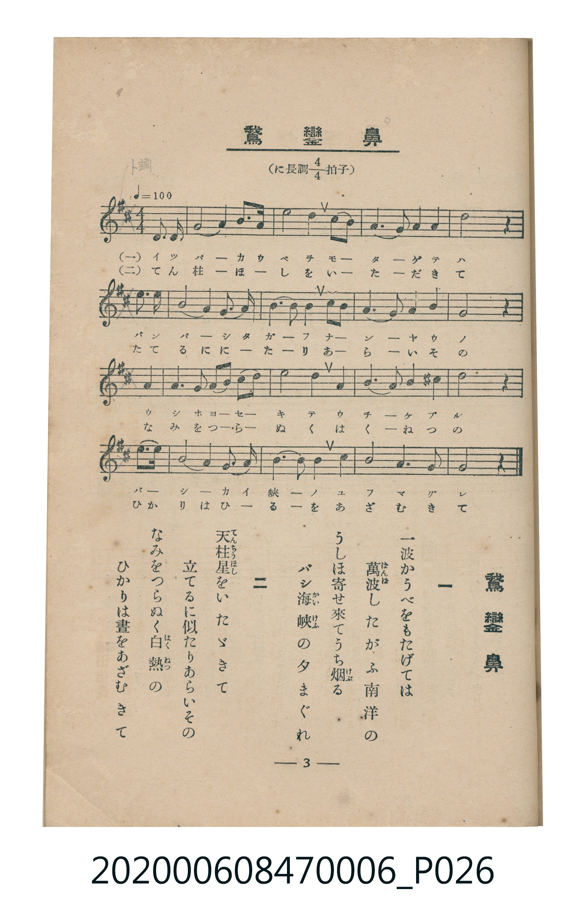

# 鵞鑾鼻

<audio controls src="garanbi.mp3"></audio>

- 臺灣教育會公認《新定兒童唱歌》尋常科第六學年用（2020.006.0847.0006）

## 說明

原書資訊與歌詞全文（對應 P026.jpg，書頁 p. 3，第一學期第 3 首）：
調性與拍號：に長調四分之四拍子（D 大調 4/4 拍），♩=100

## 歌詞

```text
一　一波かうべをもたげては
萬波（ばんぱ）したがふ南洋の
うしほ寄せ來てうち烟（けぶ）る
バシ海峽（かいけふ）の夕まぐれ

二　天柱星（てんちゅうぼし）をいたゞきて
立てるに似たりあらいその
なみをつらぬく白熱（はくねつ）の
ひかりは晝をあざむきて
```

## 原書掃描頁



## 分析

```text
================================================================================
📊 TMD Song Profile: [ 鵞鑾鼻 ]
================================================================================
⏱  Duration:       0:38 (38.4s), 16 measures total
🎼 Key & Tempo:    首調基準 D, != 100.0 BPM, <4/4>
   - 分析範圍：      由實際發聲的音符與和弦推測調性；播放脈絡另行呈現
🎤 人聲音域:    D4 (MIDI 62) – F#5 (MIDI 78) [跨度: 16 個半音 / 1.3 個八度, 難度: moderate]
   - 最低音:  D4 in [Garanbi #1 @ m.16, 0:36]
   - 最高音: F#5 in [Garanbi #1 @ m.13, 0:29]
   - 適合: soprano, mezzo-soprano, tenor, baritone
🏛  結構:      Garanbi (38.4s)
⚡ 編曲密度:        Peak 1 軌道同時演奏
🗝  調性診斷：       A 大調（純淨自然大調，未偵測到可信轉調）
   - 風格氣質:    純淨自然大調（陽光明朗、易唱易記，無明顯調外色彩）
   - 轉調歷程:    全曲維持單一推測調性（未偵測到可信轉調）
   - 核心骨幹音:  A, F#, B, D, E
   - 調性數值:    A 大調 [相關度: 0.76, 穩定度: Moderate, 自然音純度: 100.0%]
   - 候選調性 (K-S): A 大調 (0.76), D 大調 (0.73), F# 小調 (0.71)
   - 五度圈歷程:   +3
   - 各段落調性細節:
     • [Garanbi #1]: A 大調 (r: 0.76, 自然音純度: 100.0%)

  [ 五度圈游移軌跡 ]
               C  
         F            G  
      Bb               D  
      Eb              [A ]*
         Ab           E  
            Db       B  
               F# 
     (* = active key center)

  [ 十二半音累積音高分佈 ]
     C  :                            0.0%
     C# :                            0.0%
     D  : ██████████                14.6%
     D# :                            0.0%
     E  : ███████                   10.4%
     F  :                            0.0%
     F# : ███████████████           21.2%
     G  :                            0.0%
     G# :                            0.4%
     A  : ████████████████████████  34.2%
     A# :                            0.0%
     B  : █████████████             19.2%
--------------------------------------------------------------------------------
Assignment 軌道音域：
  - Piano         : D4 – F#5 (16 個半音 / 1.3 個八度, 56 個音符)
================================================================================
```

## ABC

```abc
X:1
T:鵞鑾鼻
C:TMD (Chen, Chih-Han / aguai)
M:4/4
L:1/16
Q:1/4=100
K:D

V:V1 name="Piano" snm="Pia"

[V:V1]
a3 a a8 b3 a | d8 b4 b3 a | f6 e2 f4 a4 | b12 z4 |
d3 d b8 a2 f2 | e6 f2 e4 a3 a | f6 e2 f4 a4 | a12 z4 |
f6 f2 f4 a3 f | a8 b4 d4 | e4 b6 d2 a3 ^g | a12 z4 |
d3 e f8 a3 a | b6 d2 a4 f4 | a8 e6 f2 | d12 z4 |
```

- [主旋律 TMD 檔案](garanbi.tmd)
- [鋼琴伴奏 TMD 檔案](garanbi_piano.tmd)
