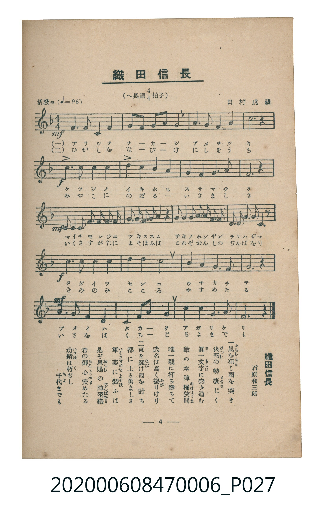

# 織田信長

<audio controls src="oda_nobunaga.mp3"></audio>

- 詞：石原和三郎
- 曲：田村虎藏
- 臺灣教育會公認《新定兒童唱歌》尋常科第六學年用（2020.006.0847.0006）

## 說明

原書資訊與歌詞全文（對應 P027.jpg，書頁 p. 4，第一學期第 4 首）：
調性與拍號：へ長調四分之四拍子（F 大調 4/4 拍），「活潑ニ」（♩=96）

## 歌詞

```text
一　嵐（あらし）を犯（をか）し雨を突き
決死（けつし）の勢凄（すさま）じく
眞一文字（まいちもんじ）に突き進む
敵の本陣桶狹間（をけはざま）
唯一戰に打ち勝ちて
武名は高く揚（あ）がりけり

二　東を靡（なび）け西を討ち
都に上る勇ましさ
軍姿（いくさすがた）に裝（よそほ）ふは
是ぞ恩賜（おんし）の陣羽織（ぢんばをり）
君の御心（みこゝろ）安めたる
功績（いさほ）は朽（く）ちじ千代（ちよ）までも
```

## 原書掃描頁



## 分析

```text
================================================================================
📊 TMD Song Profile: [ 織田信長 ]
================================================================================
⏱  Duration:       0:50 (50.0s), 20 measures total
🎼 Key & Tempo:    首調基準 F, != 96.0 BPM, <4/4>
   - 分析範圍：      由實際發聲的音符與和弦推測調性；播放脈絡另行呈現
🎤 人聲音域:    C4 (MIDI 60) – D5 (MIDI 74) [跨度: 14 個半音 / 1.2 個八度, 難度: moderate]
   - 最低音:  C4 in [OdaNobunaga #1 @ m.1, 0:01]
   - 最高音: D5 in [OdaNobunaga #1 @ m.5, 0:10]
   - 適合: soprano, mezzo-soprano, contralto, tenor, baritone, bass
🏛  結構:      OdaNobunaga (50.0s)
⚡ 編曲密度:        Peak 1 軌道同時演奏
🗝  調性診斷：       C 大調（純淨自然大調，未偵測到可信轉調）
   - 風格氣質:    純淨自然大調（陽光明朗、易唱易記，無明顯調外色彩）
   - 轉調歷程:    全曲維持單一推測調性（未偵測到可信轉調）
   - 核心骨幹音:  G, F, A, C, D
   - 調性數值:    C 大調 [相關度: 0.76, 穩定度: Moderate, 自然音純度: 100.0%]
   - 候選調性 (K-S): C 大調 (0.76), F 大調 (0.73), A 小調 (0.59)
   - 五度圈歷程:   +0
   - 各段落調性細節:
     • [OdaNobunaga #1]: C 大調 (r: 0.76, 自然音純度: 100.0%)

  [ 五度圈游移軌跡 ]
              [C ]*
         F            G  
      Bb               D  
      Eb               A  
         Ab           E  
            Db       B  
               F# 
     (* = active key center)

  [ 十二半音累積音高分佈 ]
     C  : ████████████████          17.9%
     C# :                            0.0%
     D  : ██████████                10.6%
     D# :                            0.0%
     E  : ██                         2.6%
     F  : ███████████████████       21.2%
     F# :                            0.0%
     G  : ████████████████████████  26.5%
     G# :                            0.0%
     A  : ███████████████████       21.2%
     A# :                            0.0%
     B  :                            0.0%
--------------------------------------------------------------------------------
Assignment 軌道音域：
  - Piano         : C4 – D5 (14 個半音 / 1.2 個八度, 76 個音符)
================================================================================
```

## ABC

```abc
X:1
T:織田信長
C:曲：田村虎藏
M:4/4
L:1/16
Q:1/4=96
K:F

V:V1 name="Piano" snm="Pia"

[V:V1]
!mf! f6 f2 c4 d4 | f2 g2 a2 g2 g8 | a6 a2 g4 a4 | c12 z4 |
!f! d8 c4 a2 c2 | g8 a4 g2 e2 | f6 g2 a4 g4 | f12 z4 |
!mf! g2 g2 g4 g2 a2 g2 e2 | f2 g2 a4 a4 c4 | d2 d2 d4 c2 a2 c2 a2 | g2 g2 g4 a4 g2 z2 |
!f! c6 c2 d4 c4 | a4 f4 g8 | a6 c2 g4 e4 | f12 z4 |
!mf! a6 a2 g4 f4 | d6 f2 a4 g4 | c6 d2 c4 g4 | f12 z4 |
```

- [主旋律 TMD 檔案](oda_nobunaga.tmd)
- [鋼琴伴奏 TMD 檔案](oda_nobunaga_piano.tmd)
