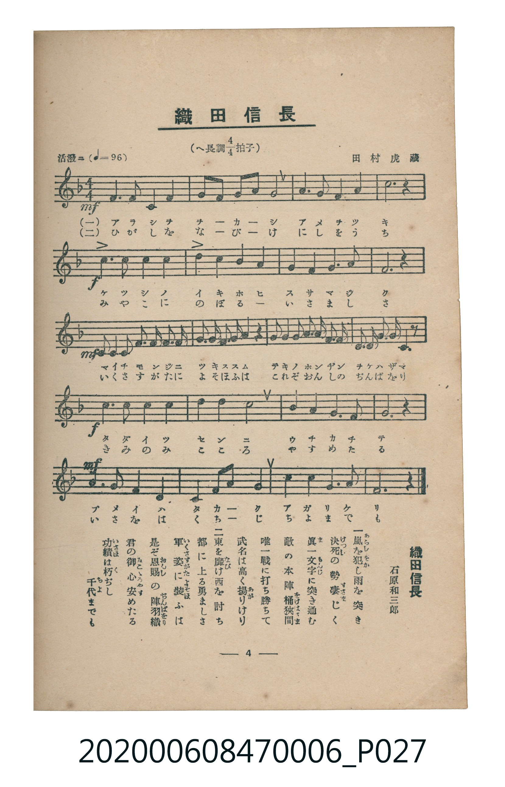

# 織田信長

> Re:Shōka 使用 AI 協助辨識與重建樂譜，可能會有錯誤。歡迎回報。

- **鋼琴伴奏版**：<br><audio controls src="oda_nobunaga.mp3"></audio>
- **NEUTRINO 歌聲合成版**：<br><audio controls src="oda_nobunaga_neutrino.mp3"></audio>

- 詞：石原和三郎
- 曲：田村虎藏
- 臺灣教育會公認《新定兒童唱歌》尋常科第六學年用（2020.006.0847.0006）

## 說明

原書資訊與歌詞全文（對應 P027.jpg，書頁 p. 4，第一學期第 4 首）：
調性與拍號：へ長調四分之四拍子（F 大調 4/4 拍），「活潑ニ」（♩=96）


## 歌詞

```text
一　嵐（あらし）を犯（をか）し雨を突き
決死（けつし）の勢凄（すさま）じく
眞一文字（まいちもんじ）に突き進む
敵の本陣桶狹間（をけはざま）
唯一戰に打ち勝ちて
武名は高く揚（あ）がりけり

二　東を靡（なび）け西を討ち
都に上る勇ましさ
軍姿（いくさすがた）に裝（よそほ）ふは
是ぞ恩賜（おんし）の陣羽織（ぢんばをり）
君の御心（みこゝろ）安めたる
功績（いさほ）は朽（く）ちじ千代（ちよ）までも
```

## ABC

<div class="abc-score" data-abc-src="oda_nobunaga.abc" aria-label="五線譜載入中"></div>

[下載 ABC 原始檔](oda_nobunaga.abc)

## TMD 檔案連結

- [主旋律 TMD 檔案](oda_nobunaga.tmd) [[在 TMD Studio 編輯](https://tmdlang.github.io/Tmd-TS/#tmd=s7IKdvYPcrWy4qpTUCpJTLdSSM7PyUlNLsnMz7MqzsjMK0nNjM_KTMmPL87Iz05Ugisry88pzU21Si9KTEmNN4s3MjAyiDcwMIs3sDAxBzIMzBBKi_NLi5JTrYqTM_Lzc-JLUitKkvLzsxHyBUX5Zal5iXlANQVFIBtTwIoQClLLMlNSQdLFyYl58WWpRZlpmakpSG5JLSoGuxdsUXxJUWJecXJRZgHIEwhV-UUlGflA9xZkVFplZBaX5BdlJifmxGcn5iF5qyQjFegriHQlst7M9Mw8q9zUzKxMLD6AWlyQmJ5qFWBgZK7EpaWl8HznlOdTNjzZv_Dl1O0KWlpcirYKlmZc9rYKblw2JvomdiDdL1bOe79n1vP5m5_2zX86qefJjs6XzX1gc5_N3gSSmbLh2dyJL2b2vZjeDxZ-0b7reePiZ1Nnvmja9GxO89PWNS9W9T5u6Ho2bcPTdbOetk56vnrp0ykbn63tedzQ_XRD99MdO54vn_h8zZqnrWufrt3xdOeW51NWvN_TAYovPWAs6YHiC8gwMHu_p1OJi0tfS8GWWoBLQUEB6K9ns3e82Nz-YkXXi452oLuAXn7auuLZtHagK55u6H3W3qkACjK9rIL093t6gIpfLmhUKNBTMAHygO5-sqMB6O5nc-YD2QomCi-XTQM6FBgyIMNfrNr_rGE5yNju3hcz5wNFHzfuAIY2UPzp7NlPO9qe7OwGMoCyT9dOAFrnpvB0yXKgpAIw-BWAomCTgAHV82zL7md7Jz5u7n7cABTseDRzpa0lKEC4QLYAXfC4oeHpVpAJjxubHjd1Pm6cDpR83DTpedd6kGDTpMeN3SCRxukvZ68Aia9qfNzYC9L8bOOuZ2t3g3VOfNy4BKqzcd3T7kVP21vA4jMfN0593LgPLD7jcWM_SNvzOfOA1gID6elaoAagon2PG1seNy583AS0fzJQHVj1aog9Lxs2PW5qANs2dSvQ7Gdz1rycufjZwm3Pu3e-nDYZ5kKg_esfN06DWAWOmynrQZZ0bACa9KwTaOrCp91zQZY0LgMbtnbZ0wm9QE0vV4Oc9ax_FiQAwFb3PG7qAhnZ1AUJo13AYGx4Nncj0KaXcxeCFa563LgZrHbii6X7geIvVvQBDQepftm8F2jlkx1dj5u6n3a3g303HRgK4Djd3ft0-X6wAUAP94PDBhhCPY8bgfEL8vOLxXPBPgIqADoWGLRAQaCv14OdPAPow3nPGle-2DwHbATQBqC_oGEODJTn-_YCsyVYahFYagMoaJq6YCEyYTYobvYtfLq_Gaxo_-PGyY-b5j5uAqWVp-uAcQ4M8PlAZ4NVd81_vgMYmBCnAt0Jccz6Z3P2ggX7wVxgcM542tv8ZPdisCAwCjvA4kA_LwdGJ8ggyrMaFCho6XNx-ack-uUnleYlpidaBWQm5uU71BjUVIPsUbAxNNOyA7Ow5XMFSHZ7sbBHQcNE4emG_ufrG3TgmVMTiwagdSDDahSqc9NqFQwVdOEQxDaNR-KAYI2CEZQHoo2hNDKsAYvCIEw1CMLEaxRM0fTAoAFMBdhNPoY1CsDEiiQPzLggsnE6nD8JbiaEDczFKCrQIaaJjSjmADM4kspeHKbAQgXqTiOQ2k3Ipjb24HZn4yq4qs1w1kQs7lyNYiLILGR3tiGpXEjQnfhTzK4eslIMMMEgxySIDePD6BoFMzQREyiNSA2wFARLJ8gpCqSqBiVZIkNs6QU5JCGxiRQPjevgtgJzPFy0F87aDWfB4hOkciZcdCqctQ_FnhlQlf04XIotxexHNqEJ5BpgUQU3ERb7IJUwVz9u3ANXD0rnyBDVR7jcCQoJkEqYPG53EihjOskuY8BlCoIAQUj8GsJpWJowQilpQBAe42BRGAZBiApjJDPMIMYDKZhpcAthRiEnHFBAQYIQkaGApTuUngyNZEjUgNRDCgpQ4oEkECjZ1IAelECZZVCVyEkQltggZi-Cs2FFGaRYAFZGUPY0tMgEmY-cnCAuByVA5OiHJF1QgQSs9ZDd39QB5c2FugRYB4NJiH2o7gcly8dNkEJtHtzsLiT3Q7IYyHcg9QjfAOtnKHsSEEN0ILsfbzIDtvxoXzChF1AwWINRVCEXTKBkhii60CG2ggkS-rCwWwAmERkWudqZDRMFhh9MHrkygKmDVQFI6RVc_SFsAYnD0h82iK1Y6kUxAVRIIadZWKEFSxUQUTirCVk3VB24aIOogxek4GoXYQsobEAq0Qs1THcSqMimkF0s4Wq1QEsRcLMFubzC3vZBT2aU1WXbkOShLRWkJAPLqMiJC5EAMOsi5LYPpIUCMRc5U0LqT1BUIIsiQ2xJBuYmiAmgwge5JkV2J8xNyEkWUqyiuhNRAEOKKcyabDnUncitOezurOXi0rVTQGpTKwC5ylwA)]
- [鋼琴伴奏 TMD 檔案](oda_nobunaga_piano.tmd) [[在 TMD Studio 編輯](https://tmdlang.github.io/Tmd-TS/#tmd=s7IKdvYPcrWy4qpTUCpJTLdSyC8qychPL0osyKi0ysgsLskvykxOzInPTsxLVIIrKs4vLUpOjS9ITE-1CjAwMlfi0tJSeL5zyvMpG57sX_hy6vb3ezpedu95PmHLkz1bni7tf97Z8X5Pp4KWFpeirYKlGZe9rYIbl42JvokdyMgXK-e93zPr-fzNT_vmP53U82RH58vmPrBlz2ZvAslM2fBs7sQXM_teTO8HC79o3_W8cfGzqTNfNG16Nqf5aeuaF6t6Hzd0PZu24em6WU9bJz1fvfTplI3P1vY8buh-uqH76Y4dz5dPfL5mzdPWtU_X7ni6c8vzKSuATjQyMDLQMzAw0zOwMDEHMgzMgK5U4uLyT0n0y08qzUtMT7QKyEzMyw_ycKgxqKnmUgACG0MzLTswS19LwRYdKABtebKj4cXCHgUNE4WnG_qfr2_QUQCFkV5WQbomFg1a-mDDahSqc9NqFQwVdOEQxDaNR-KAYI2CEZQHoo2hNDKsAYvCIEw1CMLEaxRM0fTAoAFMBdhNPoY1Co8bm5DkHzd1gsjG6XD-JLiZEPbjxm4UFegQ08RGFHMeNy5BUtmLwxRYqEDdaQRSuwnZ1MYe3O5sXAVXtRnOmojFnatRTASZhezONiSVCwm6E3-K2dVDVooBJhjkmASxYXwYXaNghiZiAqURqQGWgmDpBDlFgVTVoCRLZIgtvSCHJCQ2keKhcR3c1seNLXDRXjhrN5wFi0-Qyplw0alw1j4Ue2ZAVfbjcCm2FLMf2YQmkGseN06GmwiLfZBKmKsfN-6Bqwelc2SI6iNc7gSFBEglTB63OwmUMZ1klzHgMgVBgCAkfg3hNCxNGKGUNCAIj3GwKAyDIESFMZIZZhDjgRTMNLiFMKOQEw4ooCBBiMhQj5sghcXjpsnQSIZEDUg9pKAAJR5IAoGSTQ3oQQmUWQZViZwEYYkNxWwgG1aUQYqFx43roexpaJEJMh85OUFcDkqAyNEPSbqgAulx43xk9zd1QHlzoS553LgVTELsQ3U_KFk-boIUavPgZnchuR-SxUC-A6lH-OZx4wYoexIQQ3Qgux9vMns6ezbtCyb0AgoGazCKKuSCCZTMEEUXOsRWMEFCHxZ2C8AkIsMiVzuzYaLA8IPJI1cGMHWwKgApvYKrP4QtIHFY-sMGsRVLvSgmgAop5DQLK7RgqQIiCmc1IeuGqgMXbRB18IIUXO0ibAGFDUgleqGG6U4CFdkUsoslXK0WaCkCbrYgl1fY2z7oyYyyumwbkjy0pYKUZGAZFTlxIRIAZl2E3PaBtFAg5iJnSkj9CYoKZFFkiC3JwNwEMQFU-CDXpMjuhLkJOclCCgtUdyIKYEgxhVmTLYe6E7k1h92dtVia1D7ITWoTaIsa1giOV4g2jIVRoGgHskzjYxEMYCziU2MADRxISYSu1ATCAOtA6IWJoBuPZBZet0GUovAhKoxQFBBwlwm60ZgOxeJJNIeZIHsB01M4vQmMJ107BaSoivYBSqILGYGFlLkA)]

## 分析

```text
================================================================================
📊 TMD Song Profile: [ 織田信長 ]
================================================================================
⏱  Duration:       0:50 (50.0s), 20 measures total
🎼 Key & Tempo:    首調基準 F, != 96.0 BPM, <4/4>
   - 分析範圍：      由實際發聲的音符與和弦推測調性；播放脈絡另行呈現
🎤 人聲音域:    C4 (MIDI 60) – D5 (MIDI 74) [跨度: 14 個半音 / 1.2 個八度, 難度: moderate]
   - 最低音:  C4 in [OdaNobunaga #1 @ m.1, 0:01]
   - 最高音: D5 in [OdaNobunaga #1 @ m.6, 0:12]
   - 適合: soprano, mezzo-soprano, contralto, tenor, baritone, bass
🏛  結構:      OdaNobunaga (50.0s)
⚡ 編曲密度:        Peak 1 軌道同時演奏
🗝  調性診斷：       C 大調（純淨自然大調，未偵測到可信轉調）
   - 風格氣質:    純淨自然大調（陽光明朗、易唱易記，無明顯調外色彩）
   - 轉調歷程:    全曲維持單一推測調性（未偵測到可信轉調）
   - 核心骨幹音:  C, G, F, A, D
   - 調性數值:    C 大調 [相關度: 0.85, 穩定度: Moderate, 自然音純度: 97.3%]
   - 候選調性 (K-S): C 大調 (0.85), F 大調 (0.79), C 小調 (0.55)
   - 五度圈歷程:   +0
   - 各段落調性細節:
     • [OdaNobunaga #1]: C 大調 (r: 0.85, 自然音純度: 97.3%, 調外音: A#)

  [ 五度圈游移軌跡 ]
              [C ]*
         F            G  
      Bb               D  
      Eb               A  
         Ab           E  
            Db       B  
               F# 
     (* = active key center)

  [ 十二半音累積音高分佈 ]
     C  : ████████████████████████  28.9%
     C# :                            0.0%
     D  : ██████                     6.7%
     D# :                            0.0%
     E  :                            0.0%
     F  : ███████████████████       22.8%
     F# :                            0.0%
     G  : █████████████████████     25.5%
     G# :                            0.0%
     A  : ███████████               13.4%
     A# : ██                         2.7%
     B  :                            0.0%
--------------------------------------------------------------------------------
Assignment 軌道音域：
  - Piano         : C4 – D5 (14 個半音 / 1.2 個八度, 76 個音符)
================================================================================
```


## 原書掃描頁




