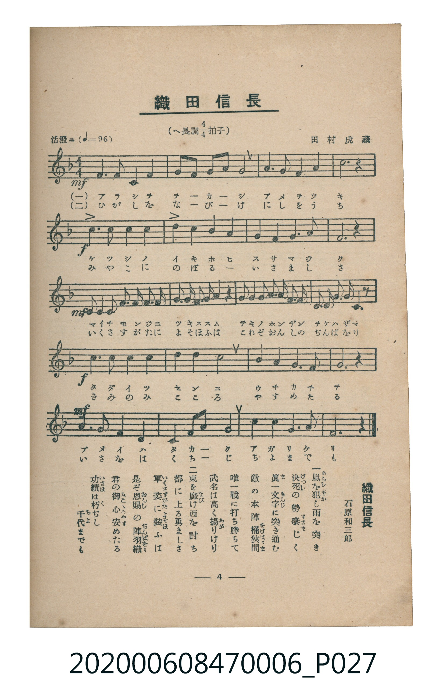

# 織田信長

> Re:Shōka 使用 AI 協助辨識與重建樂譜，可能會有錯誤。歡迎回報。

<audio controls src="oda_nobunaga.mp3"></audio>

- 詞：石原和三郎
- 曲：田村虎藏
- 臺灣教育會公認《新定兒童唱歌》尋常科第六學年用（2020.006.0847.0006）

## 說明

原書資訊與歌詞全文（對應 P027.jpg，書頁 p. 4，第一學期第 4 首）：
調性與拍號：へ長調四分之四拍子（F 大調 4/4 拍），「活潑ニ」（♩=96）


## 歌詞

```text
一　嵐（あらし）を犯（をか）し雨を突き
決死（けつし）の勢凄（すさま）じく
眞一文字（まいちもんじ）に突き進む
敵の本陣桶狹間（をけはざま）
唯一戰に打ち勝ちて
武名は高く揚（あ）がりけり

二　東を靡（なび）け西を討ち
都に上る勇ましさ
軍姿（いくさすがた）に裝（よそほ）ふは
是ぞ恩賜（おんし）の陣羽織（ぢんばをり）
君の御心（みこゝろ）安めたる
功績（いさほ）は朽（く）ちじ千代（ちよ）までも
```

## ABC

```abc
X:1
T:織田信長
C:曲：田村虎藏
M:4/4
L:1/16
Q:1/4=96
K:F
V:V1 name="Piano" snm="Pia"
[V:V1]
!mf! F6 F2 C4 D4 | F2 G2 A2 G2 G8 | A6 A2 G4 A4 | c12 z4 |
w: 1.~あ ら し を | を _ か _ し | あ め を つ | き
w: 2.~ひ が し を | な _ び _ け | に し を う | ち
!f! d8 c4 A2 c2 | G8 A4 G2 E2 | F6 G2 A4 G4 | F12 z4 |
w: 1.~け つ し の | い き ほ ひ | す さ ま じ | く
w: 2.~み や こ に | の ぼ る _ | い さ ま し | さ
!mf! G2 G2 G4 G2 A2 G2 E2 | F2 G2 A4 A4 c4 | d2 d2 d4 c2 A2 c2 A2 | G2 G2 G4 A4 G2 z2 |
w: 1.~ま い ち も ん じ に | つ き す す む | て き の ほ ん ぢ ん | を け は ざ ま
w: 2.~い く さ す が た に | よ そ ほ ふ は | こ れ ぞ お ん し の | ぢ ん ば を り
!f! c6 c2 d4 c4 | A4 F4 G8 | A6 c2 G4 E4 | F12 z4 |
w: 1.~た だ い つ | せ ん に | う ち か ち | て
w: 2.~き み の み | こ こ ろ | や す め た | る
!mf! A6 A2 G4 F4 | D6 F2 A4 G4 | c6 d2 c4 G4 | F12 z4 |
w: 1.~ぶ め い は | た か _ く | あ が り け | り
w: 2.~い さ ほ は | く ち _ じ | ち よ ま で | も
```

## TMD 檔案連結

- [主旋律 TMD 檔案](oda_nobunaga.tmd) [[在 TMD Studio 編輯](https://tmdlang.github.io/Tmd-TS/#tmd=s7IKdvYPcrWy4qpTUCpJTLdSSM7PyUlNLsnMz7MqzsjMK0nNjM_KTMmPL87Iz05Ugisry88pzU21Si9KTEmNN4s3MjAyiDcwMIs3sDAxBzIMzBBKi_NLi5JTrYqTM_Lzc-JLUitKkvLzsxHyBUX5Zal5iXlANQVFIBtTwIoQClLLMlNSQdKpKZkl-UWZiTlI7kgtKga7FWxJfElRYl5xclFmAcgDCFUlGalAx2ZkFgO1VypxaWkpPN855fmUDU_2L3w5dbuClhaXoq2CpRmXva2CG5eNib6JHUjri5Xz3u-Z9Xz-5qd9859O6nmyo_Nlcx_Y0GezN4Fkpmx4Nnfii5l9L6b3g4VftO963rj42dSZL5o2PZvT_LR1zYtVvY8bup5N2_B03aynrZOer176dMrGZ2t7Hjd0P93Q_XTHjufLJz5fs-Zp69qna3c83bnl-ZQV7_d0gEJTDxiGeqDQBDIMzN7v6VTi4tLXUrClFuBSUFAA-uvZ7B0vNre_WNH1oqMd6C6gl5-2rng2rR3oiqcbep-1dyoEGBiZ62UVpL_f0wNU_HJBo0KBnoIJkAd095MdDUB3P5szH8hWMFF4uWwa0KHAkAEZ_mLV_mcNy0HGdve-mDkfKPq4cQcwtIHiT2fPftrR9mRnN5ABlH26dgLQOjeFp0uWAyUVgMGvABQFmwQMqJ5nW3Y_2zvxcXP34wagYMejmSttLUEBwgWyBeiCxw0NT7eCTHjc2PS4qfNx43Sg5OOmSc-71oMEmyY9buwGiTROfzl7BUh8VePjxl6Q5mcbdz1buxusc-LjxiVQnY3rnnYvetreAhaf-bhx6uPGfWDxGY8b-0Hans-ZB7QWGEhP1wI1ABXte9zY8rhx4eMmoP2TgerAqldD7HnZsOlxUwPYtqlbgWY_m7Pm5czFzxZue9698-W0yTAXAu1f_7hxGsQqcNxMWQ-ypGMD0KRnnUBTFz7tnguypHEZ2LC1y55O6AVqerka5Kxn_bMgAQC2uudxUxfIyKYuSBjtAgZjw7O5G4E2vZy7EKxw1ePGzWC1E18s3Q8Uf7GiD2g4SPXL5r1AK5_s6Hrc1P20ux3su-nAUADH6e7ep8v3gw0AergfHDbAEOp53AiMX5CfXyyeC_YRUAHQscCgBQoCfb0e7OQZQB_Oe9a48sXmOWAjgDYA_QUNc2CgPN-3F5gtwVKLwFIbQEHT1AULkQmzQXGzb-HT_c1gRfsfN05-3DT3cRMorTxdB4xzYIDPBzobrLpr_vMdwMCEOBXoTohj1j-bsxcs2A_mAoNzxtPe5ie7F4MFgVHYARYH-nk5MDpBBlGe1aBAQUufi8s_JdEvP6k0LzE90SogMzEv36HGoKYaZI-CjYWWHZiBLZsrQHLbi4U9ChomCk839D9f36ADz5uaWDQAbQMZVqNQnZtWq2CooAuEhgqm8UDKDETUAHlGCsZAbASWA4kYg2mQGIgEiZhC5UDQACQCNtTHsEYBmNjAosAsB2RPB7MmgfVAaGCuA5MgGYjpCB2NcDVLoDK9SPaAXQexxwgktwmiq7EH3Z7GVWDxzWByIpI9q6E6psPtaYPKLMSwB3-Q7-ohK8iBIW4GtQUUgsZAsgYezqCQNVIwjwdHAUgAFA0gEhIpuAMc5kVIsIG917gO7K0WuAwoIIGJHRxsIJmZUPGpQLwPzJoBDYp-PEG-H2ZeE8hkYD4DBypIZh3cpj1geVAkI1yAbA8oqkAyU0kM8h2dZKdyUFoGBSMkXUNDGBK6IAyKihpgxIAgiAeKFmNwxEC0QWLBACXM94H9Bkk4wBIBiEFhMQMeHkvAYQ4JZyjZ1AD1-TKoHCjMwHEC1rsITEOyCShOgYUSWH4amNwHDCPkmADZ3Q8NRZD5kGwwH2Z_UweQNRdsOkh-K5gEmQfSC7StCaR6Hli0C2o_ItVAXAIsZ8GuBmeUpi6w_XhjCFhrk5spIMWJKTT8YUUOKM2jF0KmYBFgFBLKFPOhCW8BNBEiypTZYA9NBotBSgSIOKgsAIktBGJIGQWKXEiE4c4SkBIKlDVgEQrKJJBghmQRkG2wcgwUNbAsAYw0YIkHYoHcCpIB2UpSKTSF7CyBXKSDghGY_kE2gjiIQgcSLWZgmnAxtA3iL1ApDg1xWIKDxQXEf5AiBqncByVdYAKDldagkADxcIU4cpECSd4weyBFF6w0RxRpUD44U0AKoeVQeyAuQLanlotL104BqT5WAHKVuQA)]
- [鋼琴伴奏 TMD 檔案](oda_nobunaga_piano.tmd) [[在 TMD Studio 編輯](https://tmdlang.github.io/Tmd-TS/#tmd=s7IKdvYPcrWy4tLSUni-c8rzKRue7F_4cur293s6XnbveT5hy5M9W54u7X_e2fF-T6eClhaXoq2CpRmXva2CG5eNib6JHVedgtKLlfPe75n1fP7mp33zn07qebKj82VznxJI5tnsTSCZKRuezZ34Ymbfi-n9YOEX7bueNy5-NnXmi6ZNz-Y0P21d82JV7-OGrmfTNjxdN-tp66Tnq5c-nbLx2dqexw3dTzd0P92x4_nyic_XrHnauvbp2h1Pd255PmUF0IlGBkYGegYGZnoGFibmQIaBGdCVSlxc_imJfvlJpXmJ6YlWAZmJeflBHg41BjXVXApAYGOhZQdm6Gsp2KIDBaAlT3Y0vFjYo6BhovB0Q__z9Q06CgEGRuZ6WQXpmlg0aOmDDatRqM5Nq1UwVNAFQkMF03ggZQYiaoA8IwVjIDYCy4FEjME0SAxEgkRMoXIgaAASARvqY1ij8LixCSz6uKkTyJ4OZk0C64HQjxu7wSRIBmI6QkcjXM0SqEwvkj1g10HsMQLJbYLoauxBt6dxFVh8M5iciGTPaqiO6XB72qAyCzHswR_ku3rICnJgiJtBbQGFoDGQrIGHMyhkjRTM48FRABIARQOIhEQK7gCHeRESbGDvNa4De6sFLgMKyMeNu8HBBpKZCRWfCsT7wKwZ0KDoxxPk-2HmNYFMftw4GRyoIJl1cJv2gOVBkYxwAbI9oKgCyUwlMch3dJKdykFpGRSMkHQNDWFI6IIwKCpqgBEDgiAeKFqMwRED0QaJBQOUMN8H9hsk4TxuagJiUFjMgIfHEnCYQ8IZSjY1QH2-DCoHCjNwnID1LgLTkGwCitPHjevB8tPA5D5gGCHHBMjufmgogsyHZIP5MPubOoCsuWDTQfJbwSTIPJBeoG1NINXzwKJdUPsRqQbikseNG8CuBmeUpi6w_Xhj6Ons2eRmCkhxYgoNf1iRA0rz6IWQKVgEGIWEMsV8aMJbAE2EiDJlNthDk8FikBIBIg4qC0BiC4EYUkaBIhcSYbizBKSEAmUNWISCMgkkmCFZBGQbrBwDRQ0sSwAjDVjigVggt4JkQLaSVApNITtLIBfpoGAEpn-QjSAOotCBRIsZmCZcDG2D-AtUikNDHJbgYHEB8R-kiEEq90FJF5jAYKU1KCRAPFwhjlykQJI3zB5I0QUrzRFFGpQPzhSQQmg51B6IC5DtqcVSHfsgV8cm0OoYVoPGK0QbxsIoYAhBGKbxQNo0Hl0ErAQuB2LAihVIRjABypggmQZXChLBNA5FBEghGQZyG4pFGIohNuC0EdNxUDUgHUR4lYDbMELFDMQyi88lyUBgbOnaKSBFWLQPUBJdyAgspMwFAA)]

## 分析

```text
================================================================================
📊 TMD Song Profile: [ 織田信長 ]
================================================================================
⏱  Duration:       0:50 (50.0s), 20 measures total
🎼 Key & Tempo:    首調基準 F, != 96.0 BPM, <4/4>
   - 分析範圍：      由實際發聲的音符與和弦推測調性；播放脈絡另行呈現
🎤 人聲音域:    C4 (MIDI 60) – D5 (MIDI 74) [跨度: 14 個半音 / 1.2 個八度, 難度: moderate]
   - 最低音:  C4 in [OdaNobunaga #1 @ m.1, 0:01]
   - 最高音: D5 in [OdaNobunaga #1 @ m.5, 0:10]
   - 適合: soprano, mezzo-soprano, contralto, tenor, baritone, bass
🏛  結構:      OdaNobunaga (50.0s)
⚡ 編曲密度:        Peak 1 軌道同時演奏
🗝  調性診斷：       C 大調（純淨自然大調，未偵測到可信轉調）
   - 風格氣質:    純淨自然大調（陽光明朗、易唱易記，無明顯調外色彩）
   - 轉調歷程:    全曲維持單一推測調性（未偵測到可信轉調）
   - 核心骨幹音:  G, F, A, C, D
   - 調性數值:    C 大調 [相關度: 0.76, 穩定度: Moderate, 自然音純度: 100.0%]
   - 候選調性 (K-S): C 大調 (0.76), F 大調 (0.73), A 小調 (0.59)
   - 五度圈歷程:   +0
   - 各段落調性細節:
     • [OdaNobunaga #1]: C 大調 (r: 0.76, 自然音純度: 100.0%)

  [ 五度圈游移軌跡 ]
              [C ]*
         F            G  
      Bb               D  
      Eb               A  
         Ab           E  
            Db       B  
               F# 
     (* = active key center)

  [ 十二半音累積音高分佈 ]
     C  : ████████████████          17.9%
     C# :                            0.0%
     D  : ██████████                10.6%
     D# :                            0.0%
     E  : ██                         2.6%
     F  : ███████████████████       21.2%
     F# :                            0.0%
     G  : ████████████████████████  26.5%
     G# :                            0.0%
     A  : ███████████████████       21.2%
     A# :                            0.0%
     B  :                            0.0%
--------------------------------------------------------------------------------
Assignment 軌道音域：
  - Piano         : C4 – D5 (14 個半音 / 1.2 個八度, 76 個音符)
================================================================================
```


## 原書掃描頁




