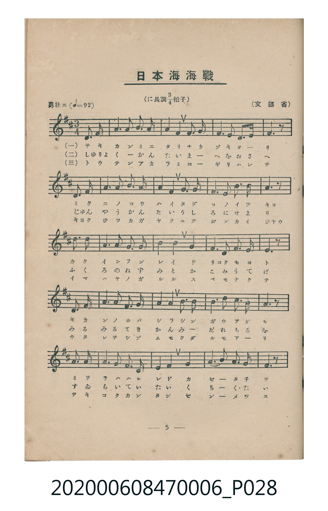
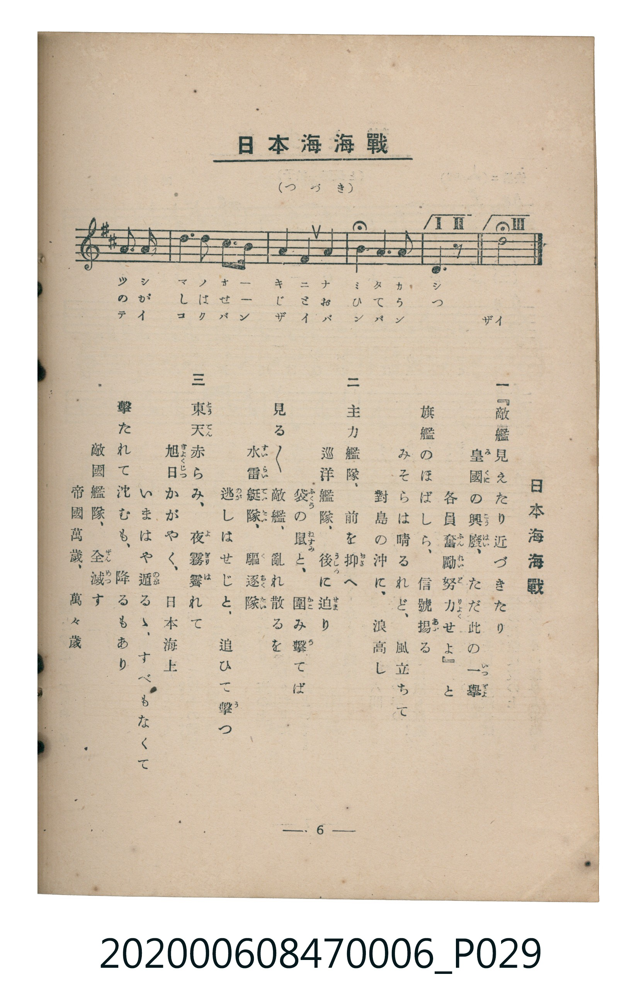

# 日本海海戰

> Re:Shōka 使用 AI 協助辨識與重建樂譜，可能會有錯誤。歡迎回報。

<audio controls src="nihonkai_kaisen.mp3"></audio>

- 文部省
- 臺灣教育會公認《新定兒童唱歌》尋常科第六學年用（2020.006.0847.0006）

## 說明

原書資訊與歌詞全文（對應 P028.jpg – P029.jpg，書頁 pp. 5–6，第一學期第 5 首）：
調性與拍號：に長調四分之三拍子（D 大調 3/4 拍，弱起 1 拍），「勇壯ニ」（♩=92）


## 跨冊／重複收錄參照

> 同曲（文部省『尋常小學唱歌』第六學年〈日本海海戰〉；《公學校唱歌》與《新定兒童唱歌》第六學年共用教材）

- **[同曲]** 《公學校唱歌》第六學年用（昭和15年／1940，國臺圖 523.37 4322-4）：[**〈日本海海戰〉**](../../../kogakko_shoka/grade_6/4_nihonkai_kaisen/index.md)（`D` / `3/4` — [原始 TMD](../../../kogakko_shoka/grade_6/4_nihonkai_kaisen/nihonkai_kaisen.tmd)）
- 總表：[跨冊重複與同名歌曲總索引](../../../duplicate_songs.md)

## 歌詞

```text
一　『敵艦見えたり近づきたり
皇國（みくに）の興廢（こうはい）、ただ此の一舉（いつきよ）
各員奮勵（ふんれい）努力（どりよく）せよ』と
旗艦のほばしら、信號揚（あ）がる
みそらは晴るれど、風立ちて
對島の沖に、浪高し

二　主力艦隊、前を抑（おさ）へ
巡洋艦隊、後（うしろ）に迫（せま）り
袋（ふくろ）の鼠（ねずみ）と、圍（かこ）み擊（う）てば
見る／＼敵艦、亂れ散るを
水雷艇隊（すゐらいていたい）、驅逐隊（くちくたい）
逃（のが）しはせじと、追ひて擊（う）つ

三　東天（とうてん）赤らみ、夜霧霽（よぎりは）れて
旭日（きよくじつ）かがやく、日本海上
いまはや遁（のが）るゝ、すべもなくて
擊たれて沈むも、降るもあり
敵國艦隊、全滅（ぜんめつ）す
帝國萬歲、萬々歲
```

## ABC

```abc
X:1
T:日本海海戰
M:3/4
L:1/16
Q:1/4=92
K:D
V:V1 name="Piano" snm="Pia"
[V:V1]
z4 z4 D3 E | F6 G2 A2 F2 | A4 F4 d3 B | A6 F2 E3 D |
w: 1.~て き | か ん み え | た り ち か | づ き た _
w: 2.~しゆ りよ | く _ か ん | た い ま _ | へ を お さ
w: 3.~と う | て ん あ か | ら み よ _ | ぎ り は れ
E6 z2 A3 A | B6 A2 B2 d2 | A4 F4 A3 F | E6 D2 E2 F2 |
w: 1.~り み く | に の こ う | は い た だ | こ の い つ
w: 2.~へ じゆ ん | や う か ん | た い う し | ろ に せ ま
w: 3.~て きよ く | じ つ か が | や く に つ | ぽ ん か い
D6 z2 D3 E | F6 D2 E2 F2 | G4 F4 E4 | F6 ^G2 A2 G2 |
w: 1.~きよ か く | い ん ふ ん | れ い ど | りよく せ よ _
w: 2.~り ふ く | ろ の ね ず | み と か | こ み う て
w: 3.~じやう い ま | は や の が | る る す | べ も な く
A6 z2 A3 B | d6 B2 d2 e2 | d4 B4 d3 B | A6 F2 A3 B |
w: 1.~と き か | ん の ほ ば | し ら し ん | が う あ が
w: 2.~ば み る | み る て き | か ん み _ | だ れ ち る
w: 3.~て う た | れ て し づ | む も く だ | る も あ _
A6 z2 F3 F | E6 D2 E2 F2 | D4 B,4 A,4 | D6 E2 F2 A2 |
w: 1.~る み そ | ら は は る | れ ど か | ぜ _ た ち
w: 2.~を す ゐ | ら い て い | た い く | ち _ く た
w: 3.~り て き | こ く か ん | た い ぜ | ん _ め つ
B6 z2 B3 c | d6 B2 A2 F2 | A4 F4 A4 | B6 E2 F3 E |
w: 1.~て つ し | ま の お _ | き に な | み た か _
w: 2.~い の が | し は せ _ | じ と お | ひ て う _
w: 3.~す て い | こ く ば ん | ざ い ば | ん ば ん _
D6 z2 z4 |
w: 1.~し
w: 2.~つ
w: 3.~ざい
```

## TMD 檔案連結

- [主旋律 TMD 檔案](nihonkai_kaisen.tmd) [[在 TMD Studio 編輯](https://tmdlang.github.io/Tmd-TS/#tmd=s7IKdvYPcrWy4qpTUCpJTLdSSM7PyUlNLsnMz7MqzsjMK0nNjM_KTMmPL87Iz05Ugisry88pzU21Si9KTEmNN4s3MjAyiDcwMIs3sDAxBzIMzBBKi_NLi5JTrYqTM_Lzc-JLUitKkvLzsxHyBUX5Zal5iXlANQVFIBtTwIoQClLLMlNSQdKpKZkl-UWZiTlI7kgtKga7FWxJfElRYl5xclFmAcgDCFUlGalAx-Zm5mSWJBZVoosX5CQmpypxaWkpPJu-9NmcNc-2bgehjg0KWlpcirYKlkZc9rYKLlw2xvomdiC9z6a1v2xe8XxOI9ikF-27njcufjZ15oumTc_mND9tXfNiVe_jhq5n0zY8XTfraeuk56uXPp2y8dnanscN3U83dD_dseP58onP16x52rr26dodT3dueT5lxfs9HaAw1AOGnB4oDIEMA7P3ezqVuLj0tRRsqQW4FBQUnvbNfzZ7x4vN7S9WdL3oaAe668XKeU9bVwB9BXTF0w29z9o7FQIMjCz0sgrSFR41TAZxLEGc93t6gDpfLmhUKCjQUzAFSgGd2AP0yZMdDUCfPJszH8hWMFV4uWwa0Onv98wCWfdi1f5nDctBFnX3vpg5Hyj6uHH1y6nbgeJPZ89-2tH2ZGf3kx2dQNmnaycAHeCi8HTJcqCkAjC0FYCiQBue7tn4Yut2BUMIF2gwMCR7nna3P128_nFz9-MGoGDHo5krbS2NgLJcIEuBDnrcAER9z6ZufdG57MWy7seNHY8b5z9u6nqxf-LjxqWPG3shXJDq57Pan87pBhryuHH_48Z-oPuA5jxuXPeio-Pp7kVg8cmPG9seN65_3NgCkmpoBGluXPBs7RKgMqBlLzqArgIqa3ncCBTpfdzUAXIJKLAntDydvPDp0nVPu7eCVWx93DT5cVMPxKCnXaueds0Gi68EugWoDWg92O7ZIHYD0CkrQKY8mz4d6AugVY8bdz9u3PC4cfrjJpArnuxfCAzSZ_2zwEY0gXX2PG7qBukB-2UuSF3j-mcztwBFwdauBGp7uWjF89XAEFn4uHEZ2JEbep9u3gY0_tmmaUDPA1U827rq5eoZQHsgobkLGOANT3bsBjoW6I6Xs7qASp52Ar056VnXRLDdXY8bp4Kt3wE2cPvCZ1u6EUr39YAVAUMQ6HBQFAJtebEfGMpAwdmPG_eBRCBR8WIRJB62guIBqnTdyz0LwIJrHzcCE89-sOAKkLlzQDH_uBHolclgwf3PJndBbAJzgSG2AWwoMPqbgOYCg3YPJEGAwm5XEzBAnk1dDA6ZSeBg3rDl5eztLzrbgc4GGzPzcdMEcAgC4xVoGJAExjo0Bbxc2fqyYQJMJTCmgKEJJKEKQMa9bGgGywFjDeh_oCnTwSkI6GFgyILc_2L_3seNm4BGozp7CTQJA21peDZ349MlK8GSK8ABuAyYfoCqXmxdAnbYflAwLJnzcs7yl3P2gpSBklAfKC01rgeHKjDKwXH8bPpaYOkGNgiUPMFuBTpjCdhGYAACkw3Qe_2guIcVgk92gKME7O99IKc3tbxsbETxEijo5oKzw8zHjTsfNzU9blwFNhpi52SgM4CZDOSGZ5uAbmsAqQAG3UygE4A6gaqBcQC2BBgtwCyISDHA4mh3K9iqOeAMA7QB4tSZ4PS1Yy5I9YQ1z9ZuAoXjhDWPG1qBbJAc5YUkFCho6XNx-WVm5OdlJ2Z6J2YWp-ZZBWQm5uU71BjUVIOsUrAxNNOyA7OwFdIKkJLxxcIeBQ1oEaatYALMbf3P1zfowItYTSw6gVaDTK1RMFDQBUMYbQgmjYAyxlAREDQBYlMgBonVgFkgCFNhGAemzJCkYNJGUENroCyEZRCVpgo1YIf4GNYoxENlYTQwUqF0L1A_MBEhmQCMM7DMfjDZAXYWMCnAZbvgZiyE0t1gFUuRzQCaCyJhuoDycH0wd0BsANH9MJcaYXMpsNhpg1kNTP1gu_qRzIK5AeZyFNc2tsBZ-xBuadyB4t9JYHmI-4BlIYYKiGtnINwxGeZgY2wOXgGl28AGQQIaNWib4E4GBUwnXCckQEDqQMEOc2wfigkgZwIzNJTXg2EHxLGgcgJqKCh08afzXT3gdE5i8jZDshSU4kB8cHLFTMUQvjFaUgXlBxAfkvIhuQMCQYkYnlvgiRhY8SCHROM6MAkJUVDMgFRAwgU14iGJAVjlg1WA1KObAVILLKSgZsDDDjlAITkENa0CC1UUw0COICYlQpNR43Rw9PeimAHyIrCeAZOgFIs952xFdw0wIQJTKIpJIO9AXdPYAzUJ4QZYDoIFKkg9yIy9yGZAkyvEDJBesC3g2gbiB2Q3QcwGuZpQetvRSU56Qy40UZMOqAgFQZgKWCJDK2jVgQQoJYIZqOUpotQElrRICQ4lfqGhAQp7ePwCMyBm_K6E2w9vGCKbA4ldlCwOKTKQQ7MXqhZYtiKlN4gozBxI4l0LJmdBTYIXIXAzEaU7ZvKHlPGQdAsqREAqNmC4BVpON8HdAk5tsKwGkYNkIYiLYKkNZi8Sq3Emklt2opgAKRRXgUlQeGEv2GB5Zz6hVAbsoJCTyqAVLgTCizQjSLkGl4SVfXiqZ3hywkhokEQJLA0RCQ2cnNAjdjeYBEUHKCimwwMKUV9AxMD1ETTYEWZAIhUUqJAoQY4QjKhtnIuczOCJCBF5kKiAJEvkBgPC5QhdIPkFKCaAXAZvLoCSEbTSRXULJGkAm-3IyQyewSB2QFwB8jekwQFS0QC3B-JbRPEGLfNR_A1LaDC12AtYpOYRocpzCjnJjHA9aAZrUJjCGKh1JEwHKHWhVsagNAbhm6OkMVi6gfgMlH2hJDh8UAszWBGGWnjMQTIBIguq3iAxiz27giohSIwhF2OoLoEUHZCYhVUy2KpNWCEKkoekJWRTQLIQfegFN8QloDwFzQlIhRhqvoOYQbgCh4UDes4FyzY1wn0O0g8r8BAugaWtFoJFWOtazLQFHs0hrQjD3b2A8VETECxpQTor6A0zWHcGuZ6Eta0hHoMUX7BMBW5SweVgTThISQ-TRylwoIkKOeHBCj9YIMKzBFKhhawGlrxBNS3MDFjrCLlmRHbjJhT9kOQIa-WA5CFJGacbcCYnUAGOSE7T4LKI5ASrcTErAoRemCuAgzzoaRvhkFouLl07BdR-rwJQRJkLAA)]
- [鋼琴伴奏 TMD 檔案](nihonkai_kaisen_piano.tmd) [[在 TMD Studio 編輯](https://tmdlang.github.io/Tmd-TS/#tmd=s7IKdvYPcrWy4tLSUng2femzOWuebd0OQh0b3u_peNm95_mELU_2bHm6tP95Z8f7PZ0KWlpcirYKlkZc9rYKLlw2xvomdlx1CkrPprW_bF7xfE6jEoj3on3X88bFz6bOfNG06dmc5qeta16s6n3c0PVs2oan62Y9bZ30fPXSp1M2Plvb87ih--mG7qc7djxfPvH5mjVPW9c-Xbvj6c4tz6esANpvZGBkoGdgYKZnYGFiDmQYmAGdoMTF5ZeZkZ-XnZjpnZhZnJpnFZCZmJcf5OFQY1BTzaUABDaGZlp2YJa-loItOlAAWvRkR8OLhT0KGgEGRhZ6WQXpmliUaemDjahRMFDQBUMYbQgmjYAyxlAREDQBYlMgBonVgFkgCFNhGAemzJCkYNJGUENroCyEZRCVpgo1YIf4GNYoxENlYfTjxmVQuheo_3FjN5IJj5smg2X2g8kOsLMeN86Hy3bBzVgIpbvBKpYimwE0F0TCdAHl4fpg7oDYAKL7YS41wubS6Y-b2mBWP27qANvVj2QWzA0wl6O4trEFztqHcEvjDhT_TgLLQ9z3uHEqhgqIa2cg3DEZ5mBjbA5eAaXbwAZBAho1aJvgTgYFTCdcJyRAQOpAwQ5zbB-KCSBnPm5cD-X1YNgBcWwvzAhI6OJP1Lt6iE_UZkhWgdIZiA9OpJhpF8I3RkugoFwA4kPSOyRPQCAo6cLzCDzpPm5cjez_xnVgEhKOoPgAqYCEBmp0Q5LA48YFYBUg9ehmgNQ-blwCNQMeYsjBCMkXqCn0cRPMElg0E5f-oImncTo40ntRzAB58XHjbDAJSqfY88tWdNcAkx8wXaKYBPIO1DWNPVCTEG6A5RtYoILUg8zYi2wGNJFCzADpBdsCNAbmB2Q3QcwGuZpQKtvRSXwqQy4gURMMqLgEQZgKWNJCK1TVgQQo_YEZqGUnooQElqpIyQwlVqFhAApxeKwCMxtmrK6E2w8pnlDLJmicomRnSPGAHIa9ULXAchQplUFEYeZAkuxaMDkLahK8uICbiSjJMRM9pDyHpFZQgQFSsQHDLdAyuQnuFnAag2UwiBwk40BcBEtjMHuRWI0zkdyyE8UESAG4CkyCwgt7IQbLMfMJpa2ns2cTn7agVSoEwosvI0gZBpeElXN4KmB4IsJIXpCkCCz5EMkLnIjQo3M3mARFAigApsODB1EjQMTANQ40sBFmQKISFJSQiECOBowIbZyLnLjgSQcRZZAIgCRG5CYBwuUIXSD5BSgmgFwGbxCAEg-0WkV1CyRBPG6agJy44NkKYgfEFSB_Q5oUIBUNcHsgvkUUZdDyHcXfsOQFU4u9MEVqABGqHqcQn7gI13RmsIaCKYyBWgvCdIDSFGp1C0pZEL45SsqCpRaIf0BZFUqCQwW14IIVV6gFxRwkEyCyoAoMEp_YsyaomoHEE3KRheoSSDEBiU9YNYKtYoQVmCB5SApCNgUkC9GHXkhDXALKSdD0j1RgoeY2iBmEq2hYOKDnV7BsUyPc5yD9sMIN4RJYimohWFy1roWlKEvSiyvcnQUYHzXZwBIUpOuB3uCCdU6Qa0JYSxniHUhRBctA4KYSXA7WNIOU5TB5lMIFmpSQkxusoIMFHTwjIBVQyGpgiRpUl8LMgLV6kOs-ZDduQtEPSYSw1gtIHpKAcboBZyICFdaIRDQNLotIRLA6FbPQR-iFuWIaZopGOKQWe4_VB7nHagLtsIJ6myAIjOB4hWjDWDBGcEyQOabxIJ5pPJALYgI1QY0wAYoAVaKqBpsDVwzVDJVEaEVRDTIHYZExkGcM5AExMGFi2oriRiKcgNCJzVVm8bnorkQ4CmgqDidjU4rpV2CM6NopoEZKtA9QEouoEVZRYCAARZW5AA)]

## 分析

```text
================================================================================
📊 TMD Song Profile: [ 日本海海戰 ]
================================================================================
⏱  Duration:       0:48 (48.9s), 25 measures total
🎼 Key & Tempo:    首調基準 D, != 92.0 BPM, <3/4>
   - 分析範圍：      由實際發聲的音符與和弦推測調性；播放脈絡另行呈現
🎤 人聲音域:    A3 (MIDI 57) – E5 (MIDI 76) [跨度: 19 個半音 / 1.6 個八度, 難度: challenging]
   - 最低音:  A3 in [NihonkaiKaisen #1 @ m.19, 0:36]
   - 最高音: E5 in [NihonkaiKaisen #1 @ m.14, 0:27]
   - 適合: soprano, mezzo-soprano, contralto, tenor, baritone, bass
🏛  結構:      NihonkaiKaisen (48.9s)
⚡ 編曲密度:        Peak 1 軌道同時演奏
🗝  調性診斷：       D 大調（純淨自然大調，未偵測到可信轉調）
   - 風格氣質:    純淨自然大調（陽光明朗、易唱易記，無明顯調外色彩）
   - 轉調歷程:    全曲維持單一推測調性（未偵測到可信轉調）
   - 核心骨幹音:  A, D, F#, E, B
   - 調性數值:    D 大調 [相關度: 0.87, 穩定度: Moderate, 自然音純度: 98.6%]
   - 候選調性 (K-S): D 大調 (0.87), A 大調 (0.75), F# 小調 (0.69)
   - 五度圈歷程:   +2
   - 各段落調性細節:
     • [NihonkaiKaisen #1]: D 大調 (r: 0.87, 自然音純度: 98.6%, 調外音: G#)

  [ 五度圈游移軌跡 ]
               C  
         F            G  
      Bb              [D ]*
      Eb               A  
         Ab           E  
            Db       B  
               F# 
     (* = active key center)

  [ 十二半音累積音高分佈 ]
     C  :                            0.0%
     C# :                            0.4%
     D  : ██████████████████████    22.1%
     D# :                            0.0%
     E  : ██████████████            14.5%
     F  :                            0.0%
     F# : █████████████████████     21.0%
     G  : ██                         2.2%
     G# : █                          1.4%
     A  : ████████████████████████  24.3%
     A# :                            0.0%
     B  : ██████████████            14.1%
--------------------------------------------------------------------------------
Assignment 軌道音域：
  - Piano         : A3 – E5 (19 個半音 / 1.6 個八度, 87 個音符)
================================================================================
```


## 原書掃描頁






