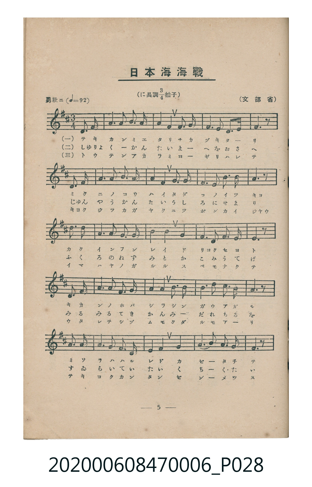
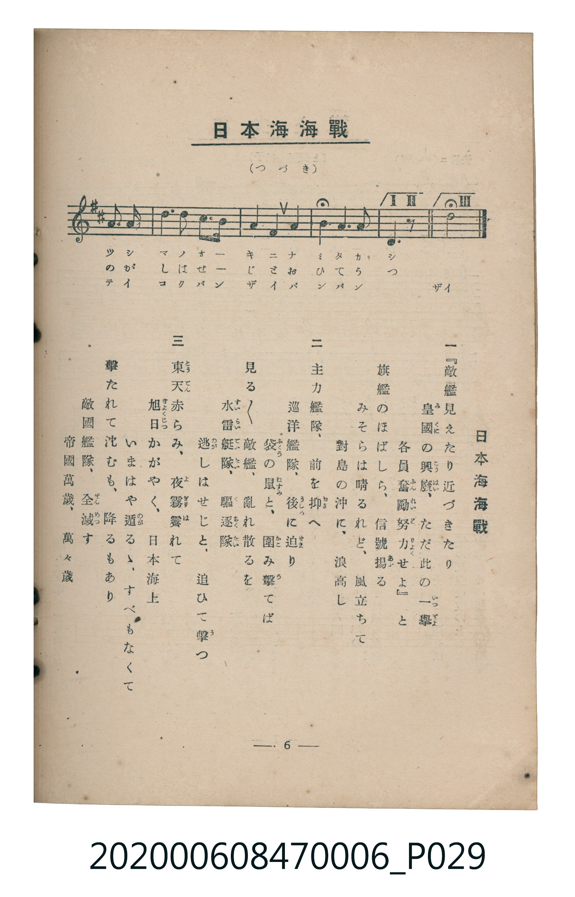

# 日本海海戰

<audio controls src="nihonkai_kaisen.mp3"></audio>

- 文部省
- 臺灣教育會公認《新定兒童唱歌》尋常科第六學年用（2020.006.0847.0006）

## 說明

原書資訊與歌詞全文（對應 P028.jpg – P029.jpg，書頁 pp. 5–6，第一學期第 5 首）：
調性與拍號：に長調四分之三拍子（D 大調 3/4 拍，弱起 1 拍），「勇壯ニ」（♩=92）

## 歌詞

```text
一　『敵艦見えたり近づきたり
皇國（みくに）の興廢（こうはい）、ただ此の一舉（いつきよ）
各員奮勵（ふんれい）努力（どりよく）せよ』と
旗艦のほばしら、信號揚（あ）がる
みそらは晴るれど、風立ちて
對島の沖に、浪高し

二　主力艦隊、前を抑（おさ）へ
巡洋艦隊、後（うしろ）に迫（せま）り
袋（ふくろ）の鼠（ねずみ）と、圍（かこ）み擊（う）てば
見る／＼敵艦、亂れ散るを
水雷艇隊（すゐらいていたい）、驅逐隊（くちくたい）
逃（のが）しはせじと、追ひて擊（う）つ

三　東天（とうてん）赤らみ、夜霧霽（よぎりは）れて
旭日（きよくじつ）かがやく、日本海上
いまはや遁（のが）るゝ、すべもなくて
擊たれて沈むも、降るもあり
敵國艦隊、全滅（ぜんめつ）す
帝國萬歲、萬々歲
```

## ABC

```abc
X:1
T:日本海海戰
C:TMD (Chen, Chih-Han / aguai)
M:3/4
L:1/16
Q:1/4=92
K:D
V:V1 name="Piano" snm="Pia"
[V:V1]
z4 z4 d3 e | f6 g2 a2 f2 | a4 f4 d3 b | a6 f2 e3 d |
e6 z2 a3 a | b6 a2 b2 d2 | a4 f4 a3 f | e6 d2 e2 f2 |
d6 z2 d3 e | f6 d2 e2 f2 | g4 f4 e4 | f6 ^g2 a2 g2 |
a6 z2 a3 b | d6 b2 d2 e2 | d4 b4 d3 b | a6 f2 a3 b |
a6 z2 f3 f | e6 d2 e2 f2 | d4 B4 A4 | d6 e2 f2 a2 |
b6 z2 b3 c | d6 b2 a2 f2 | a4 f4 a4 | b6 e2 f3 e |
d6 z2 z4 |
```

## TMD 檔案連結

- [主旋律 TMD 檔案](nihonkai_kaisen.tmd)
- [鋼琴伴奏 TMD 檔案](nihonkai_kaisen_piano.tmd)

## 分析

```text
================================================================================
📊 TMD Song Profile: [ 日本海海戰 ]
================================================================================
⏱  Duration:       0:48 (48.9s), 25 measures total
🎼 Key & Tempo:    首調基準 D, != 92.0 BPM, <3/4>
   - 分析範圍：      由實際發聲的音符與和弦推測調性；播放脈絡另行呈現
🎤 人聲音域:    A3 (MIDI 57) – E5 (MIDI 76) [跨度: 19 個半音 / 1.6 個八度, 難度: challenging]
   - 最低音:  A3 in [NihonkaiKaisen #1 @ m.19, 0:36]
   - 最高音: E5 in [NihonkaiKaisen #1 @ m.14, 0:27]
   - 適合: soprano, mezzo-soprano, contralto, tenor, baritone, bass
🏛  結構:      NihonkaiKaisen (48.9s)
⚡ 編曲密度:        Peak 1 軌道同時演奏
🗝  調性診斷：       D 大調（純淨自然大調，未偵測到可信轉調）
   - 風格氣質:    純淨自然大調（陽光明朗、易唱易記，無明顯調外色彩）
   - 轉調歷程:    全曲維持單一推測調性（未偵測到可信轉調）
   - 核心骨幹音:  A, D, F#, E, B
   - 調性數值:    D 大調 [相關度: 0.87, 穩定度: Moderate, 自然音純度: 98.6%]
   - 候選調性 (K-S): D 大調 (0.87), A 大調 (0.75), F# 小調 (0.69)
   - 五度圈歷程:   +2
   - 各段落調性細節:
     • [NihonkaiKaisen #1]: D 大調 (r: 0.87, 自然音純度: 98.6%, 調外音: G#)

  [ 五度圈游移軌跡 ]
               C  
         F            G  
      Bb              [D ]*
      Eb               A  
         Ab           E  
            Db       B  
               F# 
     (* = active key center)

  [ 十二半音累積音高分佈 ]
     C  :                            0.0%
     C# :                            0.4%
     D  : ██████████████████████    22.1%
     D# :                            0.0%
     E  : ██████████████            14.5%
     F  :                            0.0%
     F# : █████████████████████     21.0%
     G  : ██                         2.2%
     G# : █                          1.4%
     A  : ████████████████████████  24.3%
     A# :                            0.0%
     B  : ██████████████            14.1%
--------------------------------------------------------------------------------
Assignment 軌道音域：
  - Piano         : A3 – E5 (19 個半音 / 1.6 個八度, 87 個音符)
================================================================================
```


## 原書掃描頁






