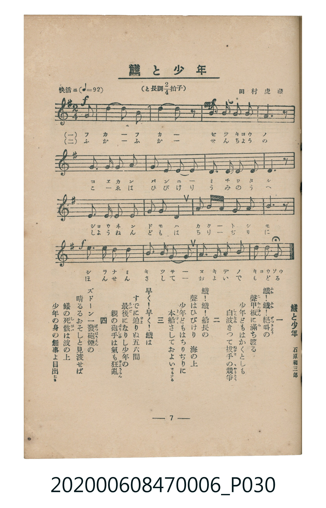

# 鱶と少年

<audio controls src="fuka_to_shonen.mp3"></audio>

- 詞：石原和三郎
- 曲：田村虎藏
- 臺灣教育會公認《新定兒童唱歌》尋常科第六學年用（2020.006.0847.0006）

## 說明

原書資訊與歌詞全文（對應 P030.jpg，書頁 p. 7，第一學期第 6 首）：
調性與拍號：と長調四分之二拍子（G 大調 2/4 拍），「快活ニ」（♩=92）

## 歌詞

```text
一　鱶（ふか）！鱶（ふか）！絕叫（ぜつきやう）の
聲（こゑ）甲板（かんぱん）に滿（み）ち渡る
少年どもはかくともし
知らぬ氣（き）きつて拔手（ぬきで）の競爭（きやうさう）

二　鱶！鱶！船長の
聲はひびけり　海の上
少年どもはちりぢりに
本船（ほんせん）さしておよいでもどる

三　早く！早く！鱶は
すでに迫（せま）りぬ五六間
最後（さいご）になりし少年の
親の砲手（はうしゆ）は氣（き）も狂亂（きやうらん）

四　ズドーン一發砲煙（ぱつはうえん）の
晴るるおそしと見渡せば
鱶の死骸（しがい）は波の上
少年の身の無事よ目出度（めでた）さ
```

## 原書掃描頁



## 分析

```text
================================================================================
📊 TMD Song Profile: [ 鱶と少年 ]
================================================================================
⏱  Duration:       0:20 (20.9s), 16 measures total
🎼 Key & Tempo:    首調基準 G, != 92.0 BPM, <2/4>
   - 分析範圍：      由實際發聲的音符與和弦推測調性；播放脈絡另行呈現
🎤 人聲音域:    D4 (MIDI 62) – E5 (MIDI 76) [跨度: 14 個半音 / 1.2 個八度, 難度: moderate]
   - 最低音:  D4 in [FukaToShonen #1 @ m.1, 0:00]
   - 最高音: E5 in [FukaToShonen #1 @ m.14, 0:16]
   - 適合: soprano, mezzo-soprano, contralto, tenor, baritone, bass
🏛  結構:      FukaToShonen (20.9s)
⚡ 編曲密度:        Peak 1 軌道同時演奏
🗝  調性診斷：       G 大調（純淨自然大調，未偵測到可信轉調）
   - 風格氣質:    純淨自然大調（陽光明朗、易唱易記，無明顯調外色彩）
   - 轉調歷程:    全曲維持單一推測調性（未偵測到可信轉調）
   - 核心骨幹音:  G, A, B, D, E
   - 調性數值:    G 大調 [相關度: 0.76, 穩定度: Moderate, 自然音純度: 100.0%]
   - 候選調性 (K-S): G 大調 (0.76), D 大調 (0.63), B 小調 (0.55)
   - 五度圈歷程:   +1
   - 各段落調性細節:
     • [FukaToShonen #1]: G 大調 (r: 0.76, 自然音純度: 100.0%)

  [ 五度圈游移軌跡 ]
               C  
         F           [G ]*
      Bb               D  
      Eb               A  
         Ab           E  
            Db       B  
               F# 
     (* = active key center)

  [ 十二半音累積音高分佈 ]
     C  : █                          0.8%
     C# :                            0.0%
     D  : ███████████               12.5%
     D# :                            0.0%
     E  : █████                      5.8%
     F  :                            0.0%
     F# : ███                        3.3%
     G  : ████████████████████████  28.3%
     G# :                            0.0%
     A  : ██████████████████████    25.8%
     A# :                            0.0%
     B  : ████████████████████      23.3%
--------------------------------------------------------------------------------
Assignment 軌道音域：
  - Piano         : D4 – E5 (14 個半音 / 1.2 個八度, 48 個音符)
================================================================================
```

## ABC

```abc
X:1
T:鱶と少年
C:曲：田村虎藏
M:2/4
L:1/16
Q:1/4=92
K:G

V:V1 name="Piano" snm="Pia"

[V:V1]
!f! d2 g4 d2 | g6 z2 | !mf! b3 b a2 g2 | a6 z2 |
b2 g2 a2 f2 | g2 b2 d2 b2 | a2 d2 b3 a | g6 z2 |
e3 e f2 g2 | a2 b2 a4 | b2 d2 b2 g2 | a6 z2 |
!f! d3 b g2 d2 | e3 c b4 | a2 g2 a2 b2 | a2 b2 g4 |
```

- [主旋律 TMD 檔案](fuka_to_shonen.tmd)
- [鋼琴伴奏 TMD 檔案](fuka_to_shonen_piano.tmd)
