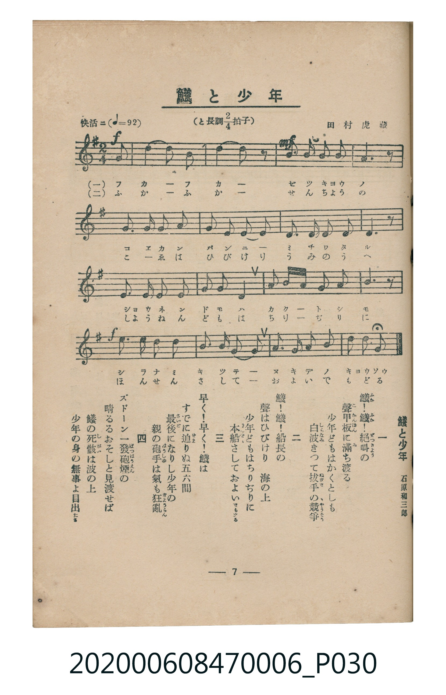

# 鱶と少年

> Re:Shōka 使用 AI 協助辨識與重建樂譜，可能會有錯誤。歡迎回報。

- **鋼琴伴奏版**：<br><audio controls src="fuka_to_shonen.mp3"></audio>
- **NEUTRINO 歌聲合成版**：<br><audio controls src="fuka_to_shonen_neutrino.mp3"></audio>

- 詞：石原和三郎
- 曲：田村虎藏
- 臺灣教育會公認《新定兒童唱歌》尋常科第六學年用（2020.006.0847.0006）

## 說明

原書資訊與歌詞全文（對應 P030.jpg，書頁 p. 7，第一學期第 6 首）：
調性與拍號：と長調四分之二拍子（G 大調 2/4 拍），「快活ニ」（♩=92）


## 歌詞

```text
一　鱶（ふか）！鱶（ふか）！絕叫（ぜつきやう）の
聲（こゑ）甲板（かんぱん）に滿（み）ち渡る
少年どもはかくとしも
白波（しらなみ）きつて拔手（ぬきで）の競爭（きやうさう）

二　鱶！鱶！船長の
聲はひびけり　海の上
少年どもはちりぢりに
本船（ほんせん）さしておよいでもどる

三　早く！早く！鱶は
すでに迫（せま）りぬ五六間
最後（さいご）になりし少年の
親の砲手（はうしゆ）は氣（き）も狂亂（きやうらん）

四　ズドーン一發砲煙（ぱつはうえん）の
晴るるおそしと見渡せば
鱶の死骸（しがい）は波の上
少年の身の無事よ目出度（めでた）さ
```

## ABC

<div class="abc-score" data-abc-src="fuka_to_shonen.abc" aria-label="五線譜載入中"></div>

[下載 ABC 原始檔](fuka_to_shonen.abc)

## TMD 檔案連結

- [主旋律 TMD 檔案](fuka_to_shonen.tmd) [[在 TMD Studio 編輯](https://tmdlang.github.io/Tmd-TS/#tmd=s7IKdvYPcrWy4qpTUCpJTLdSSM7PyUlNLsnMz7MqzsjMK0nNjM_KTMmPL87Iz05Ugisry88pzU21Si9KTEmNN4s3MjAyiDcwMIs3sDAxBzIMzBBKi_NLi5JTrYqTM_Lzc-JLUitKkvLzsxHyBUX5Zal5iXlANQVFIBtTwIoQClLLMlNSQdLFyYl58WWpRZlpmakpSG5JLSoGuxdsUXxJUWJecXJRZgHIEwhV-UUlGflA9xZkVFplZBaX5BdlJifmxGcn5iF5qyQjFeirxLzM3MQcZK2Z6Zl5VrmpmVmZWDwAtbcgMT3VKsDA2ECJS0tL4eXGbY8bVzzdMPHpzi0KWlpcirYKlkZc9rYK7lw2RvomdiDdL1bOe79n1vP5m5_2zX86qefJjs6XzX1gc5_N3gSSmbLh2dyJL2b2vZjeDxZ-0b7reePiZ1Nnvmja9GxO89PWNS9W9T5u6Ho2bcPTdbOetk56vnrp0ykbn63tedzQ_XRD99MdO54vn_h8zZqnrWufrt0BdMrzKSve7-kARZceMJL0QNEFZBiYvd_TqcTFpa-lYEstwKWgoAD017PZO15sbn-xoutFRzvQXUAvP21d8WxaO9AVTzf0PmvvVAAFmV5WQfr7PT1AxS8XNCoU6CmYA3lAdz_Z0QB097M584FsBTOFl8umAR0KDBmQ4S9W7X_WsBxkbHfvi5nzgaLAAH85dTtQ_Ons2U872p7s7H6yqwco-3TtBKB17gpPlywHSioAg18BKAo2CRhQPU_3r362Zffj5u7HDUDBjkczV9paGgFluUC2AF3wuKEBGJtAmceNWx83doP1NWKKPN869Wn_arDgnMeNSx439j5uannc2AaUfdy4DuziRmCsAqUnP26aCBR9PmXTs7n7wSLdj5smP27cCCTBqlc_2w0RB5JA7sJnOxY-buoGhyg4QT1uXPm4qelx43qQzsZ-oL8fN04HioBUPJ-599nmRWDdQCGg7lUwY3rBrlr2rHvKs06gm4EK1oAFl0Nc-Hz1tucda8HiUJc_bpwKcT8kJHYBAwsSEhDfN77o2AkMb4TnwA4CkpsfN0583NQFVP1sK0j6yY4urG4HeqrrceMiMLkapOLZnDVAM8FO2A0OkdmwEAE6ZDrQ7Y8bux43AWWBrlsONgVoVjc0njpB9k1fCQwPoNPgDHA-XA9S8bhxJkhX4-oX-yGxNPtx4z6Q4SDr1zzZNQWYSV5OmwxxR8PTfT1gRUCLgZZNgUQLKDBBqqfDvALx-TJgEK97vmATLFiBXgOGHTD0IXG__tmGxZBgBdvW9Ly76cmuJpSABsYT2KNgrwBTL9Arj5t2PW7ufNy853HzZmAifD5zD9CG560zwfo2gqMSYk8HLIzAjnk2cwswSEAIGFSNc8HBtuLFsm5QEgL5eANIEThQ1j1bu_vlqh3QlNLYA_Qo1LmbF2FG2roXu4DeX_e8ZeGTXUDjO57PXve0fdfTXctA-psawSELzIOgqAJpo7z8gAIFLX0uLrfS7MSQ_OCM_LzUPKuAzMS8fIcaXcOaapBNCjaGZlp2YBa24ksBUoq8WNijoPF0z8YXW7craCuYAL3V_3x9gw688NHEohNoM8jUGgUDBV0wBNHVabUKhkC6RsEUKgqijTFEQGprFKpzgcpBkiAlIBqi0AiqEGZoDdgiH8MahXioKIgGFi5g1cBMDhWFiIAgsihMPUhsDlTdEiAGJq5mMKcNKrkOXQPEWiPKrZ0NUdc0GcgG5mqirDVGt3Y9MDNAtfTDbV4PNhddHNlumNsQLgOJgvRhsdQE3dJZUPUrQTkN6H6YWSAbQcEIkQXlNyxWQywB-RSYDaEBgMvP-FPorh5wCiUxYYISoi6QBNGgNAURMQNZiCCA6RLiZSAFZqGKQiBqKgRWURCfNU2EBivCZxvhPGCBiBTg-6FhsRAoC4omYHEAkWnCSDDwZIdqDyzKQOKbwCZsBpMTwSq6oDKgVAUS3Q8NZUQ624HdHmA6Axb9UF3Loa6GJFmQzD646cBaAMkFU6Au64UmO4g7QP6BJRLMpAVPEUA_Q_wNLIWh5s0F86aDyRWY4QYMM0iIIVy2AcMeAqVcJzlpCJwawIkCOcmA0hEIwxMJpNAyBpKIxAYp2LAnIGDtByoFYLljLdiPsDS0EsxrAssixzokxCChDQojSHiBwhykFlcaIsuqhWBxSLQvgrNBMrBEjS0ZTYXa0wJNIBDVIJlVSOaBHA2zB-Q4WKIFyaG6DkfRCE5KkHINFCiwhA4NjMYeqBvQ_QR2AzhBEc4aeJMSsAVCTlIC1Y1mYDvMwHUgCMNSiTE8ScGqP0NoigKXRVDVIHmMlAQJh6ZOFB-CZHqhIQSq7JYhhQMkG4PkQRkeFhpgHfDYgMQlhI2eoHZDbQTVZqDMiIgvWPxPR7MRFO8gdR3weAHZC0u4sFQISt7oKQqmE5SiIHEGilHkgg6YglrRIhrqcaDhmLU8MJygaQ3savRUhTezQJIjctm6DSozA-HBpkZkD4LLLIguUOBArKvl4tK1U0ButSkA-cpcAA)]
- [鋼琴伴奏 TMD 檔案](fuka_to_shonen_piano.tmd) [[在 TMD Studio 編輯](https://tmdlang.github.io/Tmd-TS/#tmd=s7IKdvYPcrWy4qpTUCpJTLdSyC8qychPL0osyKi0ysgsLskvykxOzInPTsxLVIIrKs4vLUpOjS9ITE-1CjAwNlDi0tJSeLlx2-PGFU83THy6c8v7PR0vu_c8n7DlyZ4tT5f2P-_seL-nU0FLi0vRVsHSiMveVsGdy8ZI38QOZOSLlfPe75n1fP7mp33zn07qebKj82VzH9iyZ7M3gWSmbHg2d-KLmX0vpveDhV-073reuPjZ1JkvmjY9m9P8tHXNi1W9jxu6nk3b8HTdrKetk56vXvp0ysZna3seN3Q_3dD9dMeO58snPl-z5mnr2qdrdwDd93zKCqATjQyMDPQMDMz0DCxMzIEMAzOgK5W4uNxKsxND8oMz8vNS86wCMhPz8oM8HGp0DWuquRSAwMbQTMsOzNLXUrBFBwpAe57saHixsEdB4-mejS-2blfQVjBReLqh__n6Bh0FUHDpZRWka2LRqaUPNrVGwUBBFwxBdHVarYIhkK5RMIWKgmhjDBGQ2hqF6lygcpAkSAmIhig0giqEGVoDtsjHsEYhHioKoh83bgWrftzYDRWFiIAgsihMPUhsDlTdEiDufdzUDOa0QSXXoWuAWGtEubWzIeqaJgPZC4m01hjd2vWPm1qgWvrhNq8Hm4sujmw3zG0Il4FEQfqwWGqCbuksqPqVj5v3gNwPMwtkIygYIbIbIUx0qyGWgHz6uLEDGgC4_Iw_he7qAadQEhMmKCHqAkkQDUpTEBEzkIUIApguIV4GUmAWqigEoqbCx42QgHjcNBEarAifbYTzHjeuRgrw_dCwWAiUBUXT48b5EJkmjAQDT3ao9sCiDCS-CWzCZjA5EayiCyoDSlUg0f3QUEaksx3Y7QGms8eNM6G6lkNdDUmyIJl9cNMfN65BcsEUqMt6ockO4g6Qf2CJBDNpwVME0M8Qfz9uhLl7Lpg3HUyuwAw3YJhBQgzhsg0Y9hAo5TrJSUPg1ABOFMhJBpSOQBieSCCFljGQRCQ2SMGGPQFNh5QCsNyxFuxHWBpaCeY1gWWRYx0SYpDQBoURJLxAYQ5SiysNkWXVQrA4JNoXwdkgGViixpaMpkLtaYEmEIhqkMwqJPNAjobZA3IcLNGC5FBdh6NoBCclSLkGChRYQocGRmMP1A3ofgK7AZygCGcNvEnp6ezZ5CQlUN1oBrbDDFwHgjAslRjDkxSs-jOEpihwWQRVDZLHSEmQcGjqRPEhSKYXGkKgym4ZUjhAsjFIHpThYaEB1gGPDUhcQtjoCWo31EZQbQbKjIj4gsX_dDQbQfEOUtcBjxeQvbCEC0uFoOSNnqJgOkEpChJnoBhFLuiAKagVLaKhHgcajlnLA8MJmtbArkZPVXgzCyQ5Ipet26AyMxAebGpE9iC4zILoAgUOxLpabI02H5RGmwm0zQZqXYHSjQGo0IlXiDaMhTBAfHDrCS5oGg8WhVV9QGHTeJC4CVA82gTMBCmBikKMgCpGUoJiHDa1IMeYIDkEQzWYCRIEeVPXTgHZp9E-QAkMMSMsYsZYxEzAYspcAA)]

## 分析

```text
================================================================================
📊 TMD Song Profile: [ 鱶と少年 ]
================================================================================
⏱  Duration:       0:20 (20.9s), 16 measures total
🎼 Key & Tempo:    首調基準 G, != 92.0 BPM, <2/4>
   - 分析範圍：      由實際發聲的音符與和弦推測調性；播放脈絡另行呈現
🎤 人聲音域:    D4 (MIDI 62) – E5 (MIDI 76) [跨度: 14 個半音 / 1.2 個八度, 難度: moderate]
   - 最低音:  D4 in [FukaToShonen #1 @ m.8, 0:09]
   - 最高音: E5 in [FukaToShonen #1 @ m.14, 0:16]
   - 適合: soprano, mezzo-soprano, contralto, tenor, baritone, bass
🏛  結構:      FukaToShonen (20.9s)
⚡ 編曲密度:        Peak 1 軌道同時演奏
🗝  調性診斷：       D 調性不明確（純淨自然大調，未偵測到可信轉調）
   - 風格氣質:    純淨自然大調（陽光明朗、易唱易記，無明顯調外色彩）
   - 轉調歷程:    全曲維持單一推測調性（未偵測到可信轉調）
   - 核心骨幹音:  D, G, B, E, A
   - 調性數值:    D 調性不明確 [相關度: 0.80, 穩定度: Ambiguous, 自然音純度: 100.0%]
   - 候選調性 (K-S): D 大調 (0.80), G 大調 (0.80), B 小調 (0.67)
   - 五度圈歷程:   +2
   - 各段落調性細節:
     • [FukaToShonen #1]: D 調性不明確 (r: 0.79, 自然音純度: 100.0%)

  [ 五度圈游移軌跡 ]
               C  
         F            G  
      Bb              [D ]*
      Eb               A  
         Ab           E  
            Db       B  
               F# 
     (* = active key center)

  [ 十二半音累積音高分佈 ]
     C  :                            0.0%
     C# :                            0.0%
     D  : ████████████████████████  30.0%
     D# :                            0.0%
     E  : █████████████             16.7%
     F  :                            0.0%
     F# :                            0.0%
     G  : ███████████████           19.2%
     G# :                            0.0%
     A  : ████████████              15.0%
     A# :                            0.0%
     B  : ███████████████           19.2%
--------------------------------------------------------------------------------
Assignment 軌道音域：
  - Piano         : D4 – E5 (14 個半音 / 1.2 個八度, 52 個音符)
================================================================================
```


## 原書掃描頁




