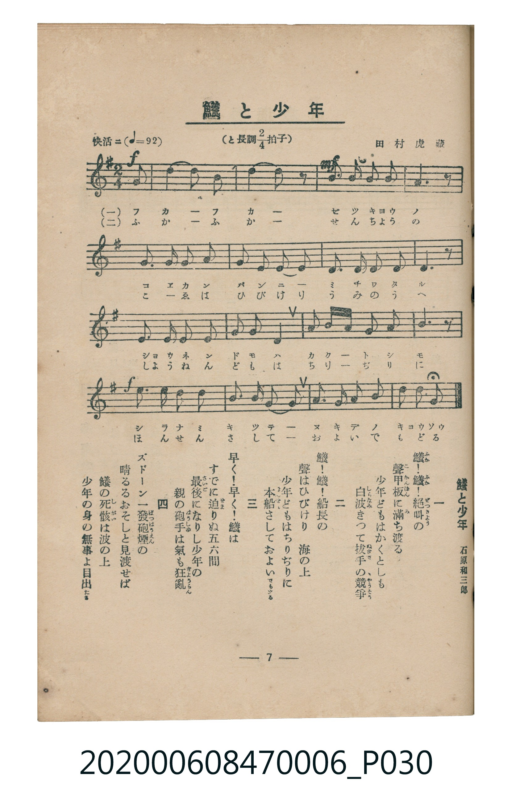

# 鱶と少年

> Re:Shōka 使用 AI 協助辨識與重建樂譜，可能會有錯誤。歡迎回報。

- **鋼琴伴奏版**：<br><audio controls src="fuka_to_shonen.mp3"></audio>
- **NEUTRINO 歌聲合成版**：<br><audio controls src="fuka_to_shonen_neutrino.mp3"></audio>

- 詞：石原和三郎
- 曲：田村虎藏
- 臺灣教育會公認《新定兒童唱歌》尋常科第六學年用（2020.006.0847.0006）

## 說明

原書資訊與歌詞全文（對應 P030.jpg，書頁 p. 7，第一學期第 6 首）：
調性與拍號：と長調四分之二拍子（G 大調 2/4 拍），「快活ニ」（♩=92）


## 歌詞

```text
一　鱶（ふか）！鱶（ふか）！絕叫（ぜつきやう）の
聲（こゑ）甲板（かんぱん）に滿（み）ち渡る
少年どもはかくとしも
白波（しらなみ）きつて拔手（ぬきで）の競爭（きやうさう）

二　鱶！鱶！船長の
聲はひびけり　海の上
少年どもはちりぢりに
本船（ほんせん）さしておよいでもどる

三　早く！早く！鱶は
すでに迫（せま）りぬ五六間
最後（さいご）になりし少年の
親の砲手（はうしゆ）は氣（き）も狂亂（きやうらん）

四　ズドーン一發砲煙（ぱつはうえん）の
晴るるおそしと見渡せば
鱶の死骸（しがい）は波の上
少年の身の無事よ目出度（めでた）さ
```

## ABC

```abc
X:1
T:鱶と少年
C:曲：田村虎藏
M:2/4
L:1/16
Q:1/4=92
K:G
V:V1 name="Piano" snm="Pia"
[V:V1]
!f! z4 z2 G2 | d4 d2 B2 | d4 d2 z2 | !mf! B3 B B2 B2 |
w: 1.~ふ | か ふ _ | か _ | ぜ つ きゃ う
w: 2.~ふ | か ふ _ | か _ | せ ん ちゃ う
w: 3.~はや | く は や | く _ | ふ _ か _
w: 4.~ず | どーん い つ | ぱつ _ | は う え ん
A6 z2 | G3 G G2 A2 | G2 E2 E2 E2 | D3 D D2 E2 |
w: 1.~の | こ ゑ か ん | ぱ ん に _ | み ち わ た
w: 2.~の | こ ゑ は _ | ひ び け り | う み の う
w: 3.~は | す で に せ | ま り ぬ _ | ご ろ く け
w: 4.~の | は る る お | そ し と _ | み わ た せ
D6 z2 | E3 E E2 E2 | G2 G2 D4 | A2 B A G2 A2 |
w: 1.~る | しゃ う ね ん | ど も は | か く _ と し
w: 2.~へ | しゃ う ね ん | ど も は | ち り _ ぢ り
w: 3.~ん | さ い ご に | な り し | しゃう _ _ ね ん
w: 4.~ば | ふ か の し | が い は | な み _ の う
B6 z2 | !f! e3 e d2 d2 | B3 B G2 G2 | A3 G A2 B2 |
w: 1.~も | し ら な み | き つ て _ | ぬ き で の
w: 2.~に | ほ ん せ ん | さ し て _ | お よ い で
w: 3.~の | お や の は | う しゅ は _ | き も きゃ う
w: 4.~へ | しゃ う ね ん | の み の ぶ | じ よ め で
d2 d2 G2 z2 |
w: 1.~きゃう さ う
w: 2.~も ど る
w: 3.~ら _ ん
w: 4.~た _ さ
```

## TMD 檔案連結

- [主旋律 TMD 檔案](fuka_to_shonen.tmd) [[在 TMD Studio 編輯](https://tmdlang.github.io/Tmd-TS/#tmd=s7IKdvYPcrWy4qpTUCpJTLdSSM7PyUlNLsnMz7MqzsjMK0nNjM_KTMmPL87Iz05Ugisry88pzU21Si9KTEmNN4s3MjAyiDcwMIs3sDAxBzIMzBBKi_NLi5JTrYqTM_Lzc-JLUitKkvLzsxHyBUX5Zal5iXlANQVFIBtTwIoQClLLMlNSQdLFyYl58WWpRZlpmakpSG5JLSoGuxdsUXxJUWJecXJRZgHIEwhV-UUlGflA9xZkVFplZBaX5BdlJifmxGcn5iF5qyQjFeirxLzM3MQcZK2Z6Zl5VrmpmVmZSB7Q0lJ4uXHb48YVTzdMfLpzi4KWFpeirYKlEZe9rYI7l42RvokdyIgXK-e93zPr-fzNT_vmP53U82RH58vmPrDhz2ZvAslM2fBs7sQXM_teTO8HC79o3_W8cfGzqTNfNG16Nqf5aeuaF6t6Hzd0PZu24em6WU9bJz1fvfTplI3P1vY8buh-uqH76Y4dz5dPfL5mzdPWtU_X7gA65fmUFe_3dIAiRQ8YFXqgSAEyDMze7-lU4uLS11KwpRbgUlBQAPrr2ewdLza3v1jR9aKjHeguoJeftq54Nq0d6IqnG3qftXcqBBgYG-hlFaS_39MDVPxyQaNCgZ6COZAHdPeTHQ1Adz-bMx_IVjBTeLlsGtChwJABGf5i1f5nDctBxnb3vpg5HygKDPCXU7cDxZ_Onv20o-3Jzu4nu3qAsk_XTgBa567wdMlyoKQCMPgVgKJgk4AB1fN0_-pnW3Y_bu5-3AAU7Hg0c6WtpRFQlgtkC9AFjxsagLEJlHncuPVxYzdYXyOmyPOtU5_2rwYLznncuORxY-_jppbHjW1A2ceN68AubgTGKlB68uOmiUDR51M2PZu7HyzS_bhp8uPGjUASrHr1s90QcSAJ5C58tmPh46ZucIiCE9TjxpWPm5oeN64H6WzsB_r7ceN0oAhIxfOZe59tXgTWDRQC6l4FM6YX7Kplz7qnPOsEuhmoYA1YcDnEhc9Xb3vesRYsDnX548apEPdDQmIXMLAgIQHxfeOLjp3A8EZ4DuwgILn5cePEx01dQNXPtoKkn-zowup2oKe6HjcuApOrQSqezVkDNBPshN3gEJkNCxGgQ6YD3f64setxE1AW6LrlYFOAZnVD46kTZN_0lcDwADoNzgDnw_UgFY8bZ4J0Na5-sR8SS7MfN-4DGQ6yfs2TXVOAmeTltMkQdzQ83dcDVgS0GGjZFEi0gAITpHo6zCsQny8DBvG65ws2wYIV6DVg2AFDHxL3659tWAwJVrBtTc-7m57sakIJaGA8gT0K9gow9QK98rhp1-PmzsfNex43bwYmwucz9wBteN46E6xvIzgqIfZ0wMII7JhnM7cAgwSEgEHVOBccbCteLOsGJSGQjzeAFIEDZd2ztbtfrtoBTSmNPUCPQp27eRFmpK17sQvo_XXPWxY-2QU0vuP57HVP23c93bUMpL-pERyywDwIiiqQNsrLDyhQ0NLn4nIrzU4MyQ_OyM9LzbMKyEzMy3eo0TWsqQbZpGBjaKZlB2ZhK74UIKXIi4U9ChpP92x8sXW7graCCdBb_c_XN-jACx9NLDqBNoNMrVEwUNAFQxBdnVarYAikaxRMoaIg2hhDBKS2RqE6F6gcJAlSAqIhCo2gCmGG1oAt8jGsUYiHioJoYOECVg3M5FBRiAgIIovC1IPE5kDVLQFiYOJqBnPaoJLr0DVArDWi3NrZEHVNk4FsYK4mylpjdGvXAzMDVEs_3Ob1YHPRxZHthrkN4TKQKEgfFktN0C2dBVW_EpTTgO6HmQWyERSMEFlQfsNiNcQSkE-B2RAaALj8jD-F7uoBp1ASEyYoIeoCSRANSlMQETOQhQgCmC4hXgZSYBaqKASipkJgFQXxWdNEaLAifLYRzgMWiEgBvh8aFguBsqBoAhYHEJkmjAQDT3ao9sCiDCS-CWzCZjA5EayiCyoDSlUg0f3QUEaksx3Y7QGmM2DRD9W1HOpqSJIFyeyDmw6sBZBcMAXqsl5osoO4A-QfWCLBTFrwFAH0M8TfwFIYat5cMG86mFyBGW7AMIOEGMJlGzDsIVDKdZKThsCpAZwokJMMKB2BMDyRQAotYyCJSGyQgg17AgLWfqBSAJY71oL9CEtDK8G8JrAscqxDQgwS2qAwgoQXKMxBanGlIbKsWggWh0T7IjgbJANL1NiS0VSoPS3QBAJRDZJZhWQeyNEwe0COgyVakByq63AUjeCkBCnXQIECS-jQwGjsgboB3U9gN4ATFOGsgTcpAVsg5CQlUN1oBrbDDFwHgjAslRjDkxSs-jOEpihwWQRVDZLHSEmQcGjqRPEhSKYXGkKgym4ZUjhAsjFIHpThYaEB1gGPDUhcQtjoCWo31EZQbQbKjIj4gsX_dDQbQfEOUtcBjxeQvbCEC0uFoOSNnqJgOkEpChJnoBhFLuiAKagVLaKhHgcajlnLA8MJmtbArkZPVXgzCyQ5Ipet26AyMxAebGpE9iC4zILoAgUOxLpaLi5dOwXkVpsCkK_MBQA)]
- [鋼琴伴奏 TMD 檔案](fuka_to_shonen_piano.tmd) [[在 TMD Studio 編輯](https://tmdlang.github.io/Tmd-TS/#tmd=s7IKdvYPcrWy4tLSUni5cdvjxhVPN0x8unPL-z0dL7v3PJ-w5cmeLU-X9j_v7Hi_p1NBS4tL0VbB0ojL3lbBncvGSN_EjqtOQenFynnv98x6Pn_z0775Tyf1PNnR-bK5Twkk82z2JpDMlA3P5k58MbPvxfR-sPCL9l3PGxc_mzrzRdOmZ3Oan7auebGq93FD17NpG56um_W0ddLz1UufTtn4bG3P44bupxu6n-7Y8Xz5xOdr1jxtXft07Q6g-55PWQF0opGBkYGegYGZnoGFiTmQYWAGdKUSF5dbaXZiSH5wRn5eap5VQGZiXn6Qh0ONrmFNNZcCENgYmmnZgVn6Wgq26EABaM-THQ0vFvYoaDzds_HF1u0K2gomCk839D9f36CjEGBgbKCXVZCuiUWnlj7Y1BoFAwVdMATR1Wm1CoZAukbBFCoKoo0xREBqaxSqc4HKQZIgJSAaotAIqhBmaA3YIh_DGoV4qCiIfty4Faz6cWM3VBQiAoLIojD1ILE5UHVLgLj3cVMzmNMGlVyHrgFirRHl1s6GqGuaDGQvJNJaY3Rr1z9uaoFq6YfbvB5sLro4st0wtyFcBhIF6cNiqQm6pbOg6lc-bt4Dcj_MLJCNoGCEyG6EMNGthlgC8unjxg5oAODyM_4UuqsHnEJJTJighKgLJEE0KE1BRMxAFiIIYLqEeBlIgVmoohCImgofN0IC4nHTRGiwIny2Ec573LgaKcD3Q8NiIVAWFE2PG-dDZJowEgw82aHaA4sykPgmsAmbweREsIouqAwoVYFE90NDGZHOdmC3B5jOHjfOhOpaDnU1JMmCZPbBTX_cuAbJBVOgLuuFJjuIO0D-gSUSzKQFTxFAP0P8_bgR5u65YN50MLkCM9yAYQYJMYTLNmDYQ6CU6yQnDYFTAzhRICcZUDoCYXgigRRaxkASkdggBRv2BDQdUgrAcsdasB9haWglmNcElkWOdUiIQUIbFEaQ8AKFOUgtrjREllULweKQaF8EZ4NkYIkaWzKaCrWnBZpAIKpBMquQzAM5GmYPyHGwRAuSQ3UdjqIRnJQg5RooUGAJHRoYjT1QN6D7CewGcIIinDXwJqWns2eTk5RAdaMZ2A4zcB0IwrBUYgxPUrDqzxCaosBlEVQ1SB4jJUHCoakTxYcgmV5oCIEqu2VI4QDJxiB5UIaHhQZYBzw2IHEJYaMnqN1QG0G1GSgzIuILFv_T0WwExTtIXQc8XkD2whIuLBWCkjd6ioLpBKUoSJyBYhS5oAOmoFa0iIZ6HGg4Zi0PDCdoWgO7Gj1V4c0skOSIXLZug8rMQHiwqRHZg-AyC6ILFDgQ62qxNdp8UBptJtA2G6h1BUo3BqBCJ14h2jAWwgDxwa0nuKBpPFgUVvUBhU3jQeImQPFoEzATpAQqCjECqhhJCYpx2NSCHGOC5BAM1WAmSBDkTV07BWSfRvsAJTDEjLCIGWMRMwGLKXMBAA)]

## 分析

```text
================================================================================
📊 TMD Song Profile: [ 鱶と少年 ]
================================================================================
⏱  Duration:       0:20 (20.9s), 16 measures total
🎼 Key & Tempo:    首調基準 G, != 92.0 BPM, <2/4>
   - 分析範圍：      由實際發聲的音符與和弦推測調性；播放脈絡另行呈現
🎤 人聲音域:    D4 (MIDI 62) – E5 (MIDI 76) [跨度: 14 個半音 / 1.2 個八度, 難度: moderate]
   - 最低音:  D4 in [FukaToShonen #1 @ m.8, 0:09]
   - 最高音: E5 in [FukaToShonen #1 @ m.14, 0:16]
   - 適合: soprano, mezzo-soprano, contralto, tenor, baritone, bass
🏛  結構:      FukaToShonen (20.9s)
⚡ 編曲密度:        Peak 1 軌道同時演奏
🗝  調性診斷：       D 調性不明確（純淨自然大調，未偵測到可信轉調）
   - 風格氣質:    純淨自然大調（陽光明朗、易唱易記，無明顯調外色彩）
   - 轉調歷程:    全曲維持單一推測調性（未偵測到可信轉調）
   - 核心骨幹音:  D, G, B, E, A
   - 調性數值:    D 調性不明確 [相關度: 0.80, 穩定度: Ambiguous, 自然音純度: 100.0%]
   - 候選調性 (K-S): D 大調 (0.80), G 大調 (0.80), B 小調 (0.67)
   - 五度圈歷程:   +2
   - 各段落調性細節:
     • [FukaToShonen #1]: D 調性不明確 (r: 0.79, 自然音純度: 100.0%)

  [ 五度圈游移軌跡 ]
               C  
         F            G  
      Bb              [D ]*
      Eb               A  
         Ab           E  
            Db       B  
               F# 
     (* = active key center)

  [ 十二半音累積音高分佈 ]
     C  :                            0.0%
     C# :                            0.0%
     D  : ████████████████████████  30.0%
     D# :                            0.0%
     E  : █████████████             16.7%
     F  :                            0.0%
     F# :                            0.0%
     G  : ███████████████           19.2%
     G# :                            0.0%
     A  : ████████████              15.0%
     A# :                            0.0%
     B  : ███████████████           19.2%
--------------------------------------------------------------------------------
Assignment 軌道音域：
  - Piano         : D4 – E5 (14 個半音 / 1.2 個八度, 52 個音符)
================================================================================
```


## 原書掃描頁




